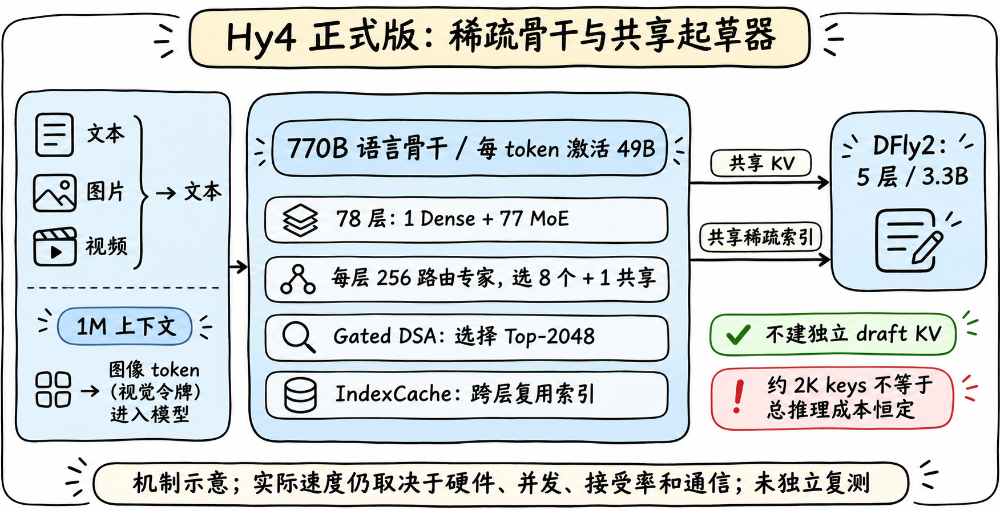
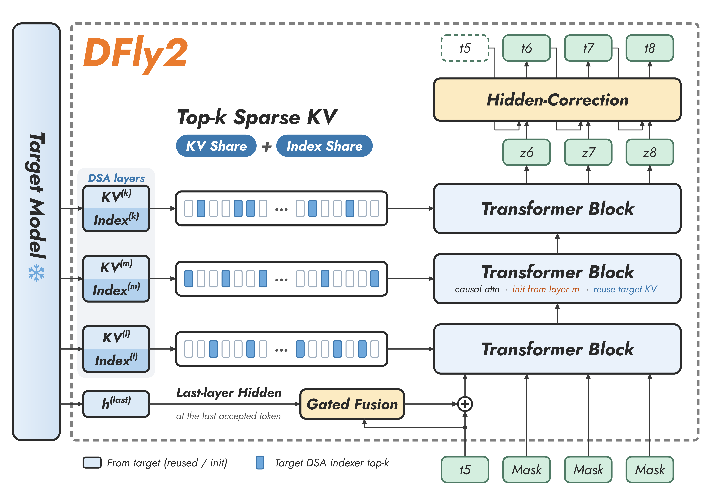
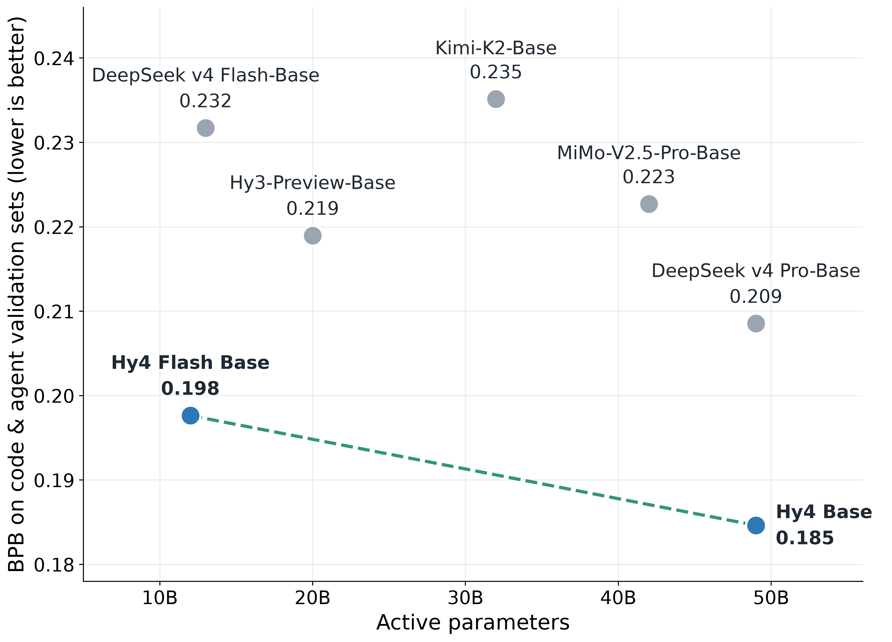
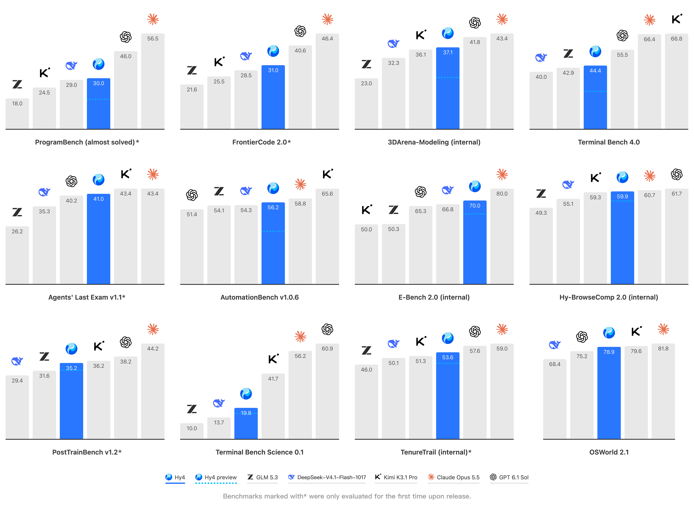
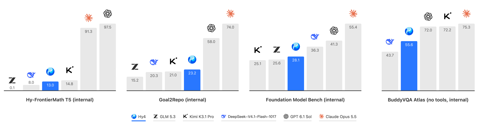
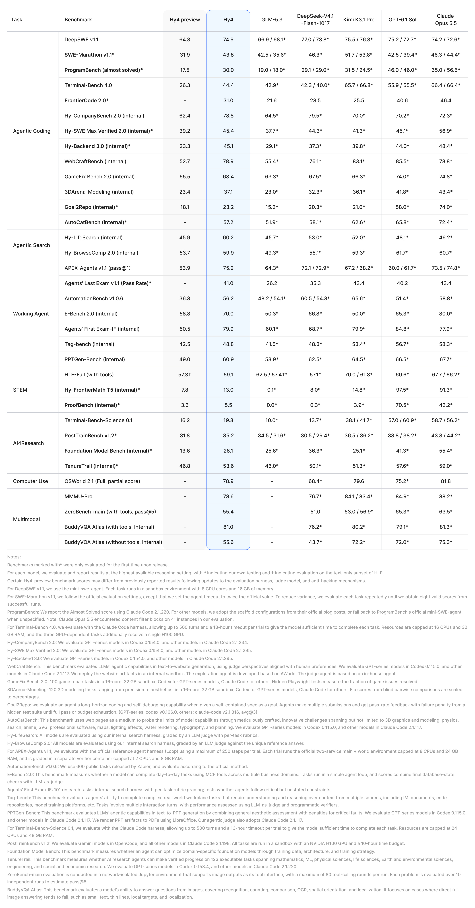

> [!tldr]
> Hy4正式版以770B语言骨干、49B文本激活、Gated DSA和IndexCache支持1M上下文，DFly2复用目标KV/稀疏索引。11/20的Base/Instruct/FP8是已有Hy4 family的权重开放阶段，不改8/28 Preview首发，也不再建新正代。

> [!warning] 日期与材料范围
> 本轮IAB在腾讯官方activity中读取到11/20“published 3 models”（Hy4-base、Hy4-FP8、Hy4），与HF卡News互证。仓库11/20提交/lastModified本身不作发布证据。已读卡/配置/中文卡/微调指南，保存六幅官方图；System Card为PDF，只保留链接未读。没有下载权重、启动服务或独立复测。原11/4正式版公告与11/18 Flash阶段保留。

## 架构与参数统计

> [!tldr]
> 770B只指语言骨干；视觉和起草器另计。总参数、激活量、运行显存三者不能互换。

| 部分 | 官方口径 |
|---|---|
|语言骨干|770B；每token文本激活49B|
|层/宽度/词表|78层，1dense+77MoE；6144；120832|
|MoE|每层256路由专家，top8+1共享；intermediate2048|
|视觉|ViT1.23B，40层/hidden1536/16heads/patch16，2×2合并|
|起草器|DFly2 5层约3.3B|
|上下文|1,048,576 tokens|
|iHC|4条residual streams|

ViT/adapter/DFly2不含在770B骨干值；HF总量约774.43B为不同统计口径，不把它与770B差额都说成视觉参数。2026-11-27当前Hy4/FP8/base模型卡将介绍从“text, image, and video”修正为“text and image”。现行公开契约按文本/图片记；源码或微调示例里的视频相关接口不证明已发布权重承诺视频质量。输出文本，没有原生声音输入的公开契约。

## 稀疏索引与DFly2

> [!tldr]
> 限定每步访问的keys降低注意力代价，但索引、MoE、通信和目标验证仍有成本。

Gated DSA基于MLA，64heads，q_lora_rank2048、kv_lora_rank512；indexer32heads×128维选择Top2048 tokens。IndexCache复用跨层稀疏索引，iHC扩展层间信息流。这些是已发布结构，不能据此推断未公开训练消融的独立收益。

5层DFly2由AngelSpec训练，在对应DSA层共享KV与已选Top2048位置；不另建draft KV，且不参与prefill。PD分离仍需额外传最后层hidden state。所谓draft每token近常数keys，不等于整个请求墙钟/显存恒定；长输入prefill、缓存增长、接受率及并发都需测。

## Base与Instruct评测

> [!tldr]
> few-shot基准有子集与格式干扰；内部任务、人评和公开榜须分别读，不能把自报排名当统一独立结论。

Base自报MMLU91.6、MMLU-Pro73.9、GP知识SuperGPQA62.7、MMMU-Pro59.6；Flash分别88.7/71.1/57.8/52.0。ARC仅299题、HellaSwag3000题，INCLUDE5000 Lite44语言，Belebele4475五语言；带†宏平均。midtrain含大量合成指令，少样本格式不遵循可能扭曲分数，不能无条件与完整榜横比。完整原表在模型卡保留。

Instruct：TerminalBench4.0为44.4，GPT6.1Sol55.5、Opus5.5 66.4、KimiK3.1Pro66.8；OSWorld2.1为78.9，而GPT79.6、Claude81.8。内部Hy-FrontierMathT5为13.0对GPT97.5/Claude91.3，Goal2Repo23.2对GPT58/Claude74，保留明显差距。星号基准是发布时首次评测，不能把新旧点位一律当相同长期追踪。

金融人评为213位从业者、579任务，平均3.04/4对DeepSeek2.97、Kimi/GLM2.68，且70%+专家经验超5年。样本/量尺公开不代表任务可复查；未给完整匿名任务、置信区间、judge一致性与运行预算。IRAB +12.03pp和幻觉率15.76%→5.45%等来自内部口径，不能归为某个架构组件的因果提升或业务保证。

## 部署与微调契约

> [!tldr]
> 11/27卡片已移除视频支持介绍；旧卡提到视频为历史口径，vLLM示例仍video=0，不将源码接口或旧描述当现行能力承诺。

推荐temperature0.9、top_p1，reasoning_effort默认high，可no_think。Base不是chat模型，不能直接套Instruct模板评判。vLLM官方hy4镜像示例TP8、FP8、FLASHMLA_SPARSE、hy_v4推理/工具解析、DFly5tokens；其中limit-mm设置image1/video0。SGLang hy4多架构镜像示例TP8。未运行这些示例，不能承诺任意8GPU或1M上下文可装下；镜像tag仍需固定digest。

微调指南给原生Transformers、LLaMA-Factory、ms-swift路径，文字/VL full或LoRA；LoRA示例rank64、alpha128、dropout.05，默认MLA投影层，建议学习率full1e-5/LoRA2e-4。FSDP与DeepSpeed不能同时开，视觉默认冻结/建议冻结，视频token可因帧数/像素超出cutoff。指南示例是微调起点，不是原模型预训练/后训练配方，更不是已执行的训练成果。

## 研究判断与缺口

> [!tldr]
> 公开结构有助于设计可测量的系统对照，但完整训练/安全报告还未形成可独立复现证据。

> [!insight]
> Agent训练可分别冻结checkpoint、harness和输出预算：第一组仅切DFly2看接受率/吞吐/质量，第二组固定解码对比Base→Instruct，第三组按长任务错误类别评估检索、工具与状态维护。不能用内部综合分替代金融、科研与代码各自的可验证结果。上述仅实验建议，未运行。

还缺完整数据/去重、训练token与算力/优化器、各架构独立消融、真实部署显存与速度、开放内部任务、人评置信区间和PDF安全报告阅读。许可为Tencent Hy专用条款，不能写Apache2；专用许可与System Card入口均随源卡保留。

## 来源与家族交付

> [!tldr]
> 新笔记补充权重阶段；主family和Flash笔记继续共存，避免按SKU重复建代际。

- [HF Instruct](https://huggingface.co/tencent/Hy4) · [Base](https://huggingface.co/tencent/Hy4-base) · [FP8](https://huggingface.co/tencent/Hy4-FP8)
- [官方代码](https://github.com/Tencent-Hunyuan/Hy4) · [微调指南](https://huggingface.co/tencent/Hy4/blob/main/finetune/README.md)
- [System Card PDF，仅链接未读](https://hy.tencent.ai/Hy4_system_card.pdf)

[[Hy4-Family]] · [[Hy4-Flash]] · [[WeMM-Video]]

> 📊 相关可视化: [[hy4_open_weights_poster_zh.html]]
