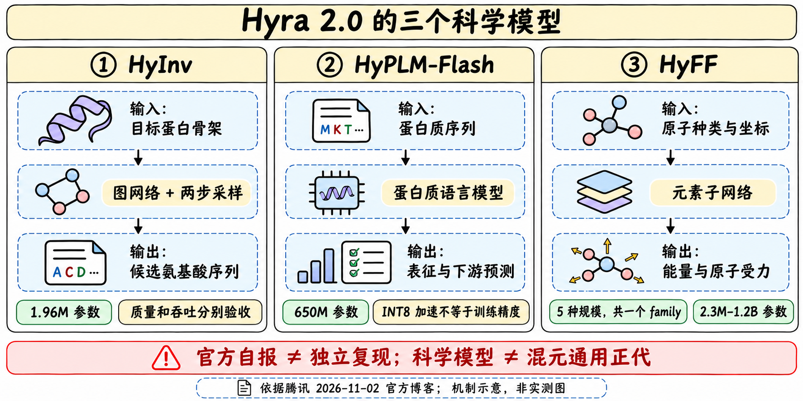
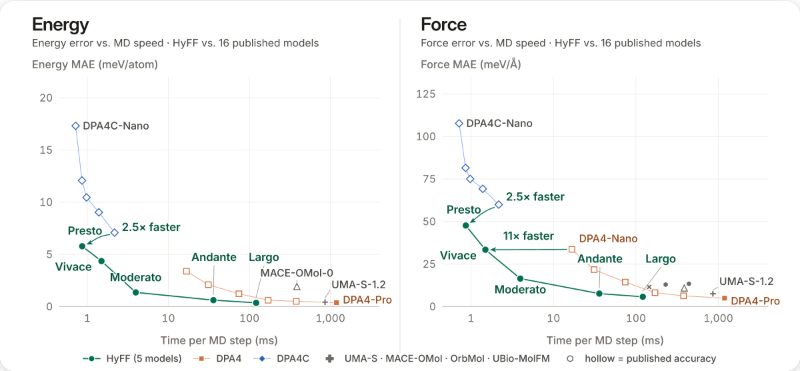

# HyFF：能量与力预测，尚不等于可复现实验包

> [!tldr] 我的判断
> HyFF把原子种类和坐标映射为能量与原子受力，是驱动分子动力学的参数化工具。官方一次介绍5种规模，按一个family记录；不能把它混成Hy聊天正代，也不能凭速度—误差前沿就证明长时模拟稳定与分布外反应可靠。

## 披露日期与资料缺口

> [!tldr]
> 2026-11-02是官方博客明确介绍HyFF的日期。本页记录模型披露，不宣称该日权重开源或Tech Report已经可下载。

同一博客中的HyInv/HyPLM已在官方仓库News明确发布权重与报告，HyFF没有获得等价的模型卡、权重与独立报告证据。不能把旁边两个模型的开源状态移植过来，也不能把Hyra系统的发布当作混元新通用模型。

> [!warning] 原始资料较少，达不到GLM/Kimi完整技术报告精读标准
> 目前只取得官方博客完整正文和原图，尚无可核验的HyFF独立Model Card、Tech Report、完整训练源码、评测表与权重入口。无法达到GLM-5.3-Flash/Kimi-K3的机制解释与复现实验深度；本页有意保留未知，后续补源，不用原子势常识编造官方架构、损失或数据规模。本轮未运行模拟、下载权重或PDF。

## 模型接口与family

> [!tldr]
> 五种尺寸共一个模型族；83种元素、带电与开壳层是厂商声称的覆盖范围，仍需逐类验证。

| 项目 | 官方博客事实 | 仍未知 |
|---|---|---|
| 输入 | 原子种类与坐标 | 单位、边界条件、总电荷/自旋输入接口 |
| 输出 | 体系能量与每个原子受力 | 是否严格力为能量梯度、能量守恒实现 |
| 规模 | 五种，2.3M至1.2B参数 | 中间三个尺寸、层数、邻域截断 |
| 覆盖 | 83种元素；带电和开壳层体系 | 各元素样本分布、极端电荷/自旋覆盖 |
| 数据 | 大规模量子化学计算数据 | 来源、规模、计算理论层级、去重/划分 |
| 容量分配 | 每原子仅调用相应元素的子网络 | 不直接等同通用LLM的token路由MoE |

元素子网络让容量扩展时每原子只访问对应部分，但总显存、邻域构图与通信成本仍需单测。将输出接入积分器、温控和约束后才构成MD工作流，模型本身不是完整模拟环境。

## 官方原图与模拟案例

> [!tldr]
> 官方称5个尺寸均位于与16个公开模型比较的精度—速度Pareto前沿；这是给定测试配置的相对结果，不是所有分子任务的统一冠军。

图的左轴分别是能量和力平均绝对误差，横轴是单步模拟耗时。由于未获得可读的完整数值表与benchmark硬件配置，本文不从缩略图估读所有数值，不将误差图改成任务成功率。不同模型若精度、batch、邻域与硬件不一致，结论的适用范围需要重核。

| 官方案例 | 实际披露 | 不能等同 |
|---|---|---|
| 水通道蛋白膜 | 近6万原子，100ns模拟，观察单列水穿过通道 | 全新实验验证或任意膜体系长期稳定 |
| 酶反应 | 4.6万原子，从选定起点观察一次完整断键/成键 | 反应速率、自由能或无偏采样已可靠 |
| 五尺寸前沿 | 与16个公开模型比较 | 每个尺寸所有指标均单项第一 |

100ns是物理模拟时长，不是墙钟运行100ns；一次反应轨迹也不足估计统计动力学。没有公开条件时，不补写温度、步长、电子结构真值或采样重复数。

## 如何验收与研究启发

> [!tldr]
> 后续最需要的是可运行接口和独立数据划分。先过物理与数值检查，再把模型作为Agent的科学工具。

可执行验收应包括同构型能量/力误差、旋转/平移与置换一致性、长轨迹能量漂移、极近原子或新电荷等分布外条件，以及相同硬件/积分器下的吞吐。以上是本文建议，**不是官方已经做过的实验**。

> [!insight] 对Agent训练
> Agent可能通过搜索初始构型来“发现”很低模型能量，却实际落在训练分布之外。工具返回应附模型版本、单位、适用域与不确定性提示；奖励验收需要独立高精度计算或多模型复核，不能只用同一HyFF自评优化后的构型。训练工具的Agent与调用工具的Agent也需分离证据。

当前可保留HyFF为已披露科学模型family并等待补源；五尺寸不拆五片叶子。没有权重证据时，不提供虚假的下载按钮或部署命令。

## 官方来源与导航

> [!tldr]
> 本页唯一实质模型来源是官方Tech Blog，来源类型明确，不伪造HF Model Card或PDF。

- [📝 Tech Blog：Hyra 2.0，HyFF段落](https://hunyuan.tencent.com/research/hyra2?langVersion=zh)，本地[[src/hyra2-blog|官方正文]]。
- [官方成果仓库](https://github.com/Tencent-Hunyuan/hyra-results)：用于交叉核对发布状态，目前News明确列出两个蛋白模型，不能当作HyFF权重已发证据。
- [[Topics/13_base_model/Tencent_Hunyuan/Variants/261102_HyInv/HyInv|HyInv]]、[[Topics/13_base_model/Tencent_Hunyuan/Variants/261102_HyPLM_Flash/HyPLM-Flash|HyPLM-Flash]]。

> 📊 相关可视化：[[hyff_poster_zh.html|中文Poster]]
