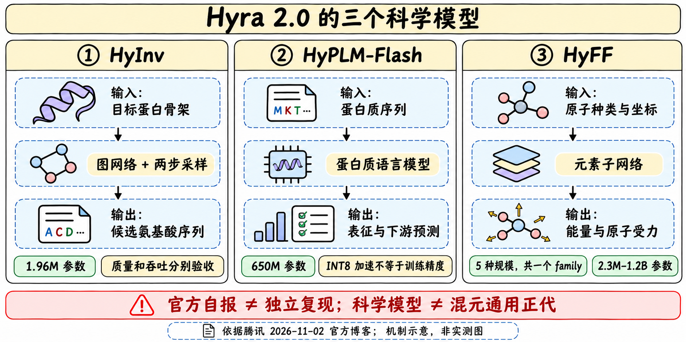
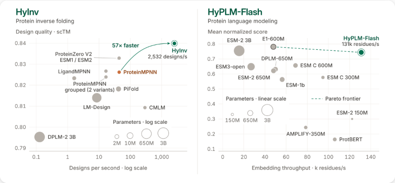

# HyInv：快采样和好序列要分别验证

> [!tldr] 我的判断
> HyInv把目标蛋白骨架变成候选序列：小型消息传递图网络、结构奖励后训练和“起草—改写”采样共同构成方案。196万参数与热态毫秒延迟是部署特征，不能单凭它们证明设计更好，更不能把结构打分当湿实验成功。

## 定位与证据

> [!tldr]
> 11月2日官方仓库News明确发布权重、代码与报告；这是混元科学模型支线，不是Hy通用聊天正代。

Hyra 2.0是研发这个模型的Agent系统，HyInv才是实际被训练和供下游调用的模型。输入是PDB骨架，输出是FASTA氨基酸序列，解决逆折叠问题：已知想要的三维骨架，寻找可能折回该结构的序列。与从序列预测结构的前向折叠方向相反。

> [!warning] 原始资料较少，达不到完整技术报告精读标准
> 已读官方完整README、模型配置与采样实现，以及Hyra 2.0博客和官方图。独立Tech Report目前只核对PDF链接，遵照不下载PDF；训练数据划分、结构reward计算、SFT/RL配方、湿实验与充分消融尚未审读。因此不能达到GLM-5.3-Flash/Kimi-K3完整报告级机制归因深度。以下速度为厂商自报，本轮没有运行模型、下载权重或安装依赖。

## 模型与采样

> [!tldr]
> 先编码骨架，再用8轮盲起草和8轮分组改写产生序列。16轮是同一次设计的采样过程，不是16个独立模型。

| 部件 | 官方可核对事实 | 判断边界 |
|---|---|---|
| 模型 | 1.96M参数；ProteinMPNN式消息传递图网络 | 小参数不直接等于高设计质量 |
| 输入 | 只看N、Cα、C、O骨架原子 | 不把侧链或配体条件说成已支持 |
| 网络 | 4层encoder、3层decoder | 不把解码轮数当网络深度 |
| 发布权重 | 结构奖励强化学习版本；FP32约7.8MB | 博客说经历预训练/SFT/RL，但完整过程尚未审读 |
| 起草 | encode一次，8轮blind drafting，温度0.6 | 不自行补成自回归逐残基生成 |
| 改写 | 8轮fixed-group rewriting，温度0.34 | “fixed groups”是采样分组，不等于用户锁定残基 |

模型在相同结构上批量提出候选，用改写阶段细化。用户固定的残基从第一轮可见并保持原样；这些约束和随机分组、批大小都必须进入复现记录。结构reward提供折回目标骨架的优化方向，但实际reward模型、奖励尺度及稳定性没有从README获得完整证据。

## 质量与速度

> [!tldr]
> 官方图同时画设计质量和吞吐；约50ms只对应预热后、单H20、128条约400残基设计的特定实现，不能称一次冷启动总耗时。

博客称比ProteinMPNN生成快57倍且结构吻合更好；图纵轴为scTM，不是实测结合活性、稳定性或药效。README给出了更可操作的条件：128条设计、候选batch上限32、单H20，排除编译和CUDA graph capture，取中位数。

| 路径 | 148 / 402残基耗时 | 必须同时记录 |
|---|---|---|
| bf16 | 约25 / 54ms；报告口径24.7 / 50.6ms | BF16乘数、FP32累加、tanh GELU；与reference同seed序列不相同 |
| exact | 约119 / 281ms | 报告另组kernel为130 / 303ms，不混为相同实现 |
| reference | 999 / 2633ms | FP32基线；与加速比较需固定结构、n、batch、seed |

exact采用TF32x3累加与erf GELU，不是位级FP32同序累加。README称约8000条核验序列中1条的1个位点不同，这支持近数值对齐，不能宣称永远完全一致。bf16是数值不同路径，重复同参数可复现自身，但不能以相同seed跨路径逐字对齐。

冷cache下exact/bf16编译约25/14秒，新shape另需约0.1–0.2秒capture；图占显存且只缓存至多4种长度，capture后不能修改权重。要评估在线Agent，应另报冷启动、热态吞吐、结构质量和失败恢复。

## 输入与复现

> [!tldr]
> PDB编号、链、缺失原子与batch随机流都会改变验收。先验证约束保持和输出身份，再谈速度收益。

仅读取PDB首个model的ATOM记录，MSE按MET处理；每个残基保留一个slot，即使缺骨架原子也会被设计。不按PDB编号缺口补齐序列。mmCIF需先转换PDB；多链输出用`/`分隔，固定位置用链限定的PDB残基号，例如`A12-20,B7`。这些规则会影响与原结构对齐。

默认`fast=off`；加速依赖Triton，已在H20/sm90核验，其他架构仅“应能编译”而非测试通过。batch k使用seed+k，改变batch大小会改变结果；CPU/GPU随机流也不同。当前读取的`sampler.py`构造`Backbone`时使用`chain=`，而`model.py`数据类字段为`chain_id`；这是静态源码接口不一致线索，本轮没有执行确认。需先核对同一发布revision/修复状态，不能宣称README命令开箱可用。

记录代码revision、输入结构hash、链选择、固定位置、n、batch、seed、设备、PyTorch与fast档位。

> [!insight] 对Agent训练
> 将序列生成的可执行性、固定残基遵循、结构reward、候选多样性与下游实验证据分开。奖励只绑定结构分数可能偏好打分器漏洞；验证器应保留新结构/新家族划分、失败样本和独立复核。本文提出的是实验建议，不是官方已验证的安全结论。

## 来源与导航

> [!tldr]
> README能支撑网络和推理协议；PDF报告未读部分明确留白，不用蛋白质通用知识替代。

- [📝 Tech Blog](https://hunyuan.tencent.com/research/hyra2?langVersion=zh)
- [官方README / 代码](https://github.com/Tencent-Hunyuan/hyra-results/tree/main/AI4Science/hyinv)，本地[[src/README|原始README]]。
- [📄 Tech Report（PDF，仅链接）](https://github.com/Tencent-Hunyuan/hyra-results/blob/main/AI4Science/hyinv/HyInv_Technical_Report.pdf)
- [[Topics/13_base_model/Tencent_Hunyuan/Variants/261102_HyPLM_Flash/HyPLM-Flash|HyPLM-Flash]]、[[Topics/13_base_model/Tencent_Hunyuan/Variants/261102_HyFF/HyFF|HyFF]]：同批公开，任务不同。

> 📊 相关可视化：[[hyinv_poster_zh.html|中文Poster]]
