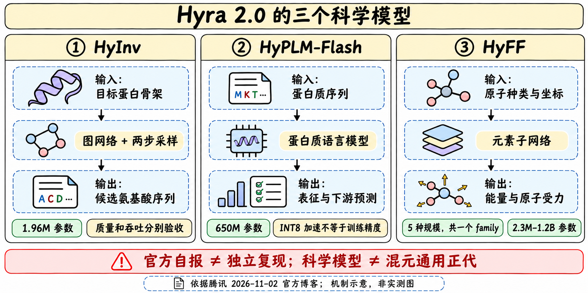
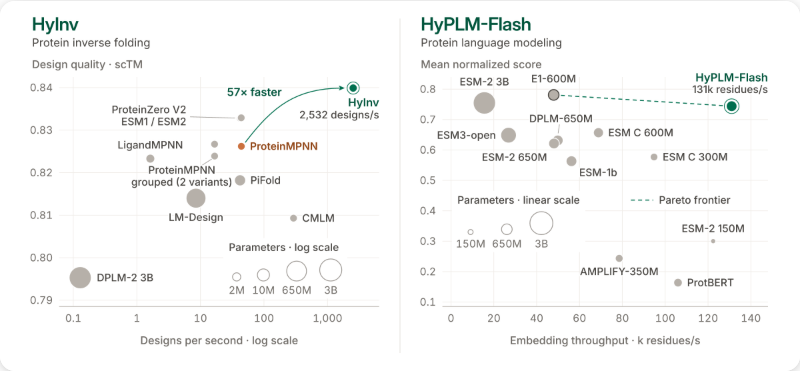

# HyPLM-Flash：650M蛋白质语言模型

> [!tldr] 我的判断
> 它是从蛋白质序列提取残基表征、给掩码位置评分的650M模型；Flash的效率证据主要来自打包、融合算子和INT8引擎。模型能力、推理精度和下游回归协议必须分开，不能把“最快”解释成每一项生物学任务都最好。

## 定位与资料边界

> [!tldr]
> 官方仓库News明确11月2日发布权重、推理代码和报告；同日博客介绍研发背景。归为混元科学模型支线，不是通用聊天正代。

Hyra 2.0从头训练HyPLM-Flash；模型把氨基酸序列映射成残基级/整蛋白表征，支持masked language-model logits，可用于突变打分、结构与功能预测。它不是HyInv那种给骨架生成序列的逆折叠器，也不是直接输出临床结论的系统。

> [!warning] 原始资料较少，达不到完整技术报告精读标准
> 已读完整官方README、配置和接口材料及官方博客/图；独立技术报告只有PDF入口，本轮仅保留链接，未下载或声称读过。完整训练数据、去污染、任务划分、统计检验细节和消融尚不能审计，因此达不到GLM-5.3-Flash/Kimi-K3完整报告级深度；没有下载2.6GB权重、执行下载脚本或本地复测。

## 结构与训练口径

> [!tldr]
> 公开配置支持32层Transformer、hidden1280、20heads与33词表；INT8是服务默认精度，发布文件是FP32。

| 规格 | 官方事实 | 不直接推导 |
|---|---|---|
| 规模 | 650M参数 | 参数小等于每项任务优于大模型 |
| 骨干 | 32层Transformer，hidden1280，20heads | 不把蛋白语言模型说成自然语言聊天模型 |
| FFN | intermediate3584；MLM head含dense/GELU/LayerNorm/decoder | 发布配置不等于完整训练recipe |
| 词表 | 33；无结构词表、structure_loss_weight=0 | 不据此编造训练中所有辅助目标 |
| 训练量 | 博客726B训练tokens | 不等于726B条独立蛋白或去重样本 |
| 发布/推理 | 约2.6GB FP32权重；INT8默认引擎 | INT8训练或无损压缩 |

博客说训练量为ESM-2 650M的0.73倍、E1-600M与ESM C 600M的1/5–1/8；分母对应厂商比较口径，不据此断言同数据质量、同算力或同训练成本。实际数据组成和重复轮次需要报告文本才能复核。

## 评测与两套公开口径

> [!tldr]
> 博客的12模型/35任务与README的28公开checkpoint/32任务是不同快照；不强行合成一个榜单。

| 来源 | 自报结果 | 保留限制 |
|---|---|---|
| 博客 | 12个蛋白模型中推理最快，35任务平均排名第3 | 未读完整任务与归一化规则，不能称32任务同样第3 |
| README | 28个checkpoint、32任务的matched evaluation | checkpoint数不是独立架构族数 |
| ProteinGym zero-shot | Spearman0.409，与ESM-2 650M/ESM C600M/E1-600M统计持平 | 不能写“显著超过”或直接解释为正确率40.9% |
| 长程接触 | README称所有被测模型中precision最高 | 未获得完整分桶/阈值/置信区间，不推及所有蛋白 |
| 推理 | 单H20约130k残基/s，比其他600M级encoder快1.9–2.7倍 | 不是单蛋白端到端低延迟，也不含所有下游计算 |

INT8约130k、BF16约90k残基/s，约1.44倍差；zero-shot/结构/功能/似然指标与BF16相差在0.01内，是README所述测试范围，不保证任意任务无损。近似变体的表征差别仅约1%，因此FLIP的AAV、GB1这类近变体监督回归建议BF16，避免量化扰动覆盖有效信号。

## 接口与可复现部署

> [!tldr]
> 最大8190残基和batch_tokens32768是不同预算。表征、logits与突变差值有不同输出含义，索引必须写清。

`encode`输出每条蛋白的CPU FP32 tensor：残基级`[L,1280]`或mean pooling的`[1280]`，去除首尾特殊token，保留输入顺序；可选中间层例如16。不要把pooled向量当每残基输出。

单序列至多8190残基，自动大写、去空白、J转X，非法字符报错。padding-free打包的默认batch_tokens32768限制一批预算，不是单序列上限。`logits`形状`[L,33]`；掩掉第3残基用0起始`masks=[2]`，T3V masked-marginal评分取该位置`logP(V)−logP(T)`，不等于预测真实适应度差。

官方建议Hopper CUDA GPU、Python3.10+，FA3可用时优先，否则FA2；Triton融合与INT8矩阵乘法属于引擎。多GPU接口每卡一个worker；单蛋白低延迟另有CUDA graph路径。固定checkpoint/revision、精度、层、pooling、序列预处理、packing与任务切分，再比较质量/吞吐。

> [!insight] 对Agent训练
> Agent可以调用表征模型做候选筛选，但评分器应记录模型身份、精度和适用分布。将“模型高分”“独立结构验证”“实验结果”拆为不同证据层，防止Agent把一个zero-shot差值包装成真实突变效应。近变体实验优先比较INT8/BF16与随机seed稳定性。

## 来源与导航

> [!tldr]
> 原始来源有冲突时保留来源标签。训练报告未读与任务数差异仍是待核项。

- [📝 Tech Blog](https://hunyuan.tencent.com/research/hyra2?langVersion=zh)
- [官方README / 代码](https://github.com/Tencent-Hunyuan/hyra-results/tree/main/AI4Science/hyplm_flash)，本地[[src/README|原始README]]。
- [📄 Tech Report（PDF，仅链接）](https://github.com/Tencent-Hunyuan/hyra-results/blob/main/AI4Science/hyplm_flash/HyPLM_Technical_Report.pdf)
- [[Topics/13_base_model/Tencent_Hunyuan/Variants/261102_HyInv/HyInv|HyInv]]、[[Topics/13_base_model/Tencent_Hunyuan/Variants/261102_HyFF/HyFF|HyFF]]。

> 📊 相关可视化：[[hyplm_flash_poster_zh.html|中文Poster]]
