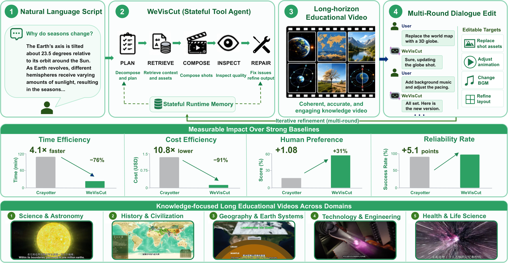
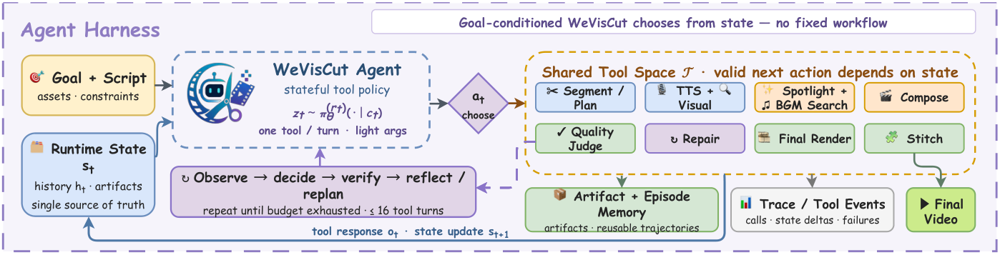
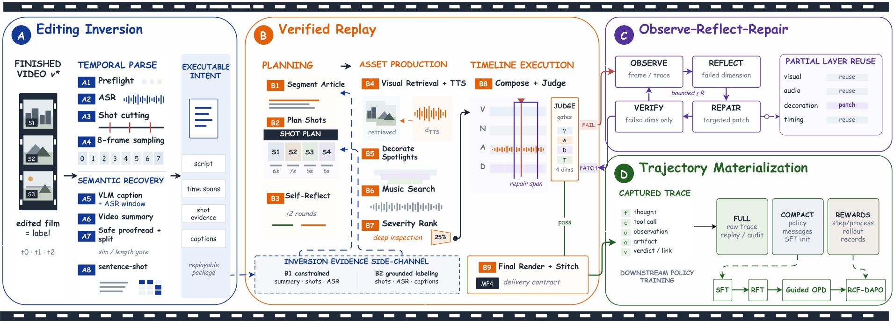
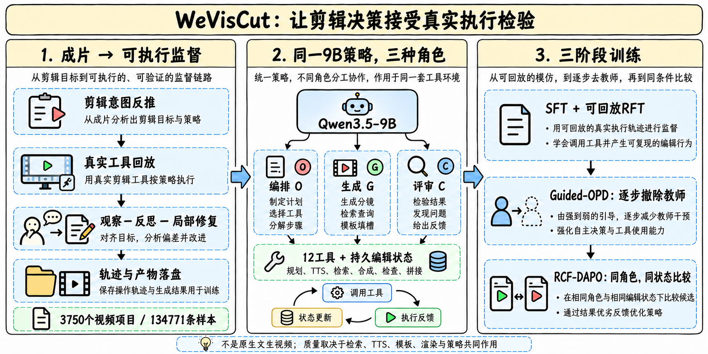
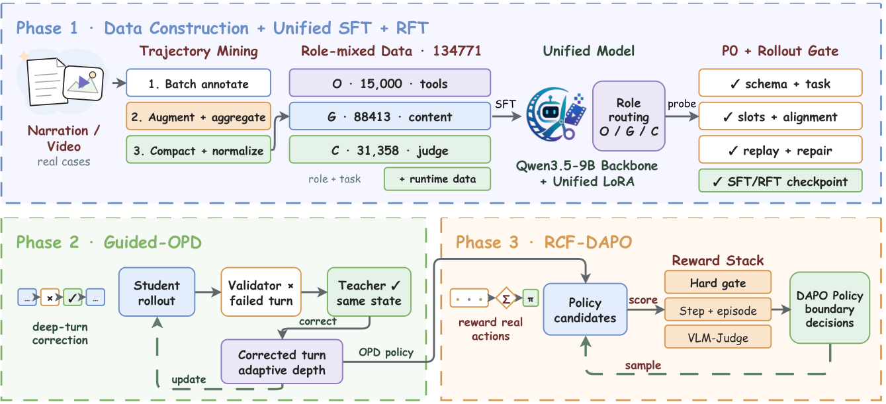
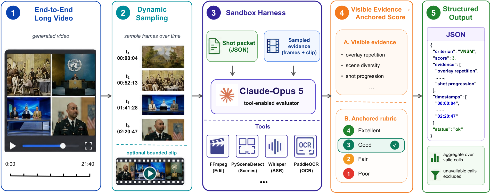
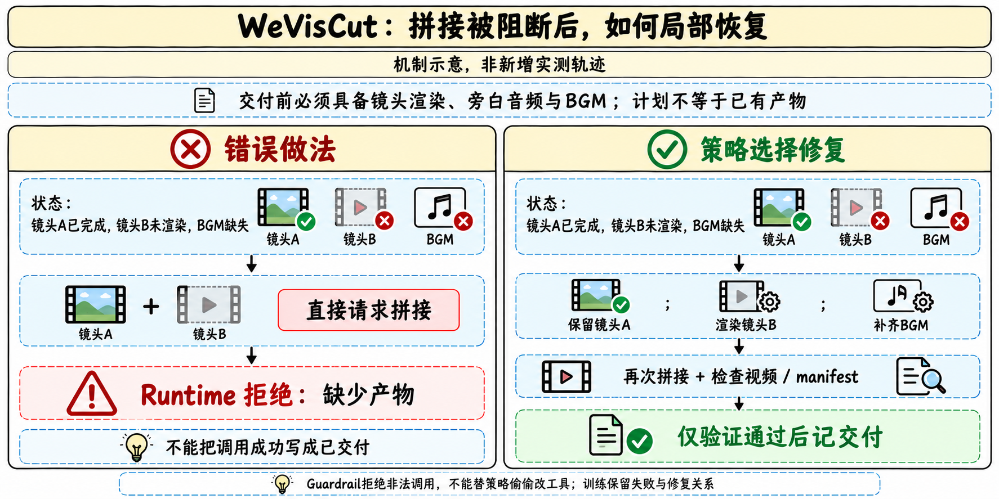

# WeVisCut：从可执行监督到局部恢复

> [!tldr] 我的判断
> WeVisCut最值得借鉴的不是“9B剪视频”，而是把**成片中的剪辑意图反推成可以真实回放的状态—工具轨迹，再训练同一个模型完成编排、生成和检查**。策略每步决定一个工具调用，执行器保存产物并返回阻断原因，后续可以只修坏掉的部分。它是基于Qwen3.5-9B的任务适配Agent，放腾讯专项支线，既不是腾讯新通用正代，也不是直接输出视频像素的原生文生视频模型。

> [!warning] 精确首发日与可复现细节仍有缺口
> 本文亲自阅读HF原卡、完整论文HTML正文及附录、项目页、运行时架构与数据构建说明，已达到详细机制/评测研读所需的材料量；但**不能声称独立复现训练或精确确认权重首发日**。代码历史有8/28旧名WeDirector公开版本、9/8更名WevisionCut、10/23更名WeVisCut并出现HF链接；论文v1提交日是10/28，HF本次新出现也不等于10/30首发。因此Atlas只标2026-10月份线索，不把提交日、改名日或仓库创建日冒充新模型首发。下文另列训练调度矛盾、缺失的复现参数及评测限制；不拿未知细节补成事实。

## 归档时间线：系统历史不等于当前checkpoint时间

| 证据 | 官方可核对内容 | 本文处理 |
|---|---|---|
| 8/28代码提交 | Initial public release of WeDirector，9B、12工具；下载地址仍是`<org>/WeDirector-9B`占位 | 证明旧系统历史，不确认当前权重已公开 |
| 9/8代码提交 | WeDirector改名WevisionCut | 名称演进，不另立一代 |
| 10/23代码提交 | 改名WeVisCut，README已有当前HF链接 | 链接存在不能证明当日权重已可下载 |
| 10/28 06:51:40 UTC | arXiv v1提交，完整报告公开页记录 | 保存论文提交日期，不直接当模型首发 |
| 10/30本轮 | HF模型卡/配置可读，现行README与项目页已可核 | 是本次核验日；精确首次权重公开日待核 |

完整报告PDF仅保留官方链接，本次读取并归档的是HTML，**没有下载PDF或模型权重、安装依赖或运行官方代码**。

## 一个模型、三种角色、十二种工具

同一9B策略共享参数，角色由上下文区分：O（orchestrator）选工具与参数；G（generator）生成分镜、检索查询、模板填槽等结构化内容；C（critic）定位问题、提出修复并验证。三角色不是三个独立权重，也不是部署时总有一个更强外部教师接管。

| 工具 | 产物或作用 |
|---|---|
| Tool_SegmentArticle | 划分脚本章节 |
| Tool_PlanShots | 为章节生成分镜 |
| Tool_GenerateAudio | 合成旁白，并确定镜头时长 |
| Tool_RetrieveVisual | 检索镜头视觉素材 |
| Tool_DecorateShot | 选择动画模板，填充类型化槽位 |
| Tool_TimelineCompose | 渲染单镜头 |
| Tool_MusicSearch | 背景音乐列表 |
| Tool_TextQuickJudge | 文本侧质量检查 |
| Tool_VLMRenderJudge | 渲染侧视觉检查 |
| Tool_SelfReflect | 决定下一步修什么 |
| Tool_ModalProbe | 外部服务预检 |
| Tool_StitchVideo | 最终拼接 |

运行时保存全局旁白覆盖、镜头顺序/时序、每镜素材/音频/模板/渲染和未解决问题。**计划记录与真实产物分开**：说“已渲染”不能代替存在、可解码的文件。工具返回需通过schema、前置条件和产物引用检查，才能提交到权威状态。

运行时文档进一步明确：推理每步重建训练形状的单轮JSON，含`recent_history`、`last_observation`、`global_state`和`agent_contract`。外层LangGraph消息只为记录/UI服务；想让模型看到的信息必须进入真实状态。持久存储不必每轮完整塞进上下文，局部状态视图可减少重复，但仍需验收压缩后是否丢失约束。

部署guardrail可拒绝非法调用、限制重复/失败与结束任务，默认不替策略改工具。数据构建README却明确允许训练采集运行时重定向非法/重复动作并记录干预。**相同工具/schema不意味着所有训练与服务控制流完全相同**；采集时干预必须有来源标签，评测要关闭“偷偷帮模型纠错”的开关。

## 成片变成训练数据：反推意图不等于还原真实历史动作

第一阶段从已完成视频恢复带时间戳旁白、镜头结构和句子—镜头对齐，得到“这个镜头应该表达什么”。成片没有暴露原编辑者用过哪些工具，因此这不是考古式还原真实点击序列。

第二阶段在部署对齐的工具合同下真实执行该意图：检索、TTS、模板填槽、合成和检查都要返回实际产物。第三阶段观察执行缺陷，反思并做有上限的局部修复，保留仍有效的结果。第四阶段把动作前状态、工具名/参数、真实返回、产物、检查意见和失败—修复关系整理成训练样本。

来源为3,750个Bilibili成片项目，产出**134,771条样本**；不是134,771个独立视频或完整episode。划分按源项目做，相关镜头和修复记录一起留在同一侧，100任务评测来自held-out项目。项目拆分可减少同片泄漏，仍不能自动排除相近题材、模板、检索素材或内容近重复，跨来源/新模板泛化需要另验。

## 三阶段后训练：先能执行，再学习自己走到的失败状态

### Phase 1：SFT与可回放RFT

Qwen3.5-9B先用LoRA拟合三角色样本，只对模型输出tokens计算损失；系统指令、工具返回、padding不当作要模仿的答案。RFT遇到首个可恢复错误后，回到最后一个可回放快照，保留正确前缀，让教师重写完整后缀。学生独立成功与教师修复分别打标签、固定配额；必须真实重放通过schema、前置条件、引用、渲染、时长、旁白、lint和黑帧检查，再满足开发集选定质量阈值。

可恢复性来自事务快照、沙箱或幂等副作用；没有快照、不可恢复的情况进入有上限的难例池。不能只把失败JSON改成“success”后加入监督。

### Phase 2：Guided-OPD逐轮撤教师

每次完整角色调用前抽取教师/学生控制权，执行完再抽下一次。教师输出用top-50重归一化分布的forward KL，学生自己走出的前缀用reverse KL；两支都训练学生。教师是Qwen3.5-397B-A17B-FP8，师生共享tokenizer；不是用Claude作为本阶段教师。

教师干预从0.8余弦降到0，末段完全由学生执行。**论文存在调度不一致**：附录文字说在训练的70%衰减、剩30%无干预；配置表却写90steps中衰减70steps（约77.8%）。两者原样记录，不能擅自选一个当已复现配置。只有无教师评估通过的checkpoint才进入RL。

### Phase 3：RCF-DAPO固定可比决策条件

它不把一条完整长轨迹的总分平均分给所有角色。O角色从同一决策前快照采样不同下一步，用冻结旧策略续跑；固定工具版本、剩余预算与配对随机种子。G/C只在同一个局部请求、产物和合同下比较候选。**只在同角色、同上下文组内标准化奖励**，不把难镜头的critic分数与简单文本生成器分数混排。

O奖励结合交付门槛、最终质量和失败分支的有效进展；重复里程碑不重复加分，后来失效会撤回进展。G看schema、grounding、需求覆盖和下游可用性，schema非法各项置零。C看诊断、验证与修复效用，并惩罚无必要修复；修复效用对比同执行器/预算/随机种子下“有诊断”与“空诊断”的结果差。

训练侧六条规则权重为0.353/0.186/0.179/0.144/0.081/0.057，依次是计划覆盖、spotlight装饰覆盖、检查覆盖、计划卫生、完成与效率；视觉清晰/吸引力audit再另混合。这些不是测试五指标的权重。论文明确这个固定续跑、停止梯度上下文的call级代理目标，**不是终局视频回报的无偏梯度**。

| 已披露配置 | Guided-OPD | RCF-DAPO |
|---|---|---|
| prompt / response上限 | 12,288 / 4,096 tokens/调用 | 24,576 / 12,288 tokens/调用 |
| horizon | 最多50次assistant调用，可提前结束 | 16-turn部署预算 |
| batch | 16，90steps | train/gen/mini=48/72/24 |
| 比较组 | 教师/学生逐调用混合 | 同角色/上下文8候选 |
| 学习率 | 1e-6 | 1e-6 |
| 其余 | topK=50，β起点0.8 | clip[0.8,1.28]，temp0.9，LoRA rank/alpha32/64，无loss侧KL |

RL按角色先做token归一化，再给O/G/C各1/3外层权重；这控制尺度，不保证共享参数梯度不冲突。低方差组会重采样并进入覆盖队列，也改变训练分布。到硬长度上限的响应要在形成8候选组前替换，无法补齐则丢组；不能当普通负样本混进组统计。SFT完整epoch/硬件、部分奖励阈值/权重和所有版本化运行产物仍不足以原样复现。

## 评测：同Harness比策略，原生系统比整体交付

100任务，各模型5次独立运行。报告五分项的均值±跨运行标准差；Overall是五个分项均值的等权描述性平均，不另给置信区间或显著性。两个评测轨道不能混为一谈。

| 共享工具环境 | SCF | VNSM | TPR | LHC | ERY | Overall | tokens/成功输出分钟 |
|---|---:|---:|---:|---:|---:|---:|---:|
| Qwen3.5-9B | 69.8 | 59.2 | 79.5 | 93.7 | 70.4 | 74.5 | 11,883 |
| Qwen3.6-27B | 72.6 | 59.7 | 80.1 | 95.1 | 72.1 | 75.9 | 6,742 |
| Qwen3.6-35B-A3B | 71.9 | 56.7 | 83.4 | 97.3 | 79.4 | 77.7 | 27,554 |
| Qwen3.5-397B-A17B | 75.8 | 64.1 | 84.6 | 96.2 | 86.9 | 81.5 | 15,223 |
| Gemini3.1 Pro | 80.2 | 66.5 | 88.2 | 98.0 | 90.3 | 84.6 | 13,814 |
| Claude Opus5 | 87.1 | 74.8 | 93.1 | 98.6 | 95.8 | 89.9 | 78,763 |
| WeVisCut | 88.4 | 74.6 | 94.0 | 98.8 | 96.7 | 90.5 | 2,377 |

此表为便读摘录均值，完整±标准差和原始表留在报告HTML。WeVisCut比初始化Overall+16.0；与Opus5的90.5/89.9接近，**VNSM74.6反而略低于74.8**。没有Overall不确定性，不能宣称显著超过。33.1倍是78,763/2,377的生成token比，分母为成功输出分钟、分子含失败尝试；不是模型参数比、总费用比或任意视频任务加速比。

| 累积训练阶段 | Overall | 解释 |
|---|---:|---|
| Base | 74.5 | 同9B初始化 |
| SFT | 79.5 | ERY70.4→87.6，先学会交付 |
| +RFT | 83.5 | SCF/计划实现进一步改善 |
| +Guided-OPD | 84.9 | 不独立证明恢复机制贡献 |
| +RCF-DAPO | 90.5 | 相对上一阶段+5.6 |

这些是依次加阶段的checkpoint，不是独立移除教师干预、快照匹配或角色奖励的因果消融。不能把最终增益唯一归因某个新组件。

原生工具/编排轨道中，WeVisCut/Crayotter/VideoAgent的Overall为90.5/84.9/82.5，每成功输出分钟耗时2.1/8.6/10.4墙钟分钟、估算费用$0.09/$0.97/$0.58。这是整套原生系统结果，包含失败尝试，不能当孤立9B模型的推理单价。三名匿名评分者在100任务上对人类整体偏好给4.56/3.48/3.46（1–5）；不是五自动指标的Overall90.5，也没有据这些均值证明统计显著。

## 五指标怎样避免“能渲染就算好”

SCF看脚本覆盖/忠实/顺序；VNSM看同时段画面是否支撑旁白；TPR看计划镜头实际存在、时长和顺序；LHC结合头尾健康保持与素材多样性；ERY看文件可解码、时长至少计划一半且有覆盖至少一半旁白的非静音语音。ERY不是完全满足全部作品要求，BGM也不能替代旁白。

VNSM用冻结Opus5对每镜4帧与旁白打1–4锚定等级，至少5个有效镜头才汇总；LHC又包含VNSM，因此五指标不独立，Overall不能当已校准感知质量总量表。provider/harness故障按missing，不当零质量；系统失败与未启动任务留在ERY分母。分项资格/分母不同，Overall不暗示每项都在同一任务子集上计算。

评测Harness为只读、无网络的证据工具环境，训练judge与测试judge/rubric分开。最多3张4×4contact sheets；VNSM单镜4帧包、必要时受限clip是另一层，不能混成每视频只看4帧。论文提出扰动、第二VLM家族一致性和人类校准协议，Krippendorff α低于0.6阻止单独VNSM主张，但正文没有给足全部校准数值表，**协议不等于各项验证结果已完整公布**。

## 失败案例：只修坏部分，交付必须看真实产物

示意中的镜头A已完成，B未渲染且BGM缺失。直接拼接应返回typed blocker；策略随后渲染B、补音乐，保留A，再请求拼接并验收视频/manifest。guardrail不替策略把坏调用静默改成“正确工具”。论文附录真实轨迹和这个说明性案例分别保留，后者不冒充新的实验日志。

这类可定位缺陷比一句“作品不好”更适合训练恢复：需要记录错误状态、动作、真实返回、影响到的下游产物和修复验收，而不是用评论文本替代重放。

## 对Agent Training的启发与仍需补的实验

> [!insight] 最可迁移的是可比较决策条件
> 视频只是场景。只要任务有持久状态、可恢复快照和确定产物，就能把失败定位到一个工具决策，再在同状态下比较候选及续跑。真正的难点是副作用可回放、奖励不重复计进展、局部修复不过度重建，以及工具服务版本漂移。不能把有状态harness简单替换成增长的聊天历史后，继续声称训练分布不变。

建议固定数据量/预算做三组对照：取消快照匹配但保持候选数；保留快照而移除角色分层奖励；完全学生rollout对比相同token预算的混合干预。另用新模板、检索服务故障、后段镜头错误和换领域脚本测泛化，报告恢复成功率与每成功任务的总成本，而不只看累积checkpoint总分。

当前局限包括模板库覆盖、检索稳定性、来源数据域窄、VLM偏好与服务漂移。开放代码Apache2.0不自动覆盖模型权重、第三方runtime或检索素材许可证；HF卡仍要求各自遵守条款。配置声明262,144位置上限是模型配置值，不是本文12K/24K训练调用窗，更不是已证明26万上下文剪辑质量。

## 一手资料与导航

- [🤗 HF Model Card](https://huggingface.co/tencent/WeVisCut)；完整MD、配置、官方工程文档与提交历史已归档。
- [📄 Tech Report PDF](https://arxiv.org/pdf/2610.38352)：只保留链接；本次读[完整HTML](https://arxiv.org/html/2610.38352v1)。
- [官方项目页](https://tencent.github.io/WeVisCut/)、[官方GitHub](https://github.com/Tencent/WeVisCut)，不把README的月份News当精确首发。
- [[Topics/13_base_model/Base Model MOC|基模主题索引]]；[[src/README|官方系统说明]]、[[src/architecture|运行时状态合同]]、[[src/data-pipeline|数据采集与干预来源]]。

> 📊 相关可视化：[[weviscut_poster_zh.html|中文研究Poster]]
