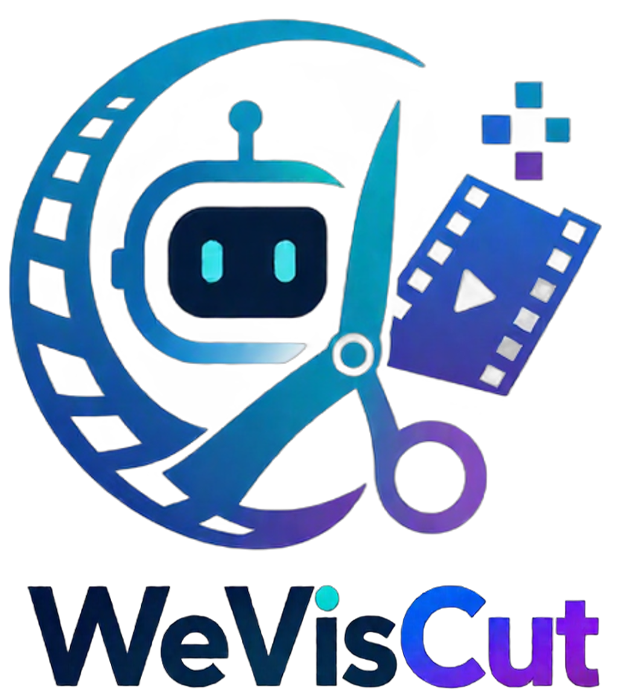
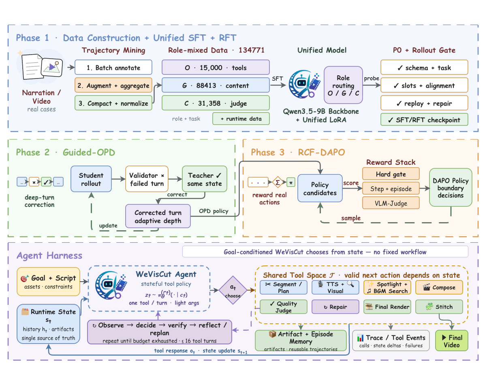

<div align="center">



# WeVisCut

### *A Long-Horizon Tool Agent for Turning Knowledge Articles into Edited Videos*

[](LICENSE)
[](requirements.txt)
[](https://huggingface.co/tencent/WeVisCut)
[](#how-it-works-short)
[](requirements-gpu.txt)

[English](README.md) · [中文](README_zh.md) · [Model](https://huggingface.co/tencent/WeVisCut) · [Code](https://github.com/Tencent/WeVisCut) · [Docs](docs/architecture.md)

</div>

---

## Abstract

**WeVisCut** is a long-horizon tool agent that turns a knowledge article or narration script into a multi-minute edited video. A single 9B policy ([`tencent/WeVisCut`](https://huggingface.co/tencent/WeVisCut)) reads the current editing state and emits **one tool call at a time** — segment the article, plan shots, synthesize narration, retrieve footage, fill animated templates, pick BGM, judge, reflect, repair, stitch — for roughly twelve calls per rollout. There is no hardcoded stage machine: the trajectory is decided by the policy, and guardrails only *reject* illegal calls, never replace them. The released runtime is **training-aligned** — the same 12 tools and the same state JSON the model saw during training — and ships together with the studio UI and the trajectory-collection pipeline that produced the data.



---

## At a glance

| | |
|---|---|
| **Task** | long-form script → multi-minute edited video |
| **Policy** | one 9B model, one tool call per step (~12 calls / rollout) |
| **Action space** | 12 editing tools (segment, plan, TTS, retrieval, template, compose, BGM, judge, reflect, probe, stitch) |
| **Runtime** | `studio/` — live timeline, pause / resume, manual & chat editing, per-shot re-render, version rollback |
| **Data** | `data_construct_pipeline/` — long-horizon trajectory annotation (orchestrator / generator / critic) |
| **Requirements** | Python ≥ 3.11, ~24 GB NVIDIA GPU for bf16 9B (UI-only mode needs none) |
| **License** | Apache-2.0 ([LICENSE](LICENSE)) |

---

## Contents

- [Quick start](#quick-start)
- [Use the studio](#use-the-studio)
- [Data-construct pipeline](#data-construct-pipeline)
- [How it works (short)](#how-it-works-short)
- [Tests (offline, no GPU)](#tests-offline-no-gpu)
- [Citation](#citation)
- [License](#license)

---

## What you get

- **Article → video.** Knowledge-style long copy in, a multi-minute cut out (typically ~12 tool calls).
- **Studio.** Live timeline (chapters, shots, narration, subtitles, footage, templates, BGM, render), pause / resume, then **manual** or **chat** edits on the finished project.
- **Training-aligned runtime.** The model sees the same 12 tools and the same state JSON as in training.
- **Data pipeline.** `data_construct_pipeline/` records the trajectories used to train the policy (orchestrator / generator / critic).

---

## Quick start

**Need:** Python ≥ 3.11, an NVIDIA GPU with ~24 GB for bf16 9B (UI-only: `--no-model`). Node and ffmpeg are installed by the setup script.

```bash
git clone https://github.com/Tencent/WeVisCut.git
cd WeVisCut

pip install -r requirements.txt
# GPU machines: install torch for your CUDA, then
pip install -r requirements-gpu.txt

bash scripts/setup_external_tools.sh          # ffmpeg, Node, renderer, ~1.1 GB

pip install -U "huggingface_hub[cli]"
hf download tencent/WeVisCut --local-dir checkpoints/weviscut-9b

bash run_studio.sh --check                   # path check, no GPU
bash run_studio.sh                          # default http://<host>:8081/
```

Weights load in the background (30–60 s). The UI is up immediately. Put the checkpoint somewhere else with `export WEVISCUT_MODEL_PATH=/path/to/WeVisCut`.

If `github.com` is blocked, `pip install deepagents==0.7.7` instead of the git pin in `requirements.txt`. The loader needs an `ms-swift` that registers `qwen3_5` (`AICUT_MS_SWIFT_PATH` if yours does not).

UI-only (no weights): `bash run_studio.sh --no-model`.

---

## Use the studio

1. Open `http://<host>:8081/` (trustworthy-cut UI: `/0907_newvis`).
2. Paste a narration / knowledge script and start. Eight tracks fill as the agent works.
3. After a cut: edit a shot (narration, footage, template, BGM) or chat (“change the opening line”, “replace the visual at 0:15”).
4. Re-render only the shots you changed. History supports version rollback.

Default footage / BGM is open-web search (`asset_retrieval_tool`). Point `studio_config.yaml` at your own HTTP API, a local folder, or a Python plugin — see [`docs/providers.md`](docs/providers.md). That file is the only config you need to edit.

```bash
python3 -m studio.config --summary
```

---

## Data-construct pipeline

[`data_construct_pipeline/`](data_construct_pipeline/README.md) is how we **annotate long-horizon trajectories**: one script in → one cut + three role streams (orchestrator, generator, critic). The studio *serves* the trained policy; this package *records* the data it was trained on.

```bash
pip install -e data_construct_pipeline
longvideo-polar smoke --pipeline-root .     # offline wiring, no GPU
longvideo-polar run --script-file /path/to/script.txt --output ./rollouts/demo
```

A full rollout also needs a served OpenAI-compatible model, TTS, and ffmpeg. Details, batch jobs, and the three-role dumps: the pipeline [README](data_construct_pipeline/README.md).

---

## How it works (short)

Each step the policy sees the current editing state and emits **one** of 12 tools. Guardrails can reject an illegal call; they do not replace it.

| Tool | Role |
|---|---|
| `Tool_SegmentArticle` | Split the article into chapters |
| `Tool_PlanShots` | Plan shots for one chapter |
| `Tool_GenerateAudio` | TTS; locks shot duration |
| `Tool_RetrieveVisual` | Find footage |
| `Tool_DecorateShot` | Template + slots |
| `Tool_TimelineCompose` | Render one shot |
| `Tool_MusicSearch` | BGM playlist |
| `Tool_TextQuickJudge` / `Tool_VLMRenderJudge` | Quality gates |
| `Tool_SelfReflect` | What to repair next |
| `Tool_ModalProbe` | Service preflight |
| `Tool_StitchVideo` | Concatenate the cut |

Deeper notes: [`docs/architecture.md`](docs/architecture.md). Config reference: [`docs/configuration.md`](docs/configuration.md). External downloads: [`docs/external_tools.md`](docs/external_tools.md).

`AICutPipeline` in prompts and state JSON is the training-time name and is left unchanged on purpose.

---

## Tests (offline, no GPU)

```bash
python3 tests/test_studio_offline.py
python3 -m pytest tests/test_aicut_agent.py tests/test_providers.py tests/test_thinking_parse.py
node tests/test_frontend.js
```

| Symptom | Check |
|---|---|
| Missing modules | `requirements.txt` / `requirements-gpu.txt` |
| Model stuck on “loading” | Log; `checkpoints/weviscut-9b` (or `WEVISCUT_MODEL_PATH`); GPU visible |
| A tool loops | Frontend terminal — usually TTS / retrieval / renderer |
| Empty thinking panel | `model.enable_thinking: true` |
| Port in use | `bash run_studio.sh --port <free>` |

## Citation

If you use WeVisCut in your research, please cite:

```bibtex
@misc{weviscut2026,
  title        = {WeVisCut: A Long-Horizon Tool Agent for Turning Knowledge Articles into Edited Videos},
  author       = {WeVisCut Team},
  organization = {Tencent},
  year         = {2026},
  howpublished = {\url{https://github.com/Tencent/WeVisCut}},
  note         = {Technical report and code release}
}
```

## License

Apache License 2.0 — [LICENSE](LICENSE). Third-party runtimes and retrieved media keep their own licences.
