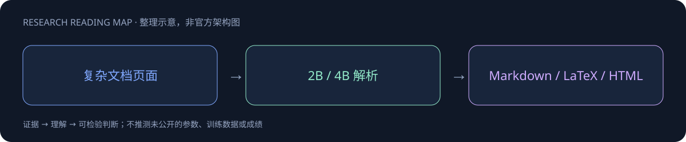
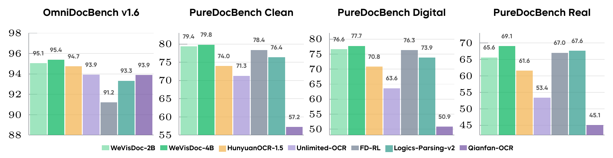

# WeVisDoc

> [!tldr]
> Qwen3-VL 2B/4B上的端到端文档parser，输出Markdown、LaTeX和HTML表格。 比只看干净页面更重要的是真实退化输入；4B在PureDocBench真实退化轨为69.08，低于干净79.81，说明场景难度仍显著影响覆盖。基线部分由作者重跑，部分引自原论文需分栏。

## 一页速览

| 维度 | 当前证据 |
|---|---|
| 发布时间 | 2026-09（确切日期待核实，未计入精确30日表） |
| 类型 | 专项支线 / family · Document |
| 关键事实 1 | 4B Overall95.38 |
| 关键事实 2 | PureDocBench三轨均值75.54 |
| 关键事实 3 | 报告arXiv2609.20423 |
| 检查日期 | 2026-10-13；官方原始资料在同级src/ |

## 文档输出格式也是能力边界

基于Qwen3VL2B/4B，输出Markdown、LaTeX、HTML，用于复杂页面解析。模型应将阅读顺序、公式和表格结构恢复成可使用的文本，而不是只摘录OCR词块。

| 官方模型 | OmniDocBench | PureDoc平均 |
|---|---:|---:|
| WeVisDoc4B | 95.38 | 75.54 |
| WeVisDoc2B | 95.06 | 73.86 |

4B在PureDoc的Clean79.81、Digital77.74、Real69.08，真实复杂文档仍明显更难。官方均值取3次运行，部分基线重新评测、部分引用论文；来源不同要保留，不能假装同一harness横评。

## 研究判断

验收解析不只看格式合法，还要看跨列阅读顺序、公式字符、合并单元格和遗漏注脚。对RAG/Agent，最危险的错误是结构看起来正确但数值归错行；应保留每个输出字段的原页面定位。HTML和LaTeX输出在发布前也要按不可信内容处理，不能直接执行。

> [!warning] 日期与阅读边界
> HF9月16日创建不能证明正式首发，本节点按9月待核实；报告2609.20423保留官方链接，未下载PDF或完成源码精读。

## 对 Agent Training 的启发

> [!insight]
> 按数字退化与真实退化分别抽样，核查阅读顺序、公式和表格。保存模型配置、3次均值与解析失败，避免把论文表中所有baseline当统一harness。

以上是基于已读官方资料的研究判断，不是官方保证，也没有在本机运行模型推理或复现论文成绩。下一步优先补独立验证器、固定任务/版本和完整失败轨迹，避免只保存最好样例。

## 一手资料与导航

- [S1] [HF Model Card](https://huggingface.co/tencent/WeVisDoc-4B)

原始下载文件与SHA-256见 [[src/retrieval_manifest.json|抓取记录]]。报告保留链接，不抓PDF；动态网页响应若只有壳文件，不将其标成完整离线正文。

- [[Topics/13_base_model/Base Model MOC|基模主题索引]]
- [[wevisdoc_poster_zh.html|中文Poster]]

> 📊 相关可视化: [[wevisdoc_poster_zh.html|WeVisDoc 中文Poster]]
