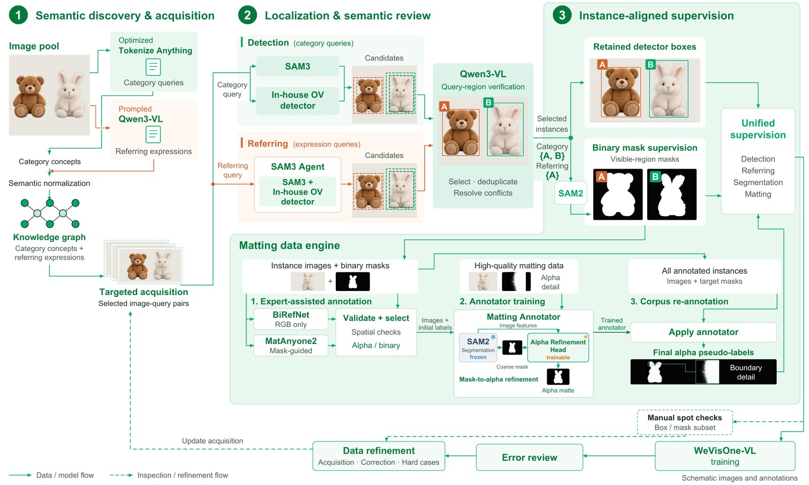
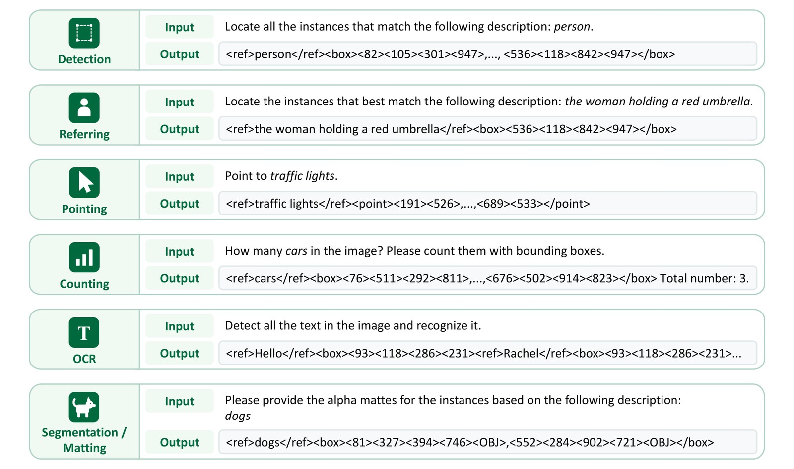
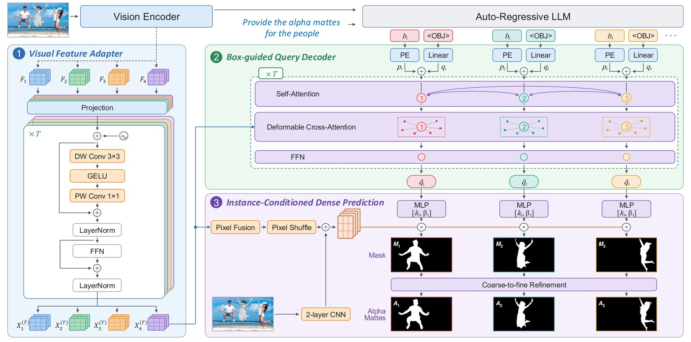

# WeVisOne-VL：把“在哪里”与“哪些像素”接在同一个实例上

> [!tldr] 核心判断
> WeChat Vision 的贡献不是再做一个聊天模型，而是把检测、指代、计数、指点、OCR、分割与抠图统一成结构化输出：先生成目标与坐标，再由 `<OBJ>` 隐状态驱动轻量像素解码器。真正值得借鉴的是 **目标身份贯穿数据标注、token 输出和像素监督**，以及对“目标不存在”的显式奖励。

> [!info] 日期与 family 边界
> 2B/4B 共用一个专项 family，放在 Tencent 的折叠支线，不算两代。官方 GitHub News 只写 `2026-10`，模型权重最早公开日尚未核实。arXiv v1 明确为 **2026-10-22 14:19:50 UTC，即北京时间10月22日22:19:50**，这是可确认的技术报告公开事件，不冒充权重首发日；10月23日是本轮发现日期。

## 一、先拆清它统一了什么

主干来自 Qwen3-VL，提供 2B 和 4B 两个规模。对象级任务输出离散结构，像素级任务还要调用 `mask_decoder.pt`，后者 **9,609,764 参数，约9.6M**；这不是整个模型只有9.6M，也不是可省略的装饰性附件。

| 输入意图 | 实际输出 | 最容易误读的边界 |
|---|---|---|
| 类别检测、指代表达 | 目标框，或 `None` | 查询不存在时应拒绝，而非硬画一个框 |
| 计数、指点 | 框/点集合及数量 | 点匹配 F1 与计数 exact-match 不是同一指标 |
| OCR | 文本及其框 | 同时要求转写与位置，不能当纯识别准确率 |
| 分割 | 框、`<OBJ>`、二值掩码 | 当前单轮图像任务，不是视频跟踪 |
| 抠图 | 框、`<OBJ>`、连续 alpha | 半透明与发丝不能用二值边界完全表示 |

卡片声明面向感知研究，不面向自主高影响决策或身份识别。直接输出结构化结果，不显式生成 CoT；专项微调也可能损失基座的通用能力。

### 10 月 27 日模型卡校正记录

2B 原卡将旧的 **9,511,460（约9.5M）** 改为 **9,609,764（约9.6M）**，与4B卡和本文原有报告口径一致；两张卡还补上论文、项目页和引用。报告已在10月23日归档，这次只是同步模型卡的证据链。参数描述被修正不能单独证明权重发生更新，本文未以README修改时间新增发布事件，family和首发日期待核状态保持不变。

## 二、Data Engine：高召回提案不等于可靠监督

报告写约 **100M 图像、3.6B 框标注**，来自 GRIT、CC3M、LAION、SA-1B 及专项数据。它们是图像/标注口径，不应与各阶段重复采样的训练样本数直接相加。

1. **概念与指代约束共同组织。** 知识图谱合并类别别名，但不能丢掉“红色、左边、正在拿东西”等决定目标集合的限制；按长尾、遮挡、尺度和既有失败补采样。
2. **定位专家先保召回，VLM 再保语义。** SAM3 与内部 DINO 风格检测器给提案，Qwen3-VL 检查类别；指代管线另引 Rex-Omni。不能把某个检测器没检出直接标成负例。
3. **负例要看整幅图。** 把“红车”改成“蓝车”，不保证图里没有蓝车；只有完整检查后无对象满足全部条件，才保留空目标集合。模型仍画框的已审负例成为 hard negative。
4. **框、掩码与 alpha 保持同一实例。** SAM2 产生二值掩码；抠图标注结合 BiRefNet、MatAnyone2，并训练专门 Mask2Alpha 标注器。选源和二值回退都有 provenance，不能把所有伪标签当精确人工 alpha。
5. **模型错误只触发复查，不自动改真值。** 可靠标注保留并重采样；坏标注重做；未解决的案例排除。原图、近重复与派生任务记录保持同一分区，固定监控集不进训练或阈值校准。

Mask2Alpha 是数据引擎的独立标注组件；**“推理不依赖 SAM”不意味着数据构建从未使用 SAM**。

## 三、token 到像素：一个对象，一条身份链

坐标使用 `<0>` 至 `<1000>` 的专用归一化 token。框为四个坐标，点为两个；像素任务在框后追加 `<OBJ>`（原卡给 token ID 152678）。`None` 是空目标的有效答案，不是解析错误。

解码器先取 Qwen3-VL ViT **pre-merging 的多层特征**，投影并加入空间/层级位置；以 `<OBJ>` 隐状态初始化内容查询，以框的 Fourier 编码形成位置查询，经过 **6 个 deformable block**。随后用实例查询生成动态卷积核，作用于共享像素特征，最后多尺度细化边缘和部分透明度。

论文的动态掩码头可概括为：

$$[k_i,\beta_i]=\mathrm{MLP}(\tilde q_i),\qquad M_i=k_i^\top P+\beta_i.$$

这解释了它为何不用再挂一个大型分割网络：图像特征共享、目标表示来自语言模型输出。但定位错目标时，精细像素解码也不能修复语义选错。

## 四、训练顺序：最重要的是 warm-up 后回接原 S2

| 阶段 | 数据/步数 | 可训练部分与目标 |
|---|---|---|
| SFT-S1 | 表9为90.2M；13,000步 | 冻结视觉/投影，只训LLM；新token/结构对齐；每类≤50框/点，16–512视觉token，4096上下文 |
| SFT-S2 | 表9为40.5M；表11为8,995步 | 全VLM；高分辨率/密集目标；最多1960视觉token、500框/点、8192上下文 |
| 像素 warm-up | 正文250M分割样本；100K步 | VLM与随机解码器联合训练，但之后仅保留解码器和`<OBJ>` embedding |
| SFT-S3 | 表9为41.8M；表11为9,062步 | **回接原S2**，NTP/分割1:1；LLM用LoRA r128/alpha256/dropout0.05，embedding/head全训 |
| 抠图微调 | 正文130M；100K步 | 冻结VLM，只训decoder；1024²，公共/WDE每batch约1:4 |
| Mixed-task RL | 178K样本；593步 | 只训LLM；GRPO每题8个回答；FSDP2+vLLM |

正文把 S2/S3 步数约写成9K，表11给精确值，二者并列保留。附录分割数据源库存171.4M公共+288.4M WDE，与 warm-up 使用250M不是同一个统计量；130M抠图也不等于130M独立新图。

分割损失为 \(20L_{focal}+L_{dice}\)，联合阶段为 \(L_{NTP}+10L_{seg}\)；抠图是 \(200L_1+5L_{grad}+50L_{lap}+L_{hard}\)。SFT用128GPU、RL用160GPU是论文训练配置，**不是推理最低硬件要求**。

### RL 不是直接优化所有像素

先用 SFT 模型采样，按 \(U(x)=4\mu_x(1-\mu_x)\sigma_x\) 选中等难度且结果有差异的约140K案例，再补充定位/指点样本到178K。不能把“高不确定度”误写成奖励全零的最难题。

同类内对预测与真值做 Hungarian 一对一匹配，奖励：

$$r_i=\frac{2\sum_{(\hat b,b^{\star})\in\mathcal M_i}\mathrm{IoU}(\hat b,b^{\star})^3}{N_{gt}+N_{pred}}.$$

重复框增大分母、漏框也受罚；IoU立方强化高精度定位。**分割/抠图在 RL 仍只用框奖励，不对 mask/alpha 给奖励**；缺失目标只在不预测对象时得1，指点用点–真值mask匹配F1，OCR用转写奖励。这是代理奖励边界，不能宣称直接像素RL。

## 五、结果：报告原值，先对齐指标

下表来自官方报告/仓库，非本地复测。报告贪心解码、temperature0、每图≤1960视觉token；Qwen3.5基线启用 thinking，与无CoT结构化模型的成本不等价。

| Benchmark / 指标 | 2B | 4B | 解读 |
|---|---:|---:|---|
| COCO / F1 Mean↑ | 55.2 | 57.1 | 不是COCO AP |
| LVIS / F1 Mean↑ | 53.3 | 55.3 | 长尾检测 |
| Dense200 / F1 Mean↑ | 61.4 | 71.3 | 密集检测 |
| VisDrone / F1 Mean↑ | 40.4 | 44.7 | 小目标 |
| RefCOCOg test / F1 Mean↑ | 78.2 | 81.8 | 正目标定位 |
| WeRef / Rejection Rate↑ | 92.9 | 96.4 | 自建集；不是所有场景拒答准确率 |
| PixMo-Count test / exact-match↑ | 88.1 | 89.6 | 少/多一个也算错 |
| PointBench / F1@Point↑ | 62.9 | 71.9 | README简表写Acc；本文按报告口径 |
| TotalText / F1 Mean↑ | 42.5 | 52.0 | 转写与框同时匹配 |
| ReasonSeg val / gIoU↑ | 60.9 | 71.2 | 不与cIoU混排 |
| P3M-500-NP Box / MAD×1000↓ | 6.6 | 7.3 | **2B更好**，不是4B全面领先 |
| WeRefMat Referring / MAD×1000↓ | 15.8 | 9.8 | 私有文本抠图集，复现边界 |

F1 Mean 是 IoU0.5至0.95步长0.05的平均，不是单一IoU0.5；Ref-ZOM还区分零/一/多目标。Box-matting使用真值框，而文本抠图先定位再解码，不能把两个任务数字当同一难度。

> [!warning] 资料与复现仍有缺口
> 已有完整报告HTML、附录、两份HF卡、官方原图和评测指南，足以写训练机制研读；但训练代码仍在官方 TODO，WeRefMat未公开，未独立复跑，缺系统的模块消融与延迟/显存曲线。**因这些原始材料尚不齐，不能达到完整可复现训练审计的标准，也不能把官方榜单当独立验证。**

## 六、对 Agent Training 的启发

> [!insight] 更好的视觉观察与更强的策略要分开测
> 将 WeVisOne 作为感知工具接到固定 Agent：同任务、同动作预算、同工具协议，对照原VLM框、WeVisOne框、WeVisOne像素与oracle目标。分别报告目标漏检/错选/不存在拒绝、动作失败和最终状态；不要只用像素更漂亮证明策略更聪明。

可以转化为实验的点：先用可验证结构监督统一接口，再补高分辨率与密集目标；对缺失目标保留真正空集合；不确定度筛选时保留成功/失败都有的轨迹；像素效果用独立 verifier，不把训练框奖励直接当 alpha质量验收。

## 来源与关联

- 🤗 [4B Model Card](https://huggingface.co/tencent/WeVisOne-VL-4B)；[2B Model Card](https://huggingface.co/tencent/WeVisOne-VL-2B)。原文：`src/hf_model_card.md`、`src/hf_2b_model_card.md`。
- 📄 [Tech Report HTML](https://arxiv.org/html/2610.31329v1)；[PDF链接](https://arxiv.org/pdf/2610.31329)仅外链，未下载PDF。
- 🧩 [官方源码与评测](https://github.com/Tencent/WeVisOne-VL)；[项目页](https://tencent.github.io/WeVisOne-VL/)。归档代码未执行。
- 关联：[[WeVisDoc]] 关注文档感知；[Qwen3-VL Atlas节点](https://linjh1118.github.io/thinking/base-model-atlas/model.html?id=qwen-qwen3-vl)及[官方仓库](https://github.com/QwenLM/Qwen3-VL)可追溯骨干来源；[[Hy-Nomas]] 是同团队树下另一种世界生成专项，不混成聊天正代。

> 📊 中文海报：[[wevisone_vl_poster_zh.html]] · [Thinking Overview](https://linjh1118.github.io/thinking/base-model-atlas/model.html?id=hunyuan-wevisone-vl)
