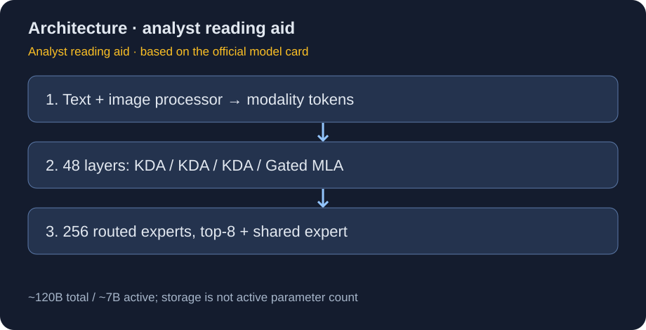
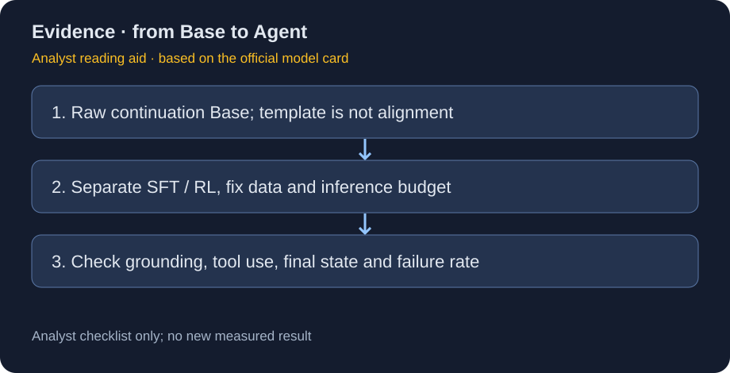

# Youtu-LLM-A7B-Base：混合注意力的稀疏视觉语言基座

> [!tldr] 我的判断
> 这是约120B总参数、每token约7B激活的**预训练视觉语言MoE基座**，不是7B总参数聊天模型。3层KDA线性注意力交错1层GatedMLA，结合细粒度专家和模态感知路由；它适合研究后训练起点，不能凭提供chat template就认为已经完成SFT/RL或工具使用对齐。

> [!warning] 日期、图片与资料深度均有缺口
> 本轮于2026-10-21首次观察到该官方仓库，原卡没有明确首发日，也没有确认首发月；目录中的2610只是**归档月份线索，不认证首发月份**。没有找到本版独立Tech Report或官方配图，不能达到完整技术报告精读深度。本文两图均为依据原卡与配置绘制的研读示意，非官方图、模型输出或本地复测。旧2B模型的2512.24618报告不冒充本A7B报告。

## 身份与证据链

主证据为[🤗 HF Model Card](https://huggingface.co/tencent/Youtu-LLM-A7B-Base)，已保存[[src/hf_model_card.md|原始MD]]、`config.json`、`configuration_youtu_vl_moe.py`、`LICENSE.txt`和仓库元数据。取得时revision为`a4fe6c899679a4c66da0d6e52cdbfd2f1814b0fb`，实际URL和SHA256在`src/retrieval_manifest.json`。

仓库createdAt为1月5日、lastModified为10月21日，两者都不证明首次公开发布日。本轮将它作为日期待核的Youtu支线收录，不放进精确日期的近30天发布表。它不是Hunyuan聊天主线的新正代，也不是文档解析Youtu-Parsing-Omni的参数SKU。

## 架构：激活稀疏与总存储分开

| 项目 | 原卡 / 配置 | 解释边界 |
|---|---|---|
| 总 / 激活参数 | 约120B / 每token约7B | 激活量不是部署时只存7B权重 |
| HF tensor统计 | 约118.387B参数 | 与约数120B不矛盾，不当性能或显存实测 |
| 层数 / hidden | 48 / 3072 | 不是7B dense结构 |
| 注意力 | `[KDA,KDA,KDA,MLA]`重复12次 | 配置pattern，不代表有完整组件消融 |
| 专家 | 256 routed，top8，1 shared | `first_k_dense_replace=1`，并非每层都完全相同 |
| 路由 | quantile balancing、模态感知expert bias | 不能据此宣称已解决全部负载/模态失衡 |
| 视觉 | Qwen3-VL-MoE风格ViT，27层，hidden1152 | 架构风格相似不证明完整训练继承或数据配比 |
| 上下文 | 262144 tokens | 长度容量不是任意位置可靠召回保证 |
| 预训练 | 11.5T multimodal tokens | 未给各模态占比、去重和污染审计 |
| 词表 / 精度 | 129280 / BF16 | 推理成本另看后端、并发与图像token |

KDA在局部层承担线性注意力，GatedMLA穿插提供另一类交互路径；MoE使每个token只选择部分专家。配置还记有MRoPE、模态token和MTP相关字段，**字段存在不等于本次服务已启用全部功能**。配置注释明确MTP记录用于训练，推理不加载；不能直接宣传MTP推理解码加速。

## 10 月 27 日模型卡补充：反向的多模态预训练起点

官方卡新增说明：与常见 MLLM 使用已训练语言骨干再连接视觉模块的路线相比，本模型将**随机初始化 LLM 连接到预训练 ViT**，按 **4K→32K→128K→256K** 上下文分阶段预训练。这里“反向”是官方对训练起点的描述，不意味着各注意力模块反向执行，也不是新增 checkpoint 或新首发日。

这使 11.5T 多模态 tokens 与语言骨干从头学习的关系更清楚，但卡没有给出每阶段 token 配比、冻结/解冻策略和可控消融。不能据此断言随机语言初始化一定优于成熟 LLM 起点。对 Agent Training，更有价值的实验是固定数据和算力，比较先验语言能力与视觉对齐的取舍，并单列长上下文扩展的收益；本轮只更新文档证据，没有运行这项实验。

## Base意味着什么

原卡推荐raw text continuation：给少样本格式后续写，而不是默认多轮助手。示例提供`chat_template.jinja`，但没有公布SFT、偏好训练或RL配方。元数据标签里的conversational、模板里的工具语法也不能当作已验证的Agent能力。

图像需通过processor传入，并与`<|vision_start|><|image_pad|><|vision_end|>`占位符对应。配置有video token不等于本卡已验证视频能力；原卡明确的是text+image，本文不扩大输入范围。

## 文本评估：完整保留胜负与shots

官方对照为DeepSeek-V4-Pro-Base（1.6T总参数/49B激活）。均为原卡报告，未本地复测；不同shots和指标不合并成平均准确率。

| Benchmark | shots / metric | DeepSeek Base | Youtu A7B |
|---|---|---:|---:|
| MMLU-Redux | 5 / EM | 93.21 | 96.00 |
| MMLU-Pro | 5 / EM | 67.11 | 78.61 |
| MMMLU | 5 / acc_norm | 86.48 | 84.02 |
| AGIEval | 0 / acc | 72.46 | 69.01 |
| SuperGPQA | 5 / acc_norm | 54.20 | 42.28 |
| GPQA main | 5 / acc_norm | 55.36 | 68.53 |
| INCLUDE | 5 / acc | 85.52 | 77.25 |
| BBH CoT | 3 / EM | 88.36 | 85.85 |
| GSM8K | 8 / EM | 91.96 | 88.86 |
| MGSM zh | 8 / EM | 79.90 | 82.60 |
| HumanEval+ | 0 / pass@1 | 76.80 | 78.05 |
| MBPP+ | 3 / pass@1 | 84.13 | 89.15 |
| LiveCodeBench v6 | 3 / pass@1 | 12.00 | 15.43 |
| RepoBench | 3 / EM | 32.72 | 33.57 |
| RULER 4K–256K | 0 / score | 93.11 | 92.38 |
| LongBench v2 | 0 / EM | 46.30 | 48.53 |
| MRCR v2 <256K | 0 / score | 32.50 | 37.93 |

MMLU-Pro与GPQA main更高，但SuperGPQA、GSM8K、RULER等更低，不能写成“7B激活全面打赢49B”。不同专业知识面板的差异值得检查数据覆盖、题型和抽取规则，不能只挑最好的几个分数。

## 视觉语言评估：不要把judge分与EM混为一谈

以下均3-shot，对照MiMo-V2.5-Base（310B总/15B激活）。MCQ取选项字母后EM，开放问答以MiniMax-M2.7作judge；其余采用各suite自己的metric。

| Benchmark | metric | MiMo Base | Youtu A7B |
|---|---|---:|---:|
| AI2D test | EM | 85.23 | 89.83 |
| LogicVista | EM | 47.20 | 50.11 |
| WeMath | Strict score | 45.14 | 56.19 |
| MMMU dev+val | EM | 65.56 | 67.11 |
| MMMU-Pro 10c | EM | 50.12 | 53.87 |
| MathVista mini | judge acc | 70.00 | 73.20 |
| MMBench EN v1.1 | EM | 85.14 | 88.08 |
| MMBench CN v1.1 | EM | 86.15 | 85.14 |
| SimpleVQA | judge acc | 49.38 | 49.48 |
| ChineseSimpleVQA | judge acc | 47.27 | 53.00 |
| WorldVQA | judge acc | 13.53 | 13.40 |
| BabyVision | judge acc | 18.56 | 14.18 |
| PerceptionBench | judge acc | 32.57 | 34.03 |
| RealWorldQA | EM | 78.56 | 80.26 |
| MMStar | EM | 68.07 | 70.47 |
| ChartQA test | relaxed acc | 87.80 | 88.60 |
| CharXiv descriptive | judge acc | 84.40 | 86.95 |
| CharXiv reasoning | judge acc | 65.40 | 61.50 |
| OCRBench v2 EN | Overall score | 52.00 | 52.19 |
| OCRBench v2 ZH | Overall score | 59.84 | 60.96 |
| CRPE exist | EM | 94.14 | 96.79 |
| CRPE relation | EM | 64.84 | 73.86 |
| HallusionBench | avg a/f/qAcc | 57.65 | 60.87 |
| EmbSpatialBench | EM | 80.00 | 81.48 |
| CountBenchQA | acc | 94.48 | 94.46 |
| RefCOCO | Precision@1 | 72.71 | 91.84 |

RefCOCO提升较大，但BabyVision和CharXiv reasoning更差；“能定位”不能代替组合视觉推理。未公开统一样本量、置信区间、judge提示词与污染检查，不把小幅差值当统计显著。

## 服务契约和安全边界

原卡固定Transformers5.12.1，要求`trust_remote_code=True`，这会执行仓库代码；本轮只保存和阅读源码，没有加载、安装、执行或推理。SGLang0.5.17要用仓库自带adapter，不能照搬通用launch命令；8GPU推荐TP4/DP2/EP4仅为官方例程，不是本地资源申请。

Overlap scheduler默认关闭；仅文本服务可开以提高吞吐，高并发图像会在`event_loop_overlap`挂住。原卡没有同硬件latency/throughput表，因此不虚构实时速度或成本领先。许可证卡片字段是other/youtu-llm，具体条文保留在原始LICENSE，不仅凭标签判断使用边界。

> [!insight] 对Agent Training的启发
> 这个基座的长上下文、视觉定位与稀疏路由值得作为后训练起点，但Agent实验应固定raw/base、SFT、RL三个阶段，不能拿模板支持冒充学习收益。视觉grounding、任务规划、工具调用、最终状态验证分层评估；保留跨模态负载、图像高并发挂起及失败轨迹。真正重要的是同预算下完成率和每成功任务成本，而非只看7B激活标签。

## 关联与交付

- [[Topics/13_base_model/Tencent_Hunyuan/Variants/2610_Youtu_Parsing_Omni/Youtu-Parsing-Omni|Youtu-Parsing-Omni]]：文档解析专项，不是本A7B的旧权重或同尺寸变体。
- 历史[Youtu-LLM-2B模型卡](https://huggingface.co/tencent/Youtu-LLM-2B)仅用于追查产品线，不把它的报告和日期套给A7B。
- 📊 相关可视化：[[youtu_llm_a7b_base_poster_zh.html|中文Poster]]。
