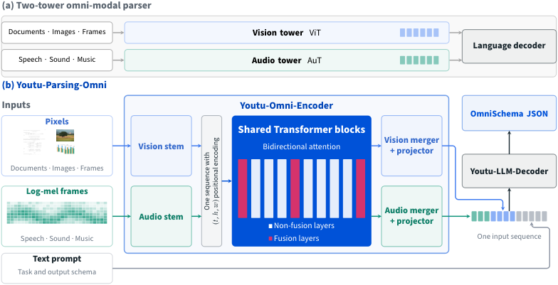
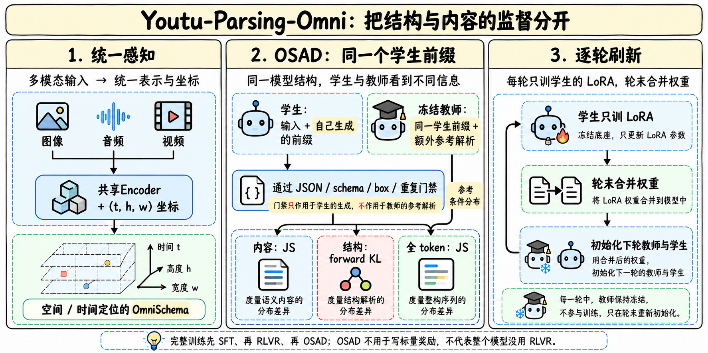
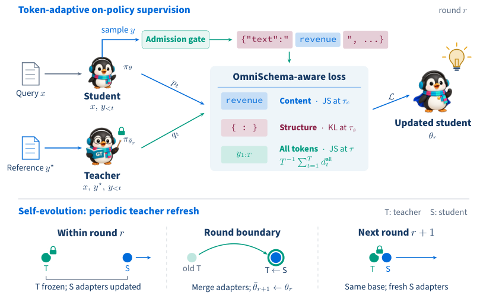
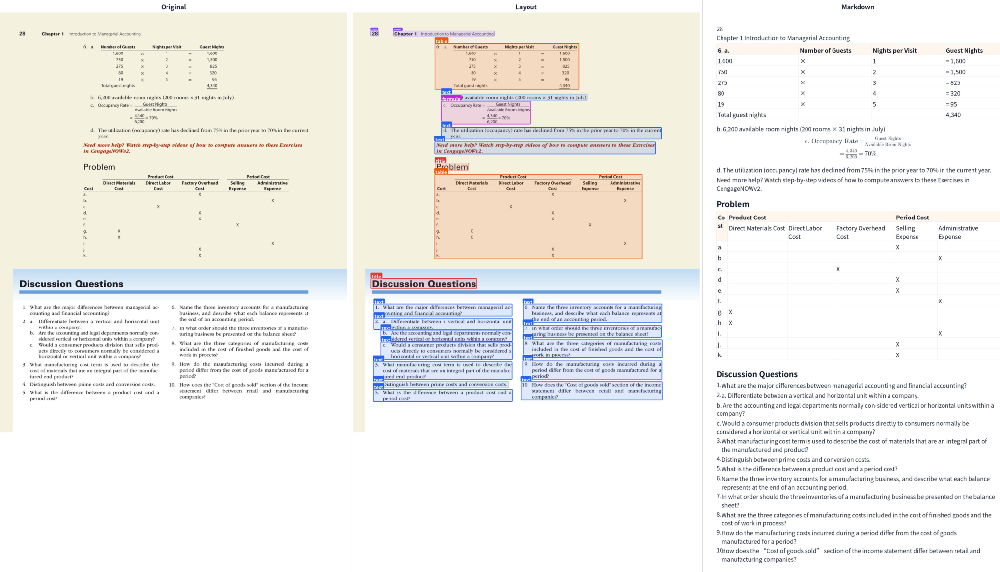

# Youtu-Parsing-Omni：结构合法之后，还要修正局部事实

> [!tldr] 核心判断
> 5B模型把文档、图像、音频和视频先变成带空间/时间位置的统一结构记录，再交给下游推理。核心训练贡献是OSAD：学生在自己的rollout前缀上学习，冻结教师看到同一前缀及额外参考解析；内容token用JS、结构token用前向KL，再逐轮刷新教师。结构门禁解决“输出能否读”，参考条件化分布解决“内容是否读对”，两者不能互相替代。

> [!info] 本次阅读升级与边界
> 原笔记只读到HF卡，现已补读正式报告**2610.39301v1的HTML正文、架构/数据/后训练/评测附录**，保存完整原文与20张官方图，重写方法、训练、消融和弱项。没有下载PDF、模型权重，也没有本地重测。模型首次发布日期仍只核实到2026-10，论文提交和HF本次补链接不替代模型首发日，因此不新增“10/30发布”事件。作者评测、可复现协议与独立验证仍需区分。

## 官方来源

| 来源类型 | 在线与本地 |
|---|---|
| 🤗 HF Model Card | [腾讯原卡](https://huggingface.co/tencent/Youtu-Parsing-Omni)；[[src/hf_model_card]] |
| 📄 Tech Report PDF | [官方报告链接](https://arxiv.org/pdf/2610.39301)，仅保留链接 |
| 📖 Tech Report HTML | [实际阅读版本](https://arxiv.org/html/2610.39301v1)；[[src/technical-report.html|离线阅读版]] |
| 🗂 原始材料 | [[src/retrieval_manifest.json|URL、下载时间与哈希]]；`src/history/`保留旧卡 |

报告题名为*One Encoder, One Schema, All Modalities*。本轮变化是**正式报告材料补全**，原HF性能数字与模型family继续沿用，不虚构新权重版本。

## 为什么把parser作为Agent的证据接口

描述一张图“像什么”与提供可追溯证据不同。下游Agent要知道文字在哪、表格单元如何关联、音频事件何时发生、视频哪一帧支持结论。自由文本caption丢掉位置和结构，单独OCR又无法统一处理其他模态。

模型输出OmniSchema：必需的modality，以及elements或segments和global_description；不同任务再扩展阅读顺序、子类型、结构化报告等。报告按10种任务组织，HF卡按7类输入/输出族介绍，两种计数粒度不同。bbox归一到0—1000；时间戳格式HH:MM:SS，**并不承诺毫秒或词级强制对齐精度**。

统一JSON是交互合同，不是真实性证明。键齐全、框格式正确的记录仍可能错字、错公式、错表格值；这正是OSAD要处理的局部错误。

## 一个共享Encoder，怎样处理不同模态

Youtu-Omni-Encoder由Qwen3-0.6B的Transformer权重初始化，去掉原词嵌入和LM head，转为双向packed感知编码。28层、hidden1024、FFN3072、16 query/8 KV heads、head dim128。视觉用16×16 patch；音频128-bin Mel以25ms窗、10ms hop得到100Hz，再过三层stride2、512通道卷积，1秒窗口约13 tokens，之后投影器再做相邻token合并。

视觉2×2合并，音频相邻2合并后投影到2560。文本decoder为40层dense MLA，hidden2560、FFN9728、32heads，长上下文128K。**5B是完整parser量级**，不能把0.6B初始化模型大小当成最终参数。

所有模态用(t,h,w)坐标；旋转维度64按21/21/22分配，每轴覆盖完整频率范围。音频h/w为0，视频帧t按音频速率与fps缩放。统一坐标本身不等于所有层都融合；跨模态注意力只在13、14、27、28四层及局部窗口开启，其他层维持对应路由。从第二阶段起80%训练采用fused route，同时保留20% independent route，支持纯图、纯音频或视频分开处理。

## 先预训练，再SFT / RLVR，最后OSAD

| 阶段 | 规模/窗口 | 关键约束 |
|---|---|---|
| Stage0 | 4K序列；256视觉tokens/图；16frames | 对齐编码器，decoder冻结；不做跨模态融合 |
| Stage1 | 1.28T tokens；8K—32K；20K视觉tokens；64frames | 全参数训练，加入文本和四层融合 |
| Stage2 | 512B tokens | LR1e-4降到1e-5；encoder层衰减0.9；fused比例0.8 |
| Stage3 | 128B tokens；128K；102400视觉tokens；512frames | 长上下文扩展 |
| SFT | 16B tokens；32K；64frames | schema任务与通用数据，全参数更新 |
| RLVR | GRPO | 可解析主载荷门禁，再给内容奖励与惩罚 |
| OSAD | 6 rounds，LoRA学生 | 冻结教师提供参考条件化逐token监督 |

RLVR仍有手工构造的可验证任务奖励：格式和主载荷有效才进入内容项，重复及覆盖不足分别以系数0.6、0.7惩罚，并截到0—1。全无效组的advantage可能为0，所以前置SFT是获得有效探索的基础。**“不需要手写标量奖励”只适用于后面的OSAD阶段，不适用于整套训练**。

## OSAD：同一学生前缀，教师多看参考解析

学生在真实输入上采样自己的输出，教师在相同输入、相同学生已生成前缀之外，额外看到reference parse。教师不独立生成另一条完美轨迹让学生盲抄，也不把参考答案直接喂给部署中的学生。学生此前走错的状态仍被保留，这使监督对准实际会遇到的分布。

门禁检查学生rollout的JSON、schema、box语法与重复情况；失败样本就地mask，不先修补再训练。通过门禁后，将内容、结构和全token分别归约：内容JS、结构前向KL，全token再加一个JS锚定。结构温度大于内容温度，软化序列化选择与局部内容精度的需求不同。原始公式与符号见报告；这里先说明计算对象，避免只抄公式而混淆信息流。

每种角色先在其token集合内取均值，再合成rollout loss；缺少某角色时省去对应项。分布式更新按全局通过门禁的rollout数归一，**不是各rank均值再不加权平均**。某rank无有效样本贡献0，只有全局有效数为0才跳过更新。门禁通过率需单独记录，否则提高分数可能伴随训练覆盖收缩。

学生只训练LoRA，基础权重冻结；一轮结束合并adapter，合并后权重初始化下一轮学生和教师。每轮内教师冻结，轮间更新。这种self-evolution并非凭空产生新真值，reference正确性仍是前提，错误reference会通过教师分布传播。

具体采样temperature0.35、top-p0.9、top-k50，采样温度不同于蒸馏温度。内容/结构权重第1轮0.50/0.10，第2轮0.60/0.10，第3—6轮0.80/0.08；LR前两轮2e-7，后四轮1.5e-7。逐步增加内容权重符合“先有合法输出，再修局部事实”，但不能用顺序增量证明每个超参数独立最佳。

## 文档、跨模态与形式语言：各自的成绩边界

| 任务与指标 | 官方结果 | 必须同时保留的限制 |
|---|---:|---|
| OmniDocBench v1.6 Overall | 96.96 | 格式转换与匹配后评测；领先幅度小，无独立显著性结论 |
| PureDocBench Avg3 | 76.29 | 端到端模型领先；多阶段TeleOCR78.41更高 |
| OmniParsingBench Overall | 75.08 | 低于Gemini3Pro77.44；并非所有模态第一 |
| Chart | 95.02 | 表中强项，不代表自然图像同样强 |
| Natural image | 62.84 | 低于Logics67.53、Gemini69.73 |
| Geometry | 74.33 | 低于Logics76.34、Gemini85.43 |
| Audio / Natural video / Text-rich video | 78.08 / 74.18 / 75.62 | 按同一重实现工具重评；与原榜数字不可直接拼接 |
| ChemOCR Tani@1.0 | 54.2 | 平均相似度74.6略低于DeepSeek-OCR2的74.9 |
| PDMX-Synth CER | 22.73 | typeset乐谱；SER/LER仍不如专用LEGATO |

PureDocBench干净到物理再拍82.61→68.13，下降14.48，说明真实采集退化仍明显。OmniParsingBench原工具不完整，作者重实现并对所有基线重评；剔除136条不可用媒体，评3738/3874，还排除camera-video子集问题标注。Overall把chart+geometry合为graphics再按5列平均，不能误写六子任务等权。

评分前还会做schema repair，修复后可解析率不等于模型原始JSON有效率。评测中“能修成JSON”与部署中“直接交给工具执行”风险不同，应保留修复日志与原输出。

Video-MME-v2采用只有视频帧、没有音频或字幕的设置。模型L1跨帧信息聚合优势较大，但L2/L3高阶时序推理相近，不能把感知提升写成全部视频推理跃迁。ChemOCR只评去掉10条非法reference后的990例；Tani@1.0是指纹一致，并不严格等同化学结构身份。PDMX是排印乐谱，不能外推任意手写谱。

## 消融支持的因果范围

编码器消融使用通用多模态数据、不含parsing数据，decoder是Qwen3-4B，与完整最终模型的训练条件不同。300B Stage1预算下，随机共享编码器在Avg6低独立预训练双塔1.3，但ASR WER2.14优于2.43；文本初始化后Avg6只差0.4，OCRBench高双塔77.2。

文本初始化与随机初始化的两支视觉训练计划相同，仅初始化不同；OCRBench767.0对636.4，差130.6。但随机模型在16项视觉benchmark中8项领先，BLINK52.89对43.41（+9.48）。**文本初始化更利于符号读取，不是所有空间感知都更强**。

OmniDocBench顺序训练中，SFT约94.97，RLVR95.21（+0.24），6轮OSAD升至96.96（+1.75），占SFT后总增益约88%。这是给定训练顺序下的贡献，六轮都正但递减；不是证明其他RL配方都只能+0.24，也不能把参考监督与新增训练token影响完全分离。

## 对Agent Training的启发

> [!insight] 结构verifier与内容teacher应分别管理
> Agent的工具调用也有“合法JSON但事实错误”。可先让学生真实rollout，用确定性门禁筛掉不能执行的结构，再让带reference的教师在学生相同历史上监督局部字段；不同角色token分开计loss，避免大量固定键名淹没少量关键内容。需要同时报告门禁覆盖、局部事实准确率、终态任务成功，而不只报告修复后可解析率。

该方案适合有可信reference的轨迹修复与结构抽取，不自动解决开放任务真值缺失。高拒绝率分布可能永远得不到监督，应保留拒绝样本、研究是否需额外结构修复curriculum。参考解析可能有错时，应独立抽验其来源，不能因为教师被冻结就假定无偏。

## 关联与产物

- [[Topics/13_base_model/Tencent_Hunyuan/Variants/2610_WeVisCut/WeVisCut|WeVisCut]]：真实状态下的学生rollout与教师条件化，但训练任务/目标不同。
- [[Topics/13_base_model/Ant_Ling/Variants/261026_ZwZ2/ZwZ2-Family|ZwZ2]]：把标签可靠性和证据必要性分开审计。
- [[youtu-parsing-omni_poster_zh.html|中文Poster]]；[[src/technical-report.html|完整报告离线阅读版]]。
