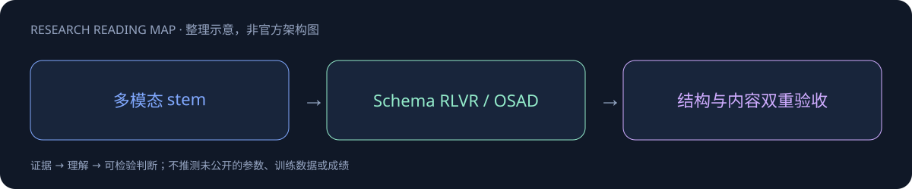

# Youtu-Parsing-Omni

> [!tldr]
> 腾讯5B统一感知parser，输出OmniSchema，涵盖文档、图表、音频与视频。 统一encoder提前融合音视频，共享(t,h,w)坐标；OSAD用通过结构门禁的学生rollout和带参考解析的冻结教师监督，对content和structure用不同散度，逐轮合并LoRA。

## 一页速览

| 维度 | 当前证据 |
|---|---|
| 发布时间 | 2026-10（确切日期待核实，未计入精确30日表） |
| 类型 | 专项支线 / family · Document / Omni |
| 关键事实 1 | 5B |
| 关键事实 2 | OmniDocBench v1.6：96.96 |
| 关键事实 3 | OmniParsingBench：75.08 |
| 检查日期 | 2026-10-13；官方原始资料在同级src/ |

## 一份 Schema 统一文档、图像、音视频的结构化输出

约5B统一encoder+文本LM，模态stem接入共享双向融合，并使用(t,h,w)位置表示。OmniSchema组织不同parser输出，核心不只是把字幕和OCR拼接，而是统一字段、结构与任务接口。

## 后训练目标中的结构与内容分工

SFT后进行schema约束的RLVR，再用OSAD蒸馏。OSAD基于学生rollout，内容角色使用JS、结构角色用forward KL，再加all-token JS；无效学生输出有gate，teacher参考也需明确来源。LoRA每轮合并，部署checkpoint与训练轮次应可追溯。

## 分数并不支持所有场景最强

官方DocParsing96.96、OmniParsing75.08；后者低于所列Gemini77.44。结构输出完整不等于原始事实都正确，应分开检查schema validity、证据对齐、时序和内容错误，尤其多模态跨段实体关联。

对Agent训练的意义是把“能解析”与“值正确”分别设reward，避免只奖励合法JSON。实际评测保存所有不合法字段和错误归属，不只保留通过的输出。

> [!warning] 日期与阅读边界
> HF10月9日创建不当作首发。当前按10月待核实；已读model card，未完成完整报告源码逐节精读。

## 对 Agent Training 的启发

> [!insight]
> schema有效不代表语义正确。分开验收结构合法、bbox/时间戳、文本事实和跨模态对齐；保留未通过门禁的数据并测分布外布局。

以上是基于已读官方资料的研究判断，不是官方保证，也没有在本机运行模型推理或复现论文成绩。下一步优先补独立验证器、固定任务/版本和完整失败轨迹，避免只保存最好样例。

## 一手资料与导航

- [S1] [HF Model Card](https://huggingface.co/tencent/Youtu-Parsing-Omni)

原始下载文件与SHA-256见 [[src/retrieval_manifest.json|抓取记录]]。报告保留链接，不抓PDF；动态网页响应若只有壳文件，不将其标成完整离线正文。

- [[Topics/13_base_model/Base Model MOC|基模主题索引]]
- [[youtu-parsing-omni_poster_zh.html|中文Poster]]

> 📊 相关可视化: [[youtu-parsing-omni_poster_zh.html|Youtu-Parsing-Omni 中文Poster]]
