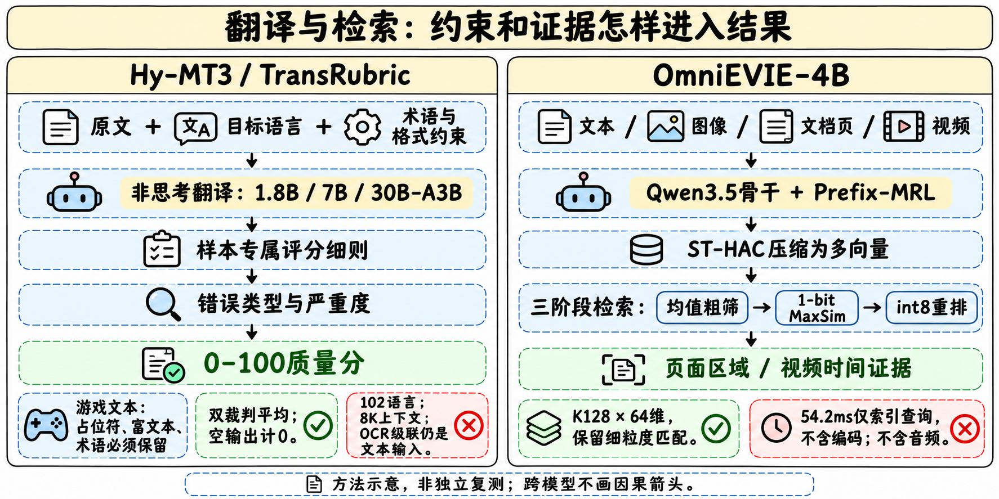
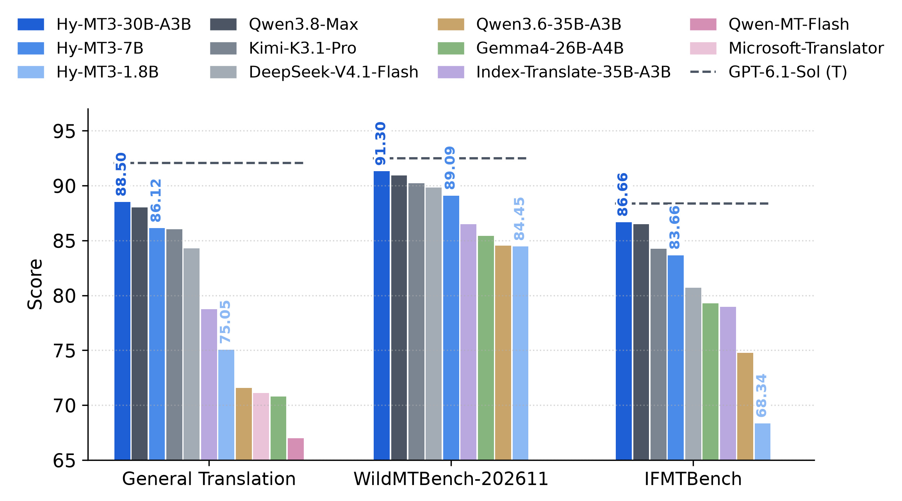
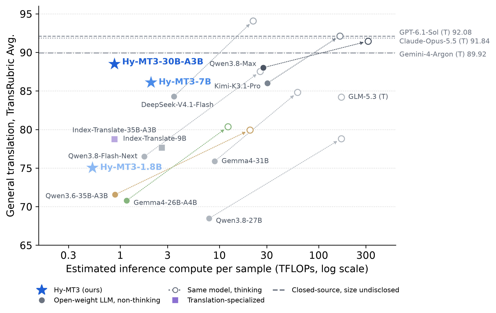

# Hy-MT3 — 把翻译质量拆到错误与约束，而非只看流畅度

> [!tldr]
> 我的判断：值得迁移到Agent Training的并非“3B激活超过大模型”口号，而是把漏译、实体错译、占位符破坏转成可逐项审计的训练与评估问题。Hy-MT3是独立翻译支线，1.8B、7B、30B-A3B及精度SKU共用一族；TransRubric和TiMi工具链是评测/工程组件。

> [!warning] 日期与材料边界
> arXiv v1实际提交为2026-11-20 14:46:42 UTC（北京11/20 22:46），v2为11/23；官方News明确11/24开放三尺寸权重和TransRubric。首次日期取11/20，11/24另列开放阶段，不以仓库创建或lastModified替代。报告HTML、模型卡、训练指南、TransRubric说明均已读取；未抓PDF正文、未运行训练或推理。报告没有给出完整预训练/后训练语料与全部原始run，下面区分实测协议与宣传。

## 规格与任务边界

> [!tldr]
> 这是文本翻译模型，不是看图翻译VLM；所谓图像翻译实验先用PaddleOCR，再让所有模型读取同一OCR文字。

| 项目 | 官方记录 | 使用含义 |
|---|---|---|
|规模|1.8B、7B、30B-A3B MoE|三个尺寸不是三个发布族|
|语言|102，来自38既有语言/方言加64新增|不能把HF语言标签数量当独立任务数|
|上下文 / 输出|卡片max_context 8192；建议max_tokens4096|不是长文无限窗口|
|思考|本文Hy-MT3全部non-thinking；(T)为比较模型思考模式|“最佳”只对应所测非思考集合|
|默认系统提示|无|源/目标语言用完整名称；中文/英文指令分别用对应名称|
|采样|1.8/7B：T0.7、top_p0.6、top_k20、重复惩罚1.05；30B：T0.7、top_p1、top_k-1、重复惩罚1|不要把小模型推荐配置套到MoE|
|开放|Apache2.0；BF16/FP8/GGUF|量化质量另测，不新增正代|

翻译约束包括术语表、口语/书面风格、个人偏好、分隔符数量与位置，以及JSON/XML中只改可见内容、保留key/占位符/标签。TiMi工程覆盖采集中文基线、译文表、编辑器还原、截图LQA与缺陷回归；它不意味着翻译模型原生会操作游戏引擎。其4500条、15品类、14目标语术语表是单独的游戏评测材料，不能混作报告里每项实验的样本量。

## TransRubric如何生成可解释分数

> [!tldr]
> 细则必须绑定具体源文、译文及任务要求。参考译文可选；平均两个裁判不等于没有系统偏差。

报告对通常翻译分数使用DeepSeek-V4.1-Flash与Qwen3.5-397B-A17B两裁判的算术平均。裁判按完整性、准确性、术语、指令遵循等类型与严重度定位问题，给0–100分。WildMTBench无参考译文；FLORES、WMT26、少数语言和HardMTBench使用参考式评价。固定期望样本数作分母，空输出、缺失译文计0；不能丢弃失败样本后抬高均值。IFMTBench另用官方规则和GPT-OSS-120B，不能写成同一双裁判协议。

示意汇总为 \(S(x)=\tfrac12[S_{D}(x)+S_{Q}(x)]\)，这里只描述报告汇总，不是模型训练loss。WMT26元评价的底层裁判改为Gemini3.6Flash：PDP0.744、SPA0.920、平均0.832；同底层官方参赛系统为0.736/0.924/0.830。因此优势主要在细则组织，不能把元评价裁判和最终模型比较裁判混为一谈。

与10名译者的比较涉及217源文×3译文=651条、651对：跨10次机器评分的平均标准差3.31，对应跨10人的15.57；这比较的是重复运行稳定性与人际分歧，不证明机器更准确。机器pairwise accuracy59.91%，排11名评分者第4，高于7名人工，仍低于3名；gold由专家修订人工评分形成，报告也承认可能偏向人工。

## 结果、反例与计算条件

> [!tldr]
> 翻译专模在所测非思考平均量尺上强，但HardMTBench和部分领域并不全面领先；效率横轴是估算计算量，非线上延迟或成本。

| 模型 / 条件 | 通用平均 TransRubric / GEMBA | WildMTBench | HardMTBench T / G | IFMT总分 |
|---|---:|---:|---:|---:|
|Hy-MT3 30B-A3B 非思考|88.50 / 81.87|91.30|88.93 / 89.80|86.66|
|Hy-MT3 7B 非思考|86.12 / 80.39|89.09|83.91 / 86.50|83.66|
|Hy-MT3 1.8B 非思考|75.05 / 71.66|84.45|76.44 / 81.77|68.34|
|Hy-MT2 30B-A3B 非思考|76.75 / 75.17|83.62|81.38 / 88.84|83.35|
|Qwen3.8-Max 非思考|88.02 / 81.08|90.94|92.30 / 91.71|86.49|
|GPT6.1Sol 思考|92.08 / 82.96|92.50|93.26 / 91.98|88.38|
|DeepSeek4.1Flash 思考|94.09 / 82.68|94.21|94.38 / 91.53|85.37|

GEMBA为GPT-OSS-120B medium、语言对宏平均。通用平均等权合并FLORES33语全对、低资源、WMT26、普通话↔少数语言四块，不是按全部译文加权。WildMTBench为5000条、10领域各500；Hy-MT3在教育89.73、体育90.17，均低于Qwen3.8-Max非思考90.05/91.14。报告原始所有表已单独转录保存，表格缺失项保留缺失，未用最佳值补齐。

| 5000条真实场景错误比例 | MT2 30B | MT3 30B | 正确读法 |
|---|---:|---:|---|
|错译|56.0%|31.8%|相对减少43%，不是下降43个百分点|
|漏译/增译|21.2%|5.5%|相对减少74%；下降15.7个百分点|
|术语|28.3%|17.9%|相对减少37%|
|指令|16.5%|9.8%|相对减少40%|
|低分&lt;60|7.4%|2.2%|相对减少70%|

错误类型可以重叠，不能相加当错误总率。游戏人工评测中30B off-target/占位符/富文本/术语分别0.24/0.08/0.08/0.08%，总分89.6；Gemini3.1Pro思考为0.38/0.08/0.19/0.54%，88.7。VISTA-Bench同OCR文字输入得45.73，GPT6.1Sol思考51.97，绝对分数受OCR丢失信息影响。效率估算约 \(2P_{active}N_{generated}\)，包含比较模型思考token；未披露参数模型画虚线，因此“30倍”不是同硬件实测加速。

## 可迁移实验与未解决问题

> [!insight]
> 对Agent轨迹，先把“做对”拆成可见证据正确、对象/版本正确、工具参数与格式正确、用户约束保留，再让裁判给出错误定位，比只奖一个最终答案分更有诊断价值。可固定同一harness和预算，对比通用reward与逐项rubric，加入“夏雨雨被误当夏季降雨”这类专名反例、缺失目标和占位符测试。奖励方差、失败计0和裁判跨模型偏差应同时报告。

本次未证明模型在用户的金融/Agent任务提分；报告训练细节不够重建完整权重。量化表显示1.8B FP8 IFMT从68.34降至65.09，故“低精度基本无损”不能全尺寸一概而论。完整语言表、量化表与所有比较行见本地报告原表。

## 官方来源与关联资料

- [mt-README.md](https://huggingface.co/tencent/Hy-MT3-30B-A3B/resolve/main/README.md)
- [game-README.md](https://huggingface.co/tencent/TiMiHOKGameTranslator/resolve/main/README.md)
- [mt-github-README.md](https://raw.githubusercontent.com/Tencent-Hunyuan/Hy-MT3/main/README.md)
- [mt-report.html](https://arxiv.org/html/2611.27673)
- [mt-abstract.html](https://arxiv.org/abs/2611.27673)
- [mt-transrubric.md](https://raw.githubusercontent.com/Tencent-Hunyuan/Hy-MT3/main/TransRubric/README.md)
- [mt-training.md](https://raw.githubusercontent.com/Tencent-Hunyuan/Hy-MT3/main/train/README.md)

> 📊 中文Poster：[[Topics/13_base_model/Tencent_Hunyuan/Variants/261120_Hy_MT3/hy_mt3_poster_zh.html|中文Poster]]

## 官方原图与机制对照

