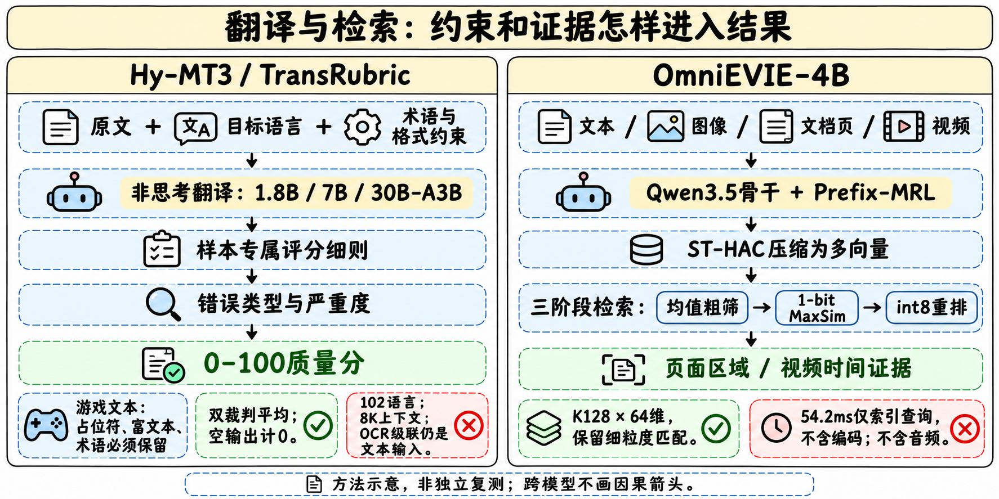
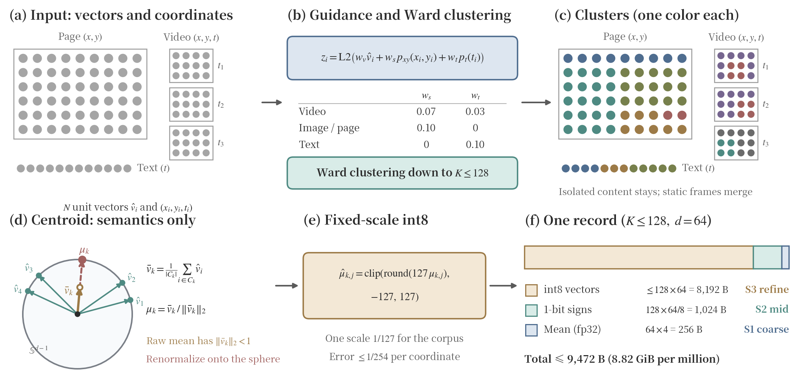
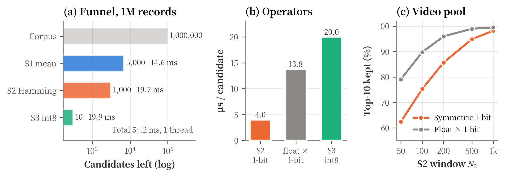

# OmniEVIE-4B — 让检索返回证据的位置，而非只返回文档ID

> [!tldr]
> 我的判断：它把多向量表示、压缩索引和定位读出放进同一检索链。对Agent记忆最有用的是“为什么这页/这秒相关”能追到局部证据。MMEB排名是检索量尺，不能写成Agent端到端成功率；毫秒级数字仅指已编码索引的查询。

> [!warning] 资料边界
> 已读官方HF卡、配置、GitHub README及三阶段索引源码，归档官方完整图；报告目前给PDF链接，按约定不抓PDF。训练配方、完整训练数据及独立复测仍不足。日期以可核实官方公开材料为准，未用lastModified作首发。

## 表示、压缩与位置保留

> [!tldr]
> 全序列高维向量与压缩表示是同一模型的不同运行配置，不是不同模型族；压缩后精度与内存需要一起看。

Qwen3.5-4B骨干、实际4.54B参数，周期性full-attention改双向；配置保留linear/full混合层，因此不是把所有层机械替换成全注意力。Prefix-MRL共用一个投影头，可取64/128/256/512/1024/2048维前缀。ST-HAC按时空约束做Ward层次聚类，把文档/视频token合并为至多128个簇，球面重归一化后定标int8；簇位置对应页面框或视频时间，late interaction的argmax可回溯到证据。学习到的query saliency gate让有信息的query token权重更高，另有噪声底修正，不能把所有token匹配等价相加。

| 配置 | 官方索引占用 | 含义与边界 |
|---|---|---|
|Full d2048|完整序列多向量|精度上界，非压缩索引内存|
|K128×64D int8|≤9472 bytes/record，8.82GiB/百万|记录布局上界含附加结构；ViDoRe实测表7.87GiB/百万页与此口径不同|
|K32×64D int8|2.15GiB/百万|更省空间，nDCG下降|
|模态|文本、图像、视觉文档、原生视频|不含音频；Agent/Tool/GUI/Memory为检索任务类别|

## 索引源码的实际查询顺序

> [!tldr]
> 先粗筛候选，再对候选精算；“百万库54.2ms”不能包含视频解码、GPU编码或离线建库。

`ThreeStageIndex.search`先按modality或显式candidate限制候选池。第一阶段归一化均值向量点积取N1=5000；第二阶段对符号码做Hamming MaxSim，取N2=1000；第三阶段在int8簇向量上计算每个query token的最佳相似度，再加saliency权重。源码的噪声修正为 \(b(s)=s+2.5\max(s-0.38,0)\)，最终求 \(\sum_i w_i b(\max_j q_i^Td_j)\)。这是当前实现的读出，不是凭空推导训练loss。

源码先过滤零向量、检查每文档1–128向量、拒绝重复doc_id；分块重排避免一次展开全部候选。保存文件包含ids、模态、均值、codes与lengths，load使用weights_only。query_gate另存权重；仅部署backbone会漏掉完整检索契约。该源码本次仅阅读，没有执行。

## 精度、定位与效率

> [!tldr]
> Full的非音频榜首不能掩盖视觉、视频或GUI/Memory子项不全面领先。用压缩省下的字节数应和检索退化同表呈现。

| 模型 / 配置 | MMEB-V3 190任务 | Text | Agent | MMEB-V2 78任务 | ViDoReV3 nDCG@10 |
|---|---:|---:|---:|---:|---:|
|OmniEVIE Full d2048|60.68|52.97|54.14|78.56|64.34|
|OmniEVIE K128 int8 32帧|60.06|51.77|54.03|77.96|62.96|
|OmniEVIE K128 int8 8帧|59.76|51.77|54.03|77.24|62.96|
|OmniEVIE K32 int8|未列|未列|未列|未列|61.16|
|WeMM-Embedding9B|59.33|48.76|50.10|80.58|未列|
|Qwen3VL-Embedding8B|53.50|42.50|38.40|77.82|59.00|

Full的GUI42.00、Memory37.60，低于WeMM9B的43.33/38.65；MMEB-V2图像/视频也非最强。官方截图称非音频模型第1，但全190任务总榜为第2，压缩第4；必须保留排除音频条件。Full→K128在MMEB-V3下降0.62点，在ViDoRe下降1.38点，K32再降1.80点。

| 索引查询单线程CPU ms | 10万 | 100万 | 500万 |
|---|---:|---:|---:|
|完整int8 MaxSim|1657|12781|63892|
|精确单向量d2048|34.6|331.0|1666|
|三阶段N1=5000,N2=1000|41.9|54.2|120.2|

100万下三阶段14.6+19.7+19.9=54.2ms，约236倍于该完整int8基线；10万下仍慢于单向量d2048，不能声称所有规模全面更快。QVHighlights val1083query：peak-in-segment78.0%、span intersection94.3%、平均span占18%，这三者量尺不同，94.3%不是定位IoU或答案正确率。

## 对Agent记忆的判断

> [!insight]
> 可把检索训练目标从“返回正确文件”升级到“返回正确版本、正确页区域/视频时间，并在后续回答使用这段证据”。先冻结语料、索引字节预算、编码与查询延迟分账，再做单向量/Full/K128/K32比较；用目标不存在、跨页近重复、同商品不同SKU和视频短暂动作检验压缩是否丢关键证据。训练RL前先验证定位真的被模型使用，不能用argmax可解释性代替因果证据。

目前没有独立复现这组CPU数字，也未验证新业务数据、索引更新代价、端到端并发和不同机器峰值内存。报告PDF未读不冒充完整论文精读。

## 官方来源与关联资料

- [omni-README.md](https://huggingface.co/tencent/OmniEVIE-4B/resolve/main/README.md)
- [omni-github-README.md](https://raw.githubusercontent.com/Tencent/OmniEVIE/main/README.md)
- [omni-index.py](https://raw.githubusercontent.com/Tencent/OmniEVIE/main/omnievie/index.py)

> 📊 中文Poster：[[Topics/13_base_model/Tencent_Hunyuan/Variants/261124_OmniEVIE/omnievie_poster_zh.html|中文Poster]]

## 官方原图与机制对照

