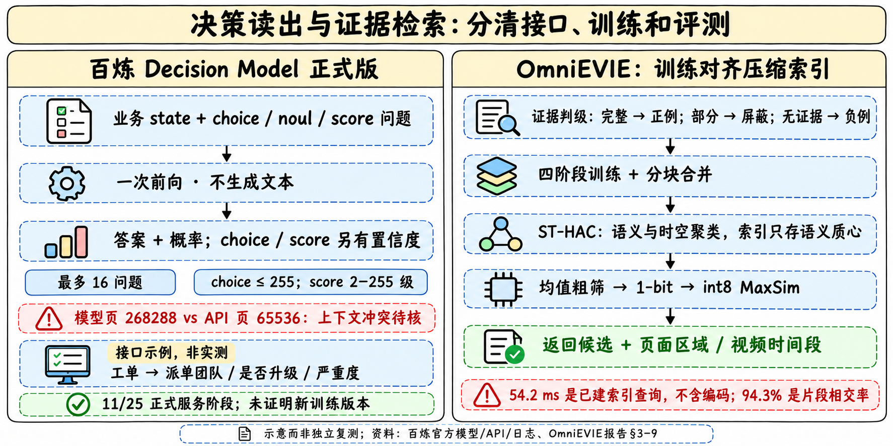

# OmniEVIE 报告补全 — 让训练直接看到将来写入索引的向量

> [!tldr]
> 我的判断：完整报告新增的核心证据是“负例证据分级→多阶段训练→按部署形态聚类训练→分块合并→查询侧读出”的闭环，不是简单把Qwen3.5输出降维。真正应迁移到Agent Training的是false negative纠正和基线胜过教师时关闭蒸馏的样本策略。

> [!warning] 本次补的是报告，不是新模型
> 家族官方开源提交仍为11/24 04:23:48UTC→北京12:23；本轮取得arXiv:2611.32203v1，提交11/24 08:49:38UTC→北京16:49。保留首次模型日期11/24，不因lastModified、SentenceTransformers接入或新报告再增事件。完整HTML已读，PDF未抓；关闭“仅PDF、训练recipe不可读”的部分缺口，完整训练配置/独立复现仍不足。

## 训练数据：哪些候选不该当负例

约2M样本、57公共数据集；图像检索25.8%、QA/grounding24.9%、文本15.6%、分类13.5%、视频13.0%、工具5.2%、文档2.0%。样本统一为instruction、query、positive、显式hard negatives、教师分布；一batch一任务。分类候选是类别名，MCQ候选是选项，工具检索候选是工具文档/skill说明，不等于执行工具成功率。

文档池775635个query、1551270个原候选负例，经VLM证据判级：完整答案的候选提升为正例，175137个query获得额外positive；partial只提供线索，屏蔽损失分母；no evidence才留负例。原表将full+partial合计223877（14.4%）从负例中移除，留下1327393；不能写成14.4%都变正例。多个正例各按1/n_positive加权。视频还有正放/反放同帧、同长视频off-window负例，让时间顺序有训练梯度。

动态五类样本：基线与教师都正确且margin大则降采样；边界小margin保留；教师能而基线不能则加权；基线胜教师或双方都错则用gold、关闭蒸馏。若某任务基线胜教师的样本多于相反情况，整个任务关蒸馏。不同任务用embedding、cross-encoder、discriminative三类教师，不把一位老师强制用于所有损失。§3.1称GUI/memory held-out zero-shot，但Table5列stage3含interfaces/memory，存在范围表述不一致，具体训练/评测重叠需数据清单澄清。

## 四阶段、压缩训练和蒸馏

| 阶段 | 新内容 | 约束与监督 |
|---|---|---|
| 1 文档 | 双向文档向量+六宽PrefixMRL | EVIE8B listwise蒸馏、三等级证据、六宽联合 |
| 2 图像/视频 | image/composed/text→image/native video | temporal hard negatives、单向ranking约束、batch内ST-HAC；固定比例回放文档 |
| 3 全任务 | 分类、QA、grounding、长文本、工具 | 五类采样、多教师、投影桥接；一batch一任务，回放旧数据 |
| 4 合并与query score | 四专项delta、gate+noise floor | 只在相应参数块加权，不引入独立通用正代 |

底座4.5B、hidden2560；全注意力改双向，GatedDeltaNet块保持原结构。视频按temporal stride2打包且插秒级timestamp，奇数帧补最后一帧；超预算统一缩小所有帧而非优先丢帧。打乱内容与时标对应会改变表示，独立逐帧编码则正反序相同，视频order测试接近随机。

PrefixMRL是一张2048×2560矩阵，宽度64/128/256/512/1024/2048是同一次forward前d行并重新L2。64维候选在训练时就聚类：K64概率.3、K128概率.7；cluster assignment固定，语义均值与归一化可反传，成员均分centroid梯度。2048分支保持全序列，联合两分支retrieval loss；focal权重gamma1并stopgrad，batch均值归一为1；反向CE系数.5；ordered loss只降低较低score，不让较高score跟随下降。

教师目标混合内部2048分支与外部教师，先在有效候选上标准化再回到internal尺度；低entropy教师蒸馏权重更大，KL+margin。外部4096维教师用无偏置正交初始化bridge对齐，训练后丢弃；不能在推理时把4096维外部教师当必需组件。精确所有loss系数、replay率与各specialist训练步数未完整列齐，recipe解释不等于可逐bit复现。

## 分块合并、gate与ST-HAC

同起点全数据run和相邻stage先按块平均，再把视频、细粒度实体、VQA、tool四个specialist delta加回trunk。块分vision、merger、vocab、llm、head；text/tool的vision/merger系数0。LLM delta保留幅值最大的75%，vision/merger/head不裁剪。二阶推导忽略跨块Hessian，说明共享系数的额外二次损失，不是精确全局最优证明；完整c系数和所有checkpoint还需公开。

query gate257参数，10个domain-free特征（范数、方向偏差、邻近差异、唯一性、模态/位置/长度）经两层SiLU，输出零初始化，从uniform开始；tanh温度.6，归一后权重总和Lq。噪声地板对每token最大相似r算`r+2.5ReLU(r-.38)`，低于.38保留原分数，**不是清零**；高于阈值只放大excess，argmax不变。理论sqrt(2ln128/64)≈.389是随机单位向量启发，不代表每个无关样本严格上界。相关/无关实测均值.694/.393。

Ward在语义+时空码上聚类，video空间.07/时间.03、图像空间.10、文本位置.10；时间频率限[π/4,π]避免远时刻周期绕回。video先按60s、text按1024token分段，再聚类centroids至K；位置只决定分组，写盘只保留归一化语义均值。fixed-scale int8为round(127μ)，共享1/127，单坐标量化误差≤1/254。K128,d64向量8192B、FP32mean256B、可选sign1024B：两级≤8448B/7.87GiB每百万，三级≤9472B/8.82GiB，定位metadata不应被默认为已计全部端到端存储。

## 索引读出与定位

S1归一化mean内积粗筛5000→S2对称1-bit XOR/popcount MaxSim保留1000→S3 int8 weighted MaxSim。只编码query一次，三表征来自同一record，不二次前向读取k个媒体。随机旋转下sign/cosine期望关系的推导，报告明确实际取原坐标sign；因此具体top10保留率才是部署证据，不应宣称任意数据严格排序不变。

页面返回命中centroid成员patch的最小矩形，只有面积≤5%page的cluster用于定位；视频每窗口每querytoken都保留越过noise floor的证据热度，合并在同一时间轴，峰值点和≥峰值80%的连通段作为输出。排名仍用全局MaxSim；定位heat与排名分数不是同一个量。

## 完整关键结果、消融与边界

| 代表量尺 | 原表结果与条件 |
|---|---|
| MMEBV3 190tasks | 全序列2048:60.68；K128d64int8:60.06；8frames:59.76；Text51.77、Agent54.03、Tool58.84 |
| MMEBV2 78tasks | 压缩77.96，低于WeMM9B80.58；image78.09 vs81.87、video69.62 vs74.31；VisDoc84.02 |
| ViDoReV3 | full2048 64.34；full64 63.09；K128d64 62.96；K32d64 61.16。压缩对full2048损失1.38，对full64损失.13 |
| 同payload4096B | K64d64 62.47 > K32d128 61.82；索引另加mean后字节4352 vs4608并非完全相同 |
| 视频四集均分/order | native78.74/75.63%；逐帧71.13/51.17%；是检索与顺序判断非Agent任务完成率 |
| Gate/地板 | uniformV3 59.71、Agent52.99；gate59.85/53.35；final60.06/54.03 |
| Specialist合并 | Agent52.34→52.83但VisDoc83.98→83.66；分块再比共享Agent52.72→52.94但VisDoc83.84→83.62 |
| 压缩对照 | grid56.50、random60.41、STHAC62.96；去空间项62.90、rawmean63.00，微小差异不能夸成必然全面提高 |
| Int8 | fixed62.96 vsFP16centroid62.99；错误丢scale57.82；corpus-scale62.97但新增数据需rescan |
| 百万singleCPUthread | S1/2/3 14.6/19.7/19.9=54.2ms，fullint8 12781ms；约236×，不是GPU端到端吞吐 |
| 5M/长query | 5M120.2ms；长query150–500+token439.9ms，图像/图文90–270token156.2ms；54.2不普适 |
| S2窗口代价 | N2=200为38.4ms但video nDCG下降3.09，top10保留85.7%；N2=1000为54.2ms、98.2% |
| 视频定位1083query | 峰值落label78.0%、span相交94.3%；随机同长span44.9%、随机点24.0%；平均span27.7s，约视频18% |

定位94.3%只要相交即计，不能写成94.3%准确边界或IoU≥.5。例150s视频label66–90、预测75–94、峰77，仍漏起始9秒且晚4秒。短clip稀疏采样经stride2可能丢动作。GUI、memory、reasoning retrieval仍薄弱；内部业务Top1场景汇总有finance76.3与Qwen8B并列，不是所有baseline每场景都胜，完整业务数据/样本量未公开。

## SentenceTransformers接入与复现边界

新卡支持MultiVectorEncoder、SentenceTransformers≥6.3、Transformers≥5.13.1，标准module无需remote code，输出**未压缩**token vectors与PrefixMRL；官方omnievie包才含STHAC、gate/noisefloor、三阶段索引和localization。两条runtime不可在性能声明中互换。卡建议batch1避免左padding扰动Qwen3.5 linear-attention；直接改batch可能影响参考嵌入。没有实际跑模型、索引或本地Bench，源码静态阅读不算复测。

> [!insight]
> 对Agent Training：先定义“完整/部分/无证据”的可核查标签，修复teacher误负例，再做采样与蒸馏；训练输出要经过部署时同一种压缩/读出。后续实验固定byte、CPU预算、候选窗口、framecap，并分别报告retention、ranking与定位，不把检索的Agent subgroup直接当端到端Agent能力。

## 来源与关联

- [[OmniEVIE-4B|原模型卡笔记]]；原笔记的“报告仅PDF”保留为11/25历史状态，本次解除该部分限制。
- [[src/official_tables_20261126|完整报告全部表格]]；原始report HTML和全部官方图在src/与src/assets/。
- [Tech Report HTML](https://arxiv.org/html/2611.32203v1)、[首版记录](https://arxiv.org/abs/2611.32203)、[HF Model Card](https://huggingface.co/tencent/OmniEVIE-4B)、[官方源码](https://github.com/Tencent/OmniEVIE)。

> 📊 相关可视化: [[omnievie_report_poster_zh.html|中文Poster]]
