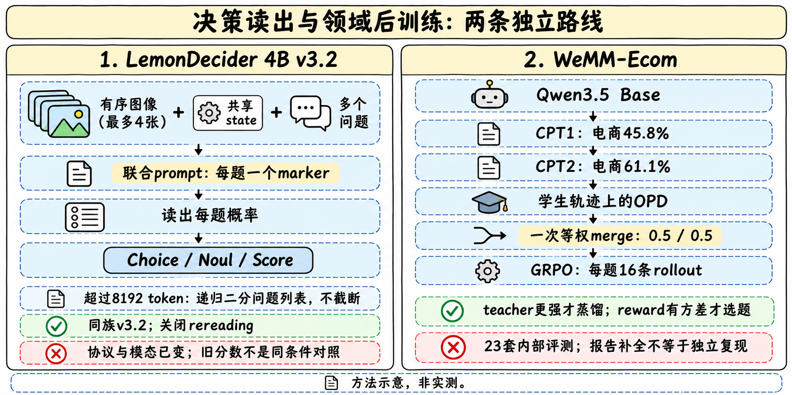
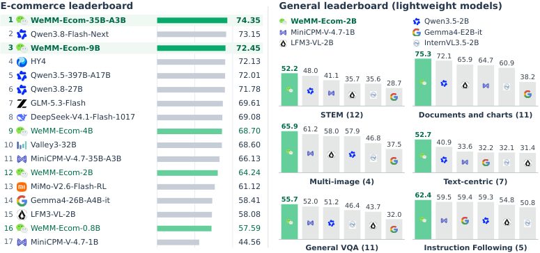

# WeMM-Ecom技术报告补全 — 领域数据、on-policy蒸馏与可验证RL

> [!tldr]
> 我的判断：这份报告补上了昨日模型卡缺失的训练主链：两阶段领域比例递增CPT → 混合思考OPD → 与Qwen后训练权重等权合并一次 → GRPO。最值得研究的是“先找teacher真正更强/学生reward有方差的提示”，以及显式教会模型拒绝不存在的对象，而非把领域数据越堆越多。

> [!warning] 本次是资料补全
> arXiv v1 2026-11-23 13:22:22 UTC（北京21:22）公开；11/25本轮首次取得完整HTML。它支持原11/23同族日期，不能把报告发现日写成新模型。已读正文、附录训练与评测协议，关闭“独立报告尚未取得”子缺口；23项内部评测数据、全部原始run和独立复现仍未公开，不宣称所有技术缺口关闭。PDF仅保留官方链接。

## 数据构建和CPT

> [!tldr]
> 从商品证据到具体SKU与规则判断，监督单位是可追溯实体，不能只靠图片级描述覆盖业务约束。

五个尺寸初始化对应Qwen3.5 Base，全参数WeChat-YATT优化。五电商域、七通用域按主要监督目标互斥计数；同一条多图不重复计样本。电商包括属性/规格/商品定位、信息审计、SPU/SKU检索、领域QA、内容生成；通用包含图文视频、OCR文档图表、grounding、指令/推理、STEM、世界知识与纯文本。所有阶段保留通用数据。

| 阶段 | token预算 | 电商占比 | 序列长度 | 优化 |
|---|---:|---:|---:|---|
|CPT1|370.3B（图精确370.32B）|45.8%|16384|AdamW+Muon|
|CPT2|76.7B（图精确76.66B）|61.1%|32768|AdamW+Muon|
|OPD|0.6B|混合模式|32768|AdamW，lr1e-6|
|GRPO|0.2B|混合模式|65536|AdamW，lr1e-6|

领域池内审计6.4→18.0%、QA24.7→31.4%、感知37.5→23.6%；这些是池内比例，不能误当全部token比例。通用池OCR文档图表13.7→23.8%、STEM2.9→19.0%。按域验证loss调整混合。CPT损失用每样本 \(N_i^{-1/2}\) 加权token和、分母 \(\sum_i\sqrt{N_i}\)，在纯token平均与等样本平均之间平衡长回答。

质量管线包含WeMMEmbedding聚类抽样recaption与去重、PaddleOCR线索、Qwen122B生成STEM推理并用35B检查答案、丢弃截断/坏格式；商品文章先双分类器筛查，再122B过滤广告并抽事实、MinHash去重。每来源按token预算比例降采样，而非大来源挤掉小来源。不存在目标必须明确拒绝，不得幻觉出框。

## OPD、merge与GRPO

> [!tldr]
> 蒸馏打分发生在学生自己到达的prefix；一次0.5/0.5权重合并在OPD后、RL前，不是每步EMA或输出投票。

499998条OPD提示：teacher/student每题各采8次，仅留teacher均分严格更高的题。0.8/2B由WeMMEcom9B教，4B由35BA3B教，9B和35BA3B由Qwen3.5-122BA10B教。学生生成token的信号为 \(a^{KD}_{i,t}=\log\pi_T(y_{i,t}|h)-\log\pi_{old}(y_{i,t}|h)\)，固定prefix下其负期望对应reverseKL；更新用importance ratio和[0.8,1.2]clip，不是简单用teacher最终答案做离线SFT。每题实际OPD采2条，T1/top_p1，max生成24576、总窗32768，无额外reference penalty、蒸馏权重1。

merge只对vision/language参数与对应Qwen3.5后训练checkpoint等权插值；RL actor/reference都从此点初始化。30976条RL提示从merge模型8次thinking候选中筛选：reward方差&gt;0、均分≤0.95，数学逻辑还要均分&gt;0。正式每题G16、T1/top_p0.9，weight_decay0.01，全部同组同模式。思考/非思考约4:1，用promptID确定性hash；OPD400229条thinking（80.05%），RL24823（80.14%）。

组内标准差用Bessel修正、ε1e-4；全同reward组advantage0。task-specific verifier对检测IoU/类别、最终答案、指令约束等给奖；指令完全满足1，部分满足0.49×平均满足率。格式错或生成碰cap未完成→task reward0；thinking必须正确reasoning块+非空答案。verifier组故障时遮掉task reward，仅referenceKL，不能把评测故障当普通零分负例。

## 评测规模与结果的限制

> [!tldr]
> 28套中23套内部、5套公开；207117例是总样本，不是独立公开题量。八场景等权/子指标归一化决定总分，不能从组均值反推每任务都提高。

| 场景 | 样本 | 核心 |
|---|---:|---|
|Product OCR|19962|包装文字与规格|
|Grounding六项|11939|商品/品牌/资质/图表/尺寸/直播|
|Knowledge两项|4598|商品品牌知识|
|Attributes四项|26676|属性与选项|
|Retrieval三项|21584|region/SPU/SKU匹配|
|Moderation三项|6443|规则审核与图标题一致性|
|Reasoning四项|3500|表格约束程序求真值|
|五公开集|112415|ShoppingMMLU、ChineseEcomQA、RAIR、EcomMMMU、IndustryBenchMIPU|

产品ID、图像精确hash、感知hash与embedding相似度共同防跨分割重复。评测默认max生成65536，OmniDocBench greedy32768；不同任务采样/惩罚不同，Qwen3-30BA3B-Instruct2507用于语义判分。完整原表和全部行另存，不将内部题面搬入其他训练集。

35BA3B非思考领域总分74.4，对手Qwen3.8FlashNext73.2；dense模型按思考/非思考排列：9B72.5/72.1、4B68.7/68.7、2B64.2/63.3、0.8B57.6/56.7。不要把这个顺序倒写。卡片已有某检索组非思考78.3高于思考70.3；也应保留。论文与模型卡数据一致性按具体分组核验，不用跨组最大值替换。训练recipe现在可读，但业务数据、完整rawrun/误差、严密消融和独立复现仍缺。

## 对Agent训练的可操作判断

> [!insight]
> 可冻结一批独立业务材料，以teacher-student差与student reward方差选题，比较随机、难度、teacher优势、有效方差四种选择，保持总token预算相同。再单独消融OPD、一次merge和RL，分开测通用能力恢复与领域能力。必须保留无目标、错误格式、截断、verifier故障等类型，避免把“容易被裁判打高分”当真正学习价值。

报告发现修复了资料缺失，不证明昨日所有结论已经被独立验证，也不能把该公开评测题面/逐题答案拿来生产训练数据。

## 官方来源与关联资料

- [ecom-report.html](https://arxiv.org/html/2611.30662)
- [ecom-abstract.html](https://arxiv.org/abs/2611.30662)

> 📊 中文Poster：[[Topics/13_base_model/Tencent_Hunyuan/Variants/261123_WeMM_Ecom/wemm_ecom_report_poster_zh.html|中文Poster]]

## 官方原图与机制对照

