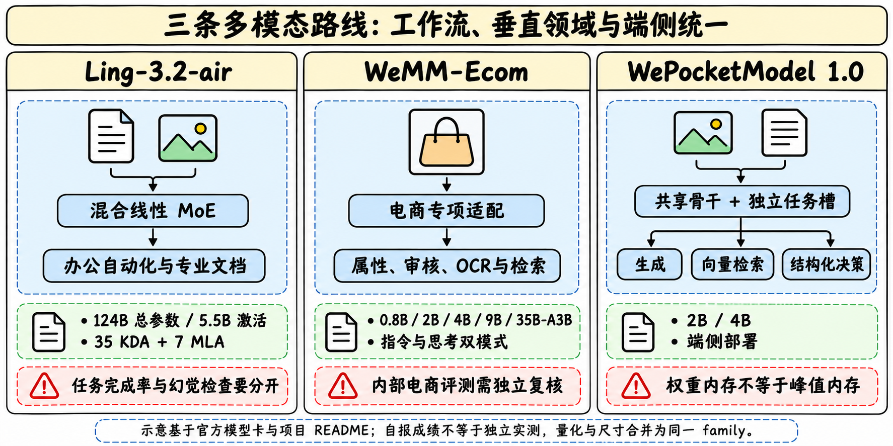
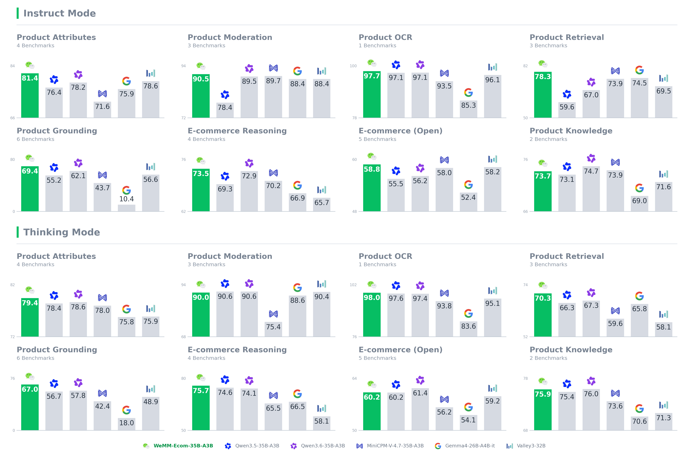
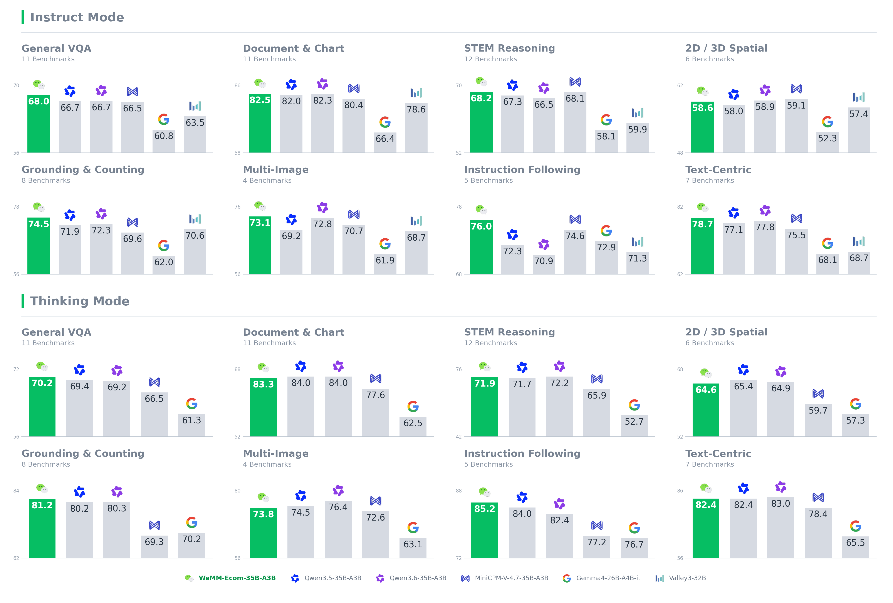

# WeMM-Ecom — 电商内容理解的一族尺寸与双思考模式

> [!tldr]
> 我的判断：这次是基于Qwen3.5的电商专项family，价值在细粒度属性、审核、OCR、匹配与定位的领域适配。平均分领先不代表每一项领先，thinking也不是每项更好。0.8B到35B-A3B及三类量化必须放同一节点。

> [!warning] 日期与报告缺口
> 本轮首次观察到20个官方仓库；11/23官方HF publish事件可举证4B/2B/0.8B GPTQ同族公开，故暂以11/23为当前可核实family公开日；更早发布公告未找到，不用11月建库或lastModified冒充首发。保存活动页、五份BF16卡/配置、30张完整官方成绩图。模型卡Technical Report按钮仍指向模型页、BibTeX url为空，GitHub README404；未取得独立技术报告或训练源码，不编造数据配比/RL/蒸馏算法。

## Family与结构

> [!tldr]
> 五尺寸同族、指令与思考共checkpoint；262144位置上限不等于每个服务启动时都启用该长度。

| 尺寸 | 语言骨干层 / hidden | 结构 | 配置最大位置 |
|---|---|---|---:|
|0.8B|24 / 1024|dense Qwen3.5|262144|
|2B|24 / 2048|dense|262144|
|4B|32 / 2560|dense|262144|
|9B|32 / 4096|dense|262144|
|35B-A3B|40 / 2048|256路由专家、top8，约3B激活|262144|

BF16/FP8/GPTQ/GGUF是checkpoint格式，不能把打包存储元素当实际参数或训练代际。视觉/语言总参数统计与简称有舍入，显存还含全权重、KV和视觉activations。35B卡声明text/image/multi-image/video；视频16帧只是QuickStart示例，不等于视频benchmark固定设置。

## 领域任务与全部分组

> [!tldr]
> 电商28个benchmark分八组，通用64个分八组。汇总数不能代替内部题目、样本和逐项原表。

| 电商组 | benchmark数 | 35B指令 | 35B思考 |
|---|---:|---:|---:|
|Product Attributes|4|81.4|79.4|
|Product Moderation|3|90.5|90.0|
|Product OCR|1|97.7|98.0|
|Product Retrieval|3|78.3|70.3|
|Product Grounding|6|69.4|67.0|
|E-commerce Reasoning|4|73.5|75.7|
|E-commerce Open|5|58.8|60.2|
|Product Knowledge|2|73.7|75.9|

这是我按官方图转录的分组均分；完整逐benchmark及比较模型见原图，不能把分组不加权均值冒充28题均值。指令检索78.3→思考70.3和属性81.4→79.4说明更多思考不保证结构任务增益；思考审核90.0低于部分基线90.6。Product Knowledge指令73.7低于Qwen3.6的74.7，保留反例。

| 通用组 | benchmark数 | 指令 | 思考 |
|---|---:|---:|---:|
|General VQA|11|68.0|70.2|
|Document & Chart|11|82.5|83.3|
|STEM|12|68.2|71.9|
|2D/3D Spatial|6|58.6|64.6|
|Grounding & Counting|8|74.5|81.2|
|Multi-Image|8|73.1|73.8|
|Instruction Following|1|76.0|85.2|
|Text-Centric|7|78.7|82.4|

思考Document83.3低于两Qwen基线84.0，空间64.6低于65.4/64.9，多图73.8低于74.5/76.4。卡称电商平均比Qwen3.5高3.92、Qwen3.6高3.36、MiniCPM-V4.7高8.22；通用比Qwen3.5高0.17。缺统计误差、统一harness、内部数据与公开集权重，0.17不能称稳定显著领先。

## 部署、模式与预算

> [!tldr]
> 65,536是评测生成上限；QuickStart4,096和服务32,768上下文是示例。模式、采样和解析都要显式锁定。

默认thinking开启，通过enable_thinking选择；指令通用temperature0.7/top_p0.8/top_k20，思考通用1.0/0.95/20。结构指令presence_penalty0，普通指令1.5；推理指令改1.0/1.0/top_k40/presence2；思考OCR/实体/SKU为presence2/repetition1.05，其余重复惩罚1.0。API额外参数与Transformers generate支持面不同，不能直接照抄所有字段。

原卡推荐Transformers≥5.2、vLLM≥0.31、SGLang≥0.5.15，reasoning parser qwen3。这些是本轮官方文档条件，不是已经安装验证的环境。原生窗口262144，服务示例32768要容纳输入和输出；65,536输出预算不能在32768服务窗口下直接照用。多轮只保存final answer、媒体顺序与坐标格式都应固定。工具例程未执行。

## 研究判断、缺口与来源

> [!insight]
> 领域适配首先应检查模式选择与结构任务收益，而不是只追一个全量均分。对电商Agent，可先用模型抽取与定位，再用业务校验器核验商品、SKU和终态。

建议固定五尺寸的输入分辨率、帧采样、输出token和同harness，比较指令/思考对属性、匹配与推理的影响；分离真实业务分布、公开bench和内部集合，并记录同商品/店铺泄漏。量化模型须单独复测坐标、OCR、schema和延迟。现有材料无训练token、领域/通用配比、SFT/RL顺序和消融；不以“专项适配”推出未披露的训练算法。

- [官方35B卡](https://huggingface.co/tencent/WeMM-Ecom-35B-A3B)、[9B卡](https://huggingface.co/tencent/WeMM-Ecom-9B)、[官方Collection](https://huggingface.co/collections/tencent/wemm-ecom)。
- [官方HF活动](https://huggingface.co/organizations/tencent/activity/all)；GitHub与独立报告访问缺口保留。
- [[WePocketModel-1.0]]、[[Qwen3.5]]：共享骨干与领域适配的不同路线。

> 📊 相关可视化: [[wemm_ecom_poster_zh.html]]

> [!update] 2026-11-25研读补充
> [[Topics/13_base_model/Tencent_Hunyuan/Variants/261123_WeMM_Ecom/WeMM-Ecom-Report|WeMM-Ecom · 技术报告补全]]：本次来源和旧结论的差异请以这份新增笔记为准；旧记录按历史保留。
