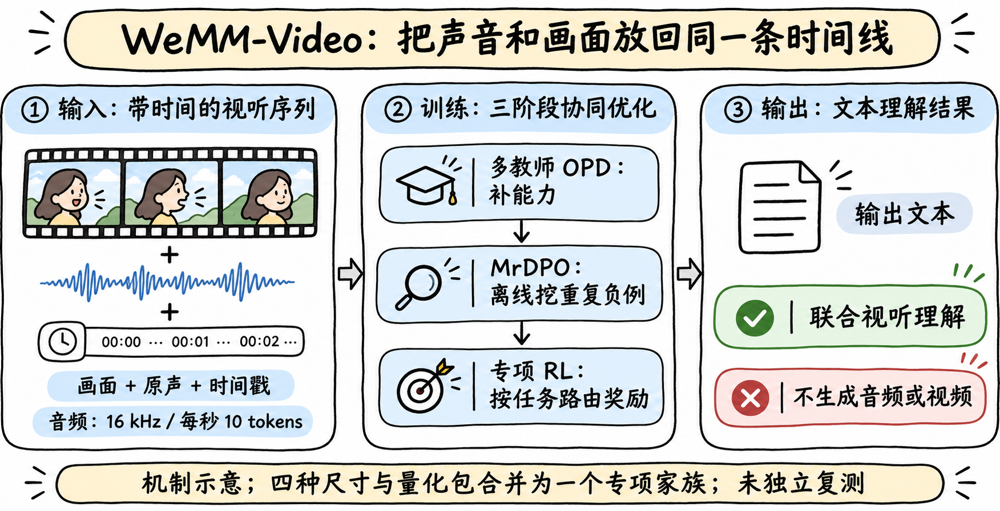
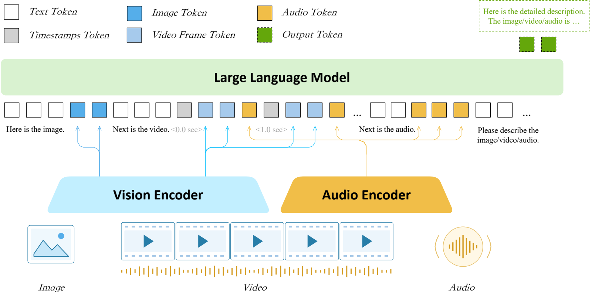
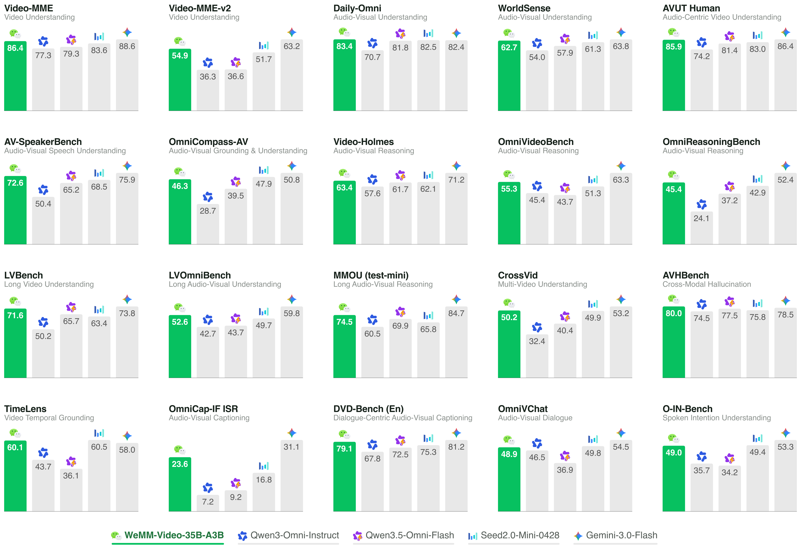
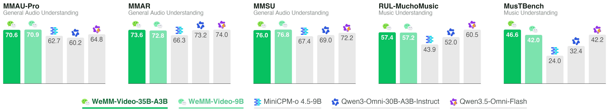

> [!tldr]
> WeMM-Video把声音和画面按时间交错输入Qwen视觉语言骨干，再用多教师蒸馏、反重复偏好优化和专项RL补齐视听推理。贡献更适合表述为联合视听专项增强；不能从“120+基准”推导所有模态、所有任务全面领先。

> [!warning] 日期与阅读范围
> arXiv v1首次提交为2026-11-19 16:58:15 UTC，即北京11/20 00:58:15。HF11/20开放四尺寸及量化包，合并为一个支线，不新增20个正代。已读报告正文、全部七张结果表、四份模型卡/配置、官方README与运行补丁说明；未下载权重、未执行自定义代码、未独立复测。训练总量给出，逐阶段token/优化器/学习率/预算和完整消融尚未披露。

## 定位与模型家族

> [!tldr]
> 2B/4B/9B为稠密骨干，35B-A3B为MoE；这些是型号口径，不等于含音频模块后的全部权重数量。

模型接受文本、图片、音频、视频，输出文本。中文/英文是重点；Instruct与Thinking为同权重两种模板模式，默认不思考。视频可保留原声，而音频理解不代表能生成语音。报告说已用于微信直播电商、短剧与交互视频，属于提供方部署声明，缺真实生产误差分布。

| 版本 | 继承骨干 | BF16 HF参数总量（静态元数据） |
|---|---|---|
|2B|Qwen3.5-2B|见对应配置/元数据，不能用型号替代|
|4B|Qwen3.5-4B|同上|
|9B|Qwen3.5-9B|同上|
|35B-A3B|Qwen3.6-35B-A3B|约36.18B含附加模块；3B为激活口径|

四型均有BF16、FP8 Block128、AWQ W4A16、GGUF Q4_K_M、NVFP4 W4A16。精度、大小、内核支持变化不自动证明重新训练；量化效果要单独比较。35BA3B的BF16文件约67.39GiB，不能把3B激活当3B驻留显存。

## 架构与时间对齐

> [!tldr]
> 音频以16kHz输入、30秒分块，经Whisper与窗口Q-Former压到每秒10个token；视频帧与音频token按时间顺序交错，并附文本时间戳。

音频encoder初始化自Qwen2.5-Omni，视觉encoder/投影继承各自骨干。0.1秒窗口映射一个音频token，在控制音频长度的同时保留局部时序；仍需要确认时间戳、帧采样和声音是否来自同一时段。仅有画面或把音轨错配，都可能改变任务本身。

35BA3B配置给40层、hidden2048、256专家选8、每四层一次全注意力，其余线性注意力，视觉27层hidden1152；text_config.max_position_embeddings=262144。这个字段是配置上限，不是任意视频时长下已验证的有效推理长度。官方默认服务max_model_len8192、2fps/4–16帧也是示例资源配置，不能互相替代。

## 数据与三阶段预训练

> [!tldr]
> 约1.2T tokens中联合视听45.4%，caption37.7%。总量与比例公开，并未公开完整数据清单、许可证去重账本和各阶段训练配方。

第一阶段只训练音频对齐Q-Former，冻结LLM与模态encoder，用音频文本对建立ASR/声音描述能力。第二阶段冻结视觉encoder，放开其他参数，以多模态混合数据注入知识；第三阶段保持该可训练范围，扩展上下文，用长音频、长视频、多视频训练长程依赖。

caption构造同时包含高动作密度视觉描述和电影、访谈、短剧、电商等联合视听描述；官方称有评分、语义去重和毒性过滤。另有跨媒体视频比较、音画匹配、商品与广告一致性，以及带推理轨迹的STEM/VL和原生视听QA。没有给具体教师名单、逐类样本量和独立污染审计，不能声称复现了同一训练集。

## 后训练为何分三步

> [!tldr]
> 三步分别解决能力保持、重复崩溃和难任务奖励；它们是有依赖的训练序列，当前没有逐模块消融证明各自贡献大小。

多教师OPD：较强外部教师监督文本/VL，同族教师保持音频/视听能力，跨模态文本→音频蒸馏帮助语音指令遵循。保留能力与引入能力来自不同监督源，不能简化为只用一个大教师。

反重复MrDPO：预训练和OPD后仍有稀有无限重复，离线挖视频/音频/VL的困难负例。每轮只更新LoRA，轮间合并并重新初始化，以减少多轮更新不稳定。这里的离线负例挖掘并不等于在线rollout RL。

专项RL：先离线评测剔除已稳定解决样本；确定性任务用规则奖励，开放任务用rubric与教师一致性，动态router按任务选奖励。Instruct/Thinking随机采样共同优化，后续加长序列与增帧。未给算法超参、reward权重和完整训练曲线，不能自动称GRPO或声称某个奖励独立带来多少提升。

## 结果、量尺与反例

> [!tldr]
> 视频比较区分带原声与静音，音频用Instruct、图文用Thinking；裁判与指标不同，不对全部表直接算一个总平均。

报告比较Gemini3Flash medium、Seed2Mini0428 medium及Qwen3.5OmniFlash；35B给两模式，小尺寸视频只给Thinking。基线混合官方成绩与作者复测，未公开本轮可核验的逐run版本/随机种子/置信区间，不能视为统一独立评测。

35B静音Video-MME-v2：Instruct39.8→Thinking45.2，但骨干Qwen3.6为45.3。VSI-Bench从62.7降57.2、EgoSchema76.0降74.2，说明更长思考不是逐项稳定收益；图像MMMU-Pro72.9低于骨干75.3，语言GPQA83.8低于86.0。保留这些反例才能判断多模态扩展是否损伤原有能力。

视听video-SALMONN2为总错误率，越低越好；ASR用WER/CER；HarmonySet为GPT4o裁判分；O-IN-Bench用GPT6Luna，其余部分交互任务用GPT6.1Sol；DVD-Bench由Qwen3-235B判说话人准确率。OmniCap-IF为CSR/ISR，不能把两个值相加或当成同一正确率。所有公开表完整保存在下面，保留原多层表头顺序与注释，复杂列分组以原报告HTML为准。

### 官方表 1

| Benchmark 1 | Gemini-3.0- | Seed2.0-Mini- | Qwen3.5-Omni- | WeMM-Video-35B-A3B |  |
| --- | --- | --- | --- | --- | --- |
| Flash | 0428 | Flash | (Instruct) | (Thinking) |  |
| General Audio-Visual Understanding |  |  |  |  |  |
| Video-MME w/ audio | 88.6 | 83.6 | 79.3 | 84.2 | 86.4 |
| Video-MME-v2 w/ audio | 63.2 | 51.7 | 36.6 | 47.5 | 54.9 |
| Daily-Omni | 82.4 | 82.5 | 81.8 | 81.5 | 83.4 |
| WorldSense | 63.8 | 61.3 | 57.9 | 59.6 | 62.7 |
| AVUT Human | 86.4 | 83.0 | 81.4 | 83.6 | 85.9 |
| AV-SpeakerBench | 75.9 | 68.5 | 65.2 | 66.5 | 72.6 |
| Video-Holmes | 71.2 | 62.1 | 61.7 | 63.2 | 63.4 |
| OmniVideoBench | 63.3 | 51.3 | 43.7 | 48.6 | 55.3 |
| RivaBench | 72.3 | 68.3 | 68.5 | 67.9 | 70.8 |
| LVOmniBench | 59.8 | 49.7 | 43.7 | 50.3 | 52.6 |
| FutureOmni | 65.3 | 52.2 | 55.4 | 58.4 | 56.2 |
| JointAVBench | 68.4 | 64.7 | 69.0 | 67.4 | 65.9 |
| SciVideoBench | 75.2 | 60.1 | 51.3 | 57.8 | 69.4 |
| MMOU (test-mini) | 84.7 | 65.8 | 69.9 | 71.4 | 74.5 |
| OmniCompass-AV | 50.8 | 47.9 | 39.5 | 41.5 | 46.3 |
| EvaOmni | 66.4 | 54.3 | 30.4 | 48.8 | 57.8 |
| OmniReasoningBench | 52.4 | 42.9 | 37.2 | 44.3 | 45.4 |
| Audio-Visual Hallucination |  |  |  |  |  |
| AVHBench Judgement 2 | 78.5 | 75.8 | 77.5 | 80.3 | 80.0 |
| SVHalluc 3 | 86.4 | 75.4 | 63.6 | 75.3 | 80.3 |
| Video-Music Understanding |  |  |  |  |  |
| MUSIC-AVQA | 76.2 | 74.2 | 82.1 | 79.6 | 79.5 |
| HarmonySet 4 | 5.73 | 5.74 | 5.48 | 5.63 | 5.97 |
| Audio-Visual Interaction 5 |  |  |  |  |  |
| Qualcomm IVD | 72.2 | 70.0 | 66.3 | 70.2 | 72.3 |
| OmniVChat | 54.5 | 49.8 | 36.9 | 44.8 | 48.9 |
| ODU-Bench 6 | 72.2 \| 72.5 | 69.8 \| 73.6 | 64.4 \| 70.4 | 74.2 \| 78.9 | 72.5 \| 77.8 |
| O-IN-Bench | 53.3 | 49.4 | 34.2 | 38.4 | 49.0 |
| SocialOmni 7 | 90.2 \| 79.5 \| 87.9 | 89.1 \| 49.0 \| 90.0 | 87.4 \| 67.0 \| 43.6 | 90.6 \| 43.5 \| 74.8 | 90.5 \| 62.0 \| 85.2 |
| Audio-Visual Captioning 8 |  |  |  |  |  |
| Omni-Cloze | 34.3 | 39.9 | 41.8 | 44.2 | 42.6 |
| video-SALMONN 2 testset 9 | 37.7 | 32.7 | 28.0 | 27.5 | 28.3 |
| UGCVideoCap | 71.0 | 74.8 | 70.5 | 75.1 | 74.9 |
| DVD-Bench (En) 10 | 81.2 | 75.3 | 72.5 | 76.2 | 79.1 |
| OmniCap-IF 11 | 83.2 \| 31.1 | 75.1 \| 16.8 | 65.6 \| 9.2 | 74.8 \| 16.9 | 79.1 \| 23.6 |
| DailyOmni (Caption-Based QA) | 51.8 | 50.9 | 44.0 | 51.9 | 62.2 |
| WorldSense (Caption-Based QA) | 32.4 | 28.5 | 26.0 | 32.3 | 36.6 |

### 官方表 2

| Benchmark 1 | Qwen3-Omni- | MiniCPM-o | WeMM-Video- |  |  |
| --- | --- | --- | --- | --- | --- |
| 30B-A3B-Instruct | 4.5-9B | 2B (Thinking) | 4B (Thinking) | 9B (Thinking) |  |
| General Audio-Visual Understanding |  |  |  |  |  |
| Video-MME w/ audio | 77.3 | 69.2 | 72.4 | 83.9 | 85.1 |
| Video-MME-v2 w/ audio | 36.3 | 28.1 | 37.7 | 48.1 | 51.6 |
| Daily-Omni | 70.7 | 80.2 | 76.5 | 82.5 | 83.6 |
| WorldSense | 54.0 | 55.7 | 52.4 | 60.3 | 63.4 |
| AVUT Human | 74.2 | 78.6 | 80.2 | 84.3 | 85.8 |
| AV-SpeakerBench | 50.4 | 56.7 | 56.2 | 68.6 | 71.1 |
| Video-Holmes | 57.6 | 64.3 | 48.8 | 58.8 | 61.3 |
| OmniVideoBench | 45.4 | 37.2 | 39.2 | 49.7 | 52.8 |
| RivaBench | 69.6 | 68.7 | 63.8 | 69.6 | 70.1 |
| LVOmniBench | 42.7 | 37.0 | 40.2 | 48.1 | 51.0 |
| FutureOmni | 55.1 | 56.1 | 45.2 | 50.9 | 53.7 |
| JointAVBench | 64.6 | 60.0 | 60.3 | 65.1 | 64.6 |
| SciVideoBench | 49.9 | 32.7 | 39.6 | 59.2 | 64.2 |
| MMOU (test-mini) | 60.5 | 40.9 | 45.7 | 63.3 | 71.7 |
| OmniCompass-AV | 28.7 | 21.5 | 29.1 | 40.7 | 42.7 |
| EvaOmni | 26.1 | 21.2 | 32.8 | 46.5 | 50.7 |
| OmniReasoningBench | 24.1 | 16.3 | 27.6 | 39.5 | 43.9 |
| Audio-Visual Hallucination |  |  |  |  |  |
| AVHBench Judgement 2 | 74.5 | 79.2 | 74.3 | 75.4 | 80.0 |
| SVHalluc 3 | 65.2 | 68.9 | 73.9 | 80.2 | 86.8 |
| Video-Music Understanding |  |  |  |  |  |
| MUSIC-AVQA | 71.0 | 71.6 | 75.4 | 78.0 | 79.3 |
| HarmonySet 4 | 5.15 | 5.55 | 6.02 | 5.94 | 5.98 |
| Audio-Visual Interaction 5 |  |  |  |  |  |
| Qualcomm IVD | 64.6 | 43.0 | 62.3 | 69.9 | 70.3 |
| OmniVChat | 46.5 | 30.4 | 33.1 | 44.3 | 49.5 |
| ODU-Bench 6 | 57.9 \| 65.5 | 47.8 \| 58.4 | 56.5 \| 62.1 | 70.2 \| 73.1 | 72.6 \| 75.6 |
| O-IN-Bench | 35.7 | 29.3 | 32.4 | 42.0 | 44.1 |
| SocialOmni 7 | 74.7 \| 58.0 \| 44.5 | 83.9 \| 39.5 \| 67.4 | 82.0 \| 41.0 \| 44.5 | 90.9 \| 57.5 \| 80.3 | 90.6 \| 59.5 \| 84.4 |
| Audio-Visual Captioning 8 |  |  |  |  |  |
| Omni-Cloze | 27.0 | 27.1 | 38.4 | 40.1 | 41.5 |
| video-SALMONN 2 testset 9 | 27.9 | 50.6 | 34.3 | 30.4 | 30.9 |
| UGCVideoCap | 70.8 | 56.9 | 72.2 | 75.1 | 74.4 |
| DVD-Bench (En) 10 | 67.8 | 64.9 | 73.6 | 78.5 | 78.3 |
| OmniCap-IF 11 | 62.7 \| 7.2 | 64.7 \| 9.3 | 63.3 \| 6.8 | 73.2 \| 14.0 | 76.7 \| 20.0 |
| DailyOmni (Caption-Based QA) | 19.4 | 26.6 | 51.1 | 58.6 | 59.7 |
| WorldSense (Caption-Based QA) | 14.6 | 16.6 | 29.6 | 34.6 | 34.1 |

### 官方表 3

| Benchmark 1 | Gemini-3.0- | Seed2.0-Mini- | Qwen3.5-Omni- | Qwen3.6- | WeMM-Video-35B-A3B |  |
| --- | --- | --- | --- | --- | --- | --- |
| Flash | 0428 | Flash | 35B-A3B | (Instruct) | (Thinking) |  |
| General Video Understanding |  |  |  |  |  |  |
| Video-MME | 86.4 | 78.1 | 77.0 | 82.5 | 78.0 | 80.4 |
| Video-MME-v2 | 55.6 | 44.4 | 33.7 | 45.3 | 39.8 | 45.2 |
| MVBench | 70.0 | 73.4 | 70.8 | 74.6 | 72.8 | 73.1 |
| Video-MMMU | 86.9 | 81.0 | 64.0 | 83.7 | 80.8 | 83.6 |
| MME-VideoOCR | 81.5 | 80.5 | 70.5 | 75.8 | 73.3 | 78.4 |
| TempCompass | 88.1 | 85.9 | 78.1 | 83.7 | 82.4 | 84.3 |
| NExT-QA | 83.0 | 83.9 | 84.1 | 84.3 | 85.7 | 84.6 |
| TOMATO | 45.9 | 53.8 | 28.2 | 51.4 | 46.4 | 52.5 |
| Video-IFBench 2 | 72.2 \| 49.5 | 56.5 \| 28.9 | 53.6 \| 26.6 | 51.2 \| 34.1 | 50.8 \| 24.7 | 57.8 \| 31.8 |
| VidHalluc 3 | 80.0 | 76.7 | 76.1 | 84.0 | 80.2 | 84.1 |
| VideoVista | 83.2 | 81.8 | 84.1 | 83.1 | 84.5 | 83.5 |
| MMVU | 77.1 | 70.5 | 62.7 | 74.7 | 68.5 | 74.4 |
| Video-Index | 58.8 | 38.3 | 24.3 | 38.1 | 27.5 | 37.9 |
| Perception Test | 78.9 | 81.1 | 74.1 | 79.8 | 77.9 | 80.4 |
| TimeBlind | 77.9 | 80.6 | 67.8 | 77.0 | 73.8 | 78.0 |
| Video-MME-Logical | 31.5 | 28.9 | 19.7 | 27.5 | 25.1 | 26.0 |
| Long Video Understanding |  |  |  |  |  |  |
| MLVU | 87.9 | 81.6 | 81.9 | 86.2 | 80.8 | 85.3 |
| LVBench | 73.8 | 63.4 | 65.7 | 71.4 | 68.7 | 71.6 |
| LongVideoBench | 77.4 | 74.4 | 66.9 | 76.7 | 74.0 | 76.6 |
| EgoSchema | 64.8 | 78.4 | 70.0 | 77.2 | 76.0 | 74.2 |
| MMBench-Video 4 | 2.56 | 2.48 | 2.06 | 2.49 | 2.43 | 2.50 |
| Fine-grained Perception |  |  |  |  |  |  |
| MotionBench | 65.0 | 68.4 | 61.7 | 66.1 | 67.1 | 65.7 |
| TemporalBench 5 | 50.9 | 44.9 | 30.6 | 43.3 | 39.0 | 45.9 |
| F-16-NBA 6 | 90.1 | 94.8 | 87.3 | 82.8 | 89.0 | 89.9 |
| Temporal Grounding |  |  |  |  |  |  |
| TimeLens-Charades 7 | 58.8 | 56.9 | 40.8 | 47.4 | 54.7 | 54.8 |
| TimeLens-ActivityNet | 47.1 | 56.2 | 30.3 | 53.9 | 58.9 | 56.4 |
| TimeLens-QVHighlights | 68.2 | 68.5 | 37.3 | 66.8 | 68.4 | 69.0 |
| Spatial Understanding |  |  |  |  |  |  |
| PAI-Bench-U | 65.8 | 67.7 | 51.5 | 65.3 | 62.5 | 65.5 |
| MMSI-Video-Bench | 43.2 | 34.1 | 29.5 | 32.7 | 31.1 | 35.6 |
| VSI-Bench | 53.3 | 49.4 | 55.2 | 56.1 | 62.7 | 57.2 |
| Streaming Video Understanding |  |  |  |  |  |  |
| OVO-Bench | 69.3 | 70.6 | 55.7 | 61.0 | 63.1 | 63.9 |
| Multi-Video Understanding |  |  |  |  |  |  |
| CrossVid | 53.2 | 49.9 | 40.4 | 45.2 | 45.0 | 50.2 |

### 官方表 4

| Benchmark 1 | Qwen3-Omni- | Qwen3.5- | MiniCPM-o- | WeMM-Video- |  |  |
| --- | --- | --- | --- | --- | --- | --- |
| 30B-A3B-Instruct | 9B | 4.5-9B | 2B (Thinking) | 4B (Thinking) | 9B (Thinking) |  |
| General Video Understanding |  |  |  |  |  |  |
| Video-MME | 70.5 | 78.4 | 70.4 | 67.6 | 75.7 | 78.5 |
| Video-MME-v2 | 29.7 | 42.4 | 26.8 | 32.8 | 39.5 | 40.6 |
| MVBench | 68.8 | 74.4 | 63.4 | 64.6 | 70.0 | 71.4 |
| Video-MMMU | 54.7 | 78.9 | 52.9 | 65.1 | 79.6 | 79.2 |
| MME-VideoOCR | 67.7 | 75.9 | 55.4 | 67.7 | 75.0 | 77.3 |
| TempCompass | 76.5 | 82.8 | 74.4 | 78.5 | 84.9 | 84.8 |
| NExT-QA | 84.8 | 81.9 | 80.2 | 76.6 | 81.6 | 83.1 |
| TOMATO | 35.2 | 45.0 | 29.4 | 34.4 | 47.9 | 48.5 |
| Video-IFBench 2 | 44.3 \| 18.0 | 56.0 \| 32.2 | 23.2 \| 10.4 | 33.1 \| 13.5 | 48.5 \| 22.2 | 52.8 \| 26.1 |
| VidHalluc 3 | 76.2 | 81.9 | 75.2 | 77.5 | 82.5 | 83.0 |
| VideoVista | 83.7 | 84.7 | 82.5 | 78.8 | 81.2 | 82.2 |
| MMVU | 62.9 | 69.6 | 59.2 | 50.8 | 64.9 | 70.2 |
| Video-Index | 19.6 | 34.2 | 11.7 | 18.3 | 30.5 | 34.6 |
| Perception Test | 75.3 | 77.5 | 67.8 | 71.2 | 76.5 | 78.0 |
| TimeBlind | 66.6 | 76.6 | 60.5 | 67.5 | 75.2 | 76.4 |
| Video-MME-Logical | 15.9 | 24.1 | 14.7 | 18.7 | 21.7 | 21.8 |
| Long Video Understanding |  |  |  |  |  |  |
| MLVU | 75.2 | 84.4 | 76.5 | 74.4 | 80.4 | 82.4 |
| LVBench | 50.2 | 70.0 | 50.9 | 55.8 | 65.3 | 68.2 |
| LongVideoBench | 63.5 | 74.8 | 66.0 | 66.0 | 74.8 | 74.7 |
| EgoSchema | 66.4 | 74.4 | 60.4 | 66.4 | 74.2 | 73.6 |
| MMBench-Video 4 | 2.13 | 2.16 | 2.20 | 2.20 | 2.38 | 2.44 |
| Fine-grained Perception |  |  |  |  |  |  |
| MotionBench | 61.9 | 63.3 | 61.4 | 58.0 | 63.4 | 64.0 |
| TemporalBench 5 | 34.7 | 39.5 | 23.9 | 29.0 | 38.3 | 40.9 |
| F-16-NBA 6 | 74.0 | 75.8 | 77.1 | 61.4 | 87.0 | 88.7 |
| Temporal Grounding |  |  |  |  |  |  |
| TimeLens-Charades 7 | 45.5 | 50.6 | 29.0 | 49.7 | 54.9 | 52.3 |
| TimeLens-ActivityNet | 38.2 | 52.2 | 15.8 | 43.3 | 55.3 | 55.3 |
| TimeLens-QVHighlights | 47.5 | 64.3 | 12.9 | 48.7 | 66.0 | 66.8 |
| Spatial Understanding |  |  |  |  |  |  |
| PAI-Bench-U | 59.2 | 63.4 | 48.4 | 52.9 | 62.7 | 64.8 |
| MMSI-Video-Bench | 29.5 | 31.2 | 27.3 | 26.3 | 32.0 | 32.4 |
| VSI-Bench | 55.7 | 58.3 | 44.0 | 44.1 | 51.1 | 54.5 |
| Streaming Video Understanding |  |  |  |  |  |  |
| OVO-Bench | 60.0 | 60.8 | 56.4 | 57.2 | 61.6 | 63.3 |
| Multi-Video Understanding |  |  |  |  |  |  |
| CrossVid | 32.4 | 37.8 | 33.1 | 31.8 | 39.9 | 45.2 |

### 官方表 5

| Benchmark | Qwen3.5-Omni- | Qwen3-Omni- | MiniCPM-o | WeMM-Video- |  |  |  |
| --- | --- | --- | --- | --- | --- | --- | --- |
| Flash | 30B-A3B-Instruct | 4.5-9B | 2B (Instruct) | 4B (Instruct) | 9B (Instruct) | 35B-A3B (Instruct) |  |
| General Audio Understanding |  |  |  |  |  |  |  |
| MMAU | 80.4 | 77.5 | 76.9 | 72.4 | 75.2 | 77.0 | 78.0 |
| MMAU-Pro | 64.8 | 60.2 | 62.7 | 62.9 | 68.1 | 70.9 | 70.6 |
| MMAR | 74.0 | 73.2 | 66.3 | 56.9 | 67.3 | 72.8 | 73.6 |
| MMSU | 72.2 | 69.0 | 67.4 | 65.6 | 72.6 | 76.8 | 76.0 |
| DCase 2025 AQA | 67.2 | 62.6 | 65.9 | 58.6 | 64.9 | 66.7 | 67.2 |
| Music Understanding |  |  |  |  |  |  |  |
| RUL-MuchoMusic | 60.5 | 52.0 | 43.9 | 46.8 | 55.4 | 57.2 | 57.4 |
| HumMusQA | 69.6 | 65.9 | 56.6 | 55.9 | 66.6 | 65.3 | 70.0 |
| MusTBench | 42.2 | 32.4 | 24.0 | 33.9 | 41.8 | 42.0 | 46.6 |
| Speech Recognition 1 |  |  |  |  |  |  |  |
| GigaSpeech | 9.2 | 8.7 | 10.1 | 9.1 | 8.6 | 8.5 | 8.6 |
| VoxPopuli | 5.7 | 6.4 | 8.5 | 6.7 | 5.7 | 5.6 | 5.7 |
| LibriSpeech 2 | 1.3 \| 2.4 | 1.2 \| 2.5 | 1.4 \| 2.8 | 2.3 \| 4.7 | 1.7 \| 3.5 | 1.5 \| 3.1 | 1.6 \| 3.4 |
| WenetSpeech 3 | 4.4 \| 5.5 | 4.7 \| 5.9 | 5.9 \| 5.7 | 6.4 \| 7.7 | 5.8 \| 6.9 | 5.4 \| 6.8 | 5.7 \| 6.8 |
| Lyrics Recognition 4 |  |  |  |  |  |  |  |
| MIR-1K (vocal) | 4.9 | 5.9 | 25.9 | 9.7 | 8.3 | 8.1 | 7.9 |
| Opencpop | 1.1 | 1.5 | 23.0 | 3.1 | 2.6 | 2.8 | 2.4 |
| Voice Interaction |  |  |  |  |  |  |  |
| VoiceBench | 87.8 | 85.5 | 68.3 | 66.5 | 83.0 | 89.0 | 88.4 |
| IFEval-Audio | 58.2 | 57.9 | 52.1 | 44.3 | 56.1 | 59.6 | 63.6 |
| Speech-IFEval | 88.2 | 77.6 | 64.8 | 94.1 | 91.7 | 95.7 | 96.5 |
| Audio MultiChallenge 5 | 58.2 | 52.2 | 45.4 | 37.7 | 54.9 | 59.2 | 62.0 |

### 官方表 6

| Benchmark | Qwen3.5-Omni- | Qwen3.6- | Qwen3.5- | WeMM-Video- |  |  |  |
| --- | --- | --- | --- | --- | --- | --- | --- |
| Flash | 35B-A3B | 9B | 2B (Thinking) | 4B (Thinking) | 9B (Thinking) | 35B-A3B (Thinking) |  |
| STEM/Puzzle |  |  |  |  |  |  |  |
| MMMU | 76.9 | 81.7 | 78.4 | 61.2 | 78.4 | 78.9 | 81.1 |
| MMMU-Pro | 68.2 | 75.3 | 70.1 | 49.4 | 64.7 | 69.4 | 72.9 |
| MathVision | 65.4 | 80.4 | 78.9 | 49.2 | 73.3 | 76.0 | 79.6 |
| MathVista (mini) | 82.9 | 86.4 | 85.7 | 78.8 | 85.2 | 86.1 | 86.6 |
| DynaMath | 79.3 | 82.8 | 83.6 | 73.4 | 81.8 | 82.2 | 81.5 |
| ZEROBench | 1.0 | 5.6 | 3.0 | 0.4 | 0.8 | 2.0 | 3.8 |
| ZEROBench_sub | 26.0 | 34.4 | 31.1 | 21.0 | 25.8 | 30.5 | 34.1 |
| VisualPuzzles | 44.9 | 58.1 | 55.1 | 39.6 | 53.4 | 56.8 | 60.1 |
| General VQA |  |  |  |  |  |  |  |
| RealWorldQA | 77.5 | 85.3 | 80.3 | 73.6 | 80.1 | 80.3 | 83.4 |
| MMStar | 75.7 | 80.7 | 79.7 | 71.8 | 76.4 | 77.9 | 79.8 |
| MMBench EN-DEV-v1.1 | 88.8 | 92.8 | 90.1 | 83.1 | 88.9 | 89.9 | 90.9 |
| MMBench CN-DEV-v1.1 | 81.7 | 88.9 | 86.7 | 80.1 | 88.2 | 88.9 | 89.2 |
| SimpleVQA | 54.4 | 58.9 | 51.2 | 45.9 | 51.9 | 55.4 | 62.0 |
| WorldVQA | 13.6 | 19.9 | 15.7 | 14.1 | 20.3 | 23.6 | 28.6 |
| Text/Doc |  |  |  |  |  |  |  |
| CharXiv RQ | 64.4 | 78.0 | 73.0 | 62.0 | 70.3 | 73.6 | 75.7 |
| CC-OCR | 80.8 | 81.9 | 79.3 | 79.8 | 82.9 | 84.7 | 84.2 |
| AI2D_TEST | 89.0 | 92.7 | 90.2 | 83.2 | 88.4 | 89.6 | 90.6 |
| MMLongBench-Doc | 53.6 | 61.2 | 57.7 | 42.8 | 55.5 | 56.1 | 60.2 |
| OCRBench | 89.1 | 87.9 | 89.2 | 81.8 | 85.7 | 89.6 | 90.2 |
| DocVQA | 95.3 | 97.3 | 97.2 | 95.1 | 96.5 | 97.5 | 97.5 |
| Spatial |  |  |  |  |  |  |  |
| ERQA | 50.0 | 59.8 | 55.5 | 43.8 | 53.0 | 54.5 | 61.8 |
| RefCOCO (avg) | 92.6 | 92.0 | 89.7 | 63.7 | 86.3 | 89.0 | 89.5 |
| EmbSpatialBench | 82.7 | 84.3 | 83.0 | 79.0 | 83.3 | 82.8 | 83.9 |
| CV-Bench | 86.6 | 87.8 | 87.2 | 84.2 | 88.6 | 88.6 | 89.2 |
| Multi-Image |  |  |  |  |  |  |  |
| MIHBench | 61.8 | 81.3 | 81.8 | 80.8 | 81.5 | 82.9 | 83.1 |
| Counting |  |  |  |  |  |  |  |
| CountBench | 88.2 | 96.3 | 97.2 | 83.9 | 93.3 | 94.3 | 96.3 |
| TallyQA | 81.2 | 79.8 | 79.8 | 78.8 | 80.4 | 81.5 | 80.7 |
| Instruction-Following |  |  |  |  |  |  |  |
| MMIFEval | 67.0 | 81.1 | 79.5 | 58.8 | 74.6 | 80.8 | 81.4 |

### 官方表 7

| Benchmark | Qwen3.5-Omni- | Qwen3.6- | Qwen3.5- | WeMM-Video- |  |  |  |
| --- | --- | --- | --- | --- | --- | --- | --- |
| Flash | 35B-A3B | 9B | 2B (Thinking) | 4B (Thinking) | 9B (Thinking) | 35B-A3B (Thinking) |  |
| Knowledge |  |  |  |  |  |  |  |
| MMLU-Pro | 79.9 | 85.2 | 82.5 | 63.7 | 78.3 | 81.6 | 84.7 |
| MMLU-Redux | 90.0 | 93.3 | 91.1 | 75.7 | 88.7 | 90.5 | 93.7 |
| SuperGPQA | 54.9 | 64.7 | 58.2 | 36.3 | 52.4 | 56.7 | 63.4 |
| C-Eval | 86.0 | 90.0 | 88.2 | 72.0 | 84.8 | 87.6 | 90.4 |
| Instruction-Following |  |  |  |  |  |  |  |
| IFEval | 85.2 | 90.9 | 91.5 | 84.3 | 91.3 | 93.2 | 93.2 |
| IFBench | 38.4 | 63.7 | 64.5 | 45.3 | 63.7 | 70.7 | 70.7 |
| CFBench | 83.4 | 87.3 | 85.3 | 77.6 | 86.0 | 86.9 | 87.7 |
| Long Context |  |  |  |  |  |  |  |
| AA-LCR | 46.0 | 60.0 | 63.0 | 14.0 | 56.0 | 59.0 | 64.0 |
| LongBench v2 | 46.4 | 59.6 | 55.2 | 33.8 | 53.5 | 54.7 | 58.1 |
| STEM |  |  |  |  |  |  |  |
| GPQA | 76.4 | 86.0 | 81.7 | 56.1 | 73.2 | 77.8 | 83.8 |
| Reasoning |  |  |  |  |  |  |  |
| HMMT Nov 25 | 59.0 | 89.1 | 82.9 | 26.7 | 75.8 | 75.0 | 90.0 |
| IMOAnswerBench | 51.5 | 78.9 | 67.8 | 22.5 | 58.8 | 62.8 | 74.8 |

## 部署接口与复现实验

> [!tldr]
> 这是带补丁的多模态运行包，需要冻结处理器、解码器和媒体预算；只换模型名不足以复现。

官方支持Transformers与vLLM/SGLang补丁，Linux x86_64/glibc2.35+、Python3.12、CUDA12.9、FFmpeg/ffprobe、TorchCodec及NPP依赖分别核对。vLLM0.18.0/0.31.0、SGLang0.5.16/0.5.19对应不同Torch/Transformers组合，不混装。作者H20加载/生成检查不是全基准复测。

OpenAI兼容服务支持audio_url/video_url；视频use_audio开关影响是否读取原声。示例关闭prefix cache、SSM缓存float32；35B示例TP2，不构成最小硬件保证。媒体帧数/像素、音频时长、thinking、输出token、温度与并发都应写入run记录。Apache2覆盖当前collection，但第三方组件仍遵守原许可。

> [!insight] 对Agent训练的判断
> 稀有重复负例可能比泛化奖励更适合先做专门偏好修复；先稳定生成再专项RL，是值得用固定底座验证的顺序假设。做四组对照：原始checkpoint、仅OPD、加MrDPO、加专项RL；固定工具与预算，同时测任务分、重复率、失败长度、墙钟和成本。当前公开结果不足以确认因果增益，以上是实验设计而非已经完成的复现。

## 官方来源与关联

> [!tldr]
> 原始模型卡/配置、README、HTML报告和官方图片已离线归档；PDF只保留入口。

- [报告HTML v1](https://arxiv.org/html/2611.26409v1) · [首次提交时间](https://arxiv.org/abs/2611.26409)
- [官方HF模型卡](https://huggingface.co/tencent/WeMM-Video-35BA3B) · [四尺寸集合](https://huggingface.co/collections/tencent/wemm-video)
- [官方代码与运行指南](https://github.com/Tencent/WeMM-Video) · [PDF入口，仅链接](https://arxiv.org/pdf/2611.26409)

[[WeVisForensics]] · [[Hy4-Flash]]

> 📊 相关可视化: [[wemm_video_poster_zh.html]]
