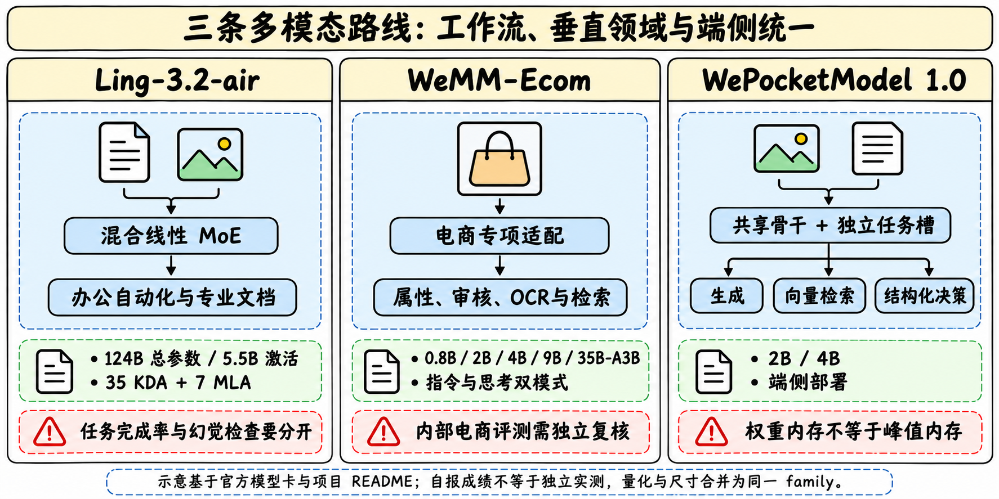
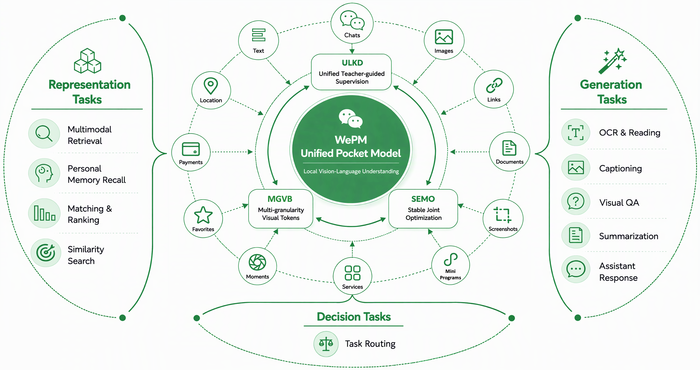
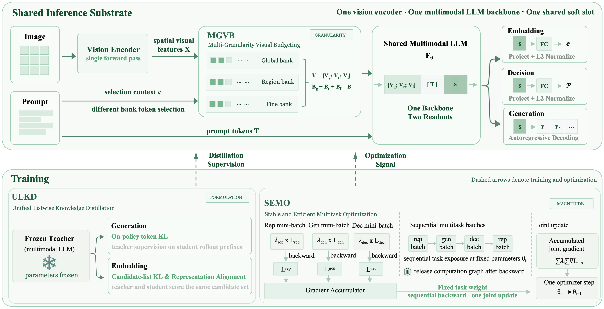
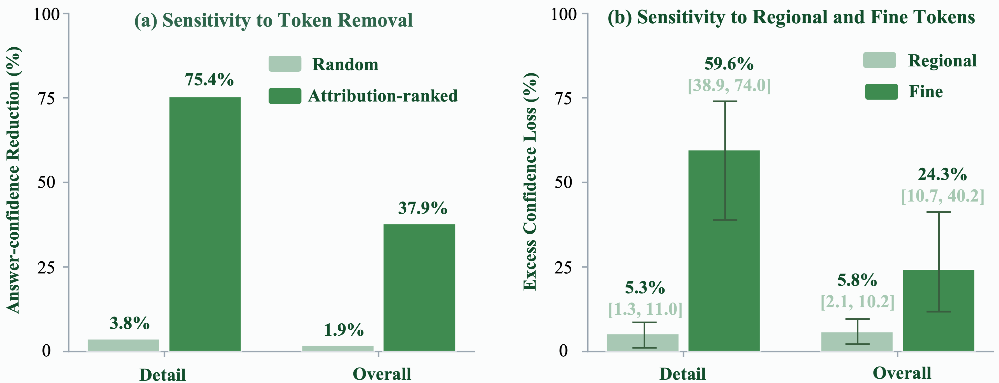
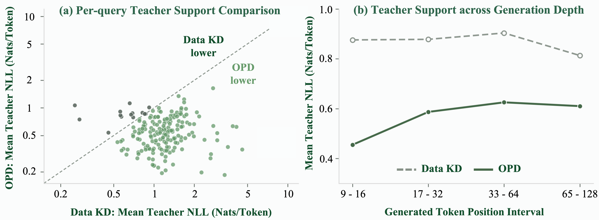
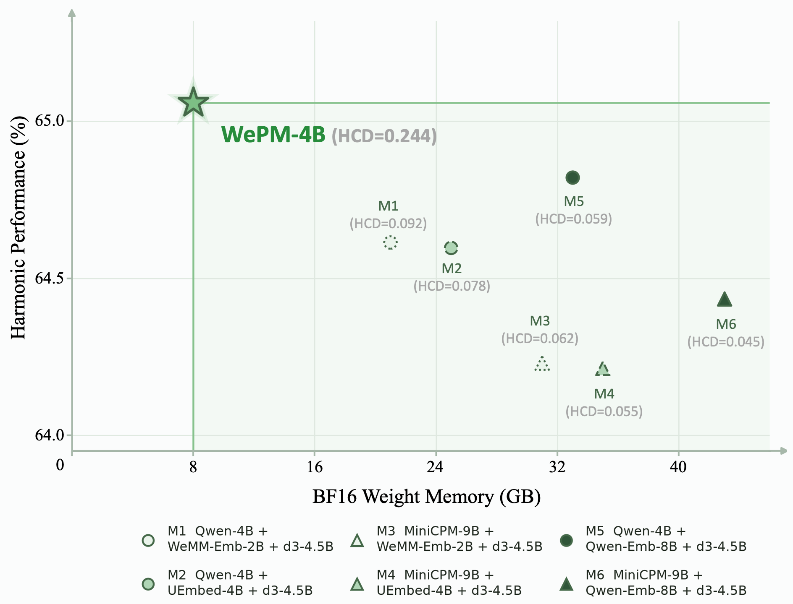

# WePocketModel 1.0 — 共享骨干中的检索、生成与结构化决策

> [!tldr]
> 我的判断：WePM最有价值的是把三种不同输出语义保留在共享模型中，再显式处理视觉粒度、监督空间与任务梯度规模冲突。它不是把所有任务都转成自由文本，也没有证明统一模型已成为更强的长程Agent；报告明确承认Agent能力下降。

> [!warning] 日期、材料与复现边界
> arXiv v1于11/20公开，官方GitHub News于11/23宣布2B/4B权重和运行时开放。因此family取论文11/20，另记11/23权重阶段，不用仓库创建/上传时间定日。已读HTML报告方法、实验、完整表格与限制，官方README、两尺寸卡/配置和静态推理模块；本轮不抓PDF、不安装依赖、不下载权重、不运行示例。完整训练集、固定优化超参数和逐次训练账本仍缺。

## 接口与共享容量

> [!tldr]
> 图像与文本先进入同一视觉编码器和Qwen3.5骨干；生成自回归，embedding和decision分别读独立学习槽与投影头。

| 路径 | 输出 | 必须保留的语义 |
|---|---|---|
|Generation|自回归文本；OCR、caption、VQA等|逐token生成，不使用E/J槽代替|
|Embedding|E槽hidden投影、L2归一化向量|候选排序；无文本的索引不能依赖未来query|
|Decision|J槽及直接候选logits|选项、序数、二元等schema条件读出；非自由CoT|

4B卡完整embedding维度2048，支持MRL前缀64/128/256/512/1024/2048；降维后仍需归一化。不同维度的索引必须一致，不能只减向量长度却继续使用旧相似度阈值。配置4B为32层/hidden2560，2B为24层/hidden2048，最大位置262144；报告训练序列上限8192。配置上限不是已验证长上下文质量。

运行时还需要unimodel_aux权重、视觉预算模块与任务head；只下载骨干分片不构成完整模型。卡与项目代码均指Apache2.0，但第三方组件条款仍分别保留。2B/4B、Transformers/GGUF共用family，不增加四个模型节点。

## 三种冲突与三个组件

> [!tldr]
> MGVB分配视觉证据，ULKD转移分布而非伪造唯一硬答案，SEMO明确每任务的权重与曝光次数。

MGVB把固定视觉预算B拆成global、regional、fine三组，满足 \(B_g+B_r+B_f=B\)。一次视觉编码后，全局latent聚合语义，region保留对象与关系，fine保留小字/局部细节；region/fine按当前文本选择，无文本时用query-independent fallback。论文选B=512；只改变总预算的消融没有单独证明每个bank或selector的因果贡献。

ULKD用冻结Qwen3.5-27B生成教师与WeMM-9B embedding教师。检索query可能有许多合理续写，硬指定一句伪答案会给任意监督，因此在学生自身采样轨迹上匹配教师next-token分布；检索侧对相同候选列表做KL，并增加教师表征到学生空间的投影对齐。原有生成token监督和检索对比监督保留，decision仍用原生typed loss；不能称三条路径都接受同一种教师蒸馏。

SEMO固定每批系数λ并预定任务曝光n：一个逻辑更新中，各batch前向后立即反传、释放图，在全部batch完成前保持参数不变，最后只做一次optimizer step。因此累积的是 \(g=\sum_i\lambda_i\sum_b\nabla\ell_{i,b}(\theta_t)\)。它节省同时保留多图的激活内存，不投影梯度方向，也不自动消除负梯度内积。若每batch就step，便不再是相同联合目标。

## 数据、训练与受控实验

> [!tldr]
> 全能力训练约1亿cleaned samples，generation:embedding:decision曝光7:5:1；二维受控消融用embedding3批、generation5批。系数比和曝光比不是同一个量。

全参数微调Qwen3.5-4B/2B。检索负样本来自原数据及WeMM-9B hard-negative mining；跨设备聚合后embedding有效全局batch约20k。每任务loss分别按token/query/decision实例归约，所以相等λ并不意味着相等梯度贡献。16个共享能力benchmark分ImageRet、TextRet、Math、VQA、OCR五组；组内算术均值，Embedding平均前两组，Generation平均后三组，Joint再平均两类。这个Joint与全能力HCD中的调和平均不是同一指标。

| 对照 | Joint | 条件与含义 |
|---|---:|---|
|Baseline|37.77|共享二维消融基线|
|MGVB128 / 256 / 512|39.58 / 41.55 / 41.90|128预算OCR从64.59降58.53，容量有取舍|
|Data KD+embedding teacher|49.33|固定伪续写序列|
|OPD+embedding teacher|51.70|学生访问前缀上分布匹配；比Data KD高2.37|
|FAMO standard / no delay / no norm|46.23 / 45.72 / 47.99|相同3:5曝光的优化比较|
|SEMO λemb/λgen=0.3/0.7|49.48|权重比不是采样比|
|SEMO 0.5/0.5 / 0.7/0.3|49.78 / 49.15|三比率Joint范围0.63|

OPD的额外自由生成分析用195个held-out检索query，教师NLL为0.584对DataKD1.323 nats/token；paired差0.739，95%bootstrapCI[0.618,0.892]，181/195更低。教师更支持学生续写并不等于事实更真或外部任务成功率更高。

8×96GiB、TP2/DP4、10个逻辑更新中，sequential平均74.42±5.45GiB、峰76.23，concurrent209.98GiB；分布式bf16累积梯度与joint-backward各模块cosine≥0.99995。该消融使用的二维训练slice与全能力三任务部署不同，不能直接把2.8倍内存数字套给推理。

## 结果、HCD与反例

> [!tldr]
> 全能力均值4B为embedding72.86、generation62.41、decision61.11；领先幅度有大有小。HCD分母仅BF16权重，运行时峰值内存与端侧延迟另算。

| 结果 | 值 | 解读 |
|---|---:|---|
|4B embedding / 30 benchmarks|72.86|比Qwen3-VL-Embedding8B仅高0.04，缺不确定性|
|4B generation / 39 benchmarks|62.41|比Qwen3.5-4B高0.58；14项第一、8项第二|
|4B decision / 7 benchmarks|61.11|typed readout成绩，不是长程Agent终态|
|2B embedding / generation|70.73 / 55.69|embedding与专用同尺度模型持平|
|共享二维Joint|52.74|ULME38.15；五组均值定义见前|
|全能力调和分 / BF16内存|65.06 / 8GB|近似参数计账，非完整峰值实测|
|HCD|0.244|最强stack0.092；报告2.64倍|

HCD示意 \(\mathrm{HCD}=K H_w(p_1,\ldots,p_K)/M\)，K按达到可用阈值的能力族计数，不能把39个generation benchmark当39个K。六组合stack都用同一个d3-mini-4.5B判断器，generation×embedding候选变化；内存21–43GB，调和分64.21–64.82。README近似2.7–5.4倍与论文对最强HCD基线2.64倍应注明四舍五入与比较对象。

项目部署建议4B CUDA BF16约8.5GiB权重、16GiB显存，CPU FP32约17GiB权重、24GiB RAM；Q4_K_M语言文件加多模态权重约3.19GiB磁盘。上述与HCD“8GB=2bytes×4B”的理想化口径不同，不能混成一个内存测量。KV、activations和runtime开销均需另量。

报告明确Agentic能力相对原Qwen底座下降，尚未做专门Agent后训练；静态任务权重也可能不适应分布变化。demo未给设备、持续运行峰值、首token/吞吐/耗电或任务成功率，不据视频声称已完成端侧产品验收。

## 对Agent Training的启发与来源

> [!insight]
> 统一能力不应牺牲接口语义：用typed decision做路由、embedding查证据、generation写回复，再单独训练并评价交互闭环。OPD教师NLL改善只能作中间诊断。

可固定同输入/同视觉budget比较E/J槽与生成式判别；在独立业务材料上比较任务混合、冻结/全参、DataKD/OPD、同一optimizer更新边界。加入多步工具harness、错误恢复、检索泄漏和端侧总内存，而非只优化HCD标量。检索任务数据隔离和不同维度的索引更新均需显式记录。

- [技术报告HTML](https://arxiv.org/html/2611.27365)、[摘要与提交历史](https://arxiv.org/abs/2611.27365)；PDF仅保留官方链接。
- [官方项目README](https://github.com/Tencent/WePocketModel)、[4B卡](https://huggingface.co/tencent/WePocketModel1.0-4B)、[2B卡](https://huggingface.co/tencent/WePocketModel1.0-2B)。
- [[LemonDecider]]、[[Kimi-K3]]：决策语义与长程环境训练对照。

> 📊 相关可视化: [[wepm_poster_zh.html]]

## 完整原表与报告图

> [!tldr]
> 静态提取保留所有原表，图形保持官方原件；摘要均值不替代逐任务读数。

[[src/wepm_original_tables|官方报告全部原表]]

