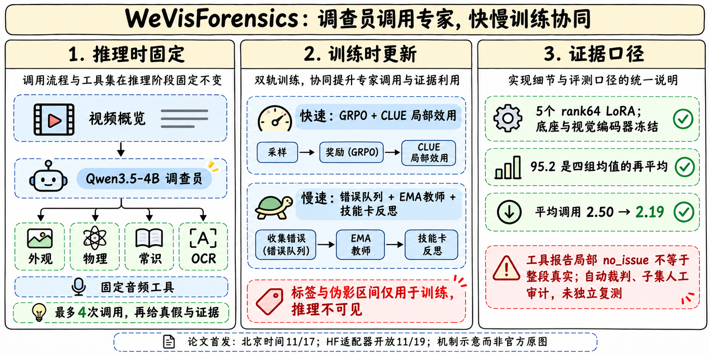
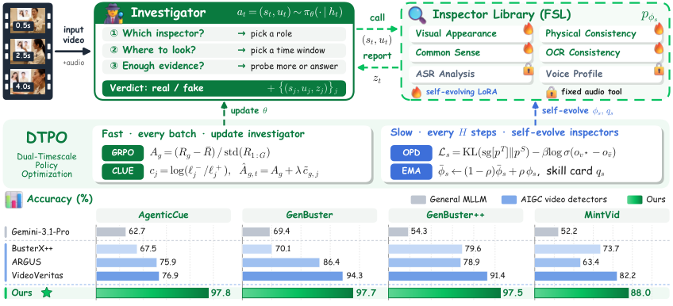

> [!tldr]
> DTPO把调查员的快速GRPO更新与专家的慢速纠错分开：前者学习何时、对哪段视频调用工具，后者用训练时的特权证据修复工具。其价值是可检查的中间证据与局部credit assignment；系统高分不意味着每条工具报告都可靠。

> [!warning] 日期与读取范围
> arXiv v1 2026-11-16T16:36:14Z→北京11/17 00:36:14为研究首发；HF 11/19 16:09:27为五LoRA开放阶段。已读主体方法、数据、训练、主结果和消融及关键实现，尚未逐项审计全部附录/原始run。未下载权重、运行工具或独立复测。

## 推理链路与工具契约

> [!tldr]
> 一个Qwen3.5-4B调查员、四个可训练视觉专家，加固定音频工具。局部no_issue并不证明整段真实。

视频概览1FPS最多16帧，带时间戳、时长与有无音频。四视觉角色为appearance、physical consistency、common sense、OCR；另有voice profile与ASR两个固定音频工具，PaddleOCR固定。最多4调用、至少1次成功才可终判，最多5个assistant turns。重复/无效调用、静音视频调用音频等会触发无效约束，不可越过预算后只报最终正确率。

视觉窗口2FPS；超过30s的视频通常约束在≤15s连续镜头。OCR只取单帧，Paddle框后模型最多选6个带15%margin的crop。只有具体变形/生成退化文字才给suspicious；no_text、失败或证据不充分应inconclusive。音频描述没有具体不一致时也不应强作伪造证据。

每个专家输出issue/no_issue/inconclusive、high/medium/low置信度和带时间戳证据。调查员不能把某窗口no_issue扩大为视频整体真实；终判仍需汇总证据。五个rank64、alpha128的LoRA分别对应主调查员与四专家，Qwen底座、视觉encoder和projector冻结。

## ForenCue构造与监督信号

> [!tldr]
> 视频、角色样本、轨迹与RL行不是同一个分母。人工审计只覆盖子样本，标签区间仅用于训练。

ForenCue核心30k视频；117,552角色记录分为外观26,378、物理32,348、常识40,246、OCR18,580；33,896执行调用轨迹。RL7500行对应6930独立视频（3750real+3180fake，存在加权重复），训练还使用扩展视频池，不能把7500行当全部独立训练视频。

角色注释由VLM+跨模型verifier构造，人工340条审计99.1%证据有效；轨迹100条审计96%选工具适当。小样本不能证明全数据零错误。AgenticCue五类别各500fake、共享500real，fake有170重叠，独立fake2330；五套平衡1000案例不是5000独立视频。

SFT只对本角色输出算loss，LR2e-4 cosine、5%warmup、两阶段各1epoch且次序不同，第一阶段合并。最大长度32768，OCR16384。报告配置与实际完整训练账本仍有距离。

## 快速更新：GRPO、CLUE与覆盖奖励

> [!tldr]
> CLUE用冻结参考模型估计某次工具报告降低正确标签不确定性的程度，仅作用该次检查动作tokens；最终答案仍按结果奖励更新。

Fast GRPO组大小4、batch32，扩展RL池1epoch，主学习率60步warmup到1e-5。每条rollout期间专家保持固定，避免同组样本的环境同时变化。

设冻结Qwen3.5-4B参考模型在报告前后对正确标签的概率为p_before/p_after，CLUE使用下式，再按同一调用序号组内中心化；epsilon=.1、clip界b=1，lambda=.2。

$$u=\operatorname{clip}\left(\log\frac{-\log p_{before}+\epsilon}{-\log p_{after}+\epsilon},-b,b\right).$$

该局部优势只加在inspection action tokens；工具观测不参与loss，最终答案使用结果归一化优势。实际调用角色与训练标签中的相关角色之间的coverage F1再组内中心化、乘.3加上；因为是组合优势，不应描述为严格字典序“正确性永远第一”。无效轨迹奖励为0。

CLUE依赖参考模型和正确标签的估计，是训练信号而非部署时可直接访问的真值。需要控制它是否偏爱参考模型易读的表达，而非真正更可靠证据。

## 慢速更新：纠错、EMA教师与技能卡

> [!tldr]
> 专家从grounded调用队列更新，EMA教师只在训练时看标签/区间。对齐KL是在学生实际prefix上计算，不是重新采样教师整段轨迹。

fake调用须窗口与角色伪影区间重合；real可用整视频。队列收集false alarm/miss/hedge，也保留被恢复的成功轨迹；hedge定义包含正确但低信心/inconclusive且CLUE<−.05。类平衡子采样防止单类压倒。

教师看到特权标签与注释区间，学生仍只看普通输入；以学生收集的prefix计算KL，决策tokens权重5，另有beta1的真假对比纠正。若教师仍给错需要改的结论，丢该KL但保留纠正；OCR增加真文字对照，防止用“视频为fake”强迫所有文字都异常。

EMA rho=.001、专家LR3e-5线性衰减、batch32，每H20刷新并同步屏障，队列不足就保持原专家。反思器提议Report/Ignore技能卡编辑，仅在近期heldout调用上正确数增加且real/fake都不丢原正确才接受；这是局部验证，非未来样本单调保证。

训练时vLLM异步工具集群、两刷新lane、最终合并全checkpoint用于数值稳定；发布LoRA与训练服务实现不同，本轮未证明二者完全同轨迹。几百步约一天没有充分公开集群硬件账本。

## 完整主结果、消融与成本

> [!tldr]
> 95.2为四个组均值的等权平均，不是所有视频micro accuracy；高精度工具也可能漏检，precision不能当recall。

### 官方表 1

|  | o x = ( { ( f k , ν k ) } k = 1 K , T x , α x ) , o_{x}=\big(\{(f_{k},\nu_{k})\}_{k=1}^{K},\;T_{x},\;\alpha_{x}\big), |  | (1) |
| --- | --- | --- | --- |

### 官方表 2

|  | a t ∼ π θ ( ⋅ ∣ h t ) , z t ∼ p ϕ s t ( ⋅ ∣ v ( x , u t ) , q s t ) , a_{t}\sim\pi_{\theta}(\cdot\mid h_{t}),\qquad z_{t}\sim p_{\phi_{s_{t}}}(\cdot\mid v(x,u_{t}),q_{s_{t}}), |  | (2) |
| --- | --- | --- | --- |

### 官方表 3

|  | C t < 4 , ( s , u ) ∉ { a t ′ } t ′ < t , u ⊆ [ 0 , T x ] , s ∈ 𝒮 aud ⇒ α x = 1 , C_{t}<4,\qquad(s,u)\notin\{a_{t^{\prime}}\}_{t^{\prime}<t},\qquad u\subseteq[0,T_{x}],\qquad s\in\mathcal{S}_{\mathrm{aud}}\Rightarrow\alpha_{x}=1, |  | (3) |
| --- | --- | --- | --- |

### 官方表 4

|  | R ( τ ) = 𝟙 [ τ is valid ] ⋅ 𝟙 [ y ^ = y ] , R(\tau)=\mathbb{1}[\tau\text{ is valid}]\cdot\mathbb{1}[\hat{y}=y], |  | (4) |
| --- | --- | --- | --- |

### 官方表 5

|  | z = ( v , c , e ) , v ∈ 𝒱 s , c ∈ { high , medium , low } , z=(v,\,c,\,e),\qquad v\in\mathcal{V}_{s},\quad c\in\{\text{high},\text{medium},\text{low}\}, |  | (5) |
| --- | --- | --- | --- |

| 配置 | GB | GB++ | MintVid均值 | Agentic均值 | 四组均值 |
|---|---:|---:|---:|---:|---:|
| SFT |93.9|94.2|83.0|94.3|91.3|
| GRPO、专家冻结 |96.8|97.0|84.3|94.7|93.2|
| GRPO+CLUE、专家冻结 |96.5|96.9|84.5|96.8|93.7|
| DTPO去CLUE |97.4|97.6|86.6|97.4|94.8|
| DTPO |97.7|97.5|88.0|97.8|95.2|

相对SFT+3.9pp、相对VideoVeritas86.2为+9.0pp，都是这一四组均值。H20刷新MintVid88.0，every-step86.0、staged85.6；算力/总刷新成本未完全匹配，不能单凭此表断定任何任务H20最优。

工具五角色precision由[98.6,94.0,72.8,77.1,84.1]→[98.6,94.6,95.4,99.7,94.3]，平均调用2.50→2.19（少12.4%）；precision条件是被调用的生成视频，不是所有伪影recall。物理匹配F1在四组66.5/85.1/72.7/89.4→97.8/97.3/91.9/98.5，仍依赖自动VLM匹配。人工paired偏好65vs20、有缺陷报告30.5%→8%只代表审计集。

## 对Agent训练的判断与下一步

> [!tldr]
> 这套工作最可借鉴的是行动位置的局部优势和慢工具的稳定接口。先证明奖励不偏工具话术，再比较全系统收益。

建议在独立材料上冻结调查员初值、工具集、调用预算和视频划分，比较结果奖励、CLUE、coverage、慢专家分别开关，保存逐调用区间、tool output与最终依据。专门构造工具失败、局部正常但其他区域fake、文字真实但视频伪造的反例。

验证train-only特权信息没有进入推理模板；评价包含未调用伪影的recall、real误报、校准、token/墙钟成本和分布外生成器。当前自动裁判/合成数据与有限人工审计仍是局限，不能把系统用于真实性高风险判定而不复核。

## 官方来源

> [!tldr]
> 论文HTML、五配置、skill card、源码README与17幅官方图已归档；PDF仅保留报告入口。

- [研究报告HTML](https://arxiv.org/html/2611.21373v1)
- [HF五LoRA](https://huggingface.co/tencent/WeVisForensics)
- [官方源码](https://github.com/Tencent/WeVisForensics)

## 关联与交付

> [!tldr]
> 一手材料、研读判断和展示分别保存；图为机制示意，原表保留原量尺。

> 📊 相关可视化: [[wevis_poster_zh.html]]

[[Invoker-Render]] · [[SingProbe-Family]]
