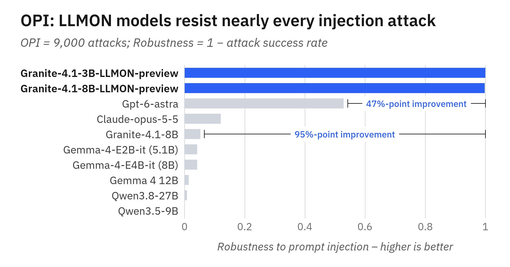
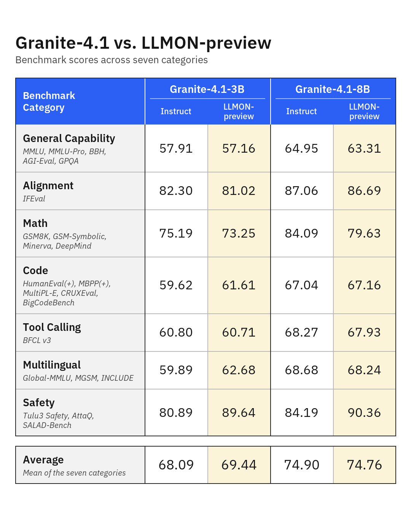
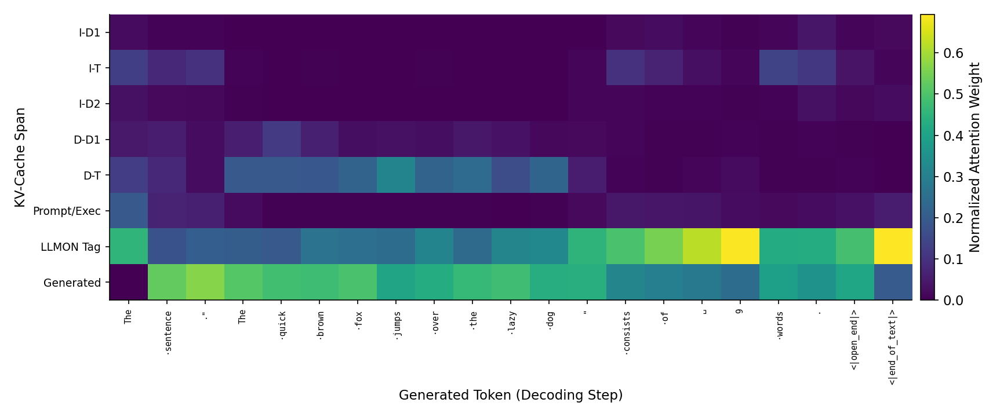

# Granite 4.1 LLMON：把执行关系教进模型

> [!tldr]
> 两款 Apache-2.0 实验 Preview 基于 Granite 4.1 **Base** 做完整后训练，3B/8B归一个专项 family，不是 Granite 4.3 新正代。贡献是把“执行哪条指令、读哪些数据”变成显式绑定和训练目标；不是只在应用层套XML。静态注入显著下降，但直接攻击和多轮攻击仍易成功。

## 发布、接口与实际开放

> [!tldr]
> 官方博客UTC 11/12 19:07:35，对应北京 **11/13 03:07:35**；模型卡写11/12为原站日历。HF createdAt 10/1不能证明当时公开。Atlas按可核官方公告的北京时间收录；更早可用时刻未独立证明。

公开3B/8B权重与模板、转换工具/示例；本轮只下载模型卡、HTML报告、模板和官方图，没有权重/数据/PDF，也没有调用模型。卡列12种语言，训练语料主要英语，不能把多语评测等同多语结构泛化已解决。

六种分隔符是保留的单token，不与普通正文共享标点语义；块有类型、唯一ID，嵌套路径在当前位置展开。ID由固定字符集两字符组成，引用成本两token。`exec.instruction/system`决定权威；`exec.input`指向的数据、文档、工具schema和结果仍是被读取材料。未绑定块仍在上下文，**不是被删去或attention mask隔离**。

`apply_chat_template`把消息转换为LLMON；`instruction/data/requirement`等列表的`exec=True/False`决定是否引用。普通user.content按可执行指令处理；不能误把不可信网页塞入它。system跨轮保持；tool结果为data。输出仍可用`<tool_call>`接口。输入普通chat格式会分布外退化，模板/解析器/工具回写必须一并对齐，不能只换权重。

## 数据构建与SFT、GRPO、DPO

> [!tldr]
> 核心监督是反事实一致性：同一目标加入不同无关指令/数据，执行绑定和目标答案保持。最后一轮注入DPO放在通用RL后，避免后续能力训练冲掉边界行为。

|来源|样本量|token量|
|---|---:|---:|
|通用单轮/多轮|3.25M / 59k|2.79B / 120M|
|RAG单轮/多轮|27k / 8k|45.5M / 17.8M|
|工具调用单轮/多轮|451k / 251k|707M / 562M|
|Alpaca原样/干扰增强|52k / 103k|17.2M / 39.4M|
|Dolly原样/增强|15k / 30k|3.3M / 16.3M|
|注入训练|约130k|211M|

作者合计约4.4M例/4.6B token，分项四舍五入不强行精确求和。注入分通用40k、RAG11k、工具80k；干扰数指令1–3、无关数据0–3，8类变体，答案不变。通用/RAG/工具占93.6% tokens。工具轨迹包含“用户→工具调用”与“工具结果→最终回答”两个exec周期。

六分隔符重映射未用词表槽，不扩embedding矩阵；全参SFT三epoch，序列4096，8×H100/FSDP，最终epoch。随后约169k prompts做五阶段GRPO：多域推理、RLHF、知识校准、两次数学boost；最终约1k在策略注入偏好对做DPO，β=.1、1epoch、LR5e-7、有效batch32。没有公开全部底层私有语料和训练run，不能把方法描述等同完整复现包。

## 实验、完整结果与研究判断

> [!tldr]
> OPI/ASB表用ASR越低越好，ARES用robustness越高越好，不能混用。8B六能力类别均值74.2→72.8，数学84.09→79.63；“保持能力”是总体目标，不是每项无损。

3B OPI ASR100→.1、ASB99.2→5.6；8B96.3→.02与52.8→3.1。ARES使用808种子扩到约15k攻击，八策略；多轮用DeepSeek-V3.2攻击、GPT-OSS120B判断、20轮预算。3B/8B间接robustness84.6/79.8，但直接37.1/32.7，多轮28/37；远非通用安全保证。训练时注入与测试静态/自适应攻击覆盖不同，不用静态分数替代真实agent攻击面。

上下文额外开销约7–15%；未系统测吞吐/延迟。IFR/DAS/LEAK从最终生成token对目标/干扰span的注意力比例诊断；3B25–34层差异大、最终39层IFR回落。它是相关性证据，不是因果电路证明。

下列四张论文表完整保留行列，再附两款模型卡全量细分表。类别平均与模型卡单项分数不能混作同一种量尺。博客能力图Code的3B/8B为61.61/67.16，论文表1为65.45/71.01；博客图包含BigCodeBench等不同聚合集，不能静默合并成一张成绩表。博客七类含Safety平均也不等于论文六能力平均。

<table>

<tbody><tr>
<td></td>
<td>IFR=A⁡(ℐt)A⁡(ℐt)+A⁡(ℐd)\text{IFR}=\frac{A(\mathcal{I}_{t})}{A(\mathcal{I}_{t})+A(\mathcal{I}_{d})}</td>
<td></td>
<td rowspan="1">(1)</td></tr></tbody>
</table>

<table>

<tbody><tr>
<td></td>
<td>DAS=A⁡(𝒟t)A⁡(𝒟t)+A⁡(𝒟d)\text{DAS}=\frac{A(\mathcal{D}_{t})}{A(\mathcal{D}_{t})+A(\mathcal{D}_{d})}</td>
<td></td>
<td rowspan="1">(2)</td></tr></tbody>
</table>

<table>

<tbody><tr>
<td></td>
<td>LEAK=A⁡(ℐd)+A⁡(𝒟d)A⁡(𝒮)\text{LEAK}=\frac{A(\mathcal{I}_{d})+A(\mathcal{D}_{d})}{A(\mathcal{S})}</td>
<td></td>
<td rowspan="1">(3)</td></tr></tbody>
</table>

<table>
<thead>
<tr>
<th>Model</th>
<th>Training</th>
<th>General</th>
<th>Alignment</th>
<th>Math</th>
<th>Code</th>
<th>Tool-Calling</th>
<th>Multilingual</th>
<th>Safety</th></tr>
</thead>
<tbody>
<tr>
<th rowspan="2">Granite-4.1-3B</th>
<th>Instruct</th>
<td>57.91</td>
<td>82.30</td>
<td>75.19</td>
<td>64.19</td>
<td>60.80</td>
<td>59.89</td>
<td>80.89</td></tr>
<tr>
<th>LLMON</th>
<td>57.16</td>
<td>81.02</td>
<td>73.25</td>
<td>65.45</td>
<td>60.71</td>
<td>62.68</td>
<td>89.64</td></tr>
<tr>
<th rowspan="2">Granite-4.1-8B</th>
<th>Instruct</th>
<td>64.95</td>
<td>87.06</td>
<td>84.09</td>
<td>72.38</td>
<td>68.27</td>
<td>68.68</td>
<td>84.19</td></tr>
<tr>
<th>LLMON</th>
<td>63.31</td>
<td>86.69</td>
<td>79.63</td>
<td>71.01</td>
<td>67.93</td>
<td>68.24</td>
<td>90.36</td></tr>
</tbody>
</table>

<table>
<thead>
<tr>
<th>Model</th>
<th>Training</th>
<th>OPI ↓\downarrow</th>
<th>ASB ↓\downarrow</th></tr>
</thead>
<tbody>
<tr>
<th rowspan="2">Granite-4.1-3B</th>
<th>Instruct</th>
<td>100.0</td>
<td>99.2</td></tr>
<tr>
<th>LLMON</th>
<td>0.1</td>
<td>5.6</td></tr>
<tr>
<th rowspan="2">Granite-4.1-8B</th>
<th>Instruct</th>
<td>96.3</td>
<td>52.8</td></tr>
<tr>
<th>LLMON</th>
<td>0.02</td>
<td>3.1</td></tr>
</tbody>
</table>

<table>
<thead>
<tr>
<th>Model</th>
<th>Training</th>
<th>Indirect</th>
<th>Direct</th>
<th>Multi-turn</th></tr>
</thead>
<tbody>
<tr>
<th rowspan="2">Granite-4.1-3B</th>
<th>Instruct</th>
<td>2.8</td>
<td>17.6</td>
<td>15.0</td></tr>
<tr>
<th>LLMON</th>
<td>84.6</td>
<td>37.1</td>
<td>28.0</td></tr>
<tr>
<th rowspan="2">Granite-4.1-8B</th>
<th>Instruct</th>
<td>0.7</td>
<td>9.2</td>
<td>15.0</td></tr>
<tr>
<th>LLMON</th>
<td>79.8</td>
<td>32.7</td>
<td>37.0</td></tr>
</tbody>
</table>

<table>
<thead>
<tr>
<th></th>
<th colspan="2">IFR ↑\uparrow</th>
<th colspan="2">DAS ↑\uparrow</th>
<th colspan="2">LEAK ↓\downarrow</th></tr>
<tr>
<th>Layer</th>
<th>LLMON</th>
<th>Inst.</th>
<th>LLMON</th>
<th>Inst.</th>
<th>LLMON</th>
<th>Inst.</th></tr>
</thead>
<tbody>
<tr>
<th>25</th>
<td>86.5</td>
<td>25.8</td>
<td>59.1</td>
<td>38.0</td>
<td>8.6</td>
<td>44.9</td></tr>
<tr>
<th>28</th>
<td>87.2</td>
<td>37.7</td>
<td>62.2</td>
<td>36.6</td>
<td>6.3</td>
<td>34.9</td></tr>
<tr>
<th>31</th>
<td>63.8</td>
<td>15.3</td>
<td>53.9</td>
<td>37.2</td>
<td>12.2</td>
<td>40.6</td></tr>
<tr>
<th>34</th>
<td>75.8</td>
<td>26.3</td>
<td>57.9</td>
<td>35.6</td>
<td>6.4</td>
<td>47.2</td></tr>
<tr>
<th>39</th>
<td>28.0</td>
<td>17.2</td>
<td>47.0</td>
<td>40.2</td>
<td>13.7</td>
<td>39.7</td></tr>
</tbody>
</table>

### 3B模型卡逐项
<table>
<thead>
  <tr>
    <th>Benchmarks</th>
    <th>Metric</th>
    <th>3B-LLMON</th>
    <th>3B-Instruct</th>
  </tr>
</thead>
  <tbody>
<tr>
  <td colspan="4">
    General Tasks
  </td>
</tr>
<tr>
    <td>MMLU</td>
    <td>5-shot</td>
    <td>68.05</td>
    <td>67.02</td>
</tr>
<tr>
    <td>MMLU-Pro</td>
    <td>5-shot, CoT</td>
    <td>46.08</td>
    <td>49.83</td>
</tr>
<tr>
    <td>BBH</td>
    <td>3-shot, CoT</td>
    <td>74.04</td>
    <td>75.83</td>
</tr>
<tr>
    <td>AGI EVAL</td>
    <td>0-shot, CoT</td>
    <td>65.70</td>
    <td>65.16</td>
</tr>
<tr>
    <td>GPQA</td>
    <td>0-shot, CoT</td>
    <td>31.92</td>
    <td>31.70</td>
</tr>
<tr>
  <td colspan="4">
    Alignment Tasks
  </td>
</tr>
<tr>
    <td>IFEval Avg</td>
    <td></td>
    <td>81.02</td>
    <td>82.30</td>
</tr>
<tr>
  <td colspan="4">
    Math Tasks
  </td>
</tr>      
<tr>
    <td>GSM8K</td>
    <td>8-shot</td>
    <td>86.96</td>
    <td>86.88</td>
</tr>
<tr>
    <td>GSM Symbolic</td>
    <td>8-shot</td>
    <td>79.60</td>
    <td>81.32</td>
</tr>
<tr>
    <td>Minerva Math</td>
    <td>0-shot, CoT</td>
    <td>65.94</td>
    <td>67.94</td>
</tr>
<tr>
    <td>DeepMind Math</td>
    <td>0-shot, CoT</td>
    <td>60.48</td>
    <td>64.64</td>
</tr>
<tr>
  <td colspan="4">
    Code Tasks
  </td>
</tr> 
<tr>
    <td>HumanEval</td>
    <td>pass@1</td>
    <td>84.15</td>
    <td>81.71</td>
</tr>
<tr>
    <td>HumanEval+</td>
    <td>pass@1</td>
    <td>78.66</td>
    <td>76.83</td>
</tr>
<tr>
    <td>MBPP</td>
    <td>pass@1</td>
    <td>76.72</td>
    <td>71.16</td>
</tr>
<tr>
    <td>MBPP+</td>
    <td>pass@1</td>
    <td>65.87</td>
    <td>62.17</td>
</tr>
<tr>
    <td>CRUXEval-O</td>
    <td>pass@1</td>
    <td>32.75</td>
    <td>40.75</td>
</tr>
<tr>
    <td>BigCodeBench</td>
    <td>pass@1</td>
    <td>38.60</td>
    <td>32.19</td>
</tr>
<tr>
    <td>MULTIPLE</td>
    <td>pass@1</td>
    <td>54.53</td>
    <td>52.54</td>
</tr>
<tr>
  <td colspan="4">
    Tool Calling Tasks
  </td>
</tr> 
<tr>
    <td>BFCL v3</td>
    <td></td>
    <td>60.71</td>
    <td>60.80</td>
</tr>
<tr>
  <td colspan="4">
    Multilingual Tasks
  </td>
</tr> 
<tr>
    <td>MMMLU</td>
    <td>5-shot</td>
    <td>59.01</td>
    <td>57.61</td>
</tr>
<tr>
    <td>INCLUDE</td>
    <td>5-shot</td>
    <td>56.71</td>
    <td>52.05</td>
</tr>
<tr>
    <td>MGSM</td>
    <td>8-shot</td>
    <td>72.32</td>
    <td>70.00</td>
</tr>
<tr>
  <td colspan="4">
    Safety
  </td>
</tr> 
<tr>
    <td>SALAD-Bench</td>
    <td></td>
    <td>97.25</td>
    <td>93.95</td>
</tr>
<tr>
    <td>AttaQ</td>
    <td></td>
    <td>85.54</td>
    <td>81.88</td>
</tr>
<tr>
    <td>Tulu3 Safety Eval Avg</td>
    <td></td>
    <td>86.13</td>
    <td>66.84</td>
</tr>
</tbody></table>

### 8B模型卡逐项
<table>
<thead>
  <tr>
    <th>Benchmarks</th>
    <th>Metric</th>
    <th>8B-LLMON</th>
    <th>8B-Instruct</th>
  </tr>
</thead>
  <tbody>
<tr>
  <td colspan="4">
    General Tasks
  </td>
</tr>
<tr>
    <td>MMLU</td>
    <td>5-shot</td>
    <td>74.20</td>
    <td>73.84</td>
</tr>
<tr>
    <td>MMLU-Pro</td>
    <td>5-shot, CoT</td>
    <td>53.11</td>
    <td>55.99</td>
</tr>
<tr>
    <td>BBH</td>
    <td>3-shot, CoT</td>
    <td>80.88</td>
    <td>80.51</td>
</tr>
<tr>
    <td>AGI EVAL</td>
    <td>0-shot, CoT</td>
    <td>73.30</td>
    <td>72.43</td>
</tr>
<tr>
    <td>GPQA</td>
    <td>0-shot, CoT</td>
    <td>35.05</td>
    <td>41.96</td>
</tr>
<tr>
  <td colspan="4">
    Alignment Tasks
  </td>
</tr>
<tr>
    <td>IFEval Avg</td>
    <td></td>
    <td>86.69</td>
    <td>87.06</td>
</tr>
<tr>
  <td colspan="4">
    Math Tasks
  </td>
</tr>      
<tr>
    <td>GSM8K</td>
    <td>8-shot</td>
    <td>89.16</td>
    <td>92.49</td>
</tr>
<tr>
    <td>GSM Symbolic</td>
    <td>8-shot</td>
    <td>86.30</td>
    <td>83.70</td>
</tr>
<tr>
    <td>Minerva Math</td>
    <td>0-shot, CoT</td>
    <td>72.20</td>
    <td>80.10</td>
</tr>
<tr>
    <td>DeepMind Math</td>
    <td>0-shot, CoT</td>
    <td>70.86</td>
    <td>80.07</td>
</tr>
<tr>
  <td colspan="4">
    Code Tasks
  </td>
</tr> 
<tr>
    <td>HumanEval</td>
    <td>pass@1</td>
    <td>86.59</td>
    <td>85.37</td>
</tr>
<tr>
    <td>HumanEval+</td>
    <td>pass@1</td>
    <td>81.71</td>
    <td>79.88</td>
</tr>
<tr>
    <td>MBPP</td>
    <td>pass@1</td>
    <td>85.19</td>
    <td>87.30</td>
</tr>
<tr>
    <td>MBPP+</td>
    <td>pass@1</td>
    <td>74.60</td>
    <td>73.81</td>
</tr>
<tr>
    <td>CRUXEval-O</td>
    <td>pass@1</td>
    <td>36.88</td>
    <td>47.63</td>
</tr>
<tr>
    <td>BigCodeBench</td>
    <td>pass@1</td>
    <td>44.04</td>
    <td>35.00</td>
</tr>
<tr>
    <td>MULTIPLE</td>
    <td>pass@1</td>
    <td>61.08</td>
    <td>60.26</td>
</tr>
<tr>
  <td colspan="4">
    Tool Calling Tasks
  </td>
</tr> 
<tr>
    <td>BFCL v3</td>
    <td></td>
    <td>67.93</td>
    <td>68.27</td>
</tr>
<tr>
  <td colspan="4">
    Multilingual Tasks
  </td>
</tr> 
<tr>
    <td>MMMLU</td>
    <td>5-shot</td>
    <td>64.96</td>
    <td>64.84</td>
</tr>
<tr>
    <td>INCLUDE</td>
    <td>5-shot</td>
    <td>63.60</td>
    <td>58.89</td>
</tr>
<tr>
    <td>MGSM</td>
    <td>8-shot</td>
    <td>76.16</td>
    <td>82.32</td>
</tr>
<tr>
  <td colspan="4">
    Safety
  </td>
</tr> 
<tr>
    <td>SALAD-Bench</td>
    <td></td>
    <td>97.70</td>
    <td>95.80</td>
</tr>
<tr>
    <td>AttaQ</td>
    <td></td>
    <td>86.07</td>
    <td>81.19</td>
</tr>
<tr>
    <td>Tulu3 Safety Eval Avg</td>
    <td></td>
    <td>87.31</td>
    <td>75.57</td>
</tr>
</tbody></table>

> [!insight]
> 对Agent Training最可检验的变量是“目标不变、干扰变化”的数据构造，而非格式名称。固定base、token预算和后训练次序，分别消融special tokens、exec绑定、干扰增强、最终DPO；同时评估正常工具成功率和动态攻击。只有这些对照才能知道收益来自结构、数据或最后的安全偏好训练。

来源：[官方博客](https://huggingface.co/blog/ibm-granite/llmon-an-llm-native-markup-language-now-in-granite)、[后训练HTML报告](https://arxiv.org/html/2610.38120v1)、[格式HTML报告](https://arxiv.org/html/2603.22519v1)（已归档，本文精读范围为后训练报告）、[代码](https://github.com/generative-computing/llmon)。格式论文只作补充材料，未声称逐节精读。关联 [[Topics/13_base_model/IBM_Granite]]。

> 📊 中文Poster：[[Topics/13_base_model/IBM_Granite/Variants/2611_Granite_4_1_LLMON/granite-4.1-llmon_poster_zh.html]]
