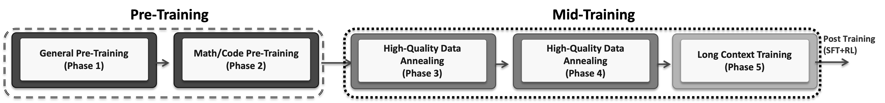
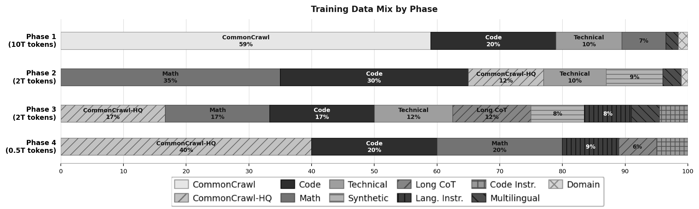
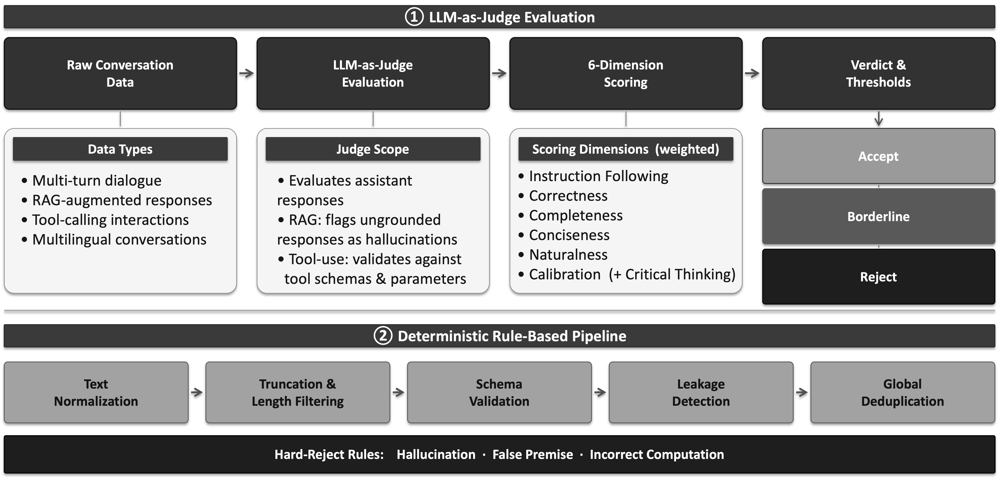
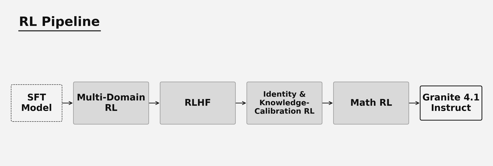
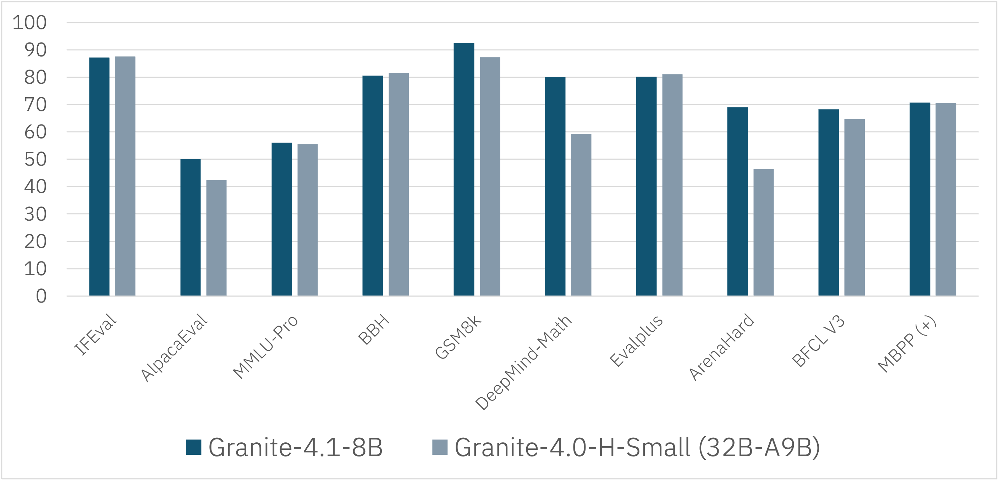

# Granite 4.1

> [!tldr]
> 我的判断：4.1 的主线不是继续堆参数，而是把数据混合的时序、SFT 缺陷审计和多阶段 RL 编排做到更细，以 Dense 3B/8B/30B 构建不依赖长篇推理轨迹的企业助手。8B 对旧 32B-A9B 的追平是整体配方结果，不能归因于 Dense 架构本身。

## Family 与来源边界

官方卡与 Tech Blog 均标明 **2026-04-29**。3B、8B、30B、Base/Instruct、FP8 同属 4.1 family，在 Atlas 合并一个主干节点。这是历史补漏，不进入 2026 年 10 月的近 30 天新发布表。

| 维度 | 3B | 8B | 30B |
|---|---:|---:|---:|
| 层数 | 40 | 40 | 64 |
| hidden size | 2560 | 4096 | 4096 |
| attention heads / KV heads | 40 / 8 | 32 / 8 | 32 / 8 |
| MLP hidden size | 8192 | 12800 | 32768 |
| 路线 | Dense decoder-only | Dense decoder-only | Dense decoder-only |

共同组件是 GQA、RoPE、SwiGLU、RMSNorm；博客称共享输入/输出 embedding。12 种测试语言包含中英、德西法日葡阿捷意韩荷，Apache 2.0。长上下文应按尺寸分开：博客的最终 512K 扩展适用于 **8B、30B**，不能把 family 的最大值无差别写给 3B。

## 五阶段：为什么数据顺序也是方法的一部分

| 阶段 | 公开规模 | 配比与意图 |
|---|---|---|
| 通用预训练 | 10T tokens | Web 59%、Code 20%、Math 7%、Technical 10.5%、Multilingual 2%、Domain 1.5% |
| 数学/代码预训练 | 2T | Math 35%、Code 30%；同时保留高质量 Web、技术、多语言和合成数据 |
| 高质量退火 | 2T | 混入长 CoT、语言/代码 instruction，指数衰减学习率 |
| 精炼退火 | 0.5T | HQ Web 40%、Code 20%、Math 20%、长 CoT 6%、Code instruction 5%、Language instruction 9% |
| 长上下文扩展 | 未单列总 token | 4K→32K→128K；8B/30B 继续到 512K，每次扩展后做模型合并 |

前四段公开规模合计 14.5T，博客整体约 15T；不要把“约”当作精确的第五段 token 数。最后 512K 阶段使用 80% books 与 20% code repository。官方说逐段模型合并用于保留短上下文表现，但没有完整披露合并系数和消融。

这里值得借鉴的是先建立覆盖，再改变采样质量与任务密度，而不是把所有高质量数据从第一天按固定比例混进去。4.1 博客还链接 PRISM 中训研究；那是相关方法来源，不应自动标成 Granite 4.1 自己的完整技术报告。

## SFT：审计的是 assistant 输出，不是 user 或工具材料

约 4.1M 样本来自开放许可数据、内部合成和人工整理。Judge 将 system、用户、检索材料和工具输出作为上下文，只评估 assistant 的行为。对 RAG 检查材料支撑，对工具调用检查允许的工具及参数 schema，避免因为上下文本身包含错误内容就把样本错杀。

六个维度是指令遵循、正确性、完整性、简洁性、自然性和校准；严重幻觉、错误前提、计算错误触发硬拒绝，不被其他高分抵消。规则管线做规范化、长度/截断检查、schema 与泄漏检查，最后全局去重，保留修复和过滤轨迹。

公开 SFT 设置：16 节点×4 GB200，3 epochs，序列 16,384，batch 256，LR 5e-6，3% warm-up，约 25K steps 的线性衰减。它公开了训练配置，但没有交付全部数据和 Judge rubric，不足以声称逐字节可复现。

## RL：对齐后再修复数学能力，而非“一次 RL 全部解决”

使用 SkyRL、on-policy GRPO 和 DAPO loss；**dynamic sampling 被关闭**。每 prompt 16 个样本、train batch 1024、context 8192。不能把采用 DAPO loss 等同于启用了 DAPO 的每一项机制。

| 阶段 | 公开 prompts | LR / KL | 作用 |
|---|---:|---|---|
| Multi-domain RL | 平均 45,504 | 5e-7 / 0.05 | 混合数学、科学、逻辑、IF、SQL、结构输出等，减少单域遗忘 |
| RLHF | 平均 17,920 | 3e-7 / 0.09 | 多语言 scalar reward model 改进对话偏好 |
| Identity / calibration | 1,728，约 40 steps | 3e-7 / 0.09 | 身份与知识校准 |
| Math RL | 平均 13,504 | 5e-7 / 0.05 | 恢复 RLHF 后下降的数学指标 |

博客报告 RLHF 相对 SFT 的 AlpacaEval 平均提升约 18.9 点；Math RL 相对原 SFT 的 GSM8K、DeepMind Math 平均提升约 3.8、23.48 点。这是不同阶段与不同参考点的改善，不能相加为“总收益”。

## 结果：规模收益并不处处单调

| Instruct 官方结果 | 3B | 8B | 30B |
|---|---:|---:|---:|
| IFEval Avg | 82.30 | 87.06 | 89.65 |
| BFCL v3 | 60.80 | 68.27 | 73.68 |
| GSM8K，8-shot | 86.88 | 92.49 | 94.16 |
| Minerva Math，0-shot CoT | 67.94 | 80.10 | 81.32 |
| HumanEval，pass@1 | 79.27 | 87.20 | 89.63 |
| AlpacaEval 2.0 | 38.57 | 50.08 | 56.16 |
| MGSM，8-shot | 70.00 | 82.32 | 71.12 |

不少指标随规模提升，但 MGSM 和 GSM Symbolic 存在逆序。官网概括“30B 各 benchmark 领先”不能覆盖表格里的反例。8B 对旧 MoE 的优势还同时混入数据、算力、训练配方与后训练变化，不是架构因果消融。

Base 模型的 RULER 128K 为 58.0/73.0/76.7，说明支持的窗口长度与可靠利用该长度是两回事。上线时要单独测长材料的多证据关联，而不是只验证请求能塞进去。

## 我的研究判断与未披露项

> [!insight]
> 对 Agent Training，更可复用的是可审计的 SFT 缺陷 taxonomy 和“多域能力—偏好对齐—能力修复”的阶段顺序。用相同算力比较顺序，逐阶段保留 checkpoint 与回归集，才能判断任务恢复是否以其他能力为代价。

测试工具调用不能只看 JSON 合法率：应同时测选错工具、错误参数、无工具可用时诚实停止、未执行却宣称完成。官方未给完整数据、reward model、训练成本、污染核查或每阶段受控消融；这些不能从公开总表补推。

## 资料地图

- [🤗 HF Model Card · 8B](https://huggingface.co/ibm-granite/granite-4.1-8b)
- [Tech Blog · 完整训练路线](https://huggingface.co/blog/ibm-granite/granite-4-1)
- `src/` 保存 3B/8B/30B 原始卡、博客原始 HTML 与正文提取、八张官方图；未下载 PDF。
- 后继：[[Topics/13_base_model/IBM_Granite/260825_Granite_4_2/Granite-4.2|Granite 4.2]]。

> 📊 相关可视化: [[Topics/13_base_model/IBM_Granite/260429_Granite_4_1/granite_4_1_poster_zh.html|Granite 4.1 中文 Poster]]
