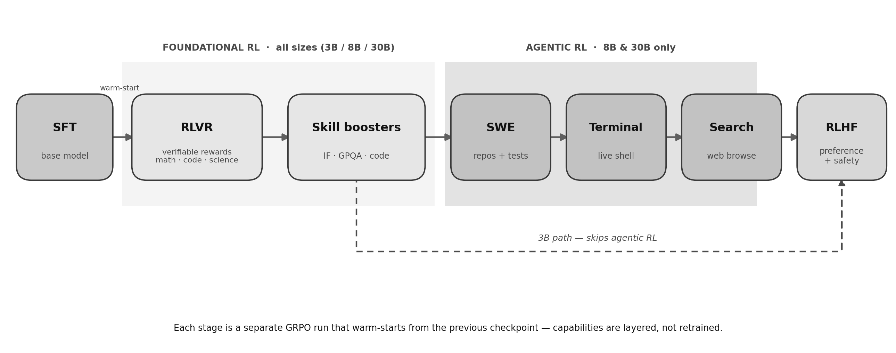
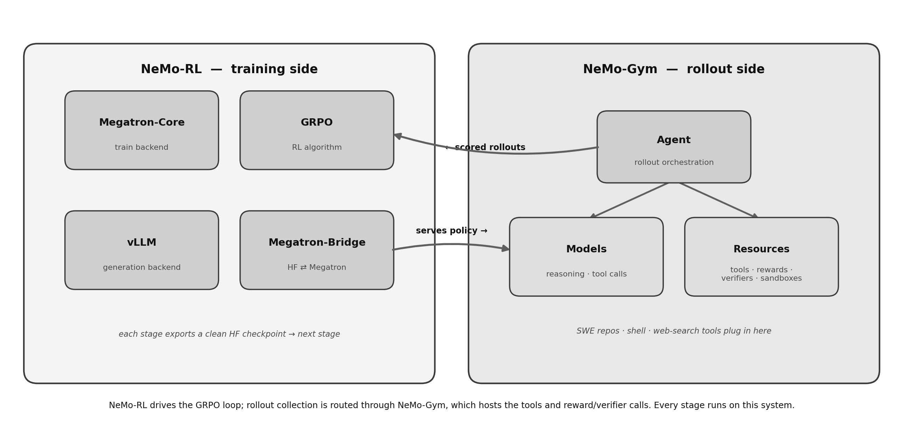
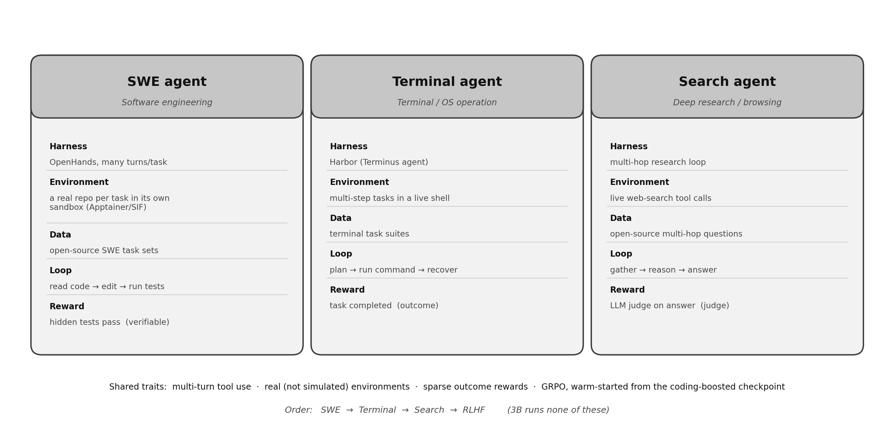
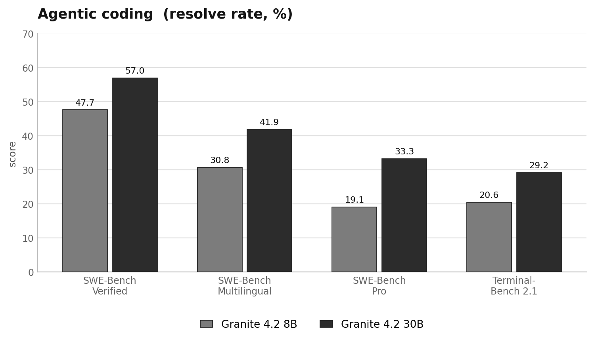

# Granite 4.2

> [!tldr]
> 我认为这代最有价值的是一份相当具体的 Agent Training 配方：基于 4.1 base，通过推理/工具轨迹 SFT、异步 GRPO 的多阶段课程和真实 SWE/终端/搜索环境，把“会答题”推进到“会行动”。3B 与 8B/30B 的区别不只是容量，后两者还额外接受了 Agentic RL。

## 一页定位

| 维度 | 已确认事实 |
|---|---|
| 发布 | 2026-08-25，三尺寸同日，历史补漏 |
| Family | 3B / 8B / 30B Dense，量化版本合并，不拆新正代 |
| 起点 | Granite 4.1 base；不是将 4.1 instruct 直接继续对齐 |
| 推理控制 | full thinking、non-thinking、low-effort |
| 工具使用 | 原生工具调用，兼容官方给出的函数定义 schema |
| Context | 卡表列原生 128K、扩展到 512K；3B 与 8B/30B 长扩展表述有冲突，需逐尺寸验证 |
| 许可 | Apache 2.0 |
| 训练资料 | 详细 Tech Blog + 三尺寸 HF 卡，无独立完整报告在本次已读材料中得到确认 |

## 不是新一轮 15T 预训练，而是从 4.1 base 开始的后训练

4.1 的约 15T 预训练和分阶段上下文扩展是继承的基础，不应再记作 4.2 新增训练量。4.2 使用 Dense decoder-only、GQA、RoPE、SwiGLU、RMSNorm，博客说 input/output embedding 不共享。博客架构概述写“40 attention heads”，具体表与 8B/30B 模型卡写 32；因此不能把概述单一数值广播给所有尺寸。

## SFT：约 7.2M 样本，把行动轨迹放进训练分布

整体约 100B tokens，其中约 65B 为 trainable，说明“处理的总 token”与“参与监督 loss 的 token”不是同一个数。Agentic 占 31.6%，non-agentic 占 68.4%。Agentic 子集内 SWE 为 69%、tool calling 12.1%、terminal 8.0%、math 3.5%、search 0.8%、action 0.2%；这些披露项不足 100%，不能擅自填剩余类别。

轨迹来自多个 agent scaffold 与 harness，而非一个固定聊天模板。质量控制将格式统一为 OpenAI Chat，用 GPT-OSS-120B 和 Gemma 4 判别质量，剔除幻觉、无效工具交互与未定义工具调用；对 `tools + messages` 做 SHA-256 局部/全局去重。去重防重复，不等于语义近重复或评测污染已经排除。

公开配置为 32–128 节点×4 Grace/GB200，packed 128K，global batch 128，LR 1e-5、warm-up 2.5%、约 2 epochs，TP=2、PP=1、CP=4/2。30B 还有第二阶段 coding/SWE 上采样 SFT，保留约 16% 旧混合数据 replay，LR 3e-6 再约一个 epoch。它的目标是专项提升与能力保留同时成立。

## 异步 GRPO：吞吐收益伴随着真实的策略版本混合

生成 worker 向共享 buffer 放入完成轨迹，trainer 收齐 batch 后更新，再流式发送权重。更新可能发生在一条 rollout 中间，官方允许沿用 KV cache，因此一个轨迹可以包含相邻策略版本。worker 至多落后一个 update，目标函数用截断 importance sampling 限制残留的 train/generation 概率比。

这不是“因为用了异步，off-policy 问题自然消失”。它是用版本滞后约束和目标修正换取生成舰队不在 optimizer step 时空转。Advantage 使用组相对 leave-one-out baseline，没有另训 value network。

固定主干设置：NeMo-RL（Megatron-Core + vLLM）与 NeMo-Gym，ratio clip 0.2 / 0.28，micro-batch 1，TP 2–4，无 PP/CP。RLVR 每步 256 prompts×16 generations = 4096 条样本；其他阶段按任务调整。

## Agentic 课程：SWE → Terminal → Search

| 30B 阶段 | prompts×gens | context | rollout turns | KL | LR |
|---|---:|---|---:|---:|---|
| RLVR ×3 | 256×16 | 64K | 1 | 0 | 5e-7 |
| IF booster | 256×16 | 64K | 1 | 0 | 5e-7 |
| Code booster | 64×16 | 64K | 1 | 0.05 | 5e-7 |
| SWE 1 | 64×16 | 128K | 1 | 0.01 | 5e-7 |
| SWE 2 | 32×16 | 128K | 128 | 0 | 5e-7 |
| Terminal | 8×32 | 64K | 64 | 0.01 | 1e-6 |
| Search | 32×16 | 128K | 64 | 0.01 | 5e-7 |
| RLHF | 128×16 | 48K | 1 | 0.05 | 5e-7 |

表中 turns 是 GRPO 看到的环境交互数；SWE 1 的值为 1 不等于它只是一个无工具单轮问答，官方说明各阶段用完整真实环境轨迹。SWE 由 OpenHands 对真实仓库读写和运行测试，以隐藏测试结果为奖励；Terminal 使用 Harbor/Terminus-2 操作 live shell；Search 做 live 多跳搜索，最终答案由 LLM judge 判断，后者不是完全客观的 verifier。

3B 只走 foundational RL 与最终 RLHF，没有 SWE/Terminal/Search block；8B 和 30B 才走完整行动课程。最终 RLHF 使用 GenRM 偏好、安全奖励和推理长度惩罚，不应将“短思考”本身当成目标完成。

## 结果与取舍

| 官方表 | 3B | 8B | 30B |
|---|---:|---:|---:|
| SWE-Bench Verified | 未报 | 47.67 | 57.00 |
| SWE-Bench Pro | 未报 | 19.11 | 33.29 |
| Terminal-Bench 2.1 | 未报 | 20.56 | 29.24 |
| τ³-bench | 45.78 | 58.06 | 62.00 |
| BFCL v4 | 52.41 | 50.29 | 61.39 |
| AIME25 | 78.33 | 86.67 | 89.17 |
| GPQA | 54.80 | 64.14 | 66.41 |
| LiveCodeBench v6 | 69.71 | 73.24 | 75.77 |
| IFBench prompt | 74.33 | 79.33 | 77.17 |
| RULER 128K | 55.30 | 71.41 | 81.38 |

并非每项都随规模单调：8B 的 BFCL 低于 3B，30B 的 IFBench 低于 8B。更重要的是容量和训练课程同时变化，不能用 3B 与 8B 分数差证明 Agentic RL 的纯因果收益。4.1 的 BFCL v3、4.2 的 v4 也不能直接当同一测试集相减。

## 使用细节与风险

官方推荐所有模式/backend 使用 temperature=1.0、top_p=0.95。通过 `enable_thinking` 与 `low_effort` 控制模式，multi-turn 默认剥离历史 thinking 保留对话结果。工具定义、输出 parser 与 reasoning parser 需要匹配，不应把工具文本显示正确当作实际调用成功。

长上下文的冲突要明确：卡片同时宣传 512K，核心表与 serving 示例为 131072；4.1 最终 512K 扩展只标 8B/30B。当前材料不足以替所有 4.2 尺寸保证 512K 同等可靠，更不能自动将服务配置上限视作有效信息利用上限。

> [!insight]
> 可复用的实验是同时记录 rollout 的生成策略版本、训练策略版本、缓存复用和终态 verifier。固定数据与 GPU-hours，对比同步、异步不修正、异步有 lag 上限及 importance correction；同时看每小时成功任务、回归、过期轨迹率和每成功成本。

官方披露足以写出具体训练流程，但完整 SFT/RL corpus、所有环境镜像、reward 实现、budget/harness 配置和课程消融仍不完备。本笔记未本地复现，不把开源权重等同于完整可复现的训练工程。

## 资料地图

- [🤗 HF Model Card · 8B](https://huggingface.co/ibm-granite/granite-4.2-8b)
- [Tech Blog · 训练路线](https://huggingface.co/blog/ibm-granite/granite-4-2)
- [[Topics/13_base_model/IBM_Granite/260429_Granite_4_1/Granite-4.1|继承的 4.1 base 预训练]]
- `src/` 包含三尺寸原卡、原始博客、正文提取与六张官方图；报告链接与实际精读范围分开。

> 📊 相关可视化: [[Topics/13_base_model/IBM_Granite/260825_Granite_4_2/granite_4_2_poster_zh.html|Granite 4.2 中文 Poster]]
