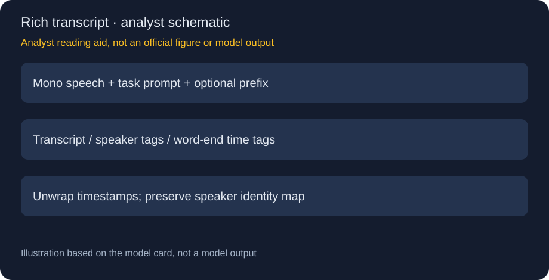
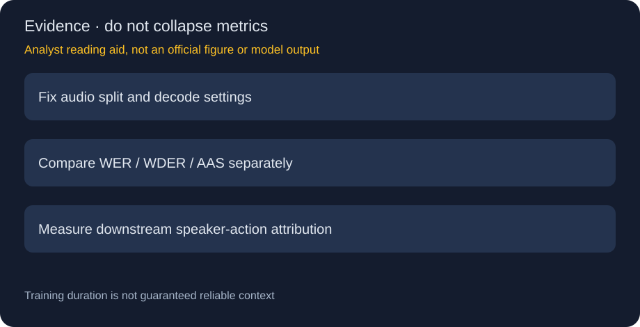

# Granite Speech 4.1 Plus：可追溯说话人、词级时间与10月权重更新

> [!tldr] 我的判断
> 4/28首发，10/19同模型更新权重/配置；说话人归属与词级时间增强。新版短语音平均WER6.10略差于6.01，不能只报收益。

> [!warning] 原始资料覆盖不足，尚未达到完整技术报告精读深度
> 当前已读卡/博客有详细结果，但完整本次更新训练recipe、消融和独立报告覆盖仍不足；相关历史报告链接保留但未精读，未达完整报告深度。两张图为研读示意，非官方原图或本地结果。

## 日期与身份

原卡明确首发2026-04-28，权重与配置于2026-10-19更新。官方保持4.1名称，API/结构/提示格式不变；本轮补历史family和10/19更新事件，而非创造4.2或5.0Plus。5.0博客在10/21回顾它，也不是第二次首发。

## 什么叫“谁在何时说了什么”

普通ASR只输出词，SAA在turn前加入`[Speaker N]:`，按首次出现顺序编号；编号不代表现实身份，也不能直接当跨录音身份识别。词级时间戳输出词尾时间，静音用`_`并带时间。Plus明确不提供base版本的标点/大小写能力，不把“Plus”理解为所有功能超集。

时间标记`[T:N]`取centisecond后三位，每10秒回卷。还原为`t=N/100+10R`，R是回卷计数；应检查单调性和分段offset，不能把N直接当绝对时间或毫秒。词尾不等于词起点，字幕区间需要另设规则。

## 数据与训练信号的可信度

SAA以带speaker标识语料拼接交替说话人，时间监督来自LibriSpeech、MLS、CommonVoice、VoxPopuli、AMI、Switchboard、TIMIT、YODAS等。部分人工时间标签保留，其余MFA forced alignment；再用CTC对齐估计平均偏移，英文保留最低错误95%、非英文70%，YODAS/MLS-en上限4M/5M样本。这是筛选一致性，不是真实词界绝对正确性。

训练ASR/SAA最长10分钟、时间戳5分钟；原卡验证ASR/SAA约9分钟、时间戳3.5分钟。原卡称32H100约5天，不据此补造完整训练token或成本。拼接数据会改变说话人转场与静音分布，应另测真实重叠会议。

## 结果要保留退化，避免博客headline盖住原卡

| 指标 / 条件 | v2604 | v2610 | 含义 |
|---|---:|---:|---|
| 新版短语音榜单WER | 6.01 | 6.10 | 略差，不能说所有ASR都提升 |
| 短段英文AAS ms | 38.8 | 34.6 | 词尾平均偏移减小 |
| 多语短段AAS ms | 29.8 | 26.5 | 与英文不是相同测试池 |
| 拼接长段AAS ms | 814.3 | 328.3 | 2–5分钟拼接测试，不外推完整会议 |
| FISHER WDER | 0.9 | 1.0 | 退化 |
| CALLHOME WDER | 2.2 | 3.0 | 退化 |
| AMI-SDM WDER | 14.6 | 13.9 | 改善 |
| GALE WDER | 30.2 | 28.3 | 改善 |

旧榜单平均5.71与新6.01/6.10不能直接比较：AMI等集合清理、移除Tedlium、增加URGENT2024/Monsoon，且旧表用speculative decoding、新表beam4/repetition_penalty2.0。博客总汇AAS210.86→98.54、cpWER30.50→28.48、长语音WER13.53→10.22、20词KWB错误11.79→6.48保留为博客聚合口径，不替换卡中分层表。KWB部分集合也退化，例如CV-en82.4低于旧85.5，不能只取最高收益。

## 解码细节直接改变“模型能力”读数

16kHz单声道；Transformers5.8起，vLLM0.23.0起。示例按音频时长设置输出上限，ASR/SAA/时间模式分别12/16/48 tokens每秒，并至少256。时间戳token多，不能用ASR预算截断后判定失败；也不能删掉耗尽上限的样本。原卡repetition_penalty2.0用于长音频循环，beam1更快、beam4用于新榜单，比较必须固定。

`prefix_text`供已转写文字前缀，示例把新音频继续拼入上下文；它不是已经证明无需历史音频、常数显存的真正流式系统。本轮没有运行这些例程或模型。

> [!insight] 可定位监督比“好看的会议纪要”更重要
> Agent会议任务应保存原始音频、speaker映射、词尾时间和解码版本。若把speaker或时间分配错，后续行动项可能被归给错误的人。独立测试词正确、说话人归属、时间定位和最终行动项验证，避免一个WER覆盖全部目标。

## 来源

[🤗 Model Card](https://huggingface.co/ibm-granite/granite-speech-4.1-2b-plus)、[📰 官方博客](https://huggingface.co/blog/ibm-granite/granite-speech-5)。[时间戳报告](https://arxiv.org/abs/2604.22817)、[SAA报告](https://arxiv.org/abs/2604.11269)、[关键词报告](https://arxiv.org/abs/2604.12398)保留链接，未下载PDF。本地src保留完整原表、解码代码和训练材料说明，不用示例system prompt当作当前指令。

> 📊 相关可视化：[[granite_speech_4_1_plus_poster_zh.html|中文Poster]]
