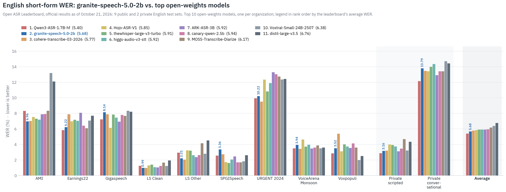
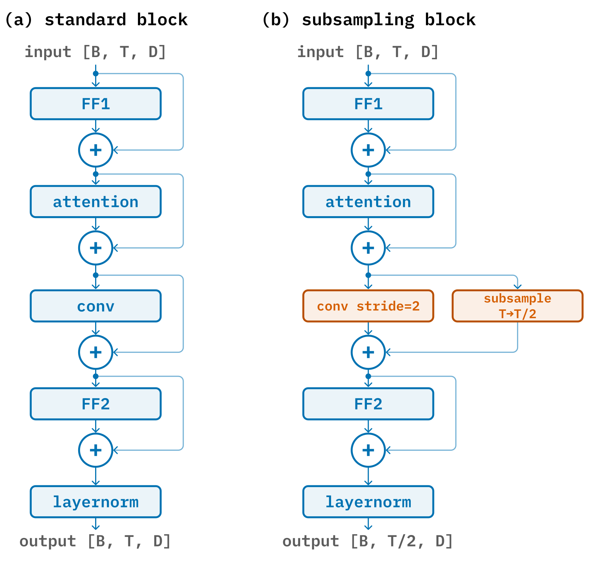

# Granite Speech 5.0 · 2B / TurboCTC：准确率路线与非自回归速度路线共用代际入口

> [!tldr] 我的判断
> 5.0 family最早TurboCTC英文版8/25；2B于10/20新增，TurboCTC多语言权重10/21更新。GGUF不拆模型；两路架构与语言范围分开。

> [!warning] 原始资料覆盖不足，尚未达到完整技术报告精读深度
> 已读本版原卡、官方博客和完整原图；本版完整训练配比、组件消融与统一延迟协议仍不足。相关报告链接保留但本轮未精读，不能宣称达到完整报告精读深度。博客5.06与原图5.68口径冲突显著保留。

## 日期：新checkpoint与旧family更新分开

原卡明确：TurboCTC英文初版2026-08-25；2B版本2026-10-20；TurboCTC多语言更新2026-10-21。家族共用一个叶子，以最早8/25为family日期，10/20新增2B和10/21权重升级列入发布表，不把GGUF再算一次。10/21博客是传播日期，不覆盖原卡首发。

## 为什么需要两条路线

2B把声学表示交给小型语言模型，兼顾转写、翻译、语言ID和最多2000词的关键词偏置。TurboCTC不依赖自回归LLM逐词生成，以CTC greedy直接产生文字，优先速度与边端部署。两者不是仅精度或尺寸不同的相同网络。

| 项目 | 2B | 470M TurboCTC |
|---|---|---|
| ASR输入语言 | 英法德西葡日 | 加意大利语，共7种 |
| 翻译 | 与英语双向；英译意/中文另支持 | 本卡定位ASR，不冒充AST |
| Encoder | 16层Conformer，hidden1024，双CTC头 | 16层Conformer，hidden1024，16384多语BPE |
| 时间压缩 | 2×encoder，再5×Q-former，10Hz | 总8×，100Hz到12.5Hz |
| 语言骨干 | Granite4.0-1B Base中间checkpoint，YaRN16K | 无自回归LLM解码器 |
| 训练量 | 原卡390000小时 | 约153000小时 |
| 训练资源 | 8H100×40天（26+14） | 8H100×24天 |

这些小时数可能重复使用语料、衍生出标点/翻译/上下文版本，不应把所有表行相加宣称独立音频量。2B包含合成日语、关键词、翻译和多说话人材料；存在教师伪标签不等于标签全真。

## 机制：模态桥与时间降采样

2B的声学encoder以字符和BPE两头CTC训练，使用4秒block attention及中间层self-conditioned CTC。非blank posterior用于4帧窗口池化。2层Q-former将15个声学embedding压成3个可学习查询，与LLM LoRA联合训练；不是把原始波形直接交给文本LLM。

TurboCTC输入80维logmel与delta，叠帧后320维；前两Conformer层用strided convolution与pooled residuals进一步降采样，block attention128帧，kernel7。多语言版主要改输出词表与训练，不应把速度改进全归因于参数增大。

## 结果：图、榜单、博客不能偷偷混口径

2B官方原图写明9公开+2私有英文测试，图内总体WER为**5.68**；博客文字写**5.06**并描述公开短语音口径。本文保留两者及来源，不擅自判定同一平均值、也不拿其中较小值替换图例。跨模型“第二名”只限图示组织代表和该快照。

TurboCTC原卡英文WER由5.78到5.51；当前多语言checkpoint的速度–质量图橙点注明非正式结果，榜单条目仍为旧英文版。博客19870 RTFx是吞吐比率，不能当首字延迟或真实手机速度。日语按CER评估，不能直接与英文WER相减。

2B标点PER和大小写Cap-F1并非全面改善：LScln PER25.70→23.20、Cap-F189.71→90.16；CV-FR PER11.00→11.43、Cap-F197.25→97.20，反而变差；VoxPopuli与Earnings22大小写也略降。关键词F1另排除常用词，不是所有词转写准确率。

## 输入与复现边界

2B官方建议16kHz单声道，约2分钟分段，长录音先VAD；示例`max_model_len=2048`是资源配置，不是训练上下文16K的同义词。2B原生Transformers支持起点4.52.1，TurboCTC要求5.16.0；示例与依赖应分别固定，不执行原网页安装命令。

2B GGUF Q8_0官方测试接近未量化版；更低比特在超过约一分钟音频上可能丢准确率。它属于部署格式，不拆叶子。模型都以文字输出，不能说成TTS或任意语音对话模型。5.0的语言/标点能力也不能自动迁移给4.1Plus。

> [!insight] 对Agent训练：输入通道的错误必须可追踪
> 语音Agent监督应保存原音频、VAD边界、原始转写、关键词清单和模型revision。关键词偏置可能提高专名，也可能把没说过的词注入轨迹；分别测召回与误插入。固定音频/预算比较CTC和LLM式转写对最终工具参数、任务完成率及延迟的影响，不把ASR提升当策略RL提升。

## 一手资料

- [🤗 2B Model Card](https://huggingface.co/ibm-granite/granite-speech-5.0-2b)、[TurboCTC Model Card](https://huggingface.co/ibm-granite/granite-speech-5.0-470m-turboctc)、[GGUF原卡](https://huggingface.co/ibm-granite/granite-speech-5.0-2b-GGUF)，本地完整原MD和11张官方图。
- [📰 Tech Blog](https://huggingface.co/blog/ibm-granite/granite-speech-5)。[📄 TurboCTC报告](https://arxiv.org/abs/2609.20104)及2B卡所列历史方法报告保留链接，不下载PDF、不宣称已精读。

> 📊 相关可视化：[[granite_speech_5_poster_zh.html|中文Poster]]

## 10月23日文档补充：托管推理不算新模型

官方2B原卡新增 `automatic-speech-recognition` 标签与 Hosted Inference Endpoint 的 OpenAI-compatible 示例。端点闲置时缩容到零，首次请求可能等待数分钟；这属于服务冷启动，不可当模型稳定推理延迟。示例限制16kHz单声道、约2分钟音频，仍沿用vLLM请求格式。HF_TOKEN由使用者环境提供，本轮未调用收费端点或提交音频。该变化仅同步原卡与说明，**没有确认新权重或能力升级，不新增family、叶子或近30天发布行**。

## 10月29日补充：浏览器ONNX是部署格式

官方新增[2B ONNX Model Card](https://huggingface.co/ibm-granite/granite-speech-5.0-2b-ONNX)，基于5.0 checkpoint重新导出权重并量化，不作为新模型族或新权重能力发布。Transformers.js≥4.3、WebGPU，16kHz单声道；Safari26特别要求该版本。音频encoder为q4（fp32 activations），embedding/decoder为q4f16，三文件分别658/119/948MB，合计约1.725GB文件量，不是浏览器峰值显存。

官方说明复用4.1 ONNX图结构但全部重新来自5.0权重，按本版YaRN factor4重建16,384位置的rotary缓存，不能只拿旧图替换文件名。CPU EP上的73句dummy LibriSpeech测试WER2.43（归一化2.31）低于旧4.1 ONNX的2.70，但这是小样本转换核对，不是完整榜单，也不是WebGPU/Safari端到端速度测试。decoder logits整体为Transformers的1/8；greedy argmax不变，不意味着采样概率或temperature已等价。完整原卡保存为[[src/ONNX|本地ONNX原卡]]，未下载权重或执行示例。
