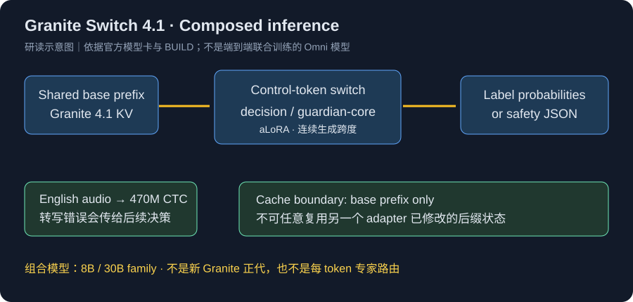
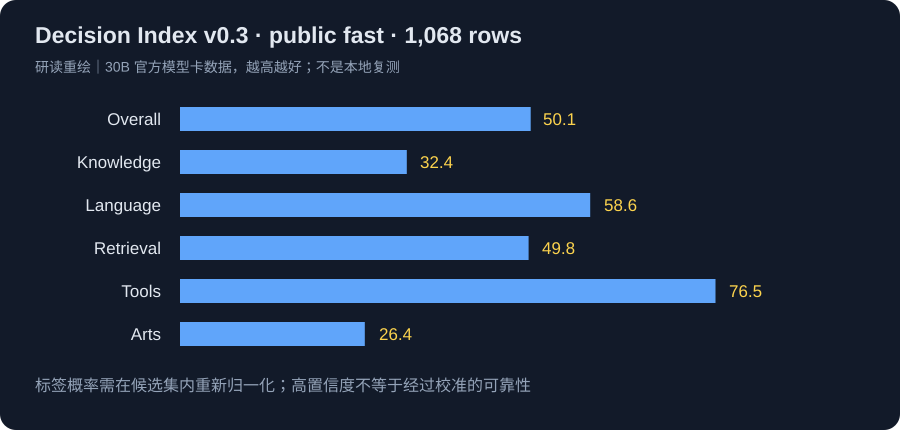

# Granite Switch 4.1

> [!tldr] 核心判断
> Switch 是将 Granite 4.1 主干、两个可切换 aLoRA 和英文 ASR 组合成可复用前缀的系统。值得关注的是专用决策头的概率语义与状态复用，不是把多个组件打包就叫新基模正代。8B、30B 共用一个组合模型支线 family。

> [!warning] 材料与深度
> 已阅读 30B 完整模型卡、官方发布博客和 BUILD 清单，归档 8B 原卡。现有材料足以核对组合方式、推理约束和部分训练目标，但缺少完整训练报告、数据配比与逐组件消融，达不到 GLM / Kimi 完整报告级深度。没有可核实的独立 Tech Report 就不伪造链接。下文两张图是依据原卡绘制的研读示意图，不冒充官方实验图片；本次没有运行权重。

## 日期、模型和组件先分开

HF 模型卡的 Release Date 为 **2026-10-14**，IBM 团队在 HF 发布的博客日期为 **2026-10-15**。Atlas 使用原卡首次发布日期，另记录博客日期；两者只有日级信息，不推测小时和时区。

30B 的主干为 Granite 4.1，dense decoder，GQA / RoPE / SwiGLU / RMSNorm，128K 上下文。BUILD 清单列 64 层、hidden 4096、32 attention heads、vocab 100352。

| 组件 | 明确配置 | 不应误读为 |
|---|---|---|
| 基础模型 | Granite 4.1 8B / 30B | 新训练一套 4.2 主干 |
| decision aLoRA | 30B rank64、alpha128；覆盖注意力与 MLP 投影 | 每 token MoE 路由 |
| guardian-core aLoRA | 30B rank16、alpha64；覆盖 q/k/v/o | 整个 Guardian adapter 库 |
| ASR | Granite Speech 5.0 Turbo CTC，470M | 音频语言端到端联合训练 |
| 权重变化 | 30B base 28,865,728,512 → composed 29,989,814,272 | 两个 rank 本身就解释全部增量 |
| 许可 | Apache-2.0 | 任意业务已有安全认证 |

BUILD 给出的组合增量约 3.89%，还包含打包组件，不能只按 LoRA rank 解释总参数差异。ASR 先生成英文转写再进入语言上下文，错误会沿后续决策传递。

*研读示意图，依据官方原卡；不是官方架构消融。*

## aLoRA 的开关有时间边界

检测控制 token 后，系统在一段连续生成跨度内激活对应 adapter，影响所有层。它是一种粗粒度能力切换，不是 MoE 对每个 token 选专家，也不是多个 Agent 各自独立思考。

关键工程机制是 **KV normalization**：切换前的 base 前缀 KV 可共享，并不缓存另一个 adapter 的内部状态。要复用的是相同 base prefix、相同切换边界。不能把 adapter 已经修改过的后缀 KV 当作任意 adapter 都能读取的共享缓存。

当大量候选动作共享长环境描述时，这种设计可能减少重复预填充。但 adapter 路由、音频转写、后缀生成、通信仍有成本；博客所说接近零额外 VRAM，不能解释为整个系统零开销。

## Decision：分数是候选标签上的概率，不是聊天的自信

Decision 训练的是单 token 标签分类，并对候选标签 logits 做 softmax。设候选标签 token 为 t1…tn，正确的条件分布应为：

$$P(t_i\mid x,\{t_j\})=\frac{\exp(z_i)}{\sum_j\exp(z_j)}.$$

第一步检查每个标签确实是**一个独立 token**，且不同选项不映射到同一个 token。获取这些 token 的 logprob 后，要在候选集合内重新归一化。不能把全词表概率直接称为选项概率，也不能靠重复采样答案频次替代这个接口。

vLLM 的 logprob_token_ids 最多一次请求 128 个 token。选项多时，保持完全相同 prompt / decoding 条件，分块取得各 token 的全词表 logprob，再在完整候选集上统一 softmax；不能每块各自归一化后直接拼接。

安全 adapter 则可以输出含 score 的 JSON，如 yes/no 结果；它不是同一个 decision label 分布。当前打包只有 guardian-core 与 decision，不自动包含其他库里的 factuality、correction、policy 等 adapter。

## Decision Index：能比较什么，不能比较什么

模型卡给出 Decision Index v0.3 public fast、1,068 样本的结果。下表是这一版的官方自报，不与不同版本或私有测试集混排。

| 项目 | 30B 官方值 |
|---|---:|
| Overall | 50.1 |
| Knowledge | 32.4 |
| Language | 58.6 |
| Retrieval | 49.8 |
| Tools | 76.5 |
| Arts | 26.4 |

*研读重绘，原卡 Decision Index v0.3 public fast，越高越好；不是本地复测。*

Tools 较强不意味着常识和艺术类同等可靠，Overall 50.1 也不足以承担无人验收决策。官方 local / hosted 差距约 0.6 points，是对应路径的一致性观察，不是统计置信区间。

原卡评测部分提到固定 decision-engine system prompt，而使用指引强调无 system prompt 以共享 prefix。两条配方不能自动视为同一个评测设置；复现前应确认具体 benchmark 配置，不把“删 system prompt 仍能复现全部成绩”当已证实事实。

博客的 Doom 60–100 decisions/s 和另一方案约 10/s 是演示配置，不是完整匹配硬件、任务与客户端的通用对照；本笔记不将它作为固定倍数收益。

## 部署与失败传播

原卡建议 Python≥3.9、torch≥2.11、transformers 5.16–5.17、vLLM≥0.26 且 <0.28。版本边界是发布时说明，升级后需重新验收控制 token、adapter 载入与概率接口。

ASR 目前是英文、小写且不带标点的转写路径，不适合直接当多语种音频理解保证。录音中的否定词、数值或实体识别错，后续 Decision 仍可能给出很尖锐的概率分布；“很确定地理解错”必须被单列。

Mellea 的 Guardian intrinsic 已有使用路径，Decision intrinsic 当时仍是计划，不能写成全部已上线。基座、adapter、ASR 与 SDK 要分别锁定 revision。

> [!insight] 对 Agent Training 的启发
> 将环境长前缀交给共享 base、在决策点切专用 adapter，是降低重复推理成本的一种路线。奖励不应只看动作选中率，还要比较候选集变化后的校准、拒答阈值、上游转写错误与最终状态。共享缓存是工程前提，决策可靠性是独立实验问题。

## 来源与导航

- [HF Model Card · 30B](https://huggingface.co/ibm-granite/granite-switch-4.1-30b)；[[src/granite-switch-4.1-30b-model-card|本地原卡]]
- [HF Model Card · 8B](https://huggingface.co/ibm-granite/granite-switch-4.1-8b)
- [Tech Blog · IBM 官方团队](https://huggingface.co/blog/ibm-granite/granite-switch-4-1)
- [[src/BUILD|30B 组合清单]]
- [[Topics/13_base_model/IBM_Granite/260429_Granite_4_1/Granite-4.1|Granite 4.1 主干]]

> 📊 相关可视化：[[granite_switch41_poster_zh.html|中文 Poster]]
