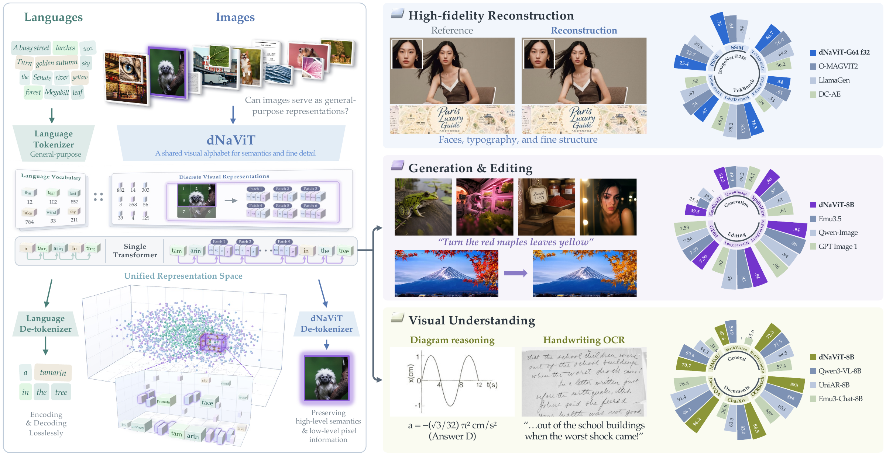
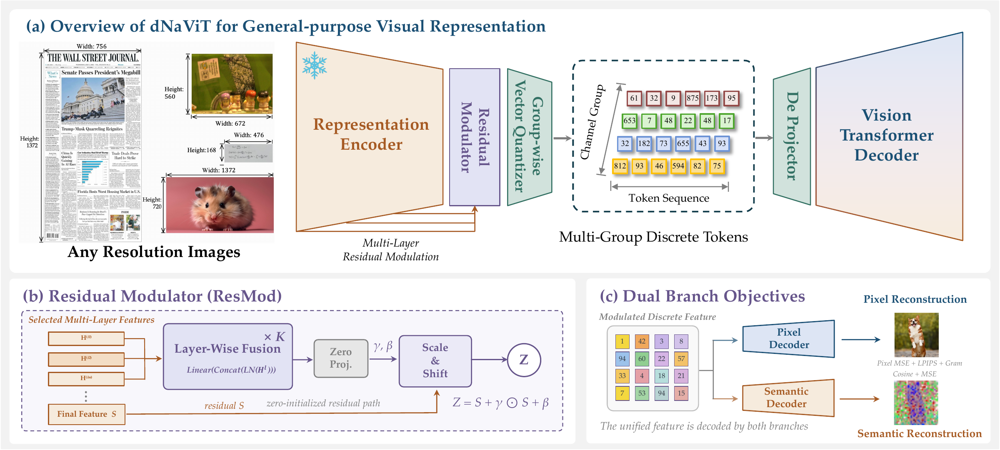
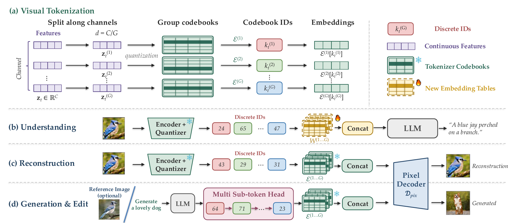
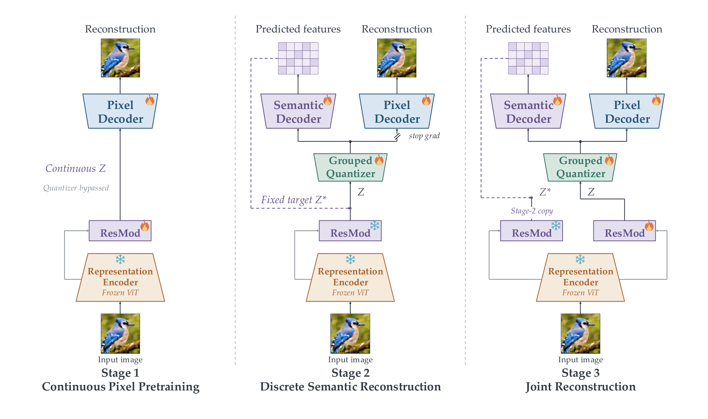
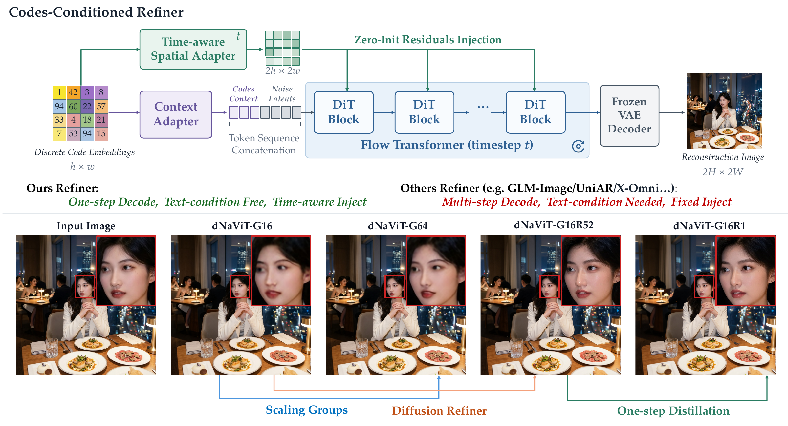
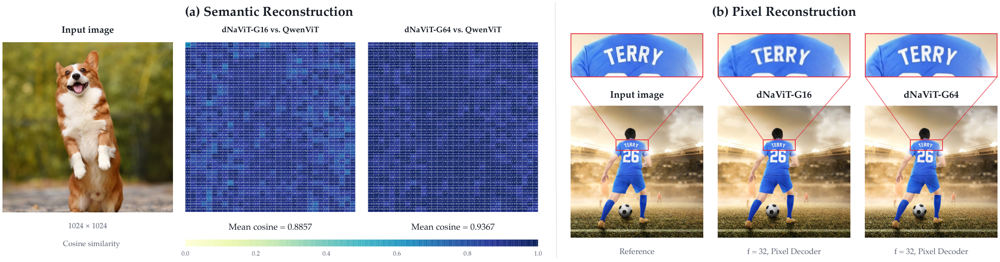
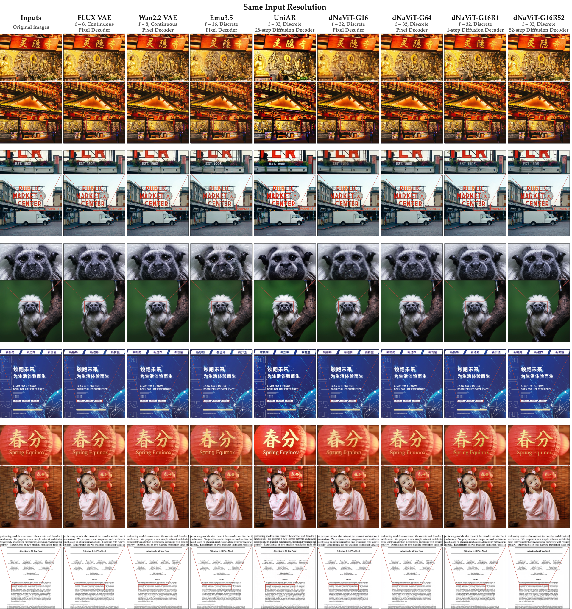

# dNaViT：把视觉词表、重建解码器和下游模型分开看

> [!tldr]
> dNaViT 是独立的视觉 tokenizer 专项研究：冻结 Qwen3-VL 视觉塔，通过残差调制、分组乘积量化和分阶段双重建训练，让同一组离散码同时保留语义与像素细节。它延续 LongCat-Next 的离散多模态路线，但不是 LongCat 新正代，也不是把旧版 8 级 RVQ 换个名字。**本次公开的是四款 tokenizer/重建导出，不包含论文中的 dNaViT-8B 理解、文生图或编辑模型。**

## 发布、家族与可用边界

> [!tldr]
> 11/12 北京17:13的官方HF提交补齐四款实现和权重路径；11/10已有独立README。最早公开公告日仍待核，arXiv的11/9提交日不充当模型首发。Atlas按专项支线收一个family，四款合并。

### 日期证据，为什么不直接写“11月9日发布”

| 证据 | 原始时间 | 北京时间/处理 |
| --- | --- | --- |
| arXiv v1 submission history | 2026-11-09 13:51:18 UTC | 11/9 21:51:18是投稿时间；没有据此证明公开可访问时刻 |
| 官方HF `5677818` | 2026-11-10 09:43:01 UTC | 11/10 17:43:01新增dNaViT README和五张图，四模型目录仅`.gitkeep` |
| 官方HF `926e550` | 2026-11-12 09:13:18 UTC | 11/12 17:13:18新增24文件：每款配置/实现/processor/权重；这是可核仓库开放阶段 |
| 本轮现状 | 11/12晚间实际读取 | 四款公开路径和LFS文件元数据可核；未下载权重或推理 |

GitHub提交历史API本轮403，项目首页没有独立首发公告日期。因此family仍以`2026-11`列在日期待核实区；近30天表仅记录11/12“官方仓库实现/权重补齐”这个明确阶段，**不暗示它是首次向任何人公开**。四个目录属于同一视觉tokenizer family；独立论文/训练目标/发布说明支持单列专项节点，与LongCat-Next主干双向关联。

### 四款模型的共同底座与差别

共同编码器为Qwen3-VL视觉塔：27层、hidden1152、16像素patch与2×2合并，总空间stride32。ResMod配置取层1/3/6/9，2层16头；总codebook embedding维4096。像素解码器24层、width1152；Refiner为34层DiT、width4608、18头，VAE潜变量32通道。论文约500M是视觉塔约400M加ResMod约100M的编码器量级，**不是含Refiner的完整包参数/显存**。

| 版本 | 分组/每组词表 | 每位置名义载荷 | 解码器 | 对齐后输出 |
| --- | --- | --- | --- | --- |
| G16 | 16 / 16384 | 224 bits | ViT pixel | 输入大小 |
| G64 | 64 / 4096 | 768 bits | ViT pixel | 输入大小 |
| G16R1 | 同G16 | 224 bits | 一步Refiner | 高宽各2倍 |
| G16R52 | 同G16 | 224 bits | 52步Refiner | 高宽各2倍 |

对齐是把高宽各自向上取32倍数，不是裁到固定正方形。512²输入的空间网格只有16×16=256个位置，但G16每个位置有16个码索引：名义载荷57344 bits=7168 bytes；G64为196608 bits=24576 bytes，不含存储开销。**空间序列长度不变，不代表比特率、softmax代价或下游训练难度不变。** R1/R52改变解码预算，不改变G16码布局。

HF当前列出G16约2.276GB、G64约2.075GB、两款Refiner各约21.231GB的文件字节数；这只是分发文件大小，不能当运行显存或模型参数量。dNaViT组件明示Apache-2.0；外层LongCat-Next的MIT不覆盖它，第三方组件继续遵守各自许可。

### 从接口读到的复现边界

HF的`forward`把图像交给重建路径，返回RGB PIL图；不是聊天接口。`encode`给出离散索引、网格、4096维codebook特征和1152维decoder投影。多图以打包序列编码，解码前按各自网格拆分；底层encode要求已经对齐、归一化并在设备上，forward才处理对齐。

G16/G64默认混合BF16线性/卷积与FP32码本、归一化、embedding；强行全转BF16可能改变最近邻分配。R1/R52文档要求BF16加载。R1配置里`decode_num_inference_steps=1`，`one_step_schedule_steps=52`是蒸馏时的教师schedule，不是52次推理；端到端延迟还包括编码和VAE。默认decode_seed=0并不保证像素忠实，生成先验可能补出看似合理的文字/人脸细节。未执行`trust_remote_code`或任何官方命令。

## 方法与训练：先隔离梯度，再联合优化

> [!tldr]
> 最有价值的设计不是“离散码”本身，而是让冻结语义空间吸收重建信息、再跨过量化瓶颈时控制梯度干扰。分组PQ、三阶段训练和Refiner分别改变码容量、学习过程、解码先验，实验必须分开归因。

### 残差调制保留语义锚点

多层特征融合后，零初始化的scale/shift分支计算以下残差：

$$
Z=S+\gamma\odot S+\beta
$$

初始化时严格回到冻结视觉塔的语义表示S。可训练的ResMod学习把浅层细节重新暴露给后续码本，不需要全量改写视觉塔。它不是保证“语义零损失”的定理；后面的线性探测和理解消融才是有限分布上的证据。

### Grouped PQ 与旧 LongCat-Next 的 RVQ 区别

本研究把通道分G组，每组独立做最近邻查表，然后拼接量化embedding；并非顺序拟合残差的8级RVQ。组合词表容量是 \(K^G\)，名义位置载荷 \(G\log_2K\)；不能把组合空间当经验熵或已保留语义信息。组索引来自同一图像，分组查表也不保证统计独立。

理解模型通过**新初始化、与LM一起训练**的group-wise embedding读取码索引；像素解码器使用冻结tokenizer自己的codebook embeddings。生成/编辑还要LM和multi-sub-token head预测码序列，这些组件没有包含在本次HF四款tokenizer导出里。

### 双重建损失与三阶段的梯度去向

语义分支使用cosine+MSE，对齐冻结ResMod生成的目标。只有cosine会在强均值/窄锥分布里出现“损失很低、实际表示重建很差”；MSE约束绝对数值。像素分支同时使用L1、像素MSE、VGG-LPIPS、ConvNeXt感知损失、VGG Gram纹理损失。

| 阶段 | 可训练部分 | 冻结/断梯度 | 目的 |
| --- | --- | --- | --- |
| A：连续像素预训练 | ResMod+像素decoder | 冻结ViT，绕过量化 | 先学暴露可重建细节 |
| B：离散语义重建 | 量化器、语义decoder、像素decoder | ViT/ResMod冻结；像素分支输入detach | 防止码本刚形成时被像素梯度拉走 |
| C：联合重建 | student ResMod、量化器、两个decoder | ViT与B阶段teacher ResMod冻结；解除像素detach | 允许联合优化，同时固定语义target防漂移 |

训练图像包括LAION/COYO/DataComp/Recap-DataComp/CapsFusion与内部通用图，TextAtlas5M子集、中英文书报、信息图/ChartGalaxy，以及人脸、SA-1B衍生和高审美图。tokenizer只用图像双重建，先256²、再到native最高2K，总数百B tokens；完整内部数据、去重和各来源混比未披露，不能声称公开代码可复现原始训练数据。

已读取官方三个公开配置：A/B/C峰值LR均1e-4、warmup10000、终值1e-5、weight_decay0、max_grad_norm1、max_batch_tokens16384、max_train_steps1000000；这些是配置上限/示例，**不是实际checkpoint训练步数证明**。B/C commitment0.25，B detach_pixel_decoder=true；C为false且student ResMod LR乘0.1。A配置虽有discriminator_weight0.05，README明示对抗更新起点超出该配置训练时长；不能据此说A实际做GAN训练。配置、HF导出和论文之间的全量对应未独立复现。

论文中的dNaViT-8B理解模型另配Qwen3-8B，alignment/pretraining/midtraining/SFT约70B/150B/60B/30B tokens，合310B；不是tokenizer权重所包含的训练。分类linear probe只在ImageNet1K训练10epoch，SGD momentum0.9/Nesterov、batch1024、峰值LR0.1、weight_decay0；对shift集直接迁移，ObjectNet用官方113个重叠类18574图并去红边。

### Refiner：由码直接条件化的生成解码器

Refiner使用global context tokens和time-conditioned spatial residual两条路径注入离散codebook特征，不用文本prompt。多步teacher用latent flow matching，一步student由teacher初始化，结合回归、同扰动下teacher噪声预测的stop-gradient修正，以及time-aware discriminator对抗监督。它直接以码作为条件，不先把模糊RGB超分；但更锐利不等于恢复原像素真值。

## 实验、完整原表与研究判断

> [!tldr]
> 论文表明这套码能支持多任务，但既没有做到所有任务胜出，也没有公开完整下游8B权重。G16/G64训练配置与时长不同，跨模型训练/推理协议也不同；不能把最好的一项分数当成统一预算的因果结论。

### 最该保留的结果与反例

| 量尺 | dNaViT | 关键对照/边界 |
| --- | --- | --- |
| ImageNet512²重建 | G64 PSNR28.12 / SSIM0.81 | 没有Refiner；不归到R1/R52 |
| TokBench1024² | G64 T-ACC63.08 / T-NED78.27 / F-Sim0.67 | FLUX对应93.09/96.96/0.96，仍有明显差距 |
| TokBench512²小字bucket | G64 T-ACC12.18 | 总均分掩盖小目标识别失败；各分辨率bucket不是固定同一实例 |
| IN1K线性探测 | 离散G16 79.47 | 连续G16 80.40，仍低0.93个百分点；UniTok在IN-R/Sketch/ObjectNet更强 |
| OCRBench / MMMU-Pro | 8B为885 / 44.5 | Qwen3-VL8B为896 / 55.9，不可写成全面优于连续表示 |
| CharXiv DQ/RQ | 86.5 / 51.0 | Qwen3-VL8B为83.0 / 46.4；这是本任务优势 |
| 生成 | GenEval2 49.5 / SpatialGenEval0.68 | 空间分仍低SenseNova0.72；QwenImageBench52.17低于闭源54.07—64.69 |
| GEdit English full | SC7.41 / PQ7.20 / Overall7.30 | 不重新算SC/PQ算术平均；低于Qwen-Image-Edit7.56、Emu3.5 7.59 |
| 1.7B受控理解消融平均 | 连续无ResMod66.31 / 连续+ResMod66.96 / 离散65.05 | OCRBench先除10；离散并未完全追平，8B主表不替代该对照 |

### 如何理解“一个词表服务多任务”

我对这项工作的判断：支持的是“离散瓶颈在合适的表示和训练下可以足够有用”，不是“离散表示普遍无损”或“原始图像信息已全部恢复”。Tokenizer的语义探测、像素重建和经310B tokens训练的理解模型是不同实验对象；Refiner加入生成先验和2×输出又是另一对象。报告把这些层次区分开，才可能把结果转成可检验的设计。

> [!insight]
> 对Agent Training，更直接的实验是固定LM、数据、视觉位置数及码比特预算，比较连续表示、G16、G64的工具任务正确率和OCR错误；再固定码本，只替换pixel decoder/R1/R52，测细节幻觉与端到端成本。需要真实任务结果验证，不把重建PSNR或GenEval2当作工具任务收益。小字12.18%的bucket是很实际的风险提示，重建后的金融表格/票据不应未经核验替代原始图。

尚缺最早公告日、完整原始训练run与内部数据、G16/G64严格匹配预算消融、Refiner完整量化重建表、下游8B权重/训练产物及独立复现。论文HTML正文/9张结果表、项目页、HF说明、三个训练配置和关键导出实现已读；没有抓取PDF/权重、运行代码或模型，也没有假装已经全审全部训练仓库。

### 九张官方结果表（完整行列保留）

以下直接保留论文HTML原表的行与合并单元格，破折号表示原文未提供；星号为作者自行评测缺少报告值的基线。跨来源基线协议不统一。正文判断与原表分开。

### Table 1 · ImageNet重建

<table>
<tr>
<td rowspan="2">Method</td>
<td colspan="3">Configuration</td>
<td colspan="2">ImageNet</td></tr>
<tr>
<td>Resolution</td>
<td>f</td>
<td>

Spatial
positions
</td>
<td>PSNR (dB) ↑    </td>
<td>SSIM ↑</td></tr>
<tr>
<td colspan="6">Continuous representations</td></tr>
<tr>
<td>SD-VAE 1.x / 2.x (Rombach et al., 2022)</td>
<td>256²</td>
<td>8</td>
<td>1024</td>
<td>23.54    </td>
<td>0.68</td></tr>
<tr>
<td>OmniTokenizer (Wang et al., 2024a)</td>
<td>256²</td>
<td>8</td>
<td>1024</td>
<td>26.74    </td>
<td>0.82</td></tr>
<tr>
<td>SD-VAE XL (Podell et al., 2023)</td>
<td>256²</td>
<td>8</td>
<td>1024</td>
<td>27.37    </td>
<td>0.78</td></tr>
<tr>
<td>Qwen-Image (Wu et al., 2025a)</td>
<td>256²</td>
<td>8</td>
<td>1024</td>
<td>32.18    </td>
<td>0.90</td></tr>
<tr>
<td>SD-VAE 3 (Esser et al., 2024)</td>
<td>256²</td>
<td>8</td>
<td>1024</td>
<td>31.29    </td>
<td>0.87</td></tr>
<tr>
<td>Wan2.1 (Team Wan et al., 2025)</td>
<td>256²</td>
<td>8</td>
<td>1024</td>
<td>31.34    </td>
<td>0.89</td></tr>
<tr>
<td>FLUX-VAE (Black Forest Labs, 2024)</td>
<td>256²</td>
<td>8</td>
<td>1024</td>
<td>32.74    </td>
<td>0.92</td></tr>
<tr>
<td>Cosmos-CI (NVIDIA et al., 2025)</td>
<td>256²</td>
<td>16</td>
<td>256</td>
<td>25.07    </td>
<td>0.70</td></tr>
<tr>
<td>VA-VAE (Yao and Wang, 2025)</td>
<td>256²</td>
<td>16</td>
<td>256</td>
<td>27.96    </td>
<td>0.79</td></tr>
<tr>
<td>Wan2.2 (Team Wan, 2025)</td>
<td>256²</td>
<td>16</td>
<td>256</td>
<td>31.25    </td>
<td>0.88</td></tr>
<tr>
<td>PAE-DINOv2‡ (Yue et al., 2026)</td>
<td>256²</td>
<td>16</td>
<td>256</td>
<td>27.28    </td>
<td>–</td></tr>
<tr>
<td>DC-SAE (Huang et al., 2026)</td>
<td>256²</td>
<td>32</td>
<td>64</td>
<td>23.13    </td>
<td>–</td></tr>
<tr>
<td>UniLiP (Tang et al., 2025a)</td>
<td>256²</td>
<td>32</td>
<td>64</td>
<td>22.99    </td>
<td>0.75</td></tr>
<tr>
<td>UniLiP (Tang et al., 2025a)</td>
<td>448²</td>
<td>32</td>
<td>196</td>
<td>24.62    </td>
<td>0.79</td></tr>
<tr>
<td colspan="6">Discrete representations</td></tr>
<tr>
<td>ARM (Wang et al., 2026)</td>
<td>256²</td>
<td>16</td>
<td>256</td>
<td>19.60    </td>
<td>–</td></tr>
<tr>
<td>Cosmos-DI (NVIDIA et al., 2025)</td>
<td>256²</td>
<td>16</td>
<td>256</td>
<td>19.98    </td>
<td>0.54</td></tr>
<tr>
<td>LlamaGen (Sun et al., 2024)</td>
<td>256²</td>
<td>16</td>
<td>256</td>
<td>20.65    </td>
<td>0.54</td></tr>
<tr>
<td>Open-MAGVIT2 (Luo et al., 2024)</td>
<td>256²</td>
<td>16</td>
<td>256</td>
<td>22.70    </td>
<td>0.64</td></tr>
<tr>
<td>BSQ-ViT (Zhao et al., 2024)</td>
<td>256²</td>
<td>16</td>
<td>256</td>
<td>28.14    </td>
<td>0.81</td></tr>
<tr>
<td>BitDance (Ai et al., 2026)</td>
<td>256²</td>
<td>16</td>
<td>256</td>
<td>24.90    </td>
<td>0.72</td></tr>
<tr>
<td>BitDance (Ai et al., 2026)</td>
<td>256²</td>
<td>32</td>
<td>64</td>
<td>25.30    </td>
<td>0.74</td></tr>
<tr>
<td>Emu3.5 (Cui et al., 2025)</td>
<td>512²</td>
<td>16</td>
<td>1024</td>
<td>23.80    </td>
<td>–</td></tr>
<tr>
<td> dNaViT-G16</td>
<td>256²</td>
<td>32</td>
<td>64</td>
<td>22.82    </td>
<td>0.64</td></tr>
<tr>
<td> dNaViT-G64</td>
<td>256²</td>
<td>32</td>
<td>64</td>
<td>25.41    </td>
<td>0.76</td></tr>
<tr>
<td> dNaViT-G16</td>
<td>512²</td>
<td>32</td>
<td>256</td>
<td>25.47    </td>
<td>0.71</td></tr>
<tr>
<td> dNaViT-G64</td>
<td>512²</td>
<td>32</td>
<td>256</td>
<td>28.12    </td>
<td>0.81</td></tr>
<tr>
<td> dNaViT-G16</td>
<td>1024²</td>
<td>32</td>
<td>1024</td>
<td>28.93    </td>
<td>0.81</td></tr>
<tr>
<td> dNaViT-G64</td>
<td>1024²</td>
<td>32</td>
<td>1024</td>
<td>32.90    </td>
<td>0.91</td></tr>
</table>

### Table 2 · TokBench细粒度重建

<table>
<tr>
<td rowspan="2">Method</td>
<td rowspan="2">f</td>
<td colspan="3">Resolution@512× 512</td>
<td colspan="3">Resolution@1024× 1024</td></tr>
<tr>
<td>T-ACC↑</td>
<td>T-NED↑</td>
<td>F-Sim↑</td>
<td>T-ACC↑</td>
<td>T-NED↑</td>
<td>F-Sim↑</td></tr>
<tr>
<td colspan="8">Continuous Autoencoders</td></tr>
<tr>
<td>DC-AE (Chen et al., 2024a)</td>
<td>32</td>
<td>38.25</td>
<td>56.22</td>
<td>0.39</td>
<td>52.14</td>
<td>68.02</td>
<td>0.50</td></tr>
<tr>
<td>VA-VAE (Yao and Wang, 2025)</td>
<td>16</td>
<td>53.30</td>
<td>69.65</td>
<td>0.57</td>
<td>62.84</td>
<td>77.21</td>
<td>0.69</td></tr>
<tr>
<td>SD-XL (Podell et al., 2023)</td>
<td>8</td>
<td>56.86</td>
<td>72.55</td>
<td>0.55</td>
<td>67.84</td>
<td>81.15</td>
<td>0.70</td></tr>
<tr>
<td>SD-3.5 (Stability AI, 2024)</td>
<td>8</td>
<td>81.84</td>
<td>90.30</td>
<td>0.81</td>
<td>89.71</td>
<td>95.05</td>
<td>0.93</td></tr>
<tr>
<td>FLUX.1-dev (Black Forest Labs, 2024)</td>
<td>8</td>
<td>87.64</td>
<td>93.86</td>
<td>0.86</td>
<td>93.09</td>
<td>96.96</td>
<td>0.96</td></tr>
<tr>
<td colspan="8">Discrete Tokenizers</td></tr>
<tr>
<td>VQGAN (Esser et al., 2021)</td>
<td>16</td>
<td>6.12</td>
<td>17.32</td>
<td>0.19</td>
<td>15.00</td>
<td>28.80</td>
<td>0.25</td></tr>
<tr>
<td>Chameleon (Chameleon Team, 2024)</td>
<td>16</td>
<td>11.55</td>
<td>26.80</td>
<td>0.28</td>
<td>23.52</td>
<td>40.39</td>
<td>0.36</td></tr>
<tr>
<td>LlamaGen (Sun et al., 2024)</td>
<td>16</td>
<td>15.01</td>
<td>30.44</td>
<td>0.25</td>
<td>27.19</td>
<td>43.58</td>
<td>0.33</td></tr>
<tr>
<td>VAR (Tian et al., 2024)</td>
<td>16</td>
<td>29.31</td>
<td>50.00</td>
<td>0.32</td>
<td>38.36</td>
<td>59.25</td>
<td>0.40</td></tr>
<tr>
<td>TokenFlow (Qu et al., 2025)</td>
<td>16</td>
<td>17.40</td>
<td>35.49</td>
<td>0.24</td>
<td>29.30</td>
<td>48.09</td>
<td>0.31</td></tr>
<tr>
<td>O-MAGVIT2 (Luo et al., 2024)</td>
<td>16</td>
<td>21.65</td>
<td>39.63</td>
<td>0.31</td>
<td>34.74</td>
<td>52.03</td>
<td>0.40</td></tr>
<tr>
<td>O-MAGVIT2 (pretrain) (Luo et al., 2024)</td>
<td>16</td>
<td>27.33</td>
<td>47.28</td>
<td>0.31</td>
<td>39.40</td>
<td>58.95</td>
<td>0.40</td></tr>
<tr>
<td>UniTok (Ma et al., 2025)</td>
<td>16</td>
<td>50.10</td>
<td>71.08</td>
<td>0.44</td>
<td>49.70</td>
<td>71.59</td>
<td>0.53</td></tr>
<tr>
<td>OmniTokenizer (Wang et al., 2024a)</td>
<td>8</td>
<td>42.48</td>
<td>60.70</td>
<td>0.50</td>
<td>53.48</td>
<td>70.02</td>
<td>0.61</td></tr>
<tr>
<td>LlamaGen (Sun et al., 2024)</td>
<td>8</td>
<td>52.56</td>
<td>68.99</td>
<td>0.53</td>
<td>63.89</td>
<td>78.24</td>
<td>0.67</td></tr>
<tr>
<td>O-MAGVIT2 (Luo et al., 2024)</td>
<td>8</td>
<td>60.56</td>
<td>76.00</td>
<td>0.61</td>
<td>69.68</td>
<td>83.12</td>
<td>0.74</td></tr>
<tr>
<td> dNaViT-G16</td>
<td>32</td>
<td>33.58</td>
<td>52.43</td>
<td>0.34</td>
<td>45.05</td>
<td>62.75</td>
<td>0.41</td></tr>
<tr>
<td> dNaViT-G64</td>
<td>32</td>
<td>51.69</td>
<td>68.72</td>
<td>0.54</td>
<td>63.08</td>
<td>78.27</td>
<td>0.67</td></tr>
</table>

### Table 3 · TokBench按尺度分桶

<table>
<tr>
<td rowspan="2">Method</td>
<td rowspan="2">Resolution</td>
<td colspan="3">T-ACC↑</td>
<td colspan="3">T-NED↑</td>
<td colspan="3">F-Sim↑</td></tr>
<tr>
<td>S</td>
<td>M</td>
<td>L</td>
<td>S</td>
<td>M</td>
<td>L</td>
<td>S</td>
<td>M</td>
<td>L</td></tr>
<tr>
<td>dNaViT-G16</td>
<td>512²</td>
<td>3.52</td>
<td>24.56</td>
<td>72.66</td>
<td>17.60</td>
<td>52.52</td>
<td>87.19</td>
<td>0.14</td>
<td>0.25</td>
<td>0.61</td></tr>
<tr>
<td>dNaViT-G64</td>
<td>512²</td>
<td>12.18</td>
<td>54.94</td>
<td>87.95</td>
<td>34.73</td>
<td>76.67</td>
<td>94.76</td>
<td>0.29</td>
<td>0.49</td>
<td>0.84</td></tr>
<tr>
<td>dNaViT-G16</td>
<td>1024²</td>
<td>10.89</td>
<td>38.81</td>
<td>85.44</td>
<td>28.93</td>
<td>65.58</td>
<td>93.74</td>
<td>0.22</td>
<td>0.35</td>
<td>0.64</td></tr>
<tr>
<td>dNaViT-G64</td>
<td>1024²</td>
<td>26.79</td>
<td>68.50</td>
<td>93.95</td>
<td>51.93</td>
<td>85.29</td>
<td>97.58</td>
<td>0.49</td>
<td>0.65</td>
<td>0.86</td></tr>
</table>

### Table 4 · STEM/通用理解

<table>
<tr>
<td>Method</td>
<td>MMMU</td>
<td>MMMU-Pro</td>
<td>MathVista</td>
<td>MathVision</td>
<td>RealWorldQA</td>
<td>MMStar</td></tr>
<tr>
<td colspan="7">Continuous</td></tr>
<tr>
<td>LLaVA-OV-1.5-8B (An et al., 2025)</td>
<td>55.4</td>
<td>31.3</td>
<td>69.6</td>
<td>25.6</td>
<td>68.1</td>
<td>67.7</td></tr>
<tr>
<td>LLaVA-OV-2-8B (An et al., 2026b)</td>
<td>–</td>
<td>–</td>
<td>–</td>
<td>–</td>
<td>69.7</td>
<td>64.8</td></tr>
<tr>
<td>InternVL3-8B (Zhu et al., 2025)</td>
<td>62.7</td>
<td>–</td>
<td>71.6</td>
<td>29.3</td>
<td>70.8</td>
<td>68.2</td></tr>
<tr>
<td>InternVL3.5-8B (Wang et al., 2025b)</td>
<td>73.4</td>
<td>–</td>
<td>78.4</td>
<td>56.8</td>
<td>67.5</td>
<td>69.3</td></tr>
<tr>
<td>Kimi-VL-A3B (Kimi Team, 2025)</td>
<td>57.0</td>
<td>36.0</td>
<td>68.7</td>
<td>21.4</td>
<td>68.1</td>
<td>61.3</td></tr>
<tr>
<td>MiMo-VL-7B-2508 (Xiaomi, 2025)</td>
<td>63.1</td>
<td>–</td>
<td>–</td>
<td>–</td>
<td>–</td>
<td>–</td></tr>
<tr>
<td>BAGEL-7B (Deng et al., 2025)</td>
<td>55.3</td>
<td>–</td>
<td>73.1</td>
<td>–</td>
<td>–</td>
<td>–</td></tr>
<tr>
<td>Show-o2-7B (Xie et al., 2025b)</td>
<td>48.9</td>
<td>–</td>
<td>–</td>
<td>–</td>
<td>–</td>
<td>56.6</td></tr>
<tr>
<td>Molmo2-8B (Clark et al., 2026)</td>
<td>53.0</td>
<td>–</td>
<td>58.9</td>
<td>–</td>
<td>77.6</td>
<td>–</td></tr>
<tr>
<td>Nemotron-VL-12B (NVIDIA, 2025)</td>
<td>55.3</td>
<td>–</td>
<td>69.0</td>
<td>31.5</td>
<td>76.2</td>
<td>65.9</td></tr>
<tr>
<td>Eagle2.5-8B (Chen et al., 2025a)</td>
<td>55.8</td>
<td>–</td>
<td>67.8</td>
<td>–</td>
<td>76.7</td>
<td>66.2</td></tr>
<tr>
<td>Phi-4-multimodal (Microsoft, 2025)</td>
<td>55.1</td>
<td>38.5</td>
<td>62.4</td>
<td>–</td>
<td>–</td>
<td>–</td></tr>
<tr>
<td>PLM-8B (Cho et al., 2025)</td>
<td>46.1</td>
<td>–</td>
<td>–</td>
<td>–</td>
<td>75.0</td>
<td>–</td></tr>
<tr>
<td>Qwen2.5-VL-7B (Bai et al., 2025b)</td>
<td>58.6</td>
<td>38.3</td>
<td>68.2</td>
<td>25.1</td>
<td>–</td>
<td>63.9</td></tr>
<tr>
<td>Qwen3-VL-8B (Bai et al., 2025a)</td>
<td>69.6</td>
<td>55.9</td>
<td>77.2</td>
<td>53.9</td>
<td>71.5</td>
<td>70.9</td></tr>
<tr>
<td colspan="7">Discrete</td></tr>
<tr>
<td>Emu3-Chat-8B (Wang et al., 2024b)</td>
<td>31.6</td>
<td>–</td>
<td>47.6*</td>
<td>15.6*</td>
<td>57.4</td>
<td>46.5*</td></tr>
<tr>
<td>Tar-7B (Han et al., 2026)</td>
<td>39.0</td>
<td>–</td>
<td>–</td>
<td>–</td>
<td>–</td>
<td>–</td></tr>
<tr>
<td>ViQ-7B (Yu et al., 2026)</td>
<td>49.1</td>
<td>–</td>
<td>–</td>
<td>–</td>
<td>–</td>
<td>54.2</td></tr>
<tr>
<td>UniAR-8B (Peng et al., 2026)</td>
<td>44.3</td>
<td>22.7*</td>
<td>50.8*</td>
<td>–</td>
<td>68.5</td>
<td>56.7*</td></tr>
<tr>
<td>Kelix-8B (Ding et al., 2026)</td>
<td>54.1</td>
<td>–</td>
<td>76.5</td>
<td>–</td>
<td>72.1</td>
<td>–</td></tr>
<tr>
<td>LLaDA2.0-Uni (Bie et al., 2026)</td>
<td>50.1</td>
<td>34.0</td>
<td>68.1</td>
<td>26.7</td>
<td>66.7</td>
<td>64.1</td></tr>
<tr>
<td> dNaViT-8B</td>
<td>70.7</td>
<td>44.5</td>
<td>79.0</td>
<td>56.5</td>
<td>72.3</td>
<td>66.7</td></tr>
</table>

### Table 5 · 分类与分布偏移

<table>
<tr>
<td>Method</td>
<td>f</td>
<td>Latent Shape</td>
<td>IN-1K</td>
<td>IN-A</td>
<td>IN-R</td>
<td>IN-V2</td>
<td>IN-Sketch</td>
<td>ObjectNet</td></tr>
<tr>
<td colspan="9">Continuous</td></tr>
<tr>
<td>QwenViT (Bai et al., 2025a)</td>
<td>32</td>
<td>16× 16</td>
<td>80.45</td>
<td>60.13</td>
<td>65.00</td>
<td>70.18</td>
<td>46.57</td>
<td>56.48</td></tr>
<tr>
<td>InternViT (Wang et al., 2025b)</td>
<td>28</td>
<td>16× 16</td>
<td>76.19</td>
<td>30.23</td>
<td>59.98</td>
<td>65.68</td>
<td>35.77</td>
<td>46.36</td></tr>
<tr>
<td>MoonViT (Kimi Team, 2025)</td>
<td>28</td>
<td>16× 16</td>
<td>75.40</td>
<td>23.96</td>
<td>49.24</td>
<td>63.34</td>
<td>34.88</td>
<td>45.46</td></tr>
<tr>
<td> dNaViT-G16†</td>
<td>32</td>
<td>16× 16</td>
<td>80.40</td>
<td>60.25</td>
<td>65.19</td>
<td>70.18</td>
<td>46.56</td>
<td>56.48</td></tr>
<tr>
<td colspan="9">Discrete</td></tr>
<tr>
<td>UniAR (Peng et al., 2026)</td>
<td>32</td>
<td>16× 16</td>
<td>66.54</td>
<td>14.52</td>
<td>36.13</td>
<td>54.11</td>
<td>15.40</td>
<td>29.16</td></tr>
<tr>
<td>UniTok (Ma et al., 2025)</td>
<td>16</td>
<td>16× 16</td>
<td>78.56</td>
<td>47.81</td>
<td>71.10</td>
<td>68.18</td>
<td>51.03</td>
<td>60.53</td></tr>
<tr>
<td>TokenFlow (Qu et al., 2025)</td>
<td>16</td>
<td>16× 16</td>
<td>48.32</td>
<td>6.88</td>
<td>24.81</td>
<td>37.93</td>
<td>15.35</td>
<td>15.89</td></tr>
<tr>
<td>Emu3.5 (Cui et al., 2025)</td>
<td>16</td>
<td>16× 16</td>
<td>8.39</td>
<td>1.16</td>
<td>3.08</td>
<td>5.87</td>
<td>0.77</td>
<td>2.71</td></tr>
<tr>
<td> dNaViT-G16</td>
<td>32</td>
<td>16× 16</td>
<td>79.47</td>
<td>56.35</td>
<td>68.09</td>
<td>69.81</td>
<td>45.02</td>
<td>59.79</td></tr>
</table>

### Table 6 · OCR/文档/图表

<table>
<tr>
<td>Method</td>
<td>OCRBench</td>
<td> 

OCRBench V2

(en/zh)
</td>
<td> 

CharXiv

(DQ/RQ)
</td>
<td>DocVQA</td>
<td>InfoVQA</td>
<td> 

OmniDocBench

(en/zh)↓
</td></tr>
<tr>
<td colspan="7">Continuous</td></tr>
<tr>
<td>LLaVA-OV-1.5-8B (An et al., 2025)</td>
<td>829</td>
<td>–</td>
<td>70.9/–</td>
<td>95.0</td>
<td>78.4</td>
<td>–</td></tr>
<tr>
<td>LLaVA-OV-2-8B (An et al., 2026b)</td>
<td>782</td>
<td>–</td>
<td>–</td>
<td>95.2</td>
<td>74.4</td>
<td>–</td></tr>
<tr>
<td>InternVL3-8B (Zhu et al., 2025)</td>
<td>880</td>
<td>–</td>
<td>73.6/37.6</td>
<td>92.7</td>
<td>76.8</td>
<td>–</td></tr>
<tr>
<td>InternVL3.5-8B (Wang et al., 2025b)</td>
<td>832</td>
<td>–</td>
<td>72.2/44.4</td>
<td>92.3</td>
<td>76.2</td>
<td>–</td></tr>
<tr>
<td>Kimi-VL-A3B (Kimi Team, 2025)</td>
<td>867</td>
<td>–</td>
<td>–</td>
<td>–</td>
<td>83.2</td>
<td>–</td></tr>
<tr>
<td>MiMo-VL-7B-2508 (Xiaomi, 2025)</td>
<td>881</td>
<td>–</td>
<td>–</td>
<td>–</td>
<td>–</td>
<td>–</td></tr>
<tr>
<td>Molmo2-8B (Clark et al., 2026)</td>
<td>–</td>
<td>–</td>
<td>–</td>
<td>93.2</td>
<td>80.1</td>
<td>–</td></tr>
<tr>
<td>Nemotron-VL-12B (NVIDIA, 2025)</td>
<td>856</td>
<td>62.0/44.2</td>
<td>76.5/41.7</td>
<td>94.7</td>
<td>79.4</td>
<td>–</td></tr>
<tr>
<td>Eagle2.5-8B (Chen et al., 2025a)</td>
<td>869</td>
<td>–</td>
<td>–</td>
<td>94.1</td>
<td>80.4</td>
<td>–</td></tr>
<tr>
<td>Phi-4-multimodal (Microsoft, 2025)</td>
<td>844</td>
<td>–</td>
<td>–</td>
<td>93.2</td>
<td>72.7</td>
<td>–</td></tr>
<tr>
<td>PLM-8B (Cho et al., 2025)</td>
<td>870</td>
<td>–</td>
<td>–</td>
<td>94.6</td>
<td>80.9</td>
<td>–</td></tr>
<tr>
<td>Qwen2.5-VL-7B (Bai et al., 2025b)</td>
<td>864</td>
<td>56.3/57.2</td>
<td>73.9/42.5</td>
<td>95.7</td>
<td>82.6</td>
<td>0.31/0.40</td></tr>
<tr>
<td>Qwen3-VL-8B (Bai et al., 2025a)</td>
<td>896</td>
<td>65.4/61.2</td>
<td>83.0/46.4</td>
<td>96.1</td>
<td>83.1</td>
<td>0.17/0.26</td></tr>
<tr>
<td colspan="7">Discrete</td></tr>
<tr>
<td>Emu3-Chat-8B (Wang et al., 2024b)</td>
<td>687</td>
<td>–</td>
<td>36.8*/14.1*</td>
<td>76.3</td>
<td>42.7*</td>
<td>–</td></tr>
<tr>
<td>X-Omni-7B (Geng et al., 2025)</td>
<td>704</td>
<td>–</td>
<td>–</td>
<td>88.6</td>
<td>–</td>
<td>–</td></tr>
<tr>
<td>ViQ-7B (Yu et al., 2026)</td>
<td>711</td>
<td>–</td>
<td>–</td>
<td>88.9</td>
<td>55.3</td>
<td>–</td></tr>
<tr>
<td>UniAR-8B (Peng et al., 2026)</td>
<td>833</td>
<td>43.0*/48.6*</td>
<td>63.3*/26.8*</td>
<td>91.4</td>
<td>68.9*</td>
<td>0.48*/0.43*</td></tr>
<tr>
<td>Kelix-8B (Ding et al., 2026)</td>
<td>867</td>
<td>–</td>
<td>–</td>
<td>–</td>
<td>–</td>
<td>–</td></tr>
<tr>
<td>LLaDA2.0-Uni (Bie et al., 2026)</td>
<td>757</td>
<td>–</td>
<td>68.4/–</td>
<td>89.5</td>
<td>70.1</td>
<td>–</td></tr>
<tr>
<td> dNaViT-8B</td>
<td>885</td>
<td>57.6/60.1</td>
<td>86.5/51.0</td>
<td>96.2</td>
<td>79.2</td>
<td>0.17/0.22</td></tr>
</table>

### Table 7 · 文生图

<table>
<tr>
<td>Model</td>
<td>Comp.</td>
<td>Params.</td>
<td> 

GenEval2

GM
</td>
<td> 

QwenImage

Bench
</td>
<td> 

Spatial

GenEval
</td>
<td> 

LongText

EN
</td>
<td> 

LongText

CN
</td></tr>
<tr>
<td colspan="8">Proprietary Models</td></tr>
<tr>
<td>GPT Image 1 (OpenAI, 2025)</td>
<td>–</td>
<td>–</td>
<td>–</td>
<td>54.07</td>
<td>0.61</td>
<td>0.96</td>
<td>0.62</td></tr>
<tr>
<td>Seedream 4.0 (ByteDance Seed, 2025)</td>
<td>–</td>
<td>–</td>
<td>–</td>
<td>56.21</td>
<td>0.63</td>
<td>0.92</td>
<td>0.93</td></tr>
<tr>
<td>Seedream 4.5 (ByteDance Seed, 2026)</td>
<td>–</td>
<td>–</td>
<td>–</td>
<td>56.78</td>
<td>–</td>
<td>0.99</td>
<td>0.99</td></tr>
<tr>
<td>GPT Image 2 (OpenAI, 2026)</td>
<td>–</td>
<td>–</td>
<td>–</td>
<td>64.69</td>
<td>–</td>
<td>0.96</td>
<td>0.98</td></tr>
<tr>
<td>Nano Banana (Google, 2025b)</td>
<td>–</td>
<td>–</td>
<td>44.6</td>
<td>–</td>
<td>0.62</td>
<td>0.87</td>
<td>0.33</td></tr>
<tr>
<td>Nano Banana 2.0 (Google Cloud, 2026)</td>
<td>–</td>
<td>–</td>
<td>–</td>
<td>59.82</td>
<td>–</td>
<td>0.98</td>
<td>0.95</td></tr>
<tr>
<td>Nano Banana Pro (Google, 2025a)</td>
<td>–</td>
<td>–</td>
<td>–</td>
<td>59.45</td>
<td>–</td>
<td>0.98</td>
<td>0.95</td></tr>
<tr>
<td colspan="8">Diffusion Models</td></tr>
<tr>
<td>HiDream-I1-Full (Cai et al., 2025)</td>
<td>16×</td>
<td>17B</td>
<td>–</td>
<td>43.08</td>
<td>–</td>
<td>0.54</td>
<td>0.02</td></tr>
<tr>
<td>FLUX.1 [dev] (Black Forest Labs, 2024)</td>
<td>16×</td>
<td>12B</td>
<td>18.3</td>
<td>21.58</td>
<td>0.57</td>
<td>0.61</td>
<td>0.01</td></tr>
<tr>
<td>BAGEL (Deng et al., 2025)</td>
<td>16×</td>
<td>14B</td>
<td>23.1</td>
<td>42.04</td>
<td>0.57</td>
<td>0.37</td>
<td>0.31</td></tr>
<tr>
<td>Z-Image (Z-Image Team, 2025)</td>
<td>16×</td>
<td>6B</td>
<td>31.8</td>
<td>49.10</td>
<td>–</td>
<td>0.94</td>
<td>0.94</td></tr>
<tr>
<td>Z-Image-Turbo (Z-Image Team, 2025)</td>
<td>–</td>
<td>6B</td>
<td>31.0</td>
<td>–</td>
<td>0.59</td>
<td>0.92</td>
<td>0.93</td></tr>
<tr>
<td>Qwen-Image (Wu et al., 2025a)</td>
<td>16×</td>
<td>20B</td>
<td>33.8</td>
<td>49.23</td>
<td>0.61</td>
<td>0.94</td>
<td>0.95</td></tr>
<tr>
<td>Qwen-Image-2512 (Qwen Team, 2025a)</td>
<td>–</td>
<td>20B</td>
<td>29.0</td>
<td>52.06</td>
<td>0.60</td>
<td>0.96</td>
<td>0.97</td></tr>
<tr>
<td>OmniGen2 (Wu et al., 2025b)</td>
<td>16×</td>
<td>4B</td>
<td>18.7</td>
<td>40.70</td>
<td>0.56</td>
<td>0.56</td>
<td>0.06</td></tr>
<tr>
<td>SANA-1.5 (Xie et al., 2025a)</td>
<td>32×</td>
<td>4.8B</td>
<td>17.5</td>
<td>35.14</td>
<td>0.54</td>
<td>0.05</td>
<td>–</td></tr>
<tr>
<td>SenseNova-U1-8B (Diao et al., 2026)</td>
<td>–</td>
<td>8B</td>
<td>40.5</td>
<td>49.02</td>
<td>0.72</td>
<td>0.95</td>
<td>0.82</td></tr>
<tr>
<td colspan="8">Autoregressive Models</td></tr>
<tr>
<td>Janus-Pro-7B (Chen et al., 2025b)</td>
<td>16×</td>
<td>7B</td>
<td>4.6</td>
<td>23.53</td>
<td>0.51</td>
<td>0.02</td>
<td>0.01</td></tr>
<tr>
<td>GLM-Image (Z.ai, 2026)</td>
<td>16×</td>
<td>16B</td>
<td>22.2</td>
<td>48.19</td>
<td>0.58</td>
<td>0.95</td>
<td>0.98</td></tr>
<tr>
<td>Emu3.5 (Cui et al., 2025)</td>
<td>16×</td>
<td>34.1B</td>
<td>25.4</td>
<td>49.89</td>
<td>0.57</td>
<td>0.98</td>
<td>0.93</td></tr>
<tr>
<td> dNaViT-8B</td>
<td>32×</td>
<td>8B</td>
<td>49.5</td>
<td>52.17</td>
<td>0.68</td>
<td>0.94</td>
<td>0.94</td></tr>
</table>

### Table 8 · GEdit编辑

<table>
<tr>
<td>Model</td>
<td>Comp.</td>
<td>Params.</td>
<td>SC ↑</td>
<td>PQ ↑</td>
<td>Overall ↑</td></tr>
<tr>
<td colspan="6">Proprietary Models</td></tr>
<tr>
<td>Gemini 2.0 (Kampf and Brichtova, 2025)</td>
<td>–</td>
<td>–</td>
<td>6.73</td>
<td>6.61</td>
<td>6.32</td></tr>
<tr>
<td>Gemini 2.5 Flash Image (Fortin et al., 2025)</td>
<td>–</td>
<td>–</td>
<td>7.41</td>
<td>7.96</td>
<td>7.10</td></tr>
<tr>
<td>GPT-Image-1 [High] (OpenAI, 2025)</td>
<td>–</td>
<td>–</td>
<td>7.85</td>
<td>7.62</td>
<td>7.53</td></tr>
<tr>
<td colspan="6">Open Models</td></tr>
<tr>
<td>AnyEdit (Yu et al., 2024a)</td>
<td>8×</td>
<td>0.9B</td>
<td>3.18</td>
<td>5.82</td>
<td>3.21</td></tr>
<tr>
<td>Instruct-Pix2Pix (Brooks et al., 2023)</td>
<td>8×</td>
<td>0.9B</td>
<td>3.58</td>
<td>5.49</td>
<td>3.68</td></tr>
<tr>
<td>MagicBrush (Zhang et al., 2023)</td>
<td>8×</td>
<td>0.9B</td>
<td>4.68</td>
<td>5.66</td>
<td>4.52</td></tr>
<tr>
<td>UniWorld-v1 (Lin et al., 2025)</td>
<td>16×</td>
<td>12B</td>
<td>4.93</td>
<td>7.43</td>
<td>4.85</td></tr>
<tr>
<td>OmniGen (Xiao et al., 2024)</td>
<td>16×</td>
<td>3.8B</td>
<td>5.96</td>
<td>5.89</td>
<td>5.06</td></tr>
<tr>
<td>FLUX.1 Kontext [Dev] (Black Forest Labs et al., 2025)</td>
<td>16×</td>
<td>12B</td>
<td>6.52</td>
<td>7.38</td>
<td>6.00</td></tr>
<tr>
<td>OmniGen2 (Wu et al., 2025b)</td>
<td>16×</td>
<td>4B</td>
<td>7.16</td>
<td>6.77</td>
<td>6.41</td></tr>
<tr>
<td>BAGEL (Deng et al., 2025)</td>
<td>16×</td>
<td>14B</td>
<td>7.36</td>
<td>6.83</td>
<td>6.52</td></tr>
<tr>
<td>Step1X-Edit (Liu et al., 2025)</td>
<td>16×</td>
<td>12B</td>
<td>7.66</td>
<td>7.35</td>
<td>6.97</td></tr>
<tr>
<td>Qwen-Image-Edit (Qwen Team, 2025b)</td>
<td>16×</td>
<td>20B</td>
<td>8.00</td>
<td>7.86</td>
<td>7.56</td></tr>
<tr>
<td>Emu3.5 (Cui et al., 2025)</td>
<td>16×</td>
<td>34.1B</td>
<td>8.11</td>
<td>7.70</td>
<td>7.59</td></tr>
<tr>
<td> dNaViT-8B</td>
<td>32×</td>
<td>8B</td>
<td>7.41</td>
<td>7.20</td>
<td>7.30</td></tr>
</table>

### Table 9 · 受控表示消融

<table>
<tr>
<td>Exp ID</td>
<td>Type</td>
<td>ResMod</td>
<td>MMMU</td>
<td>RealWorldQA</td>
<td>MMStar</td>
<td>OCRBench</td>
<td>TextVQA</td>
<td>AI2D</td>
<td>ChartQA</td>
<td>DocVQA</td>
<td>Avg. ↑</td></tr>
<tr>
<td>1</td>
<td rowspan="3">Continuous</td>
<td>✗</td>
<td>39.44</td>
<td>60.26</td>
<td>44.60</td>
<td>695</td>
<td>74.84</td>
<td>81.87</td>
<td>73.64</td>
<td>86.29</td>
<td>66.31</td></tr>
<tr>
<td>2</td>
<td>✓</td>
<td>40.56</td>
<td>60.92</td>
<td>45.33</td>
<td>695</td>
<td>74.89</td>
<td>81.51</td>
<td>73.16</td>
<td>86.01</td>
<td>66.48</td></tr>
<tr>
<td>3</td>
<td>✓</td>
<td>40.00</td>
<td>62.61</td>
<td>46.60</td>
<td>713</td>
<td>75.05</td>
<td>81.31</td>
<td>72.80</td>
<td>86.01</td>
<td>66.96</td></tr>
<tr>
<td>4</td>
<td>Discrete</td>
<td>✓</td>
<td>38.33</td>
<td>59.08</td>
<td>45.73</td>
<td>682</td>
<td>73.49</td>
<td>80.60</td>
<td>71.00</td>
<td>83.98</td>
<td>65.05</td></tr>
</table>

### 第一手来源与关联

- [HF独立dNaViT README](https://huggingface.co/meituan-longcat/LongCat-Next/blob/main/dNaViT/README.md)
- [11/12代码与四款权重新增提交](https://huggingface.co/meituan-longcat/LongCat-Next/commit/926e550cb64ac1a4469117dafc7f1a14303cd23a)
- [11/10仅README/图片和占位目录提交](https://huggingface.co/meituan-longcat/LongCat-Next/commit/567781844d14891ac173c320f702e8052dd85bc7)
- [独立项目页](https://lixiaotong97.github.io/dNaViT/)
- [Tech Report HTML全文](https://arxiv.org/html/2611.12426v1)；[官方PDF链接（未下载）](https://arxiv.org/pdf/2611.12426)
- [官方代码/训练说明](https://github.com/meituan-longcat/LongCat-Next/tree/main/dNaViT)
- [[Topics/13_base_model/Meituan_LongCat/2603_LongCat_Next/LongCat-Next-Lexicalizing-Modalities-as-Discrete-Tokens|LongCat-Next旧版路线]]；旧笔记中的Qwen2.5-ViT/8级RVQ不覆盖本次Qwen3-VL/Grouped PQ实现。
- [[dnavit_poster_zh.html|中文Poster]]
