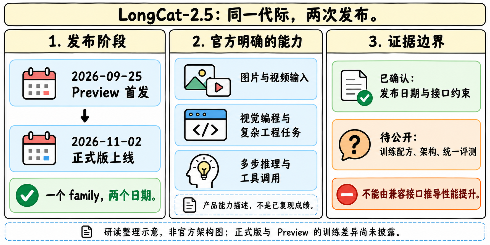
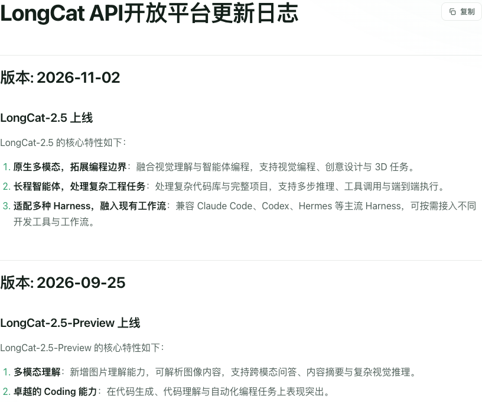

# LongCat-2.5：从 Preview 到正式版

> [!tldr]
> 2026-11-02，美团官方日志宣布 LongCat-2.5 上线：重点是视觉输入参与工程任务、长程代码库处理，以及与开发工具的协同。它与 9 月 25 日的 Preview 共用一个 2.5 family，分别记录首发和正式发布。现有资料能确定产品接口和发布阶段，不能证明正式版相对 Preview 的训练变化或性能提升。

> [!warning] 原始资料不足，尚不能达到完整技术精读标准
> 截至 2026-11-03，本轮查阅官方 HF 清单、发布日志和当前产品说明，未找到 LongCat-2.5 专属的完整 HF model card 或 Tech Report，也没有同一 harness 下 Preview 与正式版的成对评测。因此，本笔记仍无法达到 GLM-5.3-Flash / Kimi-K3 的架构、训练与实验深度。下文把已知事实、尚存的文档同步问题和建议验收分开；不使用其他 LongCat 论文的参数或训练配方填补空白。

## 发布与证据

> [!tldr]
> 两个日期对应同一家族的不同发布阶段。正式版不是一条额外的“新正代”，官方的产品定位也不是已完成复现的实验结论。

### 两个阶段怎样归档

| 阶段 | 日期 | 官方证据 | Atlas 如何处理 |
|---|---|---|---|
| LongCat-2.5-Preview 首发 | 2026-09-25 | 中文发布日志的 Preview 条目 [S1] | 保留 family 首发日期与历史链接 |
| LongCat-2.5 正式版 | 2026-11-02 | 同一日志新增正式版条目；当前模型页已使用不带 Preview 的名称 [S1][S2] | 原 family 增加正式发布事件，进入近 30 天表；不重复造叶 |
| 抓取与整理 | 2026-11-02 | 原始 HTML、正文提取、SHA-256 和旧版快照位于 src/ | 这是核查时间，不是另一个模型发布日期 |

本轮 HF 组织仓库清单没有新增或修改信号，但中文日志已经发布正式版。这说明只监控 HF 会漏掉闭源或先上线服务的发布阶段。图中的截图来自官方页面；手绘图由本笔记整理，二者来源性质不同。

### 正式版说了什么，尚未说什么

官方新增条目把视觉编程、创意设计、3D 任务与复杂工程项目并列为应用方向，并提到多步推理、工具调用和端到端执行，以及 Claude Code、Codex、Hermes 等工具适配。[S1]

这能支持“模型服务面向多模态工程 Agent”的判断，却不能直接支持以下推论：3D 任务不等于公开了原生三维生成架构；端到端执行不等于无须工具或执行环境；兼容若干开发工具不等于在相同任务与预算下优于其他模型。Preview 的首发记录已经包含图片理解，不能把所有视觉能力都说成 11 月 2 日第一次出现。

| 可以确认 | 仍不能确认 |
|---|---|
| 正式版名称和明确上线日期 | 是否重新预训练、增量训练，或采用不同后训练配方 |
| 图片/视频的产品输入方式 [S3] | 视觉编码器、视频采样策略、原生融合的具体结构 |
| 当前上下文与参数文档 [S2][S4] | 长上下文有效利用率、最大负载下的稳定性与延迟 |
| 接入文档和公开价格 [S5][S6] | 公平横评、置信区间、数据污染控制及训练数据构成 |

尤其不能把 LongCat-2.0 的论文规模、ASIC 训练描述或其他 Flash 系列的 MoE 结构直接写成 2.5 的事实。没有独立报告时，family 的技术继承关系也需要证据。

> 11月3日仅修正文档参数：最大输出口径统一256K、图片每请求上限100；正式版日期仍11月2日，不新增发布事件。

## 接口与边界

> [!tldr]
> 11月3日复查，英文Quick Start已从128K改为256K，与参数页一致；图片上限50→100。它们是服务文档修订，不是新checkpoint证据；未实际调用验证。

### 上下文、输出与思考预算

| 项目 | 当前官方原文口径 | 阅读时应怎样理解 |
|---|---|---|
| 总上下文 | 参数页为 1,048,576 tokens，含输入与输出 [S4] | 不能把最大输入与最大输出同时当作两个独立额度 |
| 最大输出 | 参数页 max_tokens 为 262,144（256K）[S4] | 指请求的输出上限；不是质量保证 |
| Quick Start同步 | 11/3已写256K，原11/2快照为128K [S2] | 文档冲突已解除；不是服务上限实测 |
| 思考预算 | thinking_budget 最大 262,144 [S4] | 文档未完整解释所有协议中的共享/计数关系；不能再叠加一个独立 256K 输出额度 |
| 截断 | 达到生成上限时 finish_reason 为 length [S4] | 这与代码是否完成、测试是否通过是不同状态 |

**11/3修订：** Quick Start与参数页当前均写256K，11/2两种口径已保留到history。对需要超长生成的使用场景，应在固定接口、模型名、请求参数与实际返回下复核；本次只做资料整理，没有消耗配额运行模型，也没有把某一页的较大数字当成实测值。

思考开关使用 enabled / disabled；温度分别固定为 1.0 / 0.7，其他传入值可能被覆盖。参数页还列出 top_p、top_k 与 repetition_penalty 的范围。[S4] 这意味着比较实验必须记录服务实际采用的设置，不能以为请求里写了同一个 temperature 就已经公平对齐。超出参数范围、请求格式错误、生成被截断与任务逻辑失败应分开计数。

### 图片和视频能怎样输入

当前视觉说明已经使用正式版模型名。图片可走 Base64 或公开 URL；视频使用 URL 输入。[S3] 这比一条“支持多模态”的宣传语更具体，但仍只是接口能力。

| 输入 | 文档列出的限制 [S3] | 常见误读 |
|---|---|---|
| 图片 | PNG、JPG/JPEG、WebP、GIF；单张不超过 10 MB；11/3当前文档每请求至多 100 张（11/2快照为50） | SVG 与 HEIC/HEIF 不在支持格式；GIF 支持不等于已证实完整时序理解 |
| 图片形状 | 原始宽高比超过 200:1 会报错 | 极长截图应拆分并保留坐标关系，不能直接拉伸后丢失细节 |
| 视频 | 单个不超过 100 MB；每请求至多 10 个；时长小于 3600 秒 | “可提交近一小时视频”不是“完整逐帧理解近一小时视频”的实测结论 |
| 跨协议 | 文档给出 OpenAI 与 Anthropic 兼容的图片块写法 | 协议兼容不代表所有客户端、视频块或错误重试行为完全相同 |

图片上限与视频上限不能直接相加为一个已经验证的混合输入配额。URL 下载也会引入可访问性、内容变化与解析失败；验收时需要固定输入文件与哈希，区分“没有看见图像”与“看见但推理错误”。

### 适配与价格应放在什么位置

OpenCode 页已使用 LongCat-2.5，并说明思考默认开启；但本轮英文 Responses 示例等页面仍保留 Preview 名称。[S6][S7] 这是官方文档同步不完全的证据。这里不自动把旧配置中的所有名称替换后声称已跑通，也不因为某个旧示例仍存在就否认正式版发布。

当前中文价格页列出的限时折扣价是：每百万 tokens，人民币未缓存输入 2 元、缓存命中输入 0.04 元、输出 8 元；同时给出美元价格。[S5] 这只是抓取时公开的计费口径，不是永久价格、真实任务总成本或相对 Preview 的降价证明。任务成本还取决于输入、输出、缓存命中、失败重试和多步工具轨迹。

## 验收与研究判断

> [!tldr]
> 应把视觉证据是否被正确利用、工程产物是否可执行、长轨迹能否恢复分别验收。以下是建议实验与判断，未运行，不是官方分数或本地复现结果。

### 案例一：截图到代码修复

给定一个固定版本仓库、目标页面截图和明确缺陷说明，让模型修复布局或交互。验收不能只看生成截图“像不像”：要保留修改前后的仓库状态，运行构建与测试，再对预先定义的交互条件验收，例如切换 Tab 后是否只有一个面板可见、过滤条件是否保留、深浅色主题是否可读。

可做三组对照：文字描述；文字加正确截图；文字加与任务不一致的截图。第三组用于检查模型是否忠实使用视觉证据，而不是给出听起来合理的代码。图像与文字冲突应由题目预先规定处理规则，不能在看见模型答案后才更改标准。这个设计验证视觉输入对行为的作用，不是给模型补一张更好看的提示图。

### 案例二：长视频与复杂项目的边界

将一个短视频中可验证的状态变化，与仓库中的事件处理逻辑对应起来：例如按钮被点击后出现什么、数据何时刷新。先固定视频文件、事件时间段和代码 revision，再检查代码修复是否解释并解决实际失败。长视频不应只检查概括性摘要；可以逐步增加视频时长或无关片段，观察定位错误、遗漏证据和工具预算消耗。

不要把建议的长视频实验误写成官方已经通过的测试。官方当前没有给出这里需要的逐时刻标注、统一评测协议或结果表。

### 怎样与 Preview 公平比较

| 需要固定的变量 | 为什么需要固定 |
|---|---|
| Preview 与正式版实际可访问的模型 ID、调用时间和服务返回 | 旧名称可能路由变化；只保存显示名称不足以证明是两个独立 checkpoint |
| 仓库 revision、输入图片/视频哈希、初始环境 | 避免任务本身变化造成假的模型收益 |
| harness 版本、工具权限、错误恢复策略 | 同一模型换脚手架也会显著改变任务结果 |
| 思考开关、实际生效的采样参数、总 token 与工具预算 | 固定温度与服务端覆盖规则会影响实验可比性 |
| 最终状态验证器与重复试验 | 单次最好样例不能代表可靠性，也不能给出统计确定性 |

建议同时报告最终产物通过率、视觉证据错误率、完成所需工具调用数、失败恢复情况和总成本。语法合法、工具调用格式正确、任务最终完成分别是不同层次，不应合并为一个“Agent 能力”标签。如果 Preview 不再独立可用，就只能做正式版的独立验收，不能伪造一个前后对照。

### 对 Agent Training 的判断

> [!insight]
> LongCat-2.5 的公开变化支持一个值得研究的方向：让图像/视频中的约束进入可执行工程轨迹，再用环境最终状态验证训练信号。数据构造应保留“视觉证据 → 中间判断 → 工具行为 → 最终产物”的对应关系，特别收集证据定位错误、忽略截图约束、工具失败后编造成功等失败类型。这个判断来自产品能力与可验证任务之间的关系，不是 LongCat 官方披露了相应训练 recipe。

目前最关键的缺口是 Preview 与正式版到底怎样训练、在哪些固定任务和预算下改进、以及长上下文和视觉输入的可靠性如何变化。增加接入示例数量不能替代这些信息。

## 原始资料与导航

> [!tldr]
> 七个当前官方页面、旧版快照和截图已经本地归档。没有找到的 model card / report 明确留空；不伪造 HF 链接，也不把产品文档改名为 Tech Blog。

- [S1] [Official Release Log · 中文发布日志](https://longcat.chat/platform/docs/zh/ChangeLog.html)：Preview 与正式版日期；保留本次及旧快照。
- [S2] [Official Model Guide · Quick Start](https://longcat.chat/platform/docs/)：正式版名称、上下文与256K输出口径；11/2原128K快照保留。
- [S3] [Official Vision Guide · Visual Understanding](https://longcat.chat/platform/docs/image-video-understanding)：图片、视频格式与限制。
- [S4] [Official Model Parameters · 参数页](https://longcat.chat/platform/docs/zh/api/model-params)：1M 总上下文、256K 输出与思考/采样限制。
- [S5] [Official Pricing · 当前限时价格](https://longcat.chat/platform/docs/zh/pricing/longcat-2.5)：抓取时计费口径，以实际结算为准。
- [S6] [Official Harness Guide · OpenCode](https://longcat.chat/platform/docs/OpenCode.html)：正式版工具接入说明。
- [S7] [Official Responses Guide](https://longcat.chat/platform/docs/api/responses)：抓取时仍含 Preview 名称，保留冲突而非擅自修正原文。

原始网页与正文提取均在同级 src/，校验和见 [[src/retrieval_manifest.json|抓取清单]]；旧官方页面在 src/history/。手绘图由内置 ImageGen 生成，提示词保存在 src/handdrawn-prompt.txt；它不替代官方原图。没有下载 PDF、权重或执行模型推理。

- [[Topics/13_base_model/Meituan_LongCat/Meituan LongCat Series MOC|美团 LongCat 系列]]
- [[Topics/13_base_model/Base Model MOC|基模主题索引]]
- [[longcat-2_5-preview_poster_zh.html|中文 Poster]]

> 📊 相关可视化: [[longcat-2_5-preview_poster_zh.html|LongCat-2.5 family 中文 Poster]]
