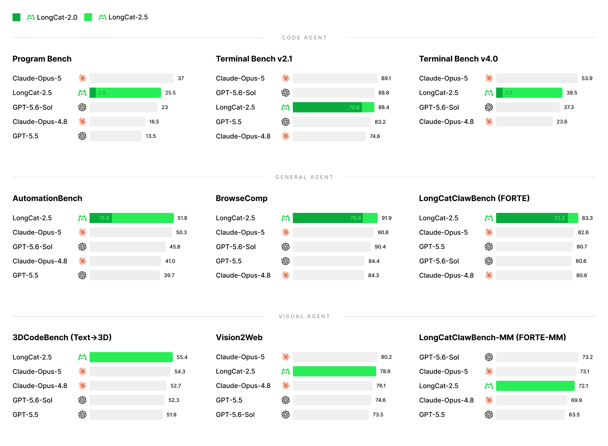
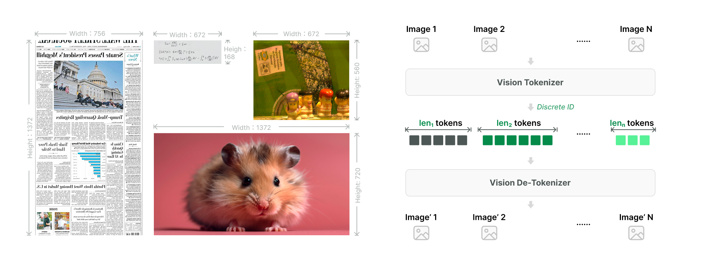
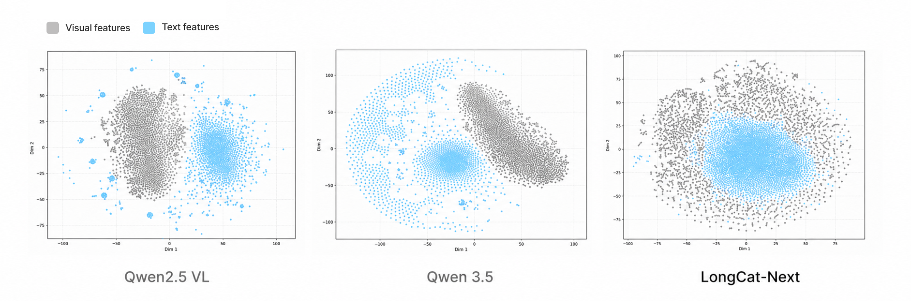
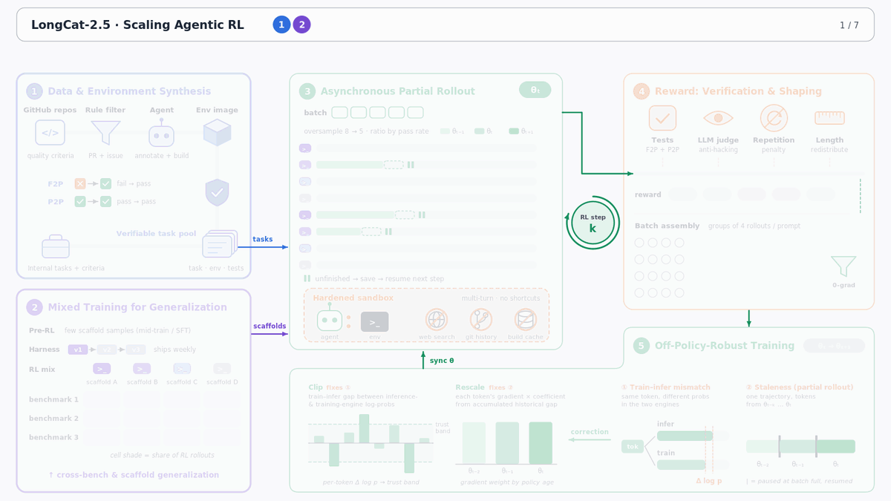
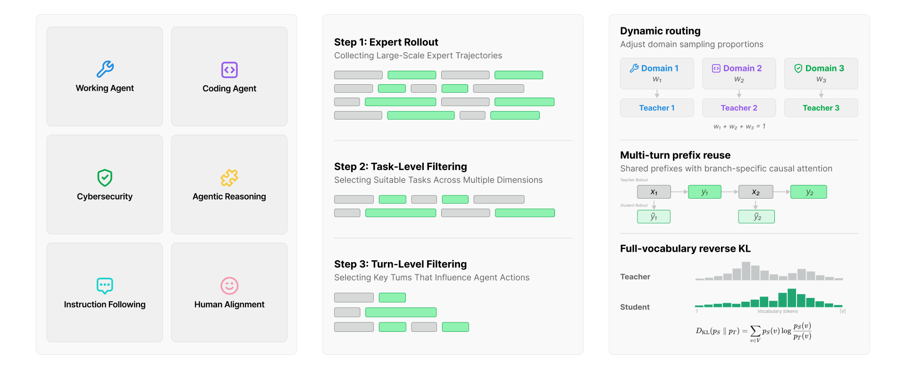
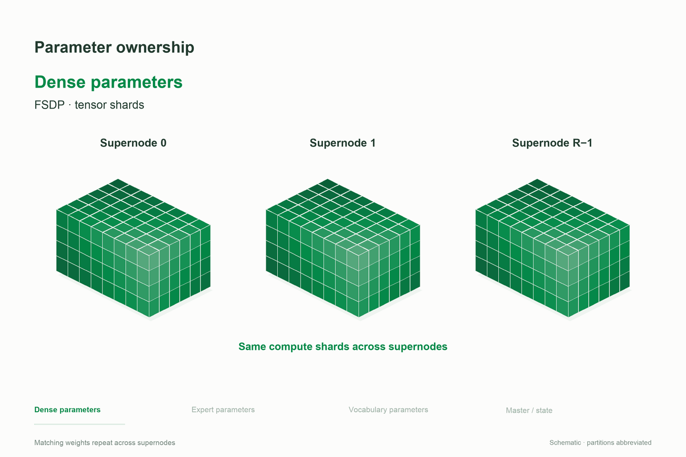
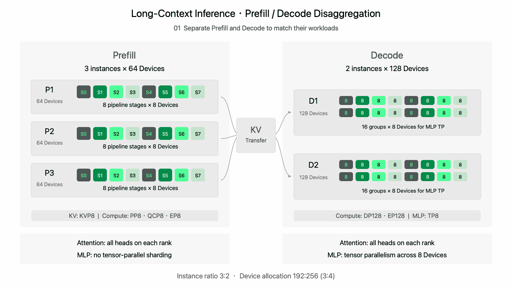

# LongCat-2.5：原生视觉、长程Agent训练与国产算力工程

> [!tldr]
> 新增官方HF模型卡与技术博客后，2.5已不只是产品接口说明：1.6T总参数、约48B激活的原生多模态MoE，把离散视觉token、可验证任务、异步长程RL、多专家在线教学和训推数值一致性接成一条链。新材料补入既有family，W4A4合并为部署变体。

> [!warning] 日期与实验披露仍有边界
> Preview首发9月25日；技术博客显示11月1日并称正式发布，API日志为11月2日正式上线，两者分别保存。HF权重首次公开日未取得明确公告，不能用仓库createdAt/lastModified代替。技术细节虽显著增加，仍缺数据规模、训练超参数、统计区间与Preview→正式版的同条件成对评测；不宣称已完成完整报告复现。

> [!warning] 2026-11-10 晚：HLE 评测范围尚未核实
> 两张官方 HF 卡的脚注由 Text-only subset 改为 **Full set**，但同一时刻官方中文技术博客仍写“仅文本子集”。分数63.1未变化。不能据此宣称完成新的全量评测，也不能把不同范围的结果直接比较；这里保留来源分歧，待官方说明。旧/新模型卡、当晚博客源码与冲突记录均在src中。

## 发布、家族与证据地图

> [!tldr]
> 保留首次发布日期与稳定链接，新增材料不生成第二个LongCat-2.5，也不把量化镜像或接口修订算新代。

| 来源 | 能确认什么 | 不能据此推出什么 |
| --- | --- | --- |
| [S1 API ChangeLog](https://longcat.chat/platform/docs/zh/ChangeLog.html) | 9/25 Preview、11/2正式API阶段 | 技术博客发布日期、权重首开日 |
| [S2官方Tech Blog](https://longcat.ai/blog/longcat-2.5/) | 显示2026-11-1；架构/训练/infra/量化/评测 | 页面显示日期与API上线时刻完全一致 |
| [S3 HF Card](https://huggingface.co/meituan-longcat/LongCat-2.5) | MIT权重卡、完整结果及协议 | 仓库建立时即公开权重 |
| [S4 W4A4 Card](https://huggingface.co/meituan-longcat/LongCat-2.5-W4A4) | 同族4bit部署与实现收益 | 独立新正代；所有任务无损 |

11月10日IAB中博客GitHub/HF按钮仍写“敬请期待”，但HF卡已存在，是页面同步状态差异，不据此否定权重卡，也不猜首开日期。原始SPA HTML、官方JS与原图已归档；博客需运行页面后读取，不能将静态壳误判为没有技术资料。

**历史服务接口（11月3日归档，非本次价格核验）：**上下文1,048,576 tokens，含输入输出；最大输出262,144；图像每请求100张；视频最多10文件、单个不足1小时；人民币每百万输入/缓存/输出2 / 0.04 / 8。它们是当时托管服务文档，不自动等于本地checkpoint硬限制或今天仍有效的价格。兼容SDK和scaffold也不等于相同harness下性能已复现。

## 视觉表示、Agent RL与在线教学

> [!tldr]
> 核心是把真实任务失败转为可验证环境，用异步长轨迹产生训练信号，再以专家在线分布教学保持多领域能力。每一环的误差都会传到下一环。

### 原生视觉：离散化不是外接一个图片描述器

LongCat-2.5为1.6T MoE、每token约48B激活，延续2.0并强化视觉与长程工程任务。语义对齐编码器 **Semantic-and-Aligned Encoder（SAE）**产生原生分辨率特征，经RVQ多层残差码本离散化；这里SAE不是稀疏自编码器。多层级token减轻单层码本的信息瓶颈，视觉码本embedding与主干联合学习。

固定tokenizer允许离线缓存视觉token ID，训练图不必在线跑视觉编码器，视觉序列长度可在packing前已知，改善各DP rank模态比例与负载均衡。这是数据/infra协同设计，不是“视觉信息免费”。

图2右图来自约**3B激活的小规模MoE验证**，不是48B激活生产模型的直接对齐证明。t-SNE交织只是投影观察；语义融合强度、分辨率泛化与文字保真仍要靠配对任务和消融验证。

### 可验证数据闭环

从公开GitHub PR、关联issue和内部代码场景开始：自动打标签、构建交互环境、生成F2P与P2P测试；真实rollout通过率再反向修正标签和难度筛选。分析假阴性/假阳性后继续修补F2P测试。关键不是只多收失败轨迹，而是确认测试能区分真修复、无关改动、脆弱投机以及测试本身错误。

### 异步partial rollout与陈旧性

每step适量超采样，凑批后中断未结束轨迹并存储，下一轮续跑；超采样量随任务通过率调整，全对/全错零梯度组被过滤。同一长轨迹token可能来自多个历史checkpoint，因此作者裁剪采样与当前logprob差异，并用累计历史差异调整token梯度贡献。博客没有足够公式与阈值，不强行命名为某个现成importance estimator，也不猜具体off-policy权重。

反作弊环境断网、清理git历史和缓存，另有LLM judge审轨迹；重复思考、重复工具调用受惩罚，正样本奖励重分配抑制过度思考与长度增长。这些是训练环境约束的厂商描述，不是对当前用户工作目录进行清理的指令。冷启动用少量scaffold适配样例，之后跨任务、跨scaffold混合RL；泛化收益仍缺完整消融。

### MOPD：学生轨迹上的专家分布

Agent、推理、交互领域专家分别优化，学生在各领域在线采样，使用全词表KL接受专家教学。教师见过的轨迹提供prefix，原先按turn拆，现在单轮长回复也切成固定长度的**per-cut prefix**，限制学生自采样最长长度，减少长回复内部的分布漂移。

同一教师轨迹的prefix送同一推理引擎共享prefill/KV；训练把教师作为树干、学生续写作为分支，Tree Attention一次前反传完成同组样本，避免重复计算。这里应分别验证教学质量、学生自由探索损失、同等token预算的学习效率，而不是把缓存复用当作模型能力增益。

## 长序列系统、量化与评测判断

> [!tldr]
> 系统优化既提升吞吐，也影响RL训练信号是否可信。86%吞吐和92%decode收益有明确基线与配置，不能跨场景外推；官方31项结果中仍有多项落后对照。

### 国产加速器：通信拓扑与显存一起设计

单卡不足80GB时，FSDP与EP度数对齐超节点卡数，CP不超过该数，使参数AG、专家token A2A与KV AG尽量位于高带宽域内。基础embedding、LM head、N-gram embedding在DP+CP联合域做混合词表并行；MoonEP达到不均衡阈值才复制专家，防止复制通信成本反超收益及路由OOM。

双重分片FSDP将模型参数留在超节点内分片，FP32主权重/优化器状态借HSDP跨副本分片；连续扁平buffer支持非均匀分片和Muon，写入权重梯度/复用临时区降低峰值。零拷贝AG/RS、AIV专家通信、参数预取和ScMoE重叠，配合CPU绑核与NUMA调度。**长序列SFT测试中单卡吞吐较DDP提升86%**，不等于所有预训练、推理均快86%。

### 数值一致性与长尾rollout

作者对齐训练、Prefill和Decode逐token logprob的bitwise结果，采用batch-invariant算子并补backward。TP以完整K维GEMM替代分片结果归约：训练/Prefill用权重AG与输入A2A；Decode把o_proj/fc2改column-parallel，以输入AG→完整K GEMM→输出A2A避免权重反复聚合。DCP则在训练/Prefill复现Decode的KV切块与固定累加顺序。目的在于不让并行配置造成的数值差被误当作策略更新或陈旧性。

PD分离后，QCP/KVP避免MLA的TP冗余；HiCache释放没有读引用的主存重复副本，Mooncake重构权重管理与Actor offload。LSA奇数层复用偶数层top-k索引，可提前从主存加载所需奇数层KV，所测场景保持TPOT、decode KV容量接近翻倍。Router按L1+L2容量和请求总token控制准入，优先完成度高的Group，防止前缀互相淘汰引发重算雪崩。**P:D=3:2仅是该负载最优**。

### W4A4：区分位宽与缓存两项变化

专家权重和激活同时INT4，以FlatQuant可学习等价变换控制精度；共享输入变换在token复制/dispatch前完成，INT4表示贯穿专家通信与计算，融合变换、scale、量化、packing。相对W8A8线上压测，prefill吞吐+43.3%、decode+42.77%、TTFT−15.91%、TPOT−19.72%，GMM平均1.73倍。卡片另报 **W4A4KV8比W8A8KV16 decode+92%**，这个对照还改变KV位宽，不能称纯W4A4的92%收益。“已评测任务保持相当”也不等于全任务量化无损。

### 完整官方结果

| Benchmark | LongCat-2.5 | LongCat-2.0 | GPT-5.5 | GPT-5.6-Sol | Claude-Opus-4.8 | Claude-Opus-5 | GLM-5.3 | kimi-k3 | DeepSeek-V4.1-Flash |
| --- | --- | --- | --- | --- | --- | --- | --- | --- | --- |
| Terminal Bench v2.1 | 88.4 | 70.8 | 83.2* | 88.8* | 74.6* | 89.1* | 88.2* | 88.3* | 90.6* |
| Terminal Bench v4.0 | 38.5 | 3.0 | - | 37.3* | 23.6* | 53.9* | 41.8* | 12.6* | 31.2* |
| Program Bench (Almost Resolved) | 25.5 | 2.5 | 13.5* | 23.0* | 16.5* | 37.0* | 19.0* | 17.5* | 20.3* |
| DeepSWE (v1.1) | 64.6 | 9.7 | 67.0* | 72.7* | 59.0* | 68.8* | 66.9* | 67.5* | 74.2* |
| PaperBench | 82.1 | 45.2 | 80.0 | 83.3 | 72.9 | 79.1 | 73.7 | 77.5 | - |
| SWE Atlas - Codebase QnA | 58.3 | 33.1 | 45.4* | 46.0* | 57.3* | 63.2* | 58.3 | 54.3 | 55.2 |
| SWE Atlas - Refactoring | 55.2 | 35.7 | 44.8 | - | 46.7 | 51.9 | - | 49.5 | 56.7 |
| SWE Atlas - Test Writing | 47.8 | 28.0 | 42.6 | 45.9 | 49.6 | 62.2 | 42.2 | 42.2 | 48.9 |
| NL2Repo | 60.5 | 40.9 | - | 56.8* | 69.7* | 75.3* | 58.0* | 58.0* | 65.4* |
| LongCat AppDev (Internal) | 73.7 | 47.7 | - | 68.8 | - | 76.4 | 73.5 | 75.1 | - |
| BrowseComp | 91.9 | 79.9 | 84.4* | 90.4* | 84.3* | 90.8* | 81.0 | 91.2* | 91.5 |
| AutomationBench (v1.0.6) | 51.8 | 15.8 | 39.7 | 45.8* | 41.0* | 50.3* | 48.2* | 46.7* | 54.8* |
| HLE (w/ tools) | 63.1 | 37.5 | 52.2 | 58.0* | 57.9* | 64.7* | 62.5* | 56.0* | 63.9* |
| ALE (v1.1) | 38.5 | - | - | 30.3* | - | - | 26.2* | 35.2* | - |
| ResearchRubrics | 81.0 | 71.9 | - | 74.2 | - | 72.9 | 79.9 | 78.8 | 80.9 |
| MCP Atlas | 83.1 | 61.8 | 75.3* | 81.8* | 82.2* | 85.8* | 84.2* | 84.2* | 84.4 |
| JobBench | 65.4 | 44.4 | 38.3* | 45.4* | 48.4* | 66.7* | 61.4* | 52.9* | 63.2 |
| SkillsBench | 63.3 | 36.8 | 62.6* | 54.1* | 59.2* | 60.4* | 52.9 | - | 69.8* |
| GDPVal-AA rubrics | 84.8 | 72.9 | - | - | - | 87.7 | 87.7 | 86.6 | 86.8 |
| FrontierScience | 77.0 | 66.0 | - | - | - | 78.0 | 75.0 | 70.0 | 73.0 |
| SpreadsheetBench 2 | 34.9 | 24.1 | 30.2 | 33.3 | - | 33.0 | 35.8 | 34.8* | 33.0 |
| FinSearchComp (T3) | 63.4 | 42.4 | 62.2 | 62.2 | - | 64.0 | 62.2 | 64.0 | 64.3 |
| Claw-Eval (Pass^3) | 78.3 | 67.1 | - | 79.5 | 82.0 | 80.8 | 73.9 | 73.9 | - |
| LongCatClawBench (FORTE) | 83.3 | 72.2 | 80.7 | 80.6 | 80.6 | 82.6 | 85.6 | 86.3 | 73.5 |
| 3DCodeBench (Text→3D) | 55.4 | - | 51.9 | 52.3 | 52.7 | 54.3 | 53.4 | 49.3 | 53.3 |
| Vision2Web | 78.6 | - | 74.6 | 73.5* | 76.1* | 80.2* | 77.8* | 79.0* | 79.2 |
| CharXiv-RQ (w/ tools) | 90.2 | - | 89.0* | 89.1* | 89.9* | 89.3* | - | 91.3* | 87.7 |
| MathVision (w/ tools) | 96.5 | - | 96.8* | 97.8* | 97.1* | - | - | 97.8* | 97.4 |
| VideoMME | 85.2 | - | - | 89.5* | 86.0* | - | - | 90.0* | - |
| PosterBench | 77.4 | - | - | - | 82.3 | - | 82.4 | 76.8 | 75.3 |
| LongCatClawBench-MM (FORTE-MM) | 72.1 | - | 63.5 | 73.2 | 69.9 | 73.1 | 69.0 | 70.7 | 72.8 |

共31个benchmark行；`*`来自其他厂商公开技术报告/博客/榜单，无星号为美团自测，混合来源只供参考。默认thinking on、temperature1、top_p0.95；不能把所有列说成同一harness现场复测。

| 项目 | 关键协议 |
| --- | --- |
| TB2.1 /4、Program、NL2Repo | Claude Code2.1.280，512K；TB2.1为3次均值 |
| DeepSWE1.1 | mini-swe-agent，1M，temp1/top_p.95，3次均值 |
| SWE Atlas QnA/Test | CC2.1.116；Opus4.5 judge三次多数，3次运行均值 |
| BrowseComp | 自研Verify/Discard-All，阈值256K，最多1024轮；search/browse_with_goal |
| HLE工具 | **范围存在官方冲突**：11/10晚 HF基础卡与W4A4卡改为Full set，中文技术博客仍为仅文本子集；CC2.1.116、最大生成256K一致。63.1保留为厂商披露，不视为范围已核实 |
| MCP Atlas | effort max，temp.7/top_p.95，256K |
| AutomationBench1.0.6 | 全部600题、官方代码 |
| JobBench Main65 | CC2.1.280；Gemini3.6Flash链式rubric judge |
| SpreadsheetBench2 | CC2.1.116；visual judge Gemini3.6Flash，Linux LibreOffice UNO，Python OOXML/Pillow兜底 |
| SkillsBench1.1 | 87题；Codex harness，temp1/top_p.95/top_k−1 |
| Vision2Web | CC2.1.7，temp1/top_p.95/top_k50，256K |
| VideoMME | <=2048帧、1fps、每帧<=256tokens，thinking on，单字母回答 |
| CharXiv / MathVision | temp1/top_p.95；原文最大生成131,972 tokens，保留原值未擅改 |

**正向结果与反例同时读：**TB2.1从70.8到88.4，但DeepSeek90.6更高；TB4为38.5，Opus5为53.9；DeepSWE64.6低于DeepSeek74.2；Claw-Eval78.3低于Opus4.8的82.0。不能概括为全面SOTA。上述2.0→2.5是官方表中两个模型的对比，不是Preview→正式版升级消融。

> [!insight]
> 最可迁移的研究线是“测试误差修复→有效梯度筛选→checkpoint与数值一致性→跨harness泛化”。实验要保存每token采样版本、环境/tests revision、过滤比例和续跑状态，分别消融异步策略与数值对齐。只有总时长更短而有效梯度/最终任务质量不退化，才能证明infra真正服务RL。

### 来源与关联

[S1]官方API日志；[S2]官方技术博客；[S3/S4]HF基础/量化卡（上表均可点击）。原始HTML、JS、模型卡和七张技术图在src；未下载PDF与权重。仍待确证首次权重开放日、完整训练配方与Preview受控对比。

相关：[[Topics/13_base_model/Anthropic/261109_Claude_Fable_Mythos_5_2/Claude-Fable-Mythos-5.2]]；[[Topics/13_base_model/MiniMax/Variants/260731_MiniMax_H3/MiniMax-H3]]。

中文Poster：[[longcat-2_5-preview_poster_zh.html]]。
