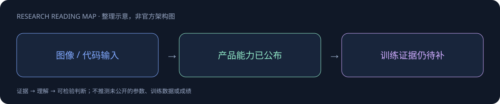

# LongCat-2.5-Preview

> [!tldr]
> 增加图像理解与跨模态问答，强化 coding 并接入常用工程 Agent harness。 这次更新把图像作为工程 Agent 的可用输入，不能仅沿旧纯文本排名理解。官方上线记录确认存在，但没有公开独立完整训练报告；接口适配也不等于同一个 scaffold 上能力必然更强。

## 一页速览

| 维度 | 当前证据 |
|---|---|
| 发布时间 | 2026-09-25 |
| 类型 | 主干正代 / family · 主干正代 |
| 关键事实 1 | 正式上线：2026-09-25 |
| 关键事实 2 | 图像理解 + 文本 |
| 关键事实 3 | Claude Code / OpenCode 等适配 |
| 检查日期 | 2026-10-13；官方原始资料在同级src/ |

> [!warning] 尚未达到完整精读标准
> 目前找到的官方一手信息主要是简短上线记录，未找到足够详细的公开model card或technical report。本笔记无法达到GLM-5.3-Flash的训练、架构与评测深度；没有用API接入说明补齐未知事实。

## 已证实与未知分开

| 已证实 | 证据边界 |
|---|---|
| 9月25日上线LongCat2.5Preview | 官方ChangeLog明确日期 |
| 新增图像理解、跨模态问答与视觉推理 | 产品能力描述，未给任务成功率 |
| coding与主流开发环境协同 | 不等于完整公开Agent训练配方 |

9月10日的企业认证、发票与权益变化是平台功能，不是新模型。公开记录目前不足以确认总参、活跃参数、预训练量、上下文可靠性、训练数据或公平横评。

## 怎样验收这次变化

先做带来源的图片问答、图表数值抽取和跨文件修复，保留原始图像、指令、接口版本与实际产物。代码环境兼容不代表所有插件和协议完全支持，应逐项检验工具调用和错误恢复。若同一服务名被更新，继续记录snapshot，不凭名称推断checkpoint完全一致。

## 对 Agent Training 的启发

> [!insight]
> 设计截图到修复、图表到数据、仓库与图片联合约束任务；检查视觉证据是否忠实，以及工具输出与最终代码是否一致。官方未披露参数与训练配比不推断。

以上是基于已读官方资料的研究判断，不是官方保证，也没有在本机运行模型推理或复现论文成绩。下一步优先补独立验证器、固定任务/版本和完整失败轨迹，避免只保存最好样例。

## 一手资料与导航

- [S1] [Official Release Log](https://longcat.chat/platform/docs/zh/ChangeLog.html)

原始下载文件与SHA-256见 [[src/retrieval_manifest.json|抓取记录]]。报告保留链接，不抓PDF；动态网页响应若只有壳文件，不将其标成完整离线正文。

- [[Topics/13_base_model/Base Model MOC|基模主题索引]]
- [[longcat-2_5-preview_poster_zh.html|中文Poster]]

> 📊 相关可视化: [[longcat-2_5-preview_poster_zh.html|LongCat-2.5-Preview 中文Poster]]
