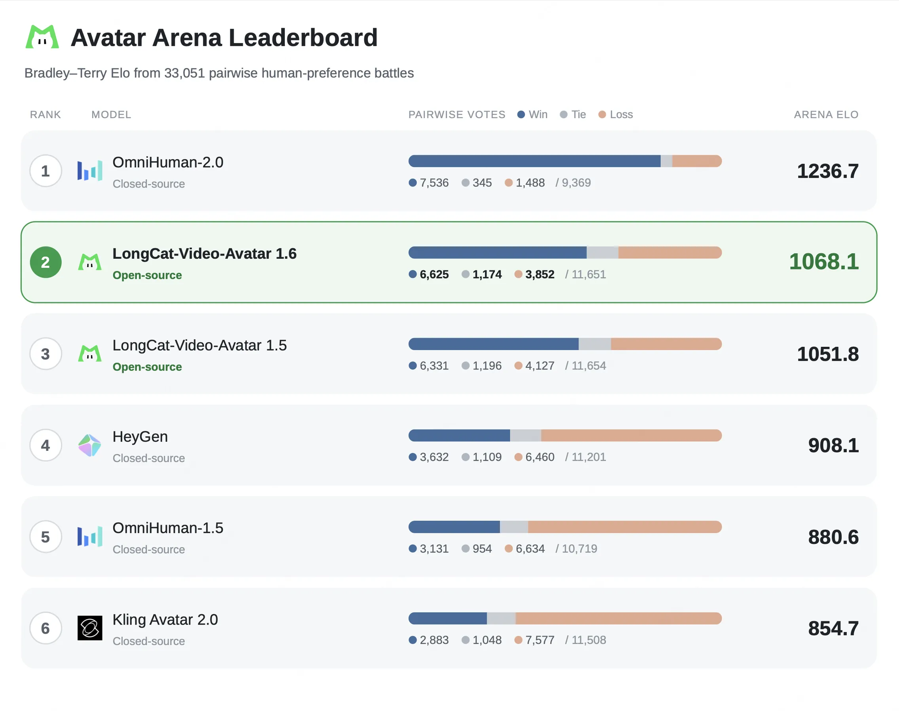

> [!tldr]
> Avatar 1.6沿用1.5架构，以RL、DMD少步蒸馏与OPSD处理口型自然度和长视频误差积累；默认八步中前四步DMD、后四步OPSD。它属于LongCat-Video-Avatar专项family，不是LongCat通用正代，也不把INT8/FP8拆成新模型。

> [!warning] 资料不足与证据边界
> 本文依据完整1.6 HF卡、GitHub发布说明/推理用法及项目页。1.6报告目前只链接PDF，遵照不抓PDF的要求只保留官方链接，未作报告级精读；RL奖励、训练数据配比、loss、算力、完整消融和速度协议仍缺。本轮未下载权重、未运行模型；项目页视频未完整播放，超过10分钟的稳定性是官方主张，不能当独立长视频实测。

## 发布谱系、开放范围与许可

> [!tldr]
> 原Avatar于2025/12/16发布，1.5于2026/05/21，1.6于2026/11/15；按官方GitHub News日期收录，未给精确时区或首位用户可用时刻。此次补收family旧入口，并只将11/15算作当期同族更新。

|阶段|官方公告日|变化与归档方式|
|---|---|---|
|LongCat-Video|2025-10-25|基础视频生成模型；是Avatar的底座，不据此把Avatar算通用正代|
|Avatar初版|2025-12-16|音频驱动角色动画，支持文字/图片条件、续写和单/多路音频；本family首个已核公告|
|Avatar 1.5|2026-05-21|音频编码器由Wav2Vec2换Whisper-Large，少步蒸馏八步、单/多流与风格泛化|
|Avatar 1.6|2026-11-15|同架构、DMD/OPSD两LoRA、长rollout及端到端执行优化；并入原family|

模型卡声明权重MIT，并明确不授予美团商标或专利权。项目页展示素材注明仅学术用途、不可商用；这针对示例图像/音频，不能反过来把模型MIT误写为非商用，也不能因模型MIT就认为所有演示人物、音频均可商用。

原生任务包括Speech-Text-to-Video、Speech-Image-to-Video与Video Continuation；多人示例是Speech-Image-to-Video和续写。输入音频是驱动条件，本文不据此推断能凭文字自行合成全部语音，也不把多人驱动等同开放世界互动理解。需要基础LongCat-Video与Avatar权重，样例中2GPU/CP2是运行命令，不是已证最小显存或实时吞吐。

## 后训练线索与推理执行契约

> [!tldr]
> LoRA混合发生在去噪步上；默认仍是八步，不是四步生成。量化、编译和并行条件要与输出质量一起记录。

官方发布说明列出RL、改进classifier-free guidance的DMD少步蒸馏、长视频rollout和on-policy distillation，但没有在已读网页中给出奖励/监督构造与完整目标。不能仅根据DMD或OPSD名称补写未披露算法细节、证明防漂移机制或训练收益归因。

|执行项|已公开含义|复现实验应保留|
|---|---|---|
|loraA|DMD LoRA|checkpoint与混合位置|
|loraB|OPSD LoRA|后半程默认只用OPSD|
|mix_steps=N|前N步用alpha×DMD+(1-alpha)×OPSD，其余8-N步仅OPSD|N、alpha、总步数|
|默认N=4、alpha=1.0|前四步DMD-only，后四步OPSD-only|不能称全程同一LoRA或四步生成|
|INT8|可选weight-only INT8 DiT/base_model_int8|不同于激活量化、与FP8互斥|
|FP8|需Transformer Engine的PyTorch/CUDA支持；质量优先时减少FP8层数|实际量化层与后端|
|compile_dit/compile_vae|首几次有追踪编译成本，同shape可复用；新shape可能重新编译|冷/热运行分别计时|
|FA3|Hopper上启用FA3、关闭FA2；默认配置是FA2|内核版本与硬件|
|多于2GPU|可启用All-to-All workspace，nproc与context_parallel_size匹配GPU数|通信拓扑与CP参数|

单人at2v/ai2v、多人ai2v分别使用对应入口，需use_distill、model_type=avatar-v1.6和OPSD路径；续写示例另给num_segments=5、ref_img_index=10、mask_frame_range=0。这些示例参数不代表每片段固定时长或最大视频长度。脚本未执行、源码未逐字段审计，未宣称部署可复现性已经验证。

## 完整Arena读数、反例与研究判断

> [!tldr]
> 1.6在六系统33,051个有效投票的全配对研究中第二，Elo 1068.1；领先1.5但落后OmniHuman-2.0。投票不是独立样本数，更不是独立评审人数，缺置信区间不能把16.3 Elo差当显著性结论。

|系统|胜|平|负|该模型参与投票|Bradley–Terry Elo|
|---|---:|---:|---:|---:|---:|
|OmniHuman-2.0|7536|345|1488|9369|1236.7|
|LongCat-Video-Avatar 1.6|6625|1174|3852|11651|1068.1|
|LongCat-Video-Avatar 1.5|6331|1196|4127|11654|1051.8|
|HeyGen|3632|1109|6460|11201|908.1|
|OmniHuman-1.5|3131|954|6634|10719|880.6|
|Kling Avatar 2.0|2883|1048|7577|11508|854.7|

六系统有15种配对；各模型参与投票合计66,102，恰为33,051的两倍，因为每票涉及两个模型。1.6的6625/11651是对所有对手汇总的胜票比例，不是对1.5的直接胜率，不能从汇总图恢复任意单一配对结果。官方README与图的33,051口径相符，但评审人数、独立输入数、置信区间、逐例失败及采样温度等未在本轮材料中完整披露。

官方强调缓解嘴部夸张/发紧、唇色过红、嘴部时序抖动和自回归续写累积误差。项目页有1.5/1.6同输入对照及唱歌、表演、直播、动画、多角色交互展示；它们是展示，不能代替全体输入分布的失败率。当前资料没有可复核的E2E速度表与具体硬件/视频规格，不补造“实时”或加速倍数。

> [!insight]
> 对Agent Training的启发是把长rollout中的状态漂移与局部表现奖励分开：训练短片段口型，不保证长续写身份与身体结构不漂移。可固定音频、参考图、片段长度与随机种子，对DMD-only、OPSD-only和八步混合做匹配预算消融，再分冷/热运行、量化模式和不同续写时长评测。完整方法仍待非PDF材料或后续公开细节补齐；不要把视频案例偏好直接当作通用Agent能力提升。

- [官方GitHub公告与代码](https://github.com/meituan-longcat/LongCat-Video)
- [官方1.6模型卡](https://huggingface.co/meituan-longcat/LongCat-Video-Avatar-1.6)
- [官方项目页](https://meigen-ai.github.io/LongCat-Video-Avatar-1.6-Page/)
- [官方技术报告PDF，仅保留链接](https://github.com/meituan-longcat/LongCat-Video/blob/main/assets/LongCat-Video-Avatar-1.6-Tech-Report.pdf)
- [[avatar_poster_zh.html|中文Poster]]
