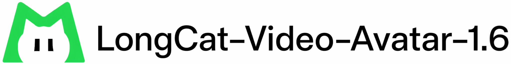

---
base_model:
  - meituan-longcat/LongCat-Video
license: mit
language:
- en
- zh
library_name: longcat-video-avatar-1.6
tags:
- audio-text-to-video
- audio-image-text-to-video
- audio-driven-video-continuation
- diffusers
- transformers
- avatar
- video-generation
---
# LongCat-Video-Avatar-1.6

<div align="center">
  
</div>
<hr>

<div align="center" style="line-height: 1;">
  <a href='https://meigen-ai.github.io/LongCat-Video-Avatar-1.6-Page/'></a>
  <a href='https://github.com/meituan-longcat/LongCat-Video/blob/main/assets/LongCat-Video-Avatar-1.6-Tech-Report.pdf'></a>
  <a href='https://huggingface.co/meituan-longcat/LongCat-Video-Avatar-1.6'></a>
  <a href='https://www.modelscope.cn/models/meituan-longcat/LongCat-Video-Avatar-1.6'></a>
</div>

<div align="center" style="line-height: 1;">
  <a href='https://github.com/meituan-longcat/LongCat-Flash-Chat/blob/main/figures/wechat_official_accounts.png'></a>  
  <a href='https://x.com/Meituan_LongCat'></a>
</div>

<div align="center" style="line-height: 1;">
  <a href='LICENSE'></a>
</div>

## 🚀 Model Introduction
We are excited to announce the release of LongCat-Video-Avatar 1.6, the latest upgrade to our open-source framework for audio-driven human video generation. Building upon LongCat-Video-Avatar 1.5, 1.6 improves expressive naturalness, lip–audio synchronization, coordinated facial and body motion, and visual consistency during long-form generation. It also introduces comprehensive inference optimizations for faster and more efficient deployment.

### Key Features
- 🌟 **More Natural and Stable Lip Animation:**: Reduces exaggerated or strained mouth movements, overly red lip coloration, and temporal instability in the mouth region.
- 🌟 **Stable Long-Video Generation**: Mitigates error accumulation during autoregressive video continuation, enabling videos exceeding 10 minutes while preserving visual quality, identity consistency, and temporal coherence.
- 🌟 **Faster End-to-End Inference**: Accelerates video generation through end-to-end pipeline and model execution optimizations, enabling more efficient deployment and serving.

For more detail, please refer to the comprehensive [***LongCat-Video-Avatar-1.6 Technical Report***](https://github.com/meituan-longcat/LongCat-Video/blob/main/assets/LongCat-Video-Avatar-1.6-Tech-Report.pdf).

## 🌀 Preview Gallery

LongCat-Video-Avatar 1.6 delivers more natural lip movements and expressive motion while maintaining visual quality and temporal consistency in videos exceeding 10 minutes.

<table align="center" width="100%" cellspacing="8" cellpadding="0">
  <tr>
    <td width="50%">
      <video src="https://www.modelscope.cn/models/meituan-longcat/LongCat-Video-Avatar-1.6/resolve/master/assets/1.mp4" width="100%" controls preload="metadata" playsinline></video>
    </td>
    <td width="50%">
      <video src="https://www.modelscope.cn/models/meituan-longcat/LongCat-Video-Avatar-1.6/resolve/master/assets/2.mp4" width="100%" controls preload="metadata" playsinline></video>
    </td>
  </tr>
  <tr>
    <td width="50%">
      <video src="https://www.modelscope.cn/models/meituan-longcat/LongCat-Video-Avatar-1.6/resolve/master/assets/3.mp4" width="100%" controls preload="metadata" playsinline></video>
    </td>
    <td width="50%">
      <video src="https://www.modelscope.cn/models/meituan-longcat/LongCat-Video-Avatar-1.6/resolve/master/assets/4.mp4" width="100%" controls preload="metadata" playsinline></video>
    </td>
  </tr>
  <tr>
    <td colspan="2" width="100%">
      <video src="https://www.modelscope.cn/models/meituan-longcat/LongCat-Video-Avatar-1.6/resolve/master/assets/5.mp4" width="100%" controls preload="metadata" playsinline></video>
    </td>
  </tr>
  <tr>
    <td colspan="2" width="100%">
      <video src="https://www.modelscope.cn/models/meituan-longcat/LongCat-Video-Avatar-1.6/resolve/master/assets/6.mp4" width="100%" controls preload="metadata" playsinline></video>
    </td>
  </tr>
</table>


## 📊 Human Evaluation
We compare LongCat-Video-Avatar 1.6  with its predecessor LongCat-Video-Avatar 1.5  and four commercial systems: OmniHuman-2.0, HeyGen, OmniHuman-1.5, and Kling Avatar 2.0. The all-pairs human preference study comprises 33,051 valid individual votes across all 15 model pairings. LongCat-Video-Avatar 1.6 ranks second among six evaluated systems in a human preference Arena comprising 33,051 valid individual votes. With a Bradley–Terry Elo score of 1068.1, it ranks behind OmniHuman-2.0 and ahead of LongCat-Video-Avatar 1.5, HeyGen, OmniHuman-1.5, and Kling Avatar 2.0.

<div align="center">
  
</div>

## 💡 Quick Start
Clone the repo

```shell
git clone --single-branch --branch main https://github.com/meituan-longcat/LongCat-Video
cd LongCat-Video
```

Install dependencies

```shell
# create conda environment
conda create -n longcat-video python=3.10
conda activate longcat-video

# install torch (configure according to your CUDA version)
pip install torch==2.6.0+cu124 torchvision==0.21.0+cu124 torchaudio==2.6.0 --index-url https://download.pytorch.org/whl/cu124

# install flash-attn-2
pip install ninja
pip install psutil
pip install packaging
pip install flash_attn==2.7.4.post1

# install other requirements
pip install -r requirements.txt

# install longcat-video-avatar requirements
conda install -c conda-forge librosa
conda install -c conda-forge ffmpeg
pip install -r requirements_avatar.txt
```

FlashAttention-2 is enabled in the model config by default; you can also change the model config to use FlashAttention-3 or xformers.

### ⛽️ Model Download

| Models | Description | Download Link |
| --- | --- | --- |
| LongCat-Video | foundational video generation | 🤗 [Huggingface](https://huggingface.co/meituan-longcat/LongCat-Video) |
| LongCat-Video-Avatar-1.6 | single- and multi-character audio-driven video generation  | 🤗 [Huggingface](https://huggingface.co/meituan-longcat/LongCat-Video-Avatar-1.6) |

Download models using huggingface-cli:
```shell
pip install "huggingface_hub[cli]"
huggingface-cli download meituan-longcat/LongCat-Video --local-dir ./weights/LongCat-Video
huggingface-cli download meituan-longcat/LongCat-Video-Avatar-1.6 --local-dir ./weights/LongCat-Video-Avatar-1.6
```

### 🔑 Quick Inference
Usage Tips
> 1. **Checkpoint composition and LoRA mixing**
>
>    LongCat-Video-Avatar 1.6 uses the same base architecture as
>    LongCat-Video-Avatar 1.5 and includes two task-specific LoRA adapters:
>
>    - `loraA/lora.safetensors`: DMD LoRA.
>    - `loraB/lora.safetensors`: OPSD LoRA.
>
>    The checkpoint package also provides `base_model_int8`, an optional
>    weight-only INT8 DiT that can be enabled with `--use_int8`.
>
>    With `--mix_steps=N`, the first `N` denoising steps use
>    `mix_alpha * DMD + (1 - mix_alpha) * OPSD`, while the remaining
>    `8 - N` steps use OPSD only. Increasing `--mix_steps` or
>    `--mix_alpha` gives the DMD LoRA greater influence during the early
>    denoising steps, which may improve structural stability and reduce
>    visual distortions.
>
>    With the default settings, `--mix_steps=4 --mix_alpha=1.0`, the first
>    four denoising steps use DMD only, and the remaining four steps use
>    OPSD only.
>
> 2. **FP8 dependency and INT8 exclusivity**
>
>    Install Transformer Engine with PyTorch and CUDA support before enabling
>    `--use_fp8`. Do not use `--use_fp8` and `--use_int8` simultaneously;
>    enable only one quantization mode at a time. If output quality is the
>    priority, reduce the number of layers using FP8.
>
> 3. **Compilation warm-up**
>
>    When `--compile_dit` and `--compile_vae` are enabled, the first few
>    inference runs include graph-tracing and compilation overhead and may
>    therefore be slower. Subsequent runs with the same input shapes reuse
>    the compiled graphs and are significantly faster. New input shapes may
>    trigger recompilation.
>
> 4. **FlashAttention 3**
>
>    For Hopper GPUs such as the H20, H100, H200, and H800, install and enable
>    FlashAttention 3. FA3 can provide a significant inference speedup over
>    FA2. Confirm that the model configuration contains:
>
>    ```json
>    {
>      "enable_flashattn3": true,
>      "enable_flashattn2": false
>    }
>    ```
>
> 5. **Multi-GPU communication**
>
>    When running on more than two GPUs, enable the optimized All-to-All
>    workspace to reduce context-parallel communication overhead:
>
>    ```shell
>    export LONGCAT_A2A_WORKSPACE=1
>    ```
>
>    Set `--nproc_per_node` and `--context_parallel_size` to the number of
>    GPUs used for inference.


#### Single-Person Animation 
```shell
# Speech-Text-to-Video
torchrun --nproc_per_node=2 run_demo_avatar_single_audio_to_video.py --context_parallel_size=2 --checkpoint_dir=./weights/LongCat-Video-Avatar-1.6 --stage_1=at2v --input_json=assets/avatar/single_example_1.json --use_distill --lora_path loraB/lora.safetensors --model_type avatar-v1.6 --mix_steps=4 --mix_alpha=1.0

# Speech-Image-to-Video
torchrun --nproc_per_node=2 run_demo_avatar_single_audio_to_video.py --context_parallel_size=2 --checkpoint_dir=./weights/LongCat-Video-Avatar-1.6 --stage_1=ai2v --input_json=assets/avatar/single_example_1.json --use_distill --lora_path loraB/lora.safetensors --model_type avatar-v1.6 --mix_steps=4 --mix_alpha=1.0

# Speech-Text-to-Video and Video-Continuation
torchrun --nproc_per_node=2 run_demo_avatar_single_audio_to_video.py --context_parallel_size=2 --checkpoint_dir=./weights/LongCat-Video-Avatar-1.6 --stage_1=at2v --input_json=assets/avatar/single_example_1.json --num_segments=5 --ref_img_index=10 --mask_frame_range=0 --use_distill --lora_path loraB/lora.safetensors --model_type avatar-v1.6 --mix_steps=4 --mix_alpha=1.0

# Speech-Image-to-Video and Video-Continuation
torchrun --nproc_per_node=2 run_demo_avatar_single_audio_to_video.py --context_parallel_size=2 --checkpoint_dir=./weights/LongCat-Video-Avatar-1.6 --stage_1=ai2v --input_json=assets/avatar/single_example_1.json --num_segments=5 --ref_img_index=10 --mask_frame_range=0 --use_distill --lora_path loraB/lora.safetensors --model_type avatar-v1.6 --mix_steps=4 --mix_alpha=1.0
```

#### Multi-Person Animation 
```shell
# Speech-Image-to-Video
torchrun --nproc_per_node=2 run_demo_avatar_multi_audio_to_video.py --context_parallel_size=2 --checkpoint_dir=./weights/LongCat-Video-Avatar-1.6 --input_json=assets/avatar/multi_example_1.json --use_distill --lora_path loraB/lora.safetensors --model_type avatar-v1.6 --mix_steps=4 --mix_alpha=1.0

# Speech-Image-to-Video and Video-Continuation
torchrun --nproc_per_node=2 run_demo_avatar_multi_audio_to_video.py --context_parallel_size=2 --checkpoint_dir=./weights/LongCat-Video-Avatar-1.6 --input_json=assets/avatar/multi_example_1.json --num_segments=5 --ref_img_index=10 --mask_frame_range=0 --use_distill --lora_path loraB/lora.safetensors --model_type avatar-v1.6 --mix_steps=4 --mix_alpha=1.0
```

## ⚖️ License Agreement

The **model weights** are released under the **MIT License**. 

Any contributions to this repository are licensed under the MIT License, unless otherwise stated. This license does not grant any rights to use Meituan trademarks or patents. 

See the [LICENSE](LICENSE) file for the full license text.


## 🧠 Usage Considerations 
This model has not been specifically designed or comprehensively evaluated for every possible downstream application. 

Developers should take into account the known limitations of large language models, including performance variations across different languages, and carefully assess accuracy, safety, and fairness before deploying the model in sensitive or high-risk scenarios. 
It is the responsibility of developers and downstream users to understand and comply with all applicable laws and regulations relevant to their use case, including but not limited to data protection, privacy, and content safety requirements. 

Nothing in this Model Card should be interpreted as altering or restricting the terms of the MIT License under which the model is released. 

## 📖 Citation
We kindly encourage citation of our work if you find it useful.

```
@misc{meituanlongcatteam2026longcatvideoavatar16technicalreport,
      title={LongCat-Video-Avatar 1.6 Technical Report}, 
      author={Meituan LongCat Team},
      year={2026},
      eprint={},
      archivePrefix={arXiv},
      primaryClass={cs.CV},
      url={}, 
}
```

## 🙏 Acknowledgements

We would like to thank the contributors to the [Wan](https://huggingface.co/Wan-AI), [UMT5-XXL](https://huggingface.co/google/umt5-xxl), [Diffusers](https://github.com/huggingface/diffusers) and [HuggingFace](https://huggingface.co) repositories, for their open research.


## 📞 Contact
Please contact us at <a href="mailto:longcat-team@meituan.com">longcat-team@meituan.com</a> or join our WeChat Group if you have any questions.
