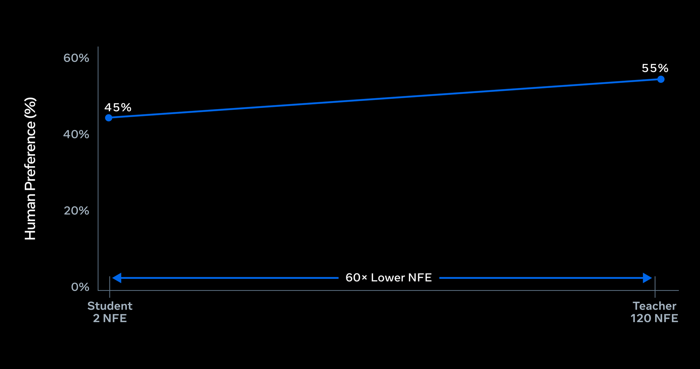

# Muse Realtime Avatar

> [!tldr]
> 我的判断：核心不是单张照片“会动”，而是把音频与视觉建立在同一语音 token 流上，用有界因果视频生成、self-forcing 和两步蒸馏兼顾长对话一致性与并发成本。它是独立视频生成专项支线，不是 Muse Wonder 的正代变体。

> [!warning] 原始资料较少
> 当前主要资料是官方技术博客和演示，没有完整 HF 模型卡、权重、训练报告与消融工程。本笔记达不到 GLM-5.3-Flash 那种完整架构/训练证据深度：参数、训练数据、损失权重、distillation 配方与量化误差未公开。官方图片与案例不等于本地复现；视频没有下载。

## 信息卡与发布日期

官方博客标注 **2026-09-23**，明确当天介绍 Realtime Avatar。输入包含参考媒体、语音 VQ token 流和近期视频 latent；输出是与声音同步的实时视频。基座/许可/权重与 API 普遍可用状态没有完整确认，不自动承诺可下载或可商用。

## 同一个语音流驱动声音与画面

Realtime Voice 产生携带内容和表达方式的 speech tokens。音频 decoder 将它们变成声音，Avatar 消费同一个流生成表情、唇形、手势与全身运动。同步来自共享信号，而不是事后把独立生成的视频对齐到音频文件。

Avatar 是 audio-driven Diffusion Transformer，逐个短 causal chunk 生成。最近已生成 latent 回灌为下个 chunk 的运动上下文，维持身份与动作延续；固定窗口让计算和 cache 保持有界。“可无限继续”指流式系统可以持续生成，不代表每一小时都已经通过无限时长质量验证。

## 蒸馏：120 次评估降到 2 次，不等于整套系统快 60 倍

双向教师使用 40 diffusion steps，每步三路 CFG、三次模型调用，总共 120 NFE/chunk。学生通过 self-forcing 在自己的生成上下文上训练，减少推理时累计漂移；distribution matching distillation 将扩散过程与 CFG 效果共同压到无 guidance 的两步学生。

120→2 是 **NFE 减少 60×**。端到端 latency 还包含语音智能、网络、排队、视频 decoder 和编排，不能把这一比值直接标成用户延迟降低 60×。官方说学生与教师总体偏好接近均分，但未公开足以还原统计置信区间的数据。

## Serving 与实测口径

| 官方披露 | 具体口径 |
|---|---|
| 视频 | 448×768 portrait，25 FPS |
| 约 870ms | 用户轮次结束到收到同步音视频响应的首字节 |
| GB200 单会话 | 20ms 生成 8 frames，对应 320ms 播放长度 |
| 折算生成时间 | 2.5ms / frame，是模型生成时间，不是端到端 latency |
| 并发 | 单 GB200 视频生成支持 12 个实时会话 |
| 容量提升 | 相对两步 BF16 baseline，serving capacity 约 8× |

优化包括持久 KV cache、memory-aware positional encoding、cache-aware routing、latency-aware dynamic batching、4-bit QAT、融合 kernel 和 CUDA Graph。8× 的参照是已经两步的 BF16 学生，不能与教师120步的60×相乘宣称480×完整系统收益。

## 对比与限制

官方使用 Runway Characters、HeyGen LiveAvatar 的原生 live-call 产品体验，让 raters 在匹配身份下进行 2–3 分钟对话，对视觉、同步、角色一致性与 mannerism 等偏好作比较。它是产品系统体验对比，不是固定同一语音模型与同一网络的单模块消融。

博客说总体和各维度更受偏好，但对 Runway 的 mannerism 比较**未与 parity 显著区分**。不能将趋势写成每一维都统计显著领先。模型训练数据、rater 规模、样本方差与长期身份漂移仍缺足够证据。

## 安全与研究启发

官方使用 Video Seal 为生成视频加入耐久不可见水印，并说明演示并不全代表 Muse app 可用化身。水印用于追溯，不等于不会冒用身份，也不等于系统拥有参考人物授权。

> [!insight]
> 对长期多模态 Agent，训练必须覆盖自己生成的历史，而不仅是教师强制的干净历史。可测 2、10、30 分钟的身份漂移、唇形/声音误差和首字节 p95，再固定并发增加负载；分别报告模型生成时间与整条交互链延迟。

## 来源

- [Tech Blog · 官方首发与配方](https://research.meta.ai/blog/bringing-your-muse-to-life)
- 原始 HTML、正文提取和官方静态图位于本模型 `src/`；未下载视频/PDF。

> 📊 相关可视化: [[Topics/13_base_model/Meta_Llama/Variants/260923_Muse_Realtime_Avatar/muse_realtime_avatar_poster_zh.html|Muse Realtime Avatar 中文 Poster]]
