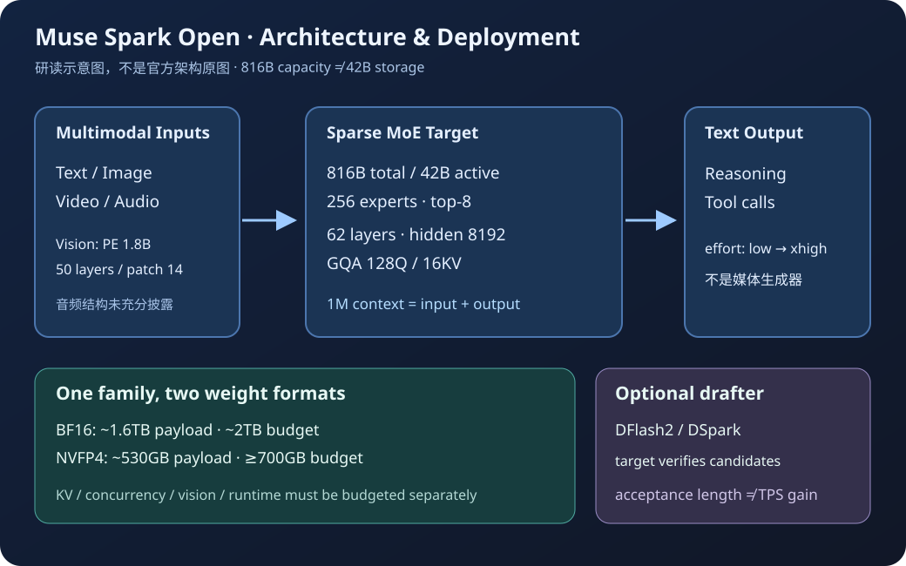
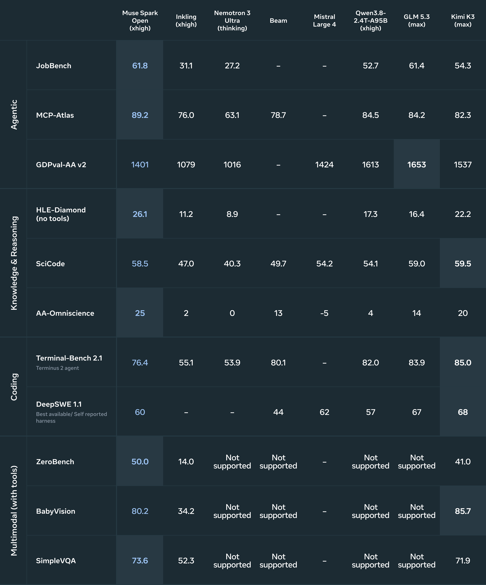

# Muse Spark Open：开放的是权重，不是全部训练过程

> [!tldr] 我的判断
> 这是 Muse Spark family 的重要**开放权重发布阶段**，不是把 BF16、NVFP4、辅助解码器拆成三个新正代。816B 总参数、42B 活跃参数、1M 上下文让它具有高容量的多模态 Agent 潜力；但官方结果同时显示代码、终端与部分科学题仍有弱项。真正需要验证的是：开放部署后，安全后训练、推理预算、工具框架与量化组合能否保持可靠性，而不是只看活跃参数或最高榜单数值。

> [!warning] 资料深度与验收边界
> **当前已读 HF BF16 / NVFP4 模型卡、Meta Research 发布页、Developer 技术博客和 NVIDIA DFlash2 原卡，官方基准图已本地化。原始公开资料仍不足以达到 GLM-5.3-Flash / Kimi-K3 完整技术报告级的训练拆解深度：训练 token 总量、数据配比、生产 RL 奖励、阶段超参与完整消融未充分披露，我在这些方面达不到该深度，不能补造。**评测方法报告只保留官方 PDF 链接，未下载、未冒充全文精读。Developer 博客在线正文可读，但直接抓取返回 HTTP 500，离线原貌暂缺；本地已保存另一份完整官方 Research HTML 和两份模型卡。未下载权重、接受许可表单或运行本地性能实验。

## 先把发布日期和 family 边界说清楚

官方 Research 发布页与 Developer 博客均标记 **2026-10-15**。HF 仓库提前建立、后续更新或 NVIDIA 在 10 月 16 日发布配套 drafter，都不能替换模型首发日。

| 条目 | 在本笔记中的位置 | 不能误读成什么 |
|---|---|---|
| Muse Spark Open 816B-A42B BF16 | 开放权重主 checkpoint | 一个全新的 Spark 架构代际 |
| NVFP4 checkpoint | 同 family 的部署格式 | 第二个新正代；所有模块都变成 4bit |
| DFlash2 / DSpark 配套 | 可选推测解码路径，分开记录实现与评测 | 第三个新正代；同名就能混用接受长度 |
| 既有 Spark 托管服务 | family 背景 | 与开放权重逐 token、逐任务完全相同 |

开放 checkpoint 另做了面向独立部署的安全后训练，因为使用者未必拥有 Meta 平台护栏。这是值得记录的发布差异；反过来，也不能把托管产品评测直接当作当前开放权重的结果。

## 结构：容量、活跃计算与输入模态是三件事

*图 1｜研读绘制，依据 HF 模型卡与开发者博客；不是官方架构图，也不表达尚未公开的音频编码器或训练配方。*

| 项目 | 模型卡披露 | 理解与限制 |
|---|---|---|
| 总参数 / 每 token 活跃 | 816B / 42B | 活跃计算远小于容量，但不意味着只需存储 42B 权重 |
| 文本主干 | 62 层，hidden 8192 | 卡内规格，不擅自推导未公开的层间模式 |
| GQA | 128 query heads / 16 KV heads，head dim 64 | 降低 KV 头数，不消除长上下文缓存开销 |
| 路由专家 | 256 experts，top-8 | 稀疏路由不是按需从磁盘加载即可无成本运行 |
| 词表 | 202,048 | 输入 / 输出 embedding 不绑权重；不把它们再重复叠加到官方总参 |
| 视觉编码器 | Perception Encoder，约 1.8B，50 层 | hidden 1536，16 heads，14×14 patch，输出维度 4096 |
| 视觉位置与注意力 | learned absolute + 2D RoPE；周期性 full attention | 不能据此猜整个语言主干的窗口布局 |
| 输入 / 输出 | 文本、图像、视频、音频 → 文本 | 不是直接生成视频或语音的全能媒体模型 |
| 上下文 | 1M，输入输出合计 | 窗口大小不等于任意位置证据利用率，也不等于所有并发都容纳得下 |

核心直觉是：MoE 把存储容量与每步计算解耦，GQA 降低 KV 头开销，视觉编码器把感知内容接入语言决策；但三者都没有免除权重、KV、通信和预填充成本。音频路径的具体结构没有在这份卡中充分展开，不把视觉编码器参数套到所有模态。

## 训练证据：哪些是公开事实，哪些只是可用工具

卡中列出公开网页、第三方、Meta 产品服务、合成数据、供应商及人工生产等数据来源，并说明清洗、去重和过滤。它没有给出足以重建训练的 token 总量、各域比例或完整阶段配方。

这里应区分三个层次：一是发布权重确实包含额外安全后训练；二是开发者可以在公开工具链上微调；三是原始生产训练用了什么奖励与超参。前两项的可见性，不能替代第三项。相同道理，支持某种推理优化不证明它贡献了哪一项能力提升。

从 Agent Training 看，最值得追的问题不是“它也做了 RL 吗”，而是安全性与工具效能如何同时留住：高拒答率可能来自识别危险请求，也可能带来正常任务过拒；更长思考可能帮助规划，也可能让重复验证增加。需要逐类任务的行为证据，而不是把两者压成一个总分。

## 评测：保留领先项，也保留明显弱项

*图 2｜Meta Research 官方完整基准图。数据为官方自报，不是本地复测；图中对手版本、effort、工具与 harness 属于比较条件。点击图片可查看原尺寸。*

下表取当前 HF 卡中有代表性的项目，完整结果保留在原卡与上图。Spark Open 为 **xhigh**；对照模型采用其各自标记的预算，不能当作相同推理成本实验。

| 任务 / 设置 | Spark Open | 必须一起看的对照与判断 |
|---|---:|---|
| AA Intelligence Index | 39 | GLM-5.3 为 45、Kimi-K3 为 44；综合项并非第一 |
| JobBench | 61.8 | GLM 61.4；小差距不能自动解释成统计显著领先 |
| MCP Atlas | 89.2 | Qwen 84.5、GLM 84.2；工具生态任务优势值得复核 |
| GDPval-AA v2 | 1401 | GLM 1653、Qwen 1613、Kimi 1537；工作产物整体仍有差距 |
| OSWorld Verified | 80.4 | Kimi 84.8；不可用单项宣传替代全部 Agent 工作流 |
| Toolathlon Verified | 72.8 | Kimi 76.5、GLM 73.0；较接近但不是全面领先 |
| HLE Diamond，无工具 | 26.1 | Kimi 22.2；此项与带工具 HLE 完全分开 |
| HLE，带工具 | 61.0 | GLM 62.5；工具系统改变问题条件 |
| GPQA | 89.0 | Qwen / Kimi 93.5、GLM 91.7；保留科学题弱项 |
| SciCode | 58.5 | Kimi 59.5、GLM 59.0；不能只凭总能力概括代码科学任务 |
| DeepSWE 1.1 | 60 | Kimi 68、GLM 67；采用 preferred harness，非严格同框架因果实验 |
| SWE Atlas QnA | 58 | Kimi 66、Qwen 62；同样保留 harness 口径 |
| Terminal-Bench 2.1 / Terminus 2 | 76.4 | Kimi 85.0、GLM 83.9、Qwen 82；终端执行仍需补课 |
| ZeroBench，带工具 | 50.0 | Kimi 41.0；不能与无工具成绩拼表 |
| BabyVision，带工具 | 80.2 | Kimi 85.7；视觉任务同样有反例 |
| SimpleVQA，带工具 | 73.6 | Kimi 71.9；分别验收检索证据与感知正确性 |
| WorldVQA，带工具 | 49.4 | Kimi 51.0；图像理解不等于世界知识无误 |
| IntPhys 2 | 68.3 | Kimi 60.3；不等于已经具备真实环境动力学保证 |
| VideoMME v2 | 61.5 | Kimi 65.4；视频能力不是所有长度与采样率等效 |

我的判断是：工具整合、部分难题与物理理解值得深入测，但“开放权重领先”不能简化成代码与终端也领先。专业工作输出应检查事实与可执行终态，工具任务应检查参数、权限和证据，而不是只评价回答是否像完成了。

## 部署：先存得下，再讨论跑得快

| 格式 / 路径 | 官方材料的量级 | 与真实部署的距离 |
|---|---|---|
| BF16 | 权重负载约 1.6TB；卡给约 2TB 内存预算 | KV、并发、多模态输入、临时张量还要留余量 |
| NVFP4 | 负载约 530GB；卡给至少约 700GB | 开发者博客指专家权重量化，不是全模型每个模块统一 4bit |
| Apple MLX | 2×512GB 或 4×256GB Mac Studio，Thunderbolt 5 / RDMA | 多机张量并行，各机持权重分片；不是一台普通笔记本就能跑 |
| 第三方低比特 GGUF | 博客正文约 300GB combined，表格另列 256GB setup | 原文口径不一致；保留冲突，不能承诺某个单一最小配置 |

推理建议温度 1、top-p 1、禁用 top-k；默认 xhigh，复杂任务建议 high / xhigh，但 low / medium 也可用。比较时必须固定 effort、最大输出、parser、量化 revision 和服务框架。1M 长上下文测量还应单列 prefill、KV 峰值与证据定位准确率。

视频有已知边界：极低分辨率或很短片段可能触发“看不到视频”式失败。卡建议短边约 448 或更长片段；这只是排障建议，不能替代不同分辨率、帧采样和片长的质量曲线。

## 配套 DFlash2：接受长度不等于端到端加速倍数

NVIDIA 10 月 16 日发布的是面向同一 target 的 **辅助 drafter**，不另作 Atlas 正代。5 个 dense decoder 层、2048 非因果窗口，4.38B 参数不含共享 target embedding / head；候选经选择后由 target 并行校验。另一条 DSpark 或 RadixArk DFlash 路径是不同实现，不把名称相似当成同一实验。

当前 NVIDIA 卡报告：GB300 节点，TP4 + EP4，draft length 7，xhigh，最大输出 4096，concurrency 32。贪心 / 概率采样（T=1，不截断）平均接受长度分别为：

| 数据设置 | 贪心 AL | 概率 AL |
|---|---:|---:|
| MTBench | 3.73 | 3.01 |
| SPEED quality | 3.72 | 3.01 |
| SPEED 32K throughput 子集 | 3.30 | 2.78 |

这些数字说明一次校验平均接受多少候选，不是 3.73× TPS 保证。drafter 本身计算、target 验证、通信以及 prefill 都改变净收益；卡内主要是文本评测，不能外推音频和图像任务也同幅加速。

开发者博客另列 RadixArk / AMD MI355X 特定实验的 3.7× 单请求、2.9× concurrency 16、AL 6.4，与上表硬件和实现不同。Helion 的最高 3.95× 是 kernel 级别，而该博客给 AMD MI350 上端到端约 3%；不把两个最大数相乘写成全系统提升。

## 安全：拒答、过拒和实际工具动作要同时验收

原卡报告内部网络安全越狱测试拒答 99.2%、公开组合测试 94.8%，危险生化请求拒答多在 98–99% 以上；MASK honesty 98.1%，所列 agentic misalignment 实验未观察到偏离。它们是具体测试分布下的结果，不能证明开放权重没有风险。

FORTRESS static 同时报告攻击成功率 5.8 和过拒率 17.4，提醒我们“更会拒绝”与“更会帮助”存在取舍。微调、量化、system prompt 或工具权限变化后应重验：正常复杂请求、危险变体、注入来源、不可逆操作前确认、失败后是否谎报完成。官方 Research 页称完整安全评估报告还将提供；不要将现有评测方法 PDF 冒充完整安全报告。

权重使用 **Muse Model License**，不是 MIT / Apache。此处仅保留协议原文用于追溯，不给出可无条件商用之类结论；本次也没有代用户接受许可条款。

## 对 Agent Training 的启发：把贡献拆成可证伪的实验

> [!insight] 我会优先做的不是继续堆一个总榜
> 固定 target revision 与 harness，把 BF16 / NVFP4、四档 effort、drafter 开关分别比较；在终态成功不变的条件下测每成功任务 token、延迟、峰值内存和错误恢复。安全集与正常任务集并行，才能区分真的可靠和只是更会拒绝。

1. **留出工具协议与环境版本**：MCP Atlas 强不代表新工具格式也稳。保持任务相同更换 harness，拆开接口适配和问题求解。
2. **量化 / drafter 独立验收**：先比较输出与终态分布，再测吞吐；接受长度单独记，不拿它替代用户感知延迟。
3. **长上下文验收看证据链**：测跨章节矛盾、工具回执与用户约束保持，插入相关但错误的外部指令，观察是否越权。
4. **安全后训练留正常对照**：过拒、工具误写、未经确认的不可逆动作、错误自报成功分别统计；不能只看危险请求拒答率。

相关材料：[[Topics/13_base_model/Meta_Llama/2601_Llama_4_Herd/src/Llama-4 - Meta AI Blog|Llama 4 官方材料]]；[[Topics/13_base_model/Meta_Llama/261015_Muse_Spark_Open/src/hf_model_card|本地原始模型卡]]；[[Topics/13_base_model/Meta_Llama/261015_Muse_Spark_Open/src/nvidia_dflash2_model_card|DFlash2 原卡]]。

## 一手来源与本地资料

- 🤗 [HF Model Card · BF16](https://huggingface.co/meta-models/Muse-Spark-Open-816B-A42B)；本地 [[Topics/13_base_model/Meta_Llama/261015_Muse_Spark_Open/src/hf_model_card|原始 Markdown]]。
- 🤗 [HF Model Card · NVFP4](https://huggingface.co/meta-models/Muse-Spark-Open-816B-A42B-NVFP4)；本地 [[Topics/13_base_model/Meta_Llama/261015_Muse_Spark_Open/src/hf_nvfp4_model_card|原始 Markdown]]。
- 📝 [Tech Blog · Meta Research，2026-10-15](https://research.meta.ai/blog/muse-spark-open)；离线原貌 `src/research-blog.html`。
- 📝 [Tech Blog · Developer，2026-10-15](https://dev.meta.ai/resources/blog/build-with-muse-spark-open)；在线已读，直接抓取 HTTP 500，离线原貌缺口保留。
- 📄 [Evaluation Report · 官方评测方法 PDF](https://research.meta.ai/static/muse-spark-open-evaluation-methodology)；仅保留链接，未抓 PDF，不冒充完整训练报告。
- 🤗 [NVIDIA DFlash2 Model Card](https://huggingface.co/nvidia/Muse-Spark-Open-816B-A42B-DFlash2)；配套发布 2026-10-16，不替换 target 首发日。
- 📜 [Muse Model License](https://huggingface.co/meta-models/Muse-Spark-Open-816B-A42B/blob/main/LICENSE.md)；本地 `src/LICENSE.md`。

> 📊 相关可视化：[[Topics/13_base_model/Meta_Llama/261015_Muse_Spark_Open/muse_spark_open_poster_zh.html|Muse Spark Open 中文研究 Poster]]
