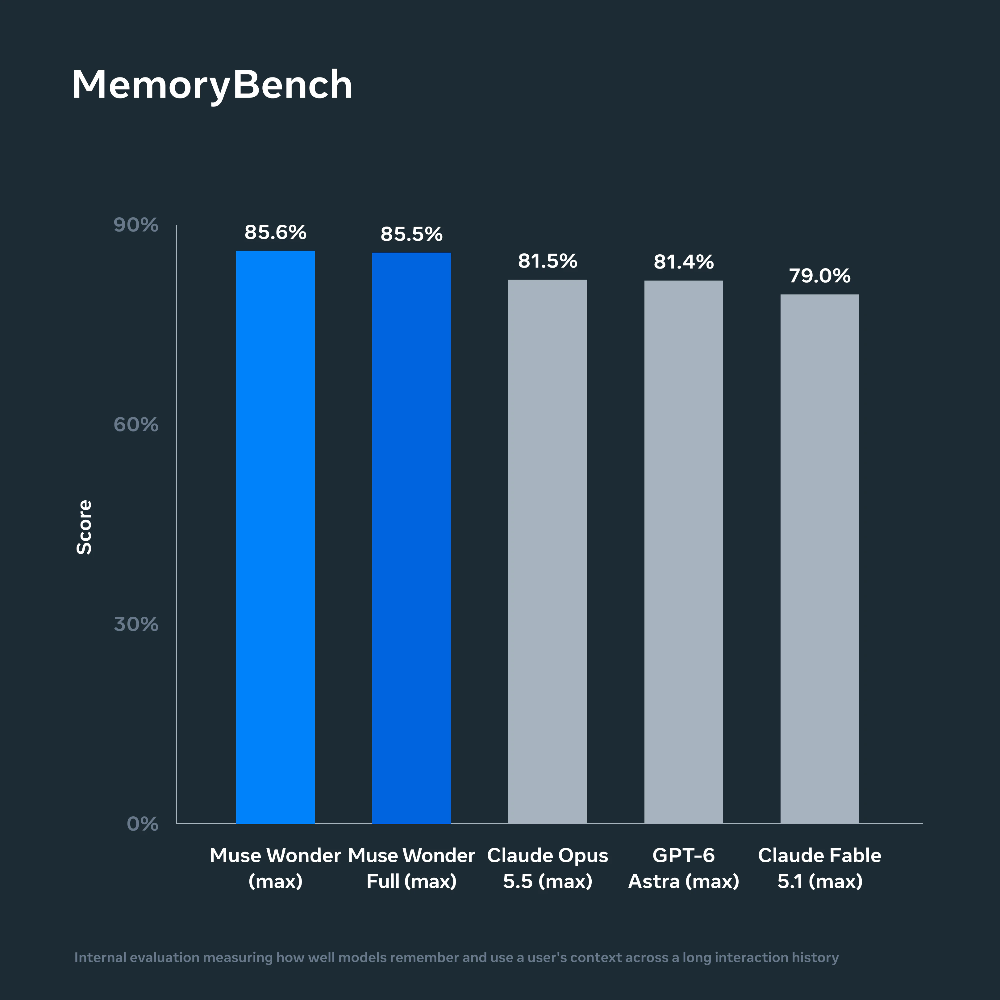
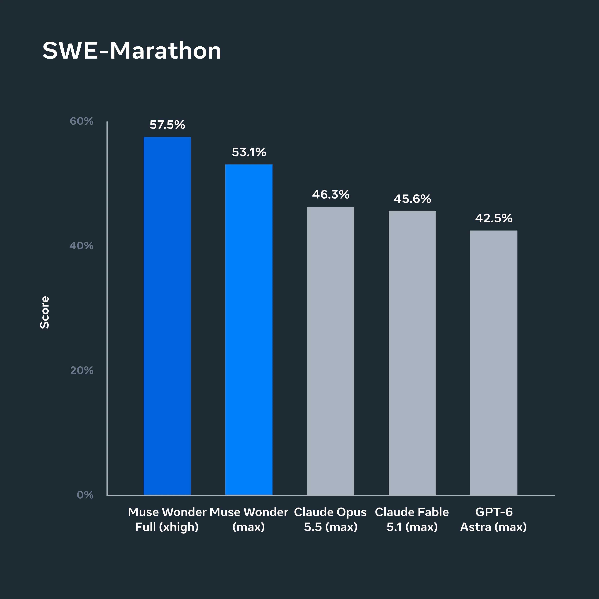
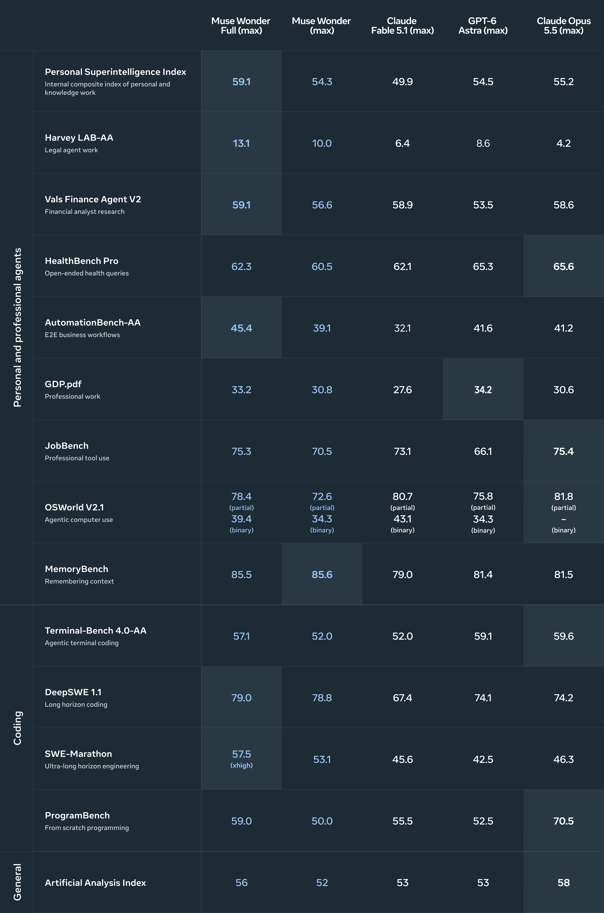
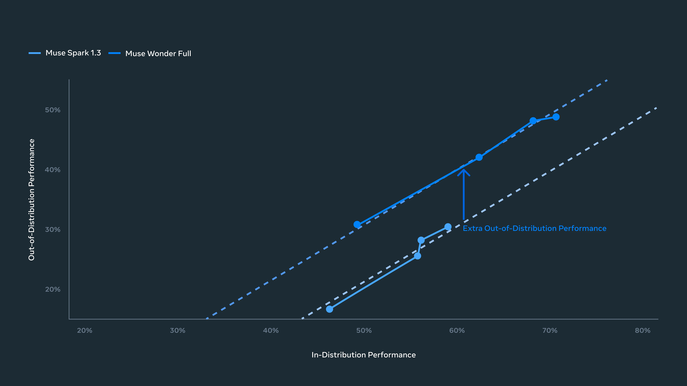
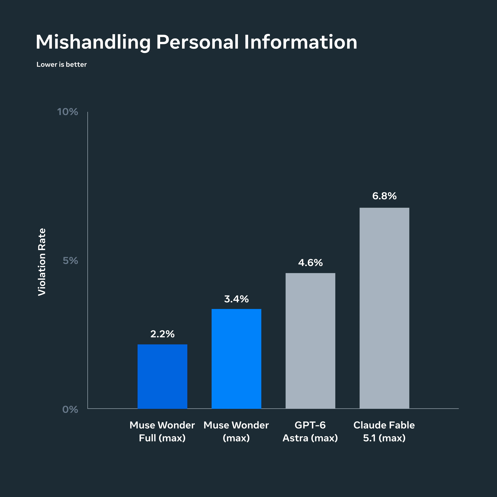

# Muse Wonder Family

> [!tldr]
> 我的判断：Wonder 把个人 Agent 的价值拆成两项需要共同验收的能力——跨会话找回正确上下文的 Active Memory，以及跨失败和长轨迹继续完成任务的 Active Focus。更强的 base 与更长程任务训练是官方给出的方向，但公开资料还不足以把提升归因于某个具体记忆架构或 RL 算法。

> [!warning] 资料不足与未完成精读
> 官方技术博客和完整评测图已读，图已本地化；没有核实到官方 HF 开放权重卡。博客没有公开参数、训练 token、记忆存储结构、奖励公式与训练配方。官方链接的 Model Card / evaluation report 本次仅保留链接，未下载 PDF、未完成全文精读；另一个模型页请求为 HTTP500。因此本笔记达不到 GLM-5.3-Flash 那种公开架构与完整训练证据的深度。资料较少/报告尚未精读的部分显著留白，不用营销用语补推细节。

## 首发、Family 和访问边界

官方文章标注 **2026-10-12** 并说明当天 Wonder 可通过 Meta Model API 和 Muse Code 使用，Wonder Full 可供 Muse Code 订阅者使用。两者作为同一新主干 family 合并，不能按服务版本拆成两个正代。Muse 消费端的逐步接入是后续 rollout，不是另一条模型首发。

该团队不只维护 Llama：Atlas 的 Meta 分支需要容纳 Muse。它不是 Llama 5 的别名，也不能继承 Llama 权重开放与许可的假设。博客称构建更大、更强的 base，并在 Prometheus 数据中心训练；未给出可核验的具体参数或 FLOPs。

## Memory：不是保存更多文本，而是取回当前任务相关的材料

Active Memory 的公开定义是跨对话保留重要上下文，并在新任务中主动找回相关细节。实现可以涉及存储、检索、选择和上下文编排，但博客没有披露哪部分在模型内部、哪部分属于服务/Harness，不能直接写成“参数化永久记忆”。

核心失败类别至少包括：没有检索到旧约束、取回过期事实、错配同名实体、忘记用户撤销的授权，以及把私人信息带给不应该看见的工具。记忆准确率提高与隐私风险下降必须分别测。

## Focus：长期保持目标，并不意味着无条件不停执行

官方以 FocusBench 与 SWE-Marathon 测持续执行。Focus 指在难目标上尝试替代路线、应对阻碍、根据新信息调整，同时在必要处澄清、重大行动前确认。它包含“坚持”也包含“知道何时停下”，不是绕过失败、权限或用户撤销。

长期软件工程需要保存需求、修改多文件、重复测试与修订；这与一次函数生成的 pass@1 不同。公开博客说训练含多样长程任务，却没有披露任务构造、过程奖励、信用分配或恢复策略。不能把这些常见技术名词自动填为已证实的方法。

## 官方成绩：强项与非领先项一起记录

下表选取官方完整图中的关键行，未本地复现。默认比较列标 max；SWE-Marathon 的 Wonder Full 标 **xhigh**，预算并不严格相同。

| 评测 | Wonder Full | Wonder | GPT-6 Astra | Claude Opus 5.5 |
|---|---:|---:|---:|---:|
| Personal Superintelligence Index | 59.1 | 54.3 | 54.5 | 55.2 |
| Harvey LAB-AA | 13.1 | 10.0 | 8.6 | 4.2 |
| Vals Finance Agent V2 | 59.1 | 56.6 | 53.5 | 58.6 |
| MemoryBench | 85.5 | 85.6 | 81.4 | 81.5 |
| AutomationBench-AA | 45.4 | 39.1 | 41.6 | 41.2 |
| DeepSWE 1.1 | 79.0 | 78.8 | 74.1 | 74.2 |
| SWE-Marathon | 57.5（xhigh） | 53.1 | 42.5 | 46.3 |
| Terminal-Bench 4.0-AA | 57.1 | 52.0 | 59.1 | 59.6 |
| HealthBench Pro | 62.3 | 60.5 | 65.3 | 65.6 |
| Artificial Analysis Index | 56 | 52 | 53 | 58 |

Full 在长程工程与内部综合指数上强，但 Terminal、HealthBench、AA Index 并非最高；普通 Wonder 在不少项也低于对手。MemoryBench 85.5/85.6 的小差异不能据此断言 Full 记忆更差，缺少不确定性与重复试验。

LAB-AA 不能与 GLM-Legal 的 Harvey LAB 19.2 直接比较；不同供应商图上的 harness、effort、token budget 与版本可能不同。“双方都有一个法律 benchmark”不等于实验条件相同。

## 泛化证据怎样理解

横轴是后训练重点任务的综合分，纵轴是没有针对训练的任务平均分；每点对应不同 reasoning effort。Wonder Full 相对 Spark 1.3 的趋势向上移，是官方用于论证更强 base 带来有效稳健性的证据。

这仍是观察性比较：base、后训练、harness 和任务集合同时可能变化。不能由曲线推出“训练了某种特定 RL 就造成 OOD 改善”，也不能把没有针对训练等同于完全无污染。

## 安全：防泄露与合法任务成功不能互相替代

个人 Agent 可访问消息、日历、私人文档，因此评测要同时处理不可信指令、未经授权动作和私人信息泄露。官方还展示 CBRN/cyber misuse 拒绝与 defensive cyber compliance，不能用拒绝所有任务来取得“安全”。博客说额外安全评估完整报告将后续提供；不能写成该报告已公开且本笔记已读。

> [!insight]
> 建一个跨会话测试：先写入偏好与授权，隔离干扰会话，再变更其中一个约束。新任务同时测相关检索、事实时效、授权边界、长程终态和每成功成本。把 memory/Harness 开关做 factorial 对比，才可能区分模型能力与外部编排收益。

## 来源地图

- [Tech Blog · 10 月 12 日首发](https://research.meta.ai/blog/muse-wonder)
- [Official Model Card / Evaluation Report · 链接保留，全文未精读](https://research.meta.ai/static/muse-wonder-model-card)
- `src/tech_blog.html` 与正文提取保留原文；16 张官方静态图位于 `src/assets/`，不抓演示视频。

> 📊 相关可视化: [[Topics/13_base_model/Meta_Llama/261012_Muse_Wonder/muse_wonder_poster_zh.html|Muse Wonder 中文 Poster]]
