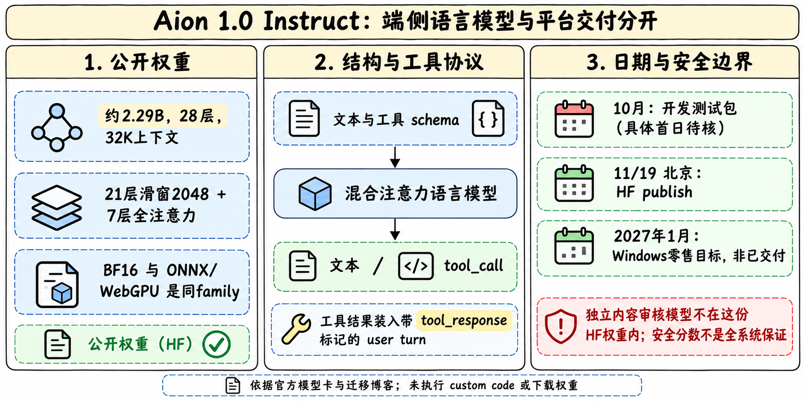
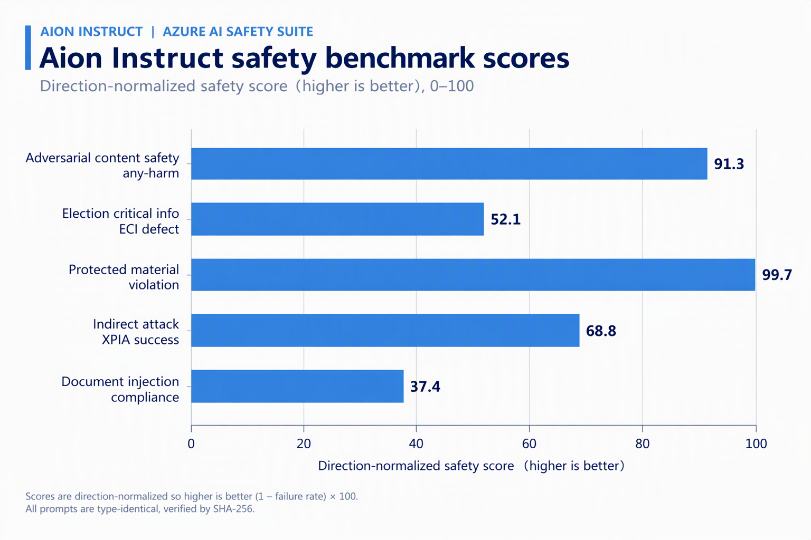

> [!tldr]
> Aion是约2.29B的Windows端侧语言/工具模型，延续Phi Silica的训练路线。模型权重、ONNX运行包与Windows内容审核/水印平台是不同交付层；不能把计划中的系统能力写成HF权重已有保证。

> [!warning] 首次日期未精确到日
> 11/13官方迁移博客的时间线明确10月已有standalone测试包，所以11/19 HF发布不是family首发。以2026-10待核具体日收录；HF publish为11/18 17:16:51Z，换算北京11/19 01:16:51，作为权重阶段。没有下载权重、执行trust_remote_code或核实Windows账号实际安装。

## 结构与训练线索

> [!tldr]
> 21层滑窗与7层全注意力平衡局部计算与长程信息；架构配置不等于完整训练配方。

| 配置 | 值 |
|---|---|
| 规模/精度 |约2.29B，BF16，tied embedding|
| 层数/宽度/FFN |28 / 2048 /8192，SiLU|
| GQA |24Q heads，8KV heads，head_dim128|
| 注意力 |21层SWA窗口2048；7层full attention|
| 长上下文 |32768，full层YaRN factor16，RoPE theta32000|
| 词表 |200029|
| 知识截止 |2025-12，属于卡的声明|
| 语言 |en/de/es/pt/it/fr/zh/ja，多语言训练约6%|

公开材料描述Phi Silica训练扩展、过滤公共高质量数据与合成数学/代码/常识；没有可复现的数量配比、完整recipe、训练算力或各项消融。2.3B是型号近似，不能以ONNX体积反推相同运行精度。

## 模板与工具协议

> [!tldr]
> 工具结果被装入带tool_response标记的user turn，不能默认直接等价OpenAI tool角色。

默认system preamble可以接前置用户system，并有current date字段；EOS为`<|end|>`。工具schema由专用tool标记围住，调用输出为tool_call中的JSON。结果进入带tool_response标记的user turn；改模板、日期、工具序列化和权限会改变行为。静态读取modeling与Jinja，未执行自定义代码。

BF16与ONNX/WebGPU合并同family。ONNX是部署格式/运行路径变化，不是训练升级；硬件、量化、浏览器WebGPU限制和CPU回退需要单独实测。工具执行仍要调用端校验schema与权限，不能由能输出JSON推导工具安全。

## 完整质量与安全证据

> [!tldr]
> benchmark分母、打分器与模板需要冻结；chrF++不是正确率。安全图只代表所列评测条件。

| Category | Benchmark | Score | Notes |
|---|---|---:|---|
| Knowledge | MMLU | 55.15 | |
| Knowledge | MMLU-Pro | 33.35 | |
| Knowledge | MMMLU | 45.51 | Multilingual MMLU |
| Knowledge | GPQA | 28.18 | |
| Math | GSM8K | 74.91 | Loose matching |
| Math | GSMPlus | 49.56 | |
| Math | MATH-500 | 48.00 | |
| Instruction following | IFEval | 83.90 | Mean of prompt-level strict and instruction-level strict |
| Instruction following | IFBench | 32.00 | Prompt-level loose |
| Instruction following | Multi-IF | 64.70 | |
| Translation | chrF++ | 43.18 | |

| | |
|---|---|
| **Type** | Causal language model (instruction-tuned) |
| **Parameters** | ~2.29B (tied input/output embeddings) |
| **Layers** | 28 |
| **Hidden size** | 2048 |
| **MLP intermediate size** | 8192 (SiLU) |
| **Attention** | GQA: 24 query heads, 8 key/value heads, head dim 128 |
| **Attention pattern** | Hybrid: 21 sliding-window layers (window 2048) + 7 full-attention layers |
| **Positional encoding** | RoPE (θ = 32000); YaRN scaling (factor 16) on full-attention layers |
| **Context length** | 32,768 tokens |
| **Vocabulary size** | 200,029 |
| **Precision** | bfloat16 |
| **Knowledge cutoff** | 2025-12 |

| File | Description |
|---|---|
| `model.safetensors` | Model weights (bfloat16) |
| `config.json` | Model configuration |
| `generation_config.json` | Default generation settings |
| `configuration_aion_instruct.py` | Custom configuration class (`AionInstructConfig`) |
| `modeling_aion_instruct.py` | Custom model implementation (`AionInstructForCausalLM`) |
| `tokenizer.json`, `tokenizer_config.json` | Tokenizer |
| `chat_template.jinja` | Chat template |

GSM8K采用loose、IFEval为prompt strict与instruction strict均值、IFBench为prompt loose；chrF++43.18为翻译量尺。能用lm-eval时使用lm-eval，否则原始repo；带†的判分使用GPT4o。缺实际版本commit、完整采样与置信区间，未复测。

图为direction-normalized safety score（越高越好，(1−failure rate)×100），不是攻击成功率：adversarial any-harm91.3、ECI defect52.1、protected material99.7、indirect XPIA68.8、document injection37.4。提示类型一致并按SHA256校验，但缺原始逐题结果与CI；低的document injection尤其不能被99.7遮住。各项结果不等于整个系统安全。Windows迁移计划中的独立内容审核模型没有随这份HF语言模型一起提供，隐形文字水印也是平台要求/能力，不能自动赋予原始checkpoint。端侧运行的隐私优势以应用实际网络调用、日志与权限为条件。

## 平台时间线与研究判断

> [!tldr]
> 最新有日期的博客优先于旧页面计划，但计划仍不是已经交付。测试包、Insider与零售开放分开写。

10月standalone测试包；11/19北京时间HF发布；最新博客预计12/4早期Insider与2027年1月下旬零售路径。旧Learn页面的11月说法保留为历史计划，不把它改写成已完成。没有本轮设备兼容性与账号实际安装证据。

适合作为小模型工具协议与端侧固定预算的研究候选。训练比较应冻结tokenizer/模板与工具工具结果表示；分别测八语言、无网络任务、失败工具返回、敏感输出及内容审核开关。不能把Windows全栈与裸HF模型的分数混为训练收益。

## 官方来源

> [!tldr]
> 模型卡、配置、模板、modeling源码与安全图已存；部署示例只读不执行。

- [HF模型卡](https://huggingface.co/microsoft/Aion-1.0-Instruct-2.3B)
- [ONNX/WebGPU](https://huggingface.co/microsoft/Aion-1.0-Instruct-2.3B-ONNX-WebGPU)
- [官方迁移时间线](https://devblogs.microsoft.com/foundry-on-windows/aion-instruct-local-ai-windows-gpu/)
- [官方样例代码](https://github.com/microsoft/Aion-Instruct-Preview-Sample)

## 关联与交付

> [!tldr]
> 一手材料、研读判断和展示分别保存；图为机制示意，原表保留原量尺。

[[Hy4-Flash]]

> 📊 相关可视化: [[aion_poster_zh.html]]
