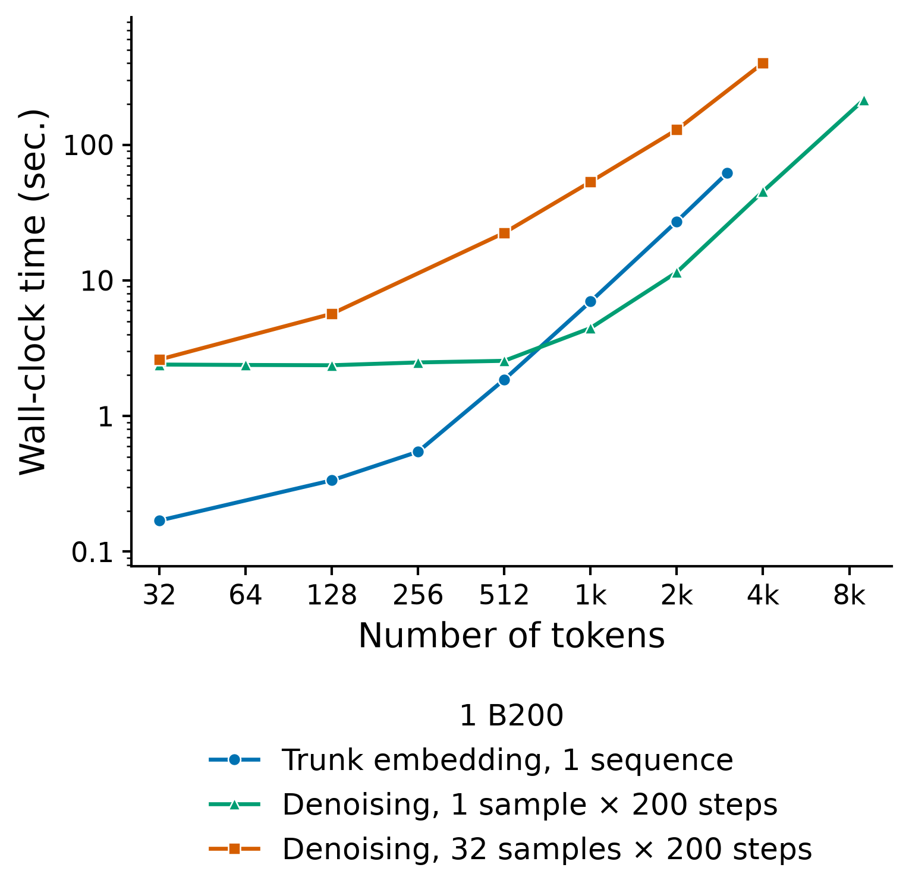
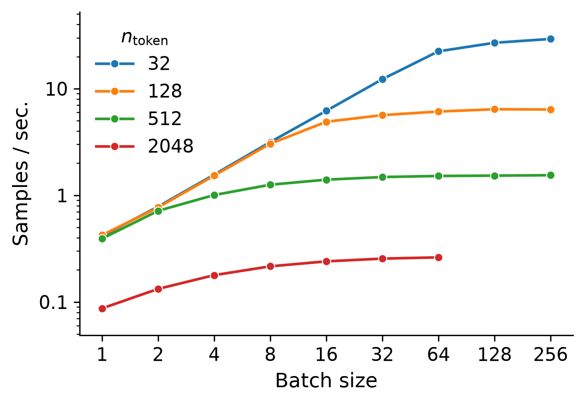

# BioEmu-2：全原子构象生成、平衡采样与时间推进的边界

> [!tldr] 我的判断
> BioEmu-2 把约500M参数的全原子扩散模型用于生物分子结构与构象集合，不是聊天基模。最值得辨清的是三种不同输出：一个折叠结构、平衡态样本集合、给定起点的未来端点；文件格式都能装成 trajectory，不意味着它们都是时间连续的真实动力学轨迹。

> [!warning] 日期与资料深度：尚不能达到完整报告精读标准
> 官方 HF 卡只明确 **2026 年10月**，没有首发日；本轮发现日期是10月20日，不写成该模型首发日。README中的默认 checkpoint 名为 `bioemu2-preview`，作为一个 family 收录。已完整读原卡、README、checkpoint、性能与时间推进文档，但未找到本版本独立 Tech Report 或完整定量精度表。因为原始资料不足，笔记尚未达到 GLM-5.3-Flash 式完整训练与消融剖析深度；不把 BioEmu-1 的旧论文、速度或自由能结论直接移植给2。

## 一手来源与本地保存

| 原文 | 负责说明什么 |
|---|---|
| [🤗 HF Model Card](https://huggingface.co/microsoft/bioemu2) | 约500M、输入输出、训练数据、研究用途、评估范围与限制 |
| [官方 GitHub](https://github.com/microsoft/bioemu2) | 模型入口、系统支持与功能范围 |
| [Checkpoint说明](https://github.com/microsoft/bioemu2/blob/main/docs/checkpoints.md) | 默认preview、trunk与denoiser精度区别 |
| [性能与容量说明](https://github.com/microsoft/bioemu2/blob/main/docs/speed-and-capacity.md) | 两张官方B200原图、复杂度与计时口径 |
| [时间推进说明](https://github.com/microsoft/bioemu2/blob/main/docs/propagation.md) | 端点与连续rollout区别、样本顺序与物理性报告 |

原文 MD 与两张完整官方图保存在同级 `src/` / `src/assets/`，来源与 SHA-256 见 retrieval_manifest.json。模型/代码为 MIT，第三方数据与组件仍要看各自条款。本轮没有下载权重、PDF，未安装或执行官方代码，没有进行生物实验或模型推理。

## 解决的问题：结构预测不等于理解构象分布

单个静态结构无法描述分子的可变构象与相互作用。BioEmu-2 接收用户给定的分子组成 / 序列，可使用 MSA、接触距离与方法条件，生成多链、配体、核酸等系统的全原子笛卡尔坐标集合。它不生成新序列，不设计新小分子，也不输出结合亲和力。

官方卡将结构预测、构象采样与 MD emulation 分别评估。这个分层很重要：形状接近参考结构、覆盖多个状态、正确重现状态权重、正确预测时间演化，是四个强度不同的结论，不能用一张动态演示互相替代。

## 模型计算：先做一次trunk，再反复去噪

官方文档描述每个系统先取得 / 加载 MSA，运行 trunk 生成 single / pair representations，然后在每个采样 batch 上多步调用 denoiser 更新坐标；trunk embedding 可以按相同输入与模型设置复用。默认采样设置为200步，4个batch会触发800次denoiser调用。不是每输出一帧都需重新跑MSA，也不能把去噪计时当作包含全部预处理的整链计时。

用 N 表示分子tokens、R表示MSA深度、B表示batch中的样本数，官方给出以下固定模型与attention tile条件下的量级估计：

| 单次操作 | 峰值内存量级 | 计算量级 |
|---|---|---|
| MSA读取 | O(RN)，主机 | 本地读取O(RN)，远程搜索另计 |
| Trunk | O(RN+N²)，GPU | O(RN²+N³) |
| 初始采样batch | O(N²+BN) | O(N²+BN) |
| 每步denoiser | O(N²+BN) | O(BN²) |
| 无steering坐标更新 | 保留O(N²+BN)，新增O(BN) | O(BN) |

N² pair 表示解释了大系统的显存压力；triangle multiplication 引入 trunk 的 N³ 项。这些是官方复杂度模型，不是所有硬件的性能保证。

读图判断：约600 tokens以上，单序列trunk耗时可超过一个样本的去噪；需要很多样本时去噪反而占主导。32样本的去噪约为trunk的5–15倍是文档对这套设置的概括，不推广成任何系统、任何GPU都如此。图为双对数坐标，不能把视觉直线当线性扩展。

## 采样集合、未来端点和时间轨迹，必须分开

| 输出 | 可以怎样理解 | 不能怎样理解 |
|---|---|---|
| Structure / equilibrium samples | 给定系统的结构或构象候选集合 | 帧序天然代表经过的物理时间 |
| Propagation endpoints | 给定起点与lag后的独立未来端点 | 同一批端点是从前一端点依次演化 |
| Time-ordered rollout | 显式逐步推进、前一结果作为下一条件 | 必然遵守全部物理定律或长期无误差累积 |

官方推进文档说主要见过1–1000ns的lag；超过这个范围不能默认一样可靠。`simulate_trajectory()` 的输出才显式包含时间顺序与起点；普通采样API把 `mdtraj.Trajectory` 当成便利容器。拓扑原子顺序必须与坐标一致，映射可以重排，不能凭空补齐缺失原子。

物理性不合格样本仍可保留在输出集合，报告索引与帧对应；系统不会自动删除、重试或修复。只展示通过筛选的帧会掩盖失败率。采样频率也**不能解释成已校准Boltzmann概率或定量自由能**，这是原卡直接列明的限制。

## 数据：训练样本的来源与量纲

训练时间为2026年8–9月，不等于发布日。官方列出的数量如下，量纲为对应dataset中的sequences/systems，不能直接等同于独立帧、轨迹时间或去重蛋白数。

| 数据集 | 类型 | sequences/systems |
|---|---|---:|
| PDB · Boltz-1预处理 | 实验结构 | 189,745 |
| MSR_cath2 | MD轨迹 | 886 |
| MSR_cath3 | MD轨迹 | 4,136 |
| MSR_cath_dimers | MD轨迹 | 7,164 |
| MSR_heterodimers | MD轨迹 | 1,272 |
| MSR_pdbbind2020 | MD轨迹 | 3,036 |
| MSR_pdbbind2020_apo_free | MD轨迹 | 2,770 |
| MSR_megasim_merge | MD轨迹 | 170 |
| AFDB monomer | AI预测结构 | 7,231,107 |
| AFDB homodimer multiconformation | AI预测结构 | 753,271 |
| AFDB heterodimer multiconformation | AI预测结构 | 22,157 |
| Teddymer | AI预测结构 | 50,651 |

公开数据与Microsoft自产MD并用，不含特别授权给Microsoft的数据；这不意味着数据没有许可条件。AFDB与Teddymer含AlphaFold家族预测，伪标签偏差和常见家族过度代表应与实验结构分开讨论。数据混合比、训练loss权重、完整去重与污染审计、关键消融未在已读材料中完整披露。

## 评估披露与尚不能回答的问题

官方卡使用同一checkpoint评估各套基准，分别列出 Boltz-1 test set 上的 RMSD / TM-score / lDDT / physicality / interface DockQ；基于相似PDB结构与不同共折叠伙伴的多构象区分；MD留出集的状态覆盖与权重分布散度；超过1500 tokens的大复合物可行性。**已读卡没有给这些精度指标的具体结果表或置信区间**，因此不宣称它击败任何指定cofolding基线。

原卡写最小已测设备80GB A100，仓库README当前则列V100、T4、A100、RTX A6000、B200等端到端测试。两份资料的测试范围表述不一致，保留这一差异，不据此给出所有系统都能在小卡运行的保证。Python3.12用于性能 / benchmark评估，3.13/3.14通过测试套件不代表精度基准已重测。

第二张图的 samples/s 是按每步时间、200步折算，**排除trunk时间**；只代表这套B200与采样设置。batch增大后吞吐饱和，较长系统在更小batch就饱和；不能写成batch翻倍必然加速一倍。减少去噪步数会改变采样过程，精度 / steering / resampling也会改变样本分布，不能当纯工程优化忽略。

## 我的研究判断：把模拟器能力与奖励可验证性拆开

> [!insight] 对 Agent Training 的启发
> 这类模型可启发“昂贵环境→学习型模拟器”的训练路线，但模拟器自评分不应成为唯一reward。集合覆盖、状态权重、一步动态、长rollout稳定性要分别验收；如果只保留漂亮或物理性通过的样本，策略会在被筛过的环境里得到过于乐观的反馈。

可迁移到通用Agent研究的是实验控制：冻结模型revision与条件输入，保存全部失败样本，分别测一步与长程误差，校验状态不变量，单列预处理 / trunk / rollout的成本。这里不提出分子设计实验，也不把模型作为医疗或高风险决策工具。

## 用途边界与交付

官方限定研究用途：输出是计算假设，不是实验测量；未验证用于临床、诊断、治疗、剂量、定量亲和力或绝对自由能预测。不用于危险生物设计。浅 / 低质量MSA、罕见家族与超过10k tokens的大系统均有不确定性。

- 本轮归档日期：2026-10-20；官方首发日：**待核，当前仅到2026-10**。
- 在Atlas中放Microsoft专项支线与“日期待核实”列表，不挤进精确日期的近30天表格。
- 📊 中文 Poster：[[bioemu_2_poster_zh.html]]。
