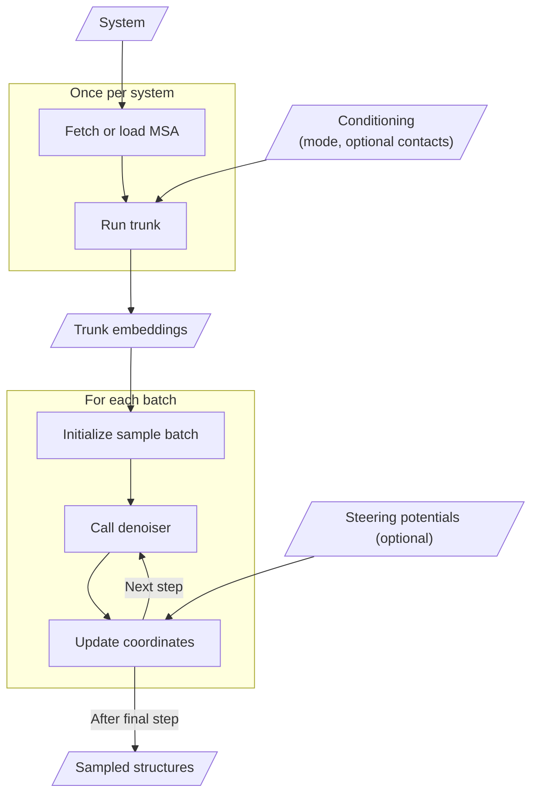
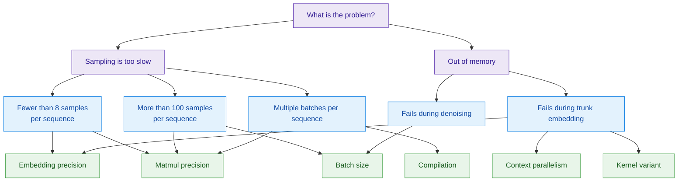

# Improve sampling speed and scale to bigger systems

<!-- BEGIN GENERATED TOC -->
## Contents

- [Know where the time goes](#know-where-the-time-goes)
- [Know the controls](#know-the-controls)
- [Choose a batch size](#choose-a-batch-size)
- [Use bfloat16-mixed precision for trunk embedding](#use-bfloat16-mixed-precision-for-trunk-embedding)
- [Compile the denoiser](#compile-the-denoiser)
- [Lower matmul precision](#lower-matmul-precision)
- [Fit larger systems](#fit-larger-systems)
<!-- END GENERATED TOC -->

Many settings can affect how fast BioEmu2 generates samples and how
large a system fits on a GPU. Only a few of them matter for a given job,
because what limits speed and memory depends on the system size, the MSA, the
sampler, the GPU, and the number of samples you need.

## Know where the time goes

For each system, BioEmu2 obtains an MSA and computes trunk embeddings
once. It then denoises each batch of samples over many steps:



Slanted boxes are inputs or outputs; rectangular boxes are operations.
The performance controls apply to different parts of this workflow; see
[Know the controls](#know-the-controls) for which stage each control affects.

The two main compute stages are:

- **Trunk embedding** runs the trunk once per system and produces
  single and pair representations.
- **Denoising** runs the denoiser once per denoising step for each
  batch of samples, so with the default 200 steps, a job with 4 batches calls
  the denoiser 800 times.

Within one Python session, [reuse trunk embeddings in
memory](reuse-embeddings.md#reuse-embeddings-in-memory). Across separate Python
sessions with unchanged inputs and model settings, [save and reload
embeddings from disk](reuse-embeddings.md#save-embeddings-to-disk) instead of running
the trunk again.

The table estimates the cost of **one invocation** of each action in the
diagram for single-GPU sampling. Let `N` be the number of
[tokens](system.md#define-contact-conditioning), `R` the number of MSA
rows (MSA depth), and `B` the number of samples in a batch. Assume a fixed
model size and fixed attention tile/window sizes. Peak memory includes the
trunk embeddings and other data still needed at that stage; MSA acquisition
uses host memory, while trunk embedding and denoising use GPU memory.

| Action | Peak memory | Compute |
| --- | --- | --- |
| Fetch or load MSA | `O(RN)` host | `O(RN)` to read a local/cached MSA; remote search depends on the service and database |
| Run trunk | `O(RN + N²)` GPU | `O(RN² + N³)` |
| Initialize sample batch | `O(N² + BN)` GPU | `O(N² + BN)` |
| Call denoiser (per step) | `O(N² + BN)` GPU | `O(BN²)` |
| Update coordinates (per step) | `O(N² + BN)` GPU; `O(BN)` additional | `O(BN)` without steering |

The quadratic pair representations contribute the `N²` memory term.
Triangle multiplication contributes `N³` trunk compute; MSA/pair mixing
contributes `RN²`. Full token attention contributes `BN²` per denoising step.
The size of the trunk embeddings does not depend on MSA depth `R`.

Which stage takes most of the time depends on how many samples you need per
sequence. The figure below shows the wall-clock time on one B200 GPU to embed
one sequence and to denoise 1 or 32 samples for 200 steps. Above about 600
tokens, embedding one sequence takes longer than denoising one sample, so when
you need only a few samples, trunk embedding takes a large share of the
runtime. Denoising 32 samples takes 5 to 15 times longer than embedding, so
when you need hundreds of samples, denoising takes most of the runtime. For
small systems, a batch of 32 takes barely longer than a single sample, which
is why batching helps most when the system is small.


## Know the controls

| Control | Set with | Stage | Improves | Changes results? |
| --- | --- | --- | --- | --- |
| Batch size | `--batch-size` / `batch_size=` | Denoising | Larger batches can increase speed; smaller batches lower peak memory | Changes exact samples; for `edm_fk`/`edm_fkc`, also changes the resampling population |
| Denoising steps | `--num-steps` / `num_steps=` | Denoising | Fewer steps shorten runtime roughly linearly; peak memory is unchanged | Yes; changes the sampling procedure |
| Compilation | `--compile-denoiser` (serial only) / `load_model(compile_denoiser=True)` | Denoising | Speed | No |
| Embedding precision | `--precision` / `load_model(precision=...)` | Trunk embedding | Speed and peak memory | Slightly |
| Matmul precision | `--matmul-precision` / `load_model(matmul_precision=...)` | Denoising | Speed | Slightly |
| Context parallelism | `torchrun --module bioemu2.cp ...` / `bioemu2.context_parallel.api` | Both | Peak memory per GPU | No |
| Kernel variant | `trimul_variant`, `opm_variant`, and `tiling_cfg` in the checkpoint's `config.yaml` | Trunk embedding | Peak memory, at the cost of speed | Slightly |

Each entry point defaults to settings that work well for its typical use case.
If you know more about your job, such as the system size, the number of
samples, or the GPU memory, tuning these controls can make sampling faster or
fit larger systems.

The sampler also affects speed, but it changes what you sample; see
[choose a sampler](steering.md#choose-a-sampler).

Start with the control that matters most for your job:



## Choose a batch size

`num_samples` is how many samples you want; `batch_size` is how many are
denoised together in one call, and it defaults to `num_samples` in every entry
point. BioEmu2 runs `ceil(num_samples / batch_size)`
batches, and the last batch takes whatever samples are left. For example,
`num_samples=100` with `batch_size=32` runs three batches of 32 and one batch
of 4. Until the GPU is fully used, doubling the batch size less than doubles
the time per batch, so larger batches produce more samples per second. Past
that point, larger batches only use more memory.

The figure below shows how batch size affects denoising throughput. It
measures the duration `t` of one denoising step on one NVIDIA B200 GPU and
reports throughput as `batch_size / 200 / t` samples per second, assuming
200 `edm` steps and excluding trunk embedding time.
Larger batches increase throughput until the GPU is fully used, and larger
systems reach that point at smaller batch sizes.
On a B200, a batch size of 64 works well for most systems.


To find the batch size for your own workload, edit the setup cell at the end of
[`examples/search_batch_size.py`](../examples/search_batch_size.py) to match
your system, MSA, mode, sampler, and model settings. The script doubles the
batch size from 1 up to 128 and stops early once two doublings in a row each
gain less than 1% throughput. If a batch size runs out of CUDA memory, it
bisects between the last batch size that fit and the one that failed. It then
tries sizes halfway between the fastest batch size and its neighbors. It stops
when each neighbor is adjacent or within 1% of the best throughput, and logs
`Best measured batch=...`. For each batch size, the script runs one untimed
warm-up call and then reports the median of three runs timed on the GPU with
CUDA events. Run it on an idle GPU. Other jobs skew the timings, and the search
may run out of memory on purpose:

```bash
CUDA_VISIBLE_DEVICES=0 python examples/search_batch_size.py
```

> [!WARNING]
> - A larger `batch_size` shortens the runtime only for a fixed `num_samples`;
>   more samples always take more time.
> - Batch size does not speed up trunk embedding, so it helps little when you
>   need only a few samples per sequence and embedding takes most of the time.

## Use bfloat16-mixed precision for trunk embedding

`precision="bf16-mixed"` runs the trunk embedding under bfloat16 autocast,
which roughly halves its intermediate memory and doubles its speed. Use it when
the embedding dominates the runtime, for example with many different systems,
large systems, or deep MSAs.

It slightly reduces accuracy. The loss is negligible for structure prediction;
if in doubt, compare against a `32-true` run.

> [!NOTE]
> Denoising always runs in float32; `precision` affects only the trunk embedding.

## Compile the denoiser

`compile_denoiser=True` compiles the denoiser layers with `torch.compile`.
The denoiser compiles on its first call, which adds a fixed startup cost, and
every later call runs faster. Compiling pays off only when the job calls the
denoiser often enough to make up for that cost. Each batch calls the denoiser
once per denoising step, so jobs with many batches and long propagation
rollouts benefit most, while a job with few samples can be slower overall.

> [!NOTE]
> Compilation works best with `"high"` matmul precision.

## Lower matmul precision

`matmul_precision` sets `torch.set_float32_matmul_precision` during denoising,
so it helps any workload dominated by denoising. `"high"` enables TF32 tensor
cores on supported NVIDIA GPUs and `"medium"` reduces precision further.
Tensors stay float32, so memory use is unchanged.

## Fit larger systems

If a system runs out of memory at batch size 1, first try
[`bf16-mixed`](#use-bfloat16-mixed-precision-for-trunk-embedding). If that is
not enough, the easiest fix is usually
[context parallelism](context-parallel-sampling.md), which splits one system
across a square grid of GPUs.

To stay on one GPU, switch the trunk to memory-saving kernels: the tiled
cuEquivariance triangle multiplication and the Triton outer-product mean.
These variants are not exposed as options, so edit a local copy of the
checkpoint config:

```bash
snapshot=$(hf download microsoft/bioemu2 \
    --include "checkpoints/bioemu2-preview/*" --quiet)
cp -rL "$snapshot/checkpoints/bioemu2-preview" bioemu2-tiled
```

In `bioemu2-tiled/config.yaml`, set:

```yaml
score_model:
  sequence_embedder:
    trimul_variant: cueq_tiled
    opm_variant: triton_memory_saving
    tiling_cfg:
      trimul_tile_size: 256  # smaller tiles use less memory but run slower
```

Then [load the edited checkpoint](checkpoints.md#load-a-local-checkpoint) with
`--checkpoint-path bioemu2-tiled/checkpoint.ckpt`
or `load_model(checkpoint_path=...)`. The kernels use a different accumulation
order, so results differ slightly from the default kernels.

> [!WARNING]
> Use these kernels only as a last resort: they trade speed for memory and slow
> down the trunk embedding.
