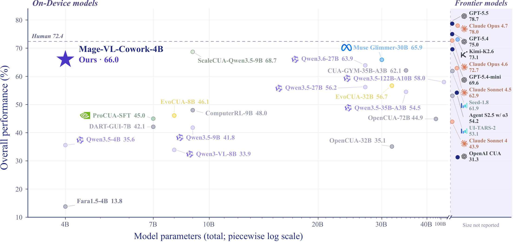
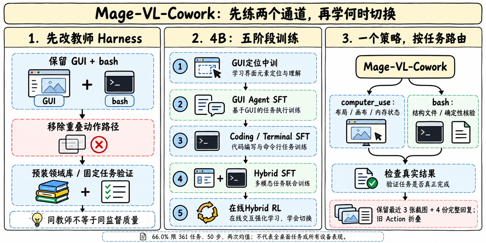
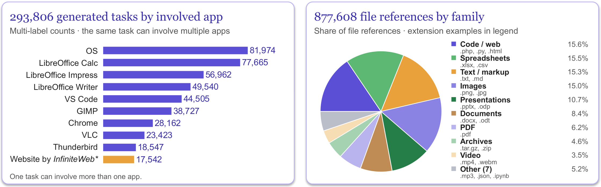
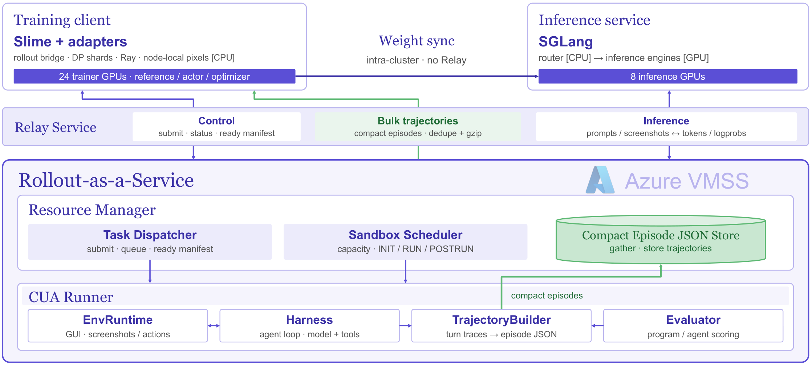
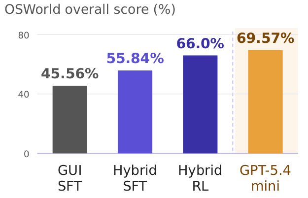

# Mage-VL-Cowork：小策略怎样学会选择交互通道

> [!tldr] 核心判断
> 核心不只是让4B模型同时拥有鼠标和shell，而是先改教师的工具、环境与任务构造，再按“定位→GUI→终端→混合→在线RL”建立能力。统一策略学的是每一轮该通过哪条通道完成工作。官方在限定的361项OSWorld-Verified任务上报告两次运行平均66.04%（摘要写66.0%）；这不是所有桌面场景或所有硬件的成功率。

> [!warning] 阅读范围与原始材料缺口
> 已逐段阅读官方HF模型卡、项目正文、README及配置，保存了11张项目原图。官方另有Tech Report PDF链接，但按照当前“不下载PDF”的要求，本次没有抓取或阅读该PDF；尚未取得同版可读HTML/源码。**因此本笔记未达到完整技术报告及附录精读的深度**，尤其不能声称复核了报告全部消融、训练细节和统计不确定性。模型卡计算占比与ZFLOPs列还存在明显不对应，下面保留原值，不能擅自修正。

## 来源与时间

| 材料 | 链接与本地原件 | 本次用途 |
|---|---|---|
| HF Model Card | [官方卡](https://huggingface.co/microsoft/Mage-VL-Cowork)；[[src/hf_model_card]] | 工具协议、课程、结果与推理边界 |
| 官方项目页 | [Tech Project](https://microsoft.github.io/Mage/cowork/)；[[src/project.html]] | 方法、阶段曲线、教师与数据系统 |
| Tech Report（PDF） | [官方报告链接](https://github.com/microsoft/Mage/blob/main/assets/mage_vl_cowork_tech_report.pdf) | 仅保留链接，未读PDF |
| 官方源码 | [Mage](https://github.com/microsoft/Mage/tree/main/mage_vl_cowork)；[[src/README]] | 发布内容与结构 |
| 首次公开依据 | [不可变README提交](https://github.com/microsoft/Mage/commit/85a16927eb4ceceb2312ddd2cd1533a992ff952f)；[[src/README-initial-release]] | 2026-10-30 07:54:49 UTC已明确命名本模型、课程与结果，随后08:09提交补HF链接 |

Atlas采用**2026-10-30**作为本模型首次官方公开材料日期，依据原始发布提交，而非HF创建/修改时间。更早的Mage-VL是上游checkpoint，不把其7月日期套到Cowork；后续README和图片更新也不重复生成模型事件。该模型放Microsoft的Computer Use专项支线。

## 4B策略实际看到什么、能做什么

主体由MageViT与Qwen3-4B-Instruct-2507组成，从中间Mage-VL checkpoint继续训练。配置的当前上下文为32,768；架构可支持更长位置范围不等于已验证262K实际任务窗口。

策略只在两个工具通道间作选择：`computer_use`包含11种GUI原语，坐标归一到0—999；`bash`提供持久shell/Python和合并stdout/stderr文本，工作目录为`/tmp_workspace`。需要画布布局、界面未保存状态时走GUI；能直接检查结构化文件或确定性运算时走终端。没有额外大模型路由器代替策略选择。

历史上下文保留最近3张截图、4条完整模型响应，旧Action折叠为动作历史。bash文本不占截图槽。单条响应最多15次工具调用，且同条调用的工具名必须一致；4096新token预算由思考、解释和工具载荷共同使用。不能把“允许15调用”当作每次都需要批量操作。

## 先改教师Harness：同一个教师不保证同一种监督质量

默认教师即使很强，也可能在重叠工具间犹豫，用冗长动作完成本可直接验收的任务。官方先演化scaffold：收敛GUI与代码接口，去掉重叠路径，预装python-pptx、openpyxl、pandas、pypdf、Pillow等工具库，再分别收集GUI、Terminal、Hybrid监督。这里的库名仅记录原始环境，没有在本机安装或执行远程代码。

同GPT-5.4教师和672项留出多应用任务下，演化GUI+Coding教师成功率92.0%，学生37.6%；增加AX的对照教师89.6%，学生25.1%。学生差12.5个百分点，说明示范是否容易模仿很重要。不过这包含接口、提示与环境的多项共同调整，**不能把全部增益归因于单独删除AX，更不能认定AX在所有任务都有害**。

## Mage-CUA-Forge：复用任务生成工作流

它将一次性编写的技能工作流与应用准备器复用到许多任务，而不是每个任务重新运行一套长生成Agent。准备器确保文件、应用状态和可验证目标存在，教师执行后保留能通过验收的轨迹。学生反馈还可帮助扩展薄弱技能。

官方统计293,806项桌面/Web任务、6,915种技能；38.24%涉及多应用。877,608个文件引用覆盖278类文件，不能当作同等数量的独立任务。最终318,837条混合轨迹中的工具调用为68.19% GUI、31.81%终端；这一比例描述数据，不是部署时固定配额。

| 任务生成指标 | 旧方案 | 复用工作流方案 | 应怎样解读 |
|---|---:|---:|---|
| 经常性单任务开销 | $0.906 | $0.158 | 下降82.6%；不包含所有前期工作流开发摊销 |
| 单任务生成tokens | 1276K | 85K | 下降93.3%；不是最终模型推理token下降幅度 |
| 混合轨迹 | — | 318,837 | 验证后数据量，不是唯一任务数量 |

## 五阶段训练与计算口径

| 阶段 | 主要监督 | 官方数据规模 | 作用 |
|---|---|---|---|
| GUI Midtraining | 定位、视觉推理、结构化调用 | 24.6B tokens/epoch；751K个32K packed bins | 先掌握界面元素与工具格式 |
| GUI Agent SFT | 完整截图—鼠标键盘轨迹 | 156.7K轨迹；32.2B tokens/epoch | 学GUI任务链 |
| Coding / Terminal SFT | 代码、终端与程序化操作 | 563.7K轨迹；5.7B tokens/epoch | 建立第二条可用通道 |
| Hybrid SFT | 两类通道交错的同一任务 | 318.8K轨迹；45.1B tokens/epoch | 学选择和切换，而非并排两个独立Agent |
| Online Hybrid RL | 有可验证结果的交互 | 1,988任务；768 episode slots/update | 用任务结果优化效率与成功 |

RL使用GRPO及异步rollout；策略落后不超过3次更新，TIS上限2。基础设施区分训练GPU与CPU环境槽，官方给出32个B200和1120个CPU slots；这不是32台机器，也不代表完整总墙钟成本。

> [!warning] 计算表尚不能作为可靠分配图
> 原卡Compute Share依次为15.2%、33.6%、19.9%、27.8%、3.5%；对应Nominal LM ZFLOPs却是1.18、1.55、0.27、2.17、2.62，总计7.79。后者归一约15.15%、19.90%、3.47%、27.86%、33.63%，第二、三、五阶段明显不对应。这里保存两个原始列，**不擅自调换标签、不据此画阶段算力饼图**。Nominal LM计算还不等于视觉、环境、教师和工程的全部开销。

## 结果必须带上分母与checkpoint

OSWorld-Verified使用361任务，**排除Google Drive**，50步，1920×1080屏幕，最近3图。两次完整运行65.33与66.75，平均66.04；66.0是摘要舍入值。

| checkpoint | 成功率 | 平均模型调用 | 平均输出tokens |
|---|---:|---:|---:|
| GUI SFT | 45.56% | 25.36 | 6401 |
| Hybrid SFT | 55.84% | 21.57 | 7374 |
| Hybrid RL | 66.04%（摘要66.0） | 18.77 | 5499 |

混合SFT提高成功率但输出tokens增加，RL再同时提高成功并减少调用与输出。用66.0与55.84相减得官方摘要的10.16pp；用两run均值66.04则是10.20pp，不能混合精度又称完全精确。分任务OS87.5、Office64.9、Daily65.0、Professional66.3、Workflow62.7，多应用仍明显弱于单OS操作。

GPT-5.4-mini xhigh在该表69.57%，高于Mage；其输出12,397而Mage5,499。约2.25倍token比只说明该协议下输出长度，**不是同等质量总成本优势**，也没包含不同模型单价/环境时间。

WebVoyager-Static把15个网站的643任务做成可重置离线环境，用UI轨迹与SQLite终态验证。表中**58.6来自Cowork SFT checkpoint**，不能自动写成最终RL权重的成绩。浏览器专用Fara1.5为68.0，比较还涉及工具协议。live与static任务环境不相同，差异不能直接视作纯粹的评测虚高因果量。

精选Calc案例39秒/6步，对照9分56秒/39步的15.3倍加速是单个成功案例。GIMP对照还未通过文件验证，不能包装成等质量平均加速。真实评测仍须保留失败、重试和验收成本。

## 对Agent Training的启发

> [!insight] 先优化监督接口，再扩数据与RL
> 可以先固定一批多工具任务，用同一教师比较接口冗余、环境库、状态可见性和验收合同，测学生可学性而不只测教师成功率。随后做GUI、Terminal、Hybrid SFT与RL的顺序实验，同时记录成功、调用数、输出与完整墙钟费用；否则看不到“能力变强但语言更啰嗦”的中间阶段。

建议额外记录切换位置：本应终端验收却反复截图、本应操作未保存界面却直接改文件、工具成功但最终文件错误。规则应约束危险副作用并提供终态verifier，不能把教师示范的漂亮格式当最终完成证明。这里是可转化实验建议，未在本机运行模型或重测官方结果。

## 关联与产物

- [[Topics/13_base_model/Microsoft/Variants/2609_AesCode/AesCode|AesCode]]：视觉产物的多通道奖励，与任务成功和设计质量分开验收。
- [[Topics/13_base_model/Tencent_Hunyuan/Variants/2610_WeVisCut/WeVisCut|WeVisCut]]：真实工具状态、恢复轨迹与匹配决策条件的Agent训练。
- [[mage_vl_cowork_poster_zh.html|中文Poster]]；[[src/retrieval_manifest.json|原始材料与哈希清单]]。
