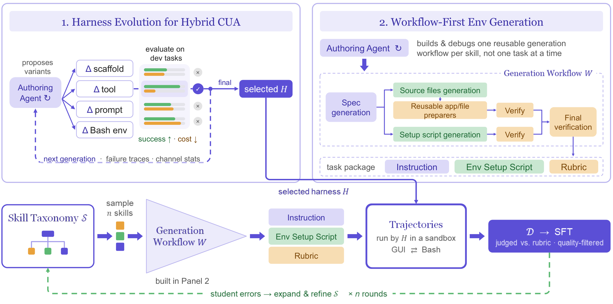

<h1 align="center">Mage-VL-Cowork<br><span style="font-size: 0.55em; font-weight: normal;">A Full Training Recipe to Learn Hybrid Computer Use from Evolved Harnesses</span></h1>

<p align="center">
  <a href="https://microsoft.github.io/Mage/cowork/"></a>
  <a href="https://github.com/microsoft/Mage/blob/main/assets/mage_vl_cowork_tech_report.pdf"></a>
  <a href="https://github.com/microsoft/Mage/tree/main/mage_vl_cowork"></a>
  <a href="https://huggingface.co/microsoft/Mage-VL-Cowork"></a>
</p>

<div align="center">
<a href="assets/mage-vl-cowork-teaser.pdf"></a><br>
<em>OSWorld-Verified performance versus model size. Click the figure to open the PDF.</em>
</div>

---

**Mage-VL-Cowork** is a **4B hybrid computer-use agent** that combines visual GUI interaction with code and terminal execution in a single policy. It starts from an intermediate Mage-VL checkpoint and follows a progressive **five-stage curriculum** across midtraining, supervised fine-tuning (SFT), and reinforcement learning (RL).

The training data comes from **Mage-CUA-Forge**, which replaces per-task agent construction with reusable, skill-conditioned generation workflows and application-specific preparers. Rather than directly distilling a default teacher, we evolve the teacher harness and use specialized GUI, terminal, and hybrid harnesses to collect stage-specific supervision.

## ✨ Highlights

- **Hybrid computer use at 4B.** The final policy reaches **66.0% on OSWorld-Verified** under a 50-step budget, averaged over two runs on 361 tasks excluding Google Drive.
- **Evolved teacher harnesses.** We refine the scaffold, tool interfaces, prompts, and terminal environment before large-scale rollout, then collect GUI, terminal, and hybrid demonstrations for different training stages.
- **Workflow-first environment synthesis.** Mage-CUA-Forge synthesizes **293,806 desktop and web tasks** across **6,915 skills** and retains **318,837 hybrid trajectories**. It reduces recurring per-task generation expenditure by **82.6%**.
- **Complete training recipe.** The model first develops GUI and coding/terminal capabilities, then learns turn-level routing between them through hybrid SFT and online hybrid RL.
- **More efficient after RL.** Relative to Hybrid SFT, online RL adds **10.16 percentage points** while reducing mean model calls by **13.0%** and output tokens by **25.4%**.

## 📥 Model

| Model | Task | Backbone | Hugging Face |
| :--- | :--- | :--- | :--- |
| `Mage-VL-Cowork` | hybrid computer use (GUI + code & terminal) | Mage-VL-4B | [🤗 microsoft/Mage-VL-Cowork](https://huggingface.co/microsoft/Mage-VL-Cowork) |

## 🏗️ Method

<div align="center">
<br>
<em>Teacher-harness evolution, reusable task-generation workflows, rubric judging, and student-feedback-driven skill expansion.</em>
</div>

**Training** uses five stages:

1. **GUI-Oriented Midtraining** for visual grounding, reasoning, and structured tool calling.
2. **GUI Agent SFT** for complete workflows through screenshots, mouse, and keyboard actions.
3. **Coding & Terminal SFT** for terminal use, software engineering, and programmatic desktop manipulation.
4. **Hybrid CUA SFT** for turn-level routing between GUI interaction and coding or terminal execution.
5. **Online Hybrid RL** with GRPO, asynchronous rollouts, and verifiable task rewards.

## 📊 Results

| Stage | OSWorld-Verified (%) |
| :--- | :---: |
| GUI SFT | 45.56 |
| Hybrid SFT | 55.84 |
| Hybrid RL | **66.0** |

Mage-VL-Cowork-4B reports **87.5%** on OSWorld-Verified OS tasks and **62.7%** on multi-application workflow tasks. See the [project page](https://microsoft.github.io/Mage/cowork/) and [technical report](https://github.com/microsoft/Mage/blob/main/assets/mage_vl_cowork_tech_report.pdf) for evaluation settings, baselines, ablations, and RL infrastructure.

## 📝 Citation

```bibtex
@article{zhang2026magecowork,
  title={Mage-VL-Cowork: A Full Training Recipe to Learn Hybrid Computer Use from Evolved Harnesses},
  author={Zhang, Xiaoyi and Wang, Haoqing and Zhang, Xinjie and Ming, Xiang and Wang, Xing and Yang, Senqiao and Zhang, Kaichen and Jia, Zhaoyang and Tan, Andong and Wang, Xinjiang and others},
  journal={arXiv preprint},
  year={2026}
}
```
