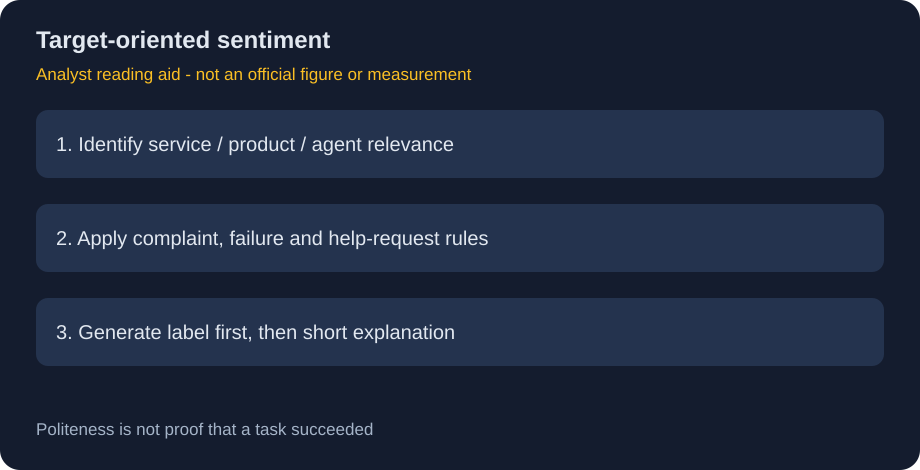
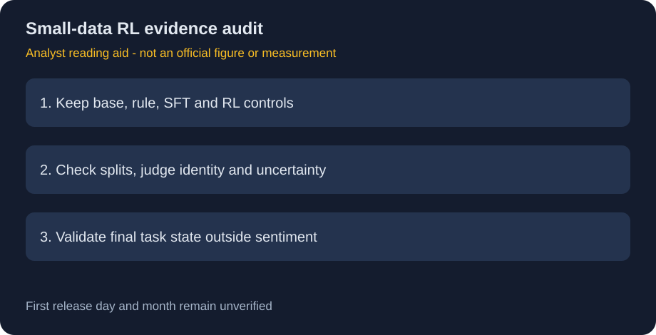

# Sentiment-Analysis-7B：用小量RL数据学习定向情感规则

> [!tldr] 我的判断
> 这个模型学的不是泛化“开心/难过”，而是面向当前服务Target的一套带例外的业务标签规则。约300训练例加LLM judge的RL结果值得记录，但无法据此证明小数据RL普遍优于监督训练。

> [!warning] 原始资料较少，未达到完整精读标准
> 官方当前只有短HF模型卡：没有正式发布日期、独立报告、官方图片、训练超参、评估集大小/拆分或误差条。本文未达到完整技术报告精读深度。两张图为明确标注的研读示意，非官方图或实测。2026-10是发现后的**归档月份，不是已核实发布月份**，首发日/月均待核，不计入精确日期表。

## 来源与定位

[HF Model Card](https://huggingface.co/microsoft/Sentiment-Analysis-7B)；原件 [[src/Sentiment-Analysis-7B.md]]，manifest保存原卡URL。属于Microsoft专项微调，不是Phi新代，也不因Mistral基座而归到Mistral的官方发布。

| 项目 | 官方明确 | 未披露 |
|---|---|---|
| 基座 | Mistral-7B-Instruct-v0.2，7B自回归模型 | 是否与其他classifier公平比较 |
| 训练 | 约300内部样例，RL、LLM judge，未用预定义标签训练 | judge身份、reward形式、优化器、预算 |
| 输出 | 首先标签Negative/Neutral/Positive，再短理由 | 校准概率、拒答/不确定性策略 |
| 评估 | accuracy62.0%→72.8% | 数据量、随机种子、置信区间、污染分析 |
| 许可 | 卡头MIT | 内部训练集细节与可重建性 |

## 核心语义：Target与条件规则

Target定义为用户正在交互的服务/产品/agent及其网站、app、API或支持。无关内容为Neutral；相关投诉问句为Negative；间接事件描述可能Neutral。失败陈述为Negative，但相同失败加礼貌求助在官方规则里变Neutral。

这使标签与通用情感数据集定义不一定一致。例如“登录失败”和“登录失败，能帮我吗”会因业务规则而异；不能把这种差异自动解释成模型错误，也不能把礼貌误当实际满意度。

## 为什么使用生成式分类

它仍通过AutoModelForCausalLM生成，不是独立三分类logits head。卡称标签先输出，随后给理由。10月27日原卡已移除旧的 `max_new_tokens=3` 标签截断建议；不再将它作为官方推荐。实现中应按实际tokenizer和完整标签串验证，不假定每个标签始终单token。短理由是事后文本，不是可靠概率或必然忠实的reward因果解释。这是文档修订，不是新模型发布。

## 62.0→72.8应该怎样理解

算术上是 **+10.8个百分点**，相对accuracy提升约17.4%，两者不能混写。缺少评估样本量，无法判断方差或显著性；没有SFT对照，也不知道RL提升来自哪些规则、judge偏好还是数据适应。

合理的后续验收应分Target相关/无关、投诉/求助、礼貌有无、语言、对话历史等维度，构造成对最小变化测试。要记录标签、理由和不确定样本；这些是研究建议，不是已实施或已测出的结果。

## 对 Agent Training 的启发

> [!insight] 奖励学到的可能是业务规则，不是客观情绪
> 若把用户情感分类当Agent reward，应防策略仅学会诱导礼貌措辞、把失败变成Neutral。用最终问题是否解决、用户实际反馈和独立人工校验补充标签；尤其不能用这套标签判断人的心理状态或机会资格。

RL与LLM judge只给了方法类别，不足以复原奖励。小样本条件下应先保留未改模型、规则baseline、同数据SFT和RL控制组，再讨论训练范式；不从一行accuracy推出普适方法结论。

## 归档与后续缺口

当前保存模型卡和两张解释图，不下载权重、不运行模型。待补官方首次发布证据、训练方法、评估样本与协议、独立对照；在此之前维持“日期待核、资料不足”。

关联：[[NVIDIA_Nemotron/Variants/2610_Flora/Flora]]（同样应检查judge/reward与最终状态的区别）。

> 📊 中文 Poster：[[sentiment_analysis_7b_poster_zh.html]]
