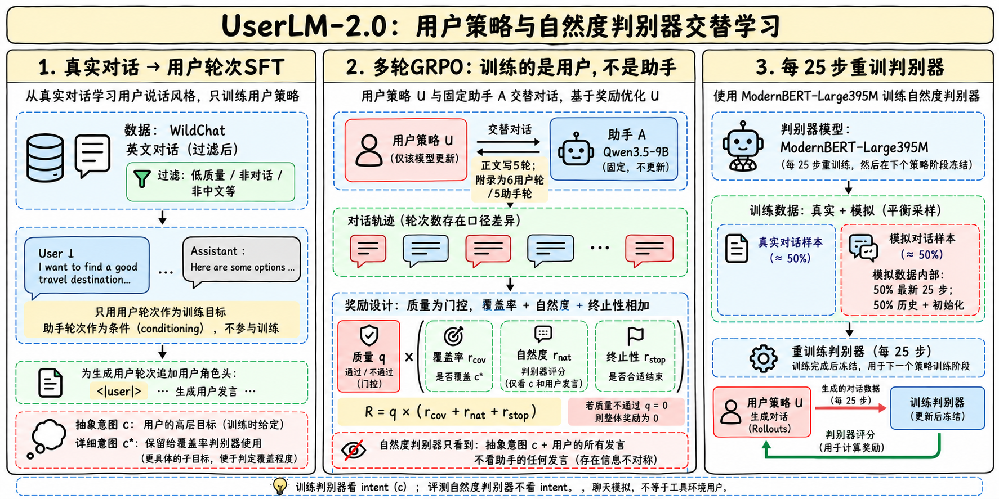
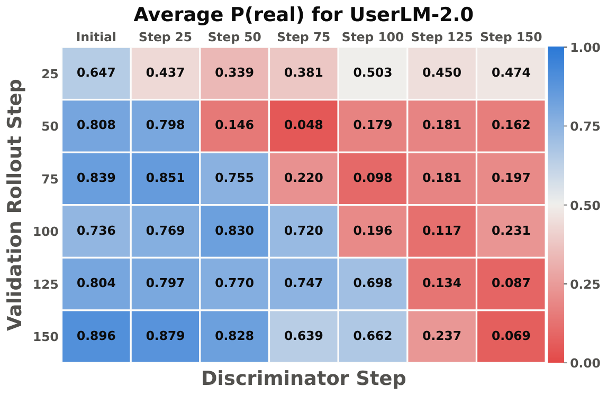
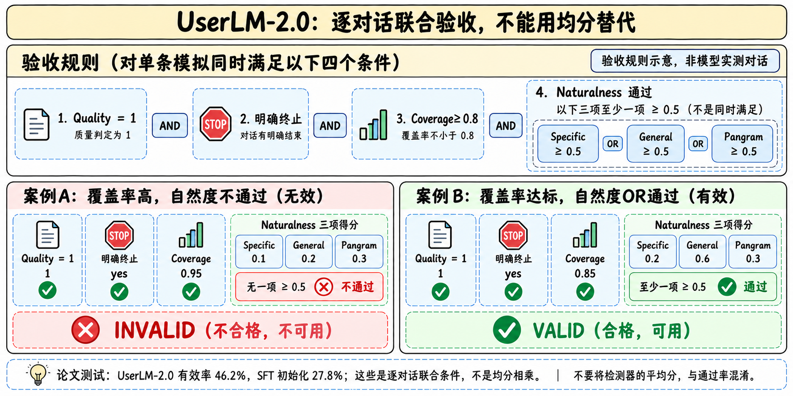
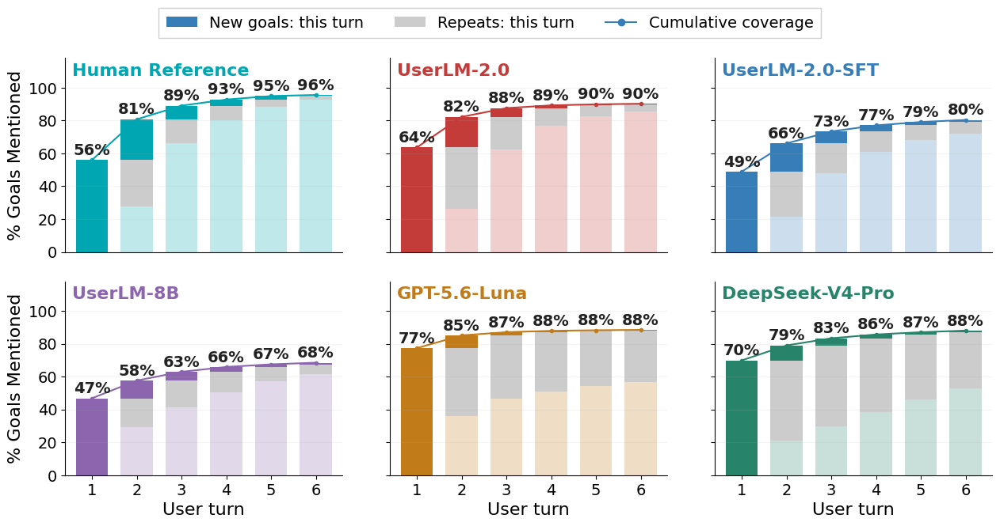

# UserLM-2.0：训练的是“用户怎样说”，不是“助手怎样答”

> [!tldr] 我的判断
> 8B用户策略先从真实用户轮次SFT，再通过多轮GRPO提高意图覆盖、恰当终止与自然度。关键不是多加一个“像人”的LLM评分，而是每25步重训一个轻量判别器，跟上策略分布的变化，减少固定判别器被钻空子。论文按逐对话联合条件得到46.2%有效模拟率，仍低于人类参考80.2%，不能称“模拟用户已经解决”。

> [!info] HF卡写forthcoming，但论文已经公开
> 本次找到并阅读正式报告2610.31512v1的HTML：方法、训练、完整主表、奖励消融、数据/训练/评测附录和训练动态。HF卡仍说论文即将发布，属于未同步的材料状态；本笔记不沿用该过时说法。保存原卡、配置、模板、报告原HTML及原图，未下载PDF/权重，未运行模型或官方脚本。

> [!warning] 首发日期与复现边界
> HF提交历史在2026-10-01 17时UTC（北京时间10月2日）已有权重/模型卡，论文v1是10月22日16:26:48 UTC（北京时间10月23日）；今天才在清单中出现不等于今天发布。提交历史也不能证明当时仓库已公开。**首次公开日仍待核，Atlas以2026-10作月份线索，不伪造精确首发事件。** 论文正文写最多5轮，附录B.2写6个用户轮/5个助手轮，需实际run确认；处理后的训练数据与处理脚本也未随本卡公开，不能宣称完全复现。

## 一手来源

| 类型 | 线上与本地 |
|---|---|
| 🤗 HF Model Card | [UserLM-2.0](https://huggingface.co/microsoft/UserLM-2.0)；[[src/hf_model_card]] |
| 📄 Tech Report PDF | [2610.31512](https://arxiv.org/pdf/2610.31512)，只保留链接 |
| 📖 Tech Report HTML | [本次精读版本](https://arxiv.org/html/2610.31512v1)；[[src/technical-report.html|离线完整原文]] |
| 🧩 推理接口 | `src/config.json`、`src/tokenizer_config.json`、`src/chat_template.jinja` |
| 📅 时间依据 | `src/repository-commits.json`、`src/arxiv-abs.html.raw.txt`；不把createdAt/lastModified当首发 |

## 为什么不能直接让强助手扮演用户

强助手倾向一开始就完整复述任务、说得很工整，后续反复确认所有要求，容易让多轮评测失真。只做用户轮次SFT则更像人，却可能漏掉任务目标、跑题或过早结束。前者使Agent被不真实的“完美用户”帮助，后者可能把模拟器遗漏误算成助手失败。

目标要分两层：语料整体的长度、轮数、重复率像真实用户；**每条**交互也必须足够覆盖指定目标、角色不漂移并适当终止。两个总体均分都高，并不证明同一条轨迹同时通过，因此论文把有效性定义为逐对话联合验收。

UserLM-2.0继承Llama3.1-8B-Instruct，生成用户轮次；它与UserRepGen-4B的“生成用户表示”职责不同，也不是新的通用聊天主干。放Microsoft的User Simulation专项支线。

## SFT：把用户轮次作为训练目标

WildChat-4.8M非毒性子集中原有3,199,860交互，经过英文、重复模板、角色历史夹带、单用户轮等过滤后剩199,249。按国家分组用户并在国家内90/5/5划分，不是把整个国家留作未见域。SFT训练/验证167,625/6,816个intent，RL10,000/1,000，判别器3,200/1,000；测试从余下9,608中抽取2,000。

每个SFT样本是一个用户轮次，历史双方对话作为条件，loss对准当前用户输出；不是把助手回答也当用户目标。训练1 epoch，batch1024，AdamW LR2e-5、weight decay1e-4，每100步按验证loss选择checkpoint；卡中最大序列8192。新增终止token的输入/输出embedding用均值初始化，再把生成起始头改为user角色。

高层intent用Qwen3-30B-A3B-Instruct-2507抽取；细粒度子目标由GPT模型抽取。用户策略接收较抽象的c，覆盖率judge看更详细的c*，避免策略仅复述完整子目标清单就拿满奖励。这种信息不对称定义了任务难度，也使覆盖评分依赖抽取质量，不能假定c*是无误的真实用户意图。

## 多轮GRPO：四种信号怎样组合

用户U与固定的Qwen3.5-9B助手A交替发言，RL只更新U。质量检查先排除逐字复述intent、逐字复述旧用户轮、角色变成助手等失败；前两项先用规则，其余由LLM judge判断。质量不通过时整体reward归零。

$$
r_{\mathrm{overall}}=r_{\mathrm{quality}}\left(r_{\mathrm{coverage}}+r_{\mathrm{naturalness}}+r_{\mathrm{termination}}\right)
$$

| 分量 | 计算对象 | 关键边界 |
|---|---|---|
| Quality | 用户生成与抽象intent；规则+judge | 二值门禁，不是四分量全部相乘 |
| Coverage | 用户轮次覆盖详细c*中多少子目标 | 训练用Qwen3.5-9B，正式评测用GPT-5.6-Luna |
| Naturalness | 判别器把模拟用户判为真实的分数 | 训练阈值0.5转二值；看intent和用户轮，不看助手轮 |
| Termination | 是否在先前已覆盖目标后输出终止tag | 满足时+0.2、未满足却终止−0.2；一直不终止为0 |

训练batch64、每intent8条rollouts，GRPO clip0.2、KL权重0.001，每次rollout只有一次on-policy更新；AdamW恒定LR1e-6、weight decay0.01、grad clip1.0，1 epoch共156步，每25步验证。用户temperature1.0、每轮最多1024新tokens；助手temperature0.7、top-p0.8、top-k20、最多2048。

**正文§3.2的N=5与附录B.2的6用户轮/5助手轮不一致。** 本文保留两处原文口径，不自行“修正”为唯一训练配置。论文的长交互结论也不能外推几十上百轮工具Agent。

## 为什么动态判别器比固定“自然度分”重要

395M ModernBERT-Large只看用户发言和intent。加入助手发言会让它凭助手风格轻易分辨真假，形成与用户行为无关的捷径。初始化时，用SFT策略在专用intent集生成模拟，和真实交互各一例，保持类别平衡。

每25步RL后重训：模拟数据的一半来自最近25步，另一半来自历史和初始化数据；真实/模拟两类仍平衡。训练5 epochs，batch64，LR2e-5线性衰减、warmup0.05、weight decay1e-4、clip1.0，选验证准确率最佳checkpoint。它是交替更新，不是把用户模型和判别器做一次联合反向传播。

固定判别器在约75步就容易被策略骗过，方式可能是把话变长、轮数变少。动态版继续识别新策略的投机模式，历史重放也避免忘掉旧漏洞。训练热图的下三角说明新策略还能骗旧判别器，后训判别器又能识别旧rollout；这是经验现象，**不是对reward hacking绝对免疫的保证**。

checkpoint选择也不是直接最大化最终Validity：要求验证Coverage至少85%，再最小化用户发言长度/轮数直方图与人类参考的平均JSD。No-Coverage消融没有满足阈值的checkpoint，作者改为最高coverage的两个中选最低JSD。因此该消融还包含选择规则变化。

## 有效对话的联合条件，尤其别写错OR

测试2,000 intents，每个模型/intent采样4条，助手仍为Qwen3.5-9B。论文称按1—7子目标平衡，但精确桶大小并不相等：1目标202例，2—5各336，6目标335，7目标119。7目标尾部的方差与代表性应单独看。

Naturalness-Specific为每个模拟器单独训练判别器，General用所有模拟器联合训练；正式评测的这两种判别器**不看intent**，避免重复惩罚coverage。每个训练3次，选择验证macro accuracy最佳模型。Pangram-4用用户轮拼接到超过100词的首个完整轮；不足时用全部，且移除终止tag。Pangram通常每intent只抽一条，其他指标每intent四条，联合统计需复现作者的抽样/聚合过程。

Naturalness Pass为Specific、General、Pangram中**至少一项≥0.5**；不是三者都过，也不是三项均值≥0.5。Validity同时要求Quality=1、明确终止、Coverage≥0.8和Naturalness通过。不能把四个总体均值相乘估计有效率。

## 完整主表应怎样读

下面保留主要对照；完整所有模型/分量在离线报告Table1中。分数均为作者报告，未本地重测。

| 模型 | Quality | Coverage | Terminated | 自然度通过率 | 有效率 |
|---|---:|---:|---:|---:|---:|
| GPT-5.6-Sol扮演用户 | 99.3 | 79.7 | 49.8 | 10.2 | 6.7 |
| UserLM-8B | 47.6 | 64.2 | 37.5 | 50.2 | 13.0 |
| SFTUser-14B | 55.5 | 60.7 | 66.4 | 40.9 | 14.1 |
| UserLM-2.0-SFT | 75.9 | 76.0 | 62.5 | 68.2 | 27.8 |
| UserLM-2.0 | 89.8 | 88.0 | 82.8 | 71.8 | 46.2 |
| 人类参考 | 87.9 | 96.0 | 100 | 100 | 80.2 |

46.2是SFT初始化27.8的1.66倍、此前最强已发布模拟器14.1的3.28倍。前者差18.4**个百分点**，不是一律“提升18.4%”。HF卡“至少12%/23%”没有给出明确分母，分析优先使用正式完整表。

UserLM-2.0并非所有自然度分量都比SFT高：Specific均分从25.3降到9.4，General50.7降到36.1，Pangram50.7升到59.2，OR通过率68.2升到71.8。笼统说“各项自然度全面提升”会掩盖分量变化与OR定义。

每100条有效交互估算$0.11，SFT$0.19、GPT-Sol$205.20；它以基座价格代理估算模拟器生成成本，**不是本地8B部署实测全成本**，不能覆盖助手、judge、判别器训练与环境等待。人类参考Validity只有80.2也说明评测器存在误差，不能用它直接宣判20%真实对话不可用。

## 奖励消融比总体排名更有启发

| 配方 | 自然度通过率 | Validity | 解释 |
|---|---:|---:|---|
| 固定判别器 | 11.3 | 7.8 | 可被窄行为模式钻空子 |
| LLM judge Likert | 14.0 | 10.5 | “像人”提示难刻画语料分布 |
| LLM judge Winrate | 24.5 | 7.0 | 终止也明显下降 |
| 无Naturalness | 42.0 | 20.7 | 内容覆盖提高不能替代自然度 |
| 无Coverage | 81.2 | 19.0 | 同时去掉Termination，且选择规则改变 |
| 无Termination | 71.0 | 18.1 | 自然度高也可能不停或早停 |
| 完整 | 71.8 | 46.2 | 联合目标比单一分量更关键 |

无Coverage的平均Coverage仍89.8并不矛盾：训练自然度判别器也看intent，间接奖励按目标行动。但这同时说明组件并不独立，不能把该行称作“只删除coverage直接项，其他因素完全不变”。

## 难题、节奏与真实用户之间的距离

7子目标时Coverage79.4%，Validity只12.6%；GPT-Luna同桶Coverage78.0却没有有效样本，体现联合条件的严格性。先前模型同桶低于1%，而UserLM自身SFT不是外部先前模型，不能说除本版外所有checkpoint都低于1%。

人类第一轮只揭示约56%目标，对照提示助手70%—77%，后者有明显front-loading。UserLM-2.0最后累计约90%，SFT约80%、旧UserLM约68%，但节奏分析仅取最多六轮的交互。用户复述并非都该清零：人类目标重访38.8%、只重复的轮33.3%，UserLM2为39.0%/33.0（表3）；正文写33.3有舍入/文字差异，本文以表为准。

每已覆盖目标的用户词数中位数为59，人类34，仍约1.74倍；“更自然”不等于和真人无差别。空转轮4.3%低于人类6.9%，也不意味着用户策略每个行为维度都应压到最低。

## 接口边界：用户角色、终止与工具信息

配置为LlamaForCausalLM，32层、hidden4096、32 query/8 KV、位置上限131072；这是架构配置，**不是证明在128K用户模拟任务上测过**。SFT卡长度8192，RL每用户轮1024。模板在`add_generation_prompt`时明确追加user头，并跳过`tool`、`ipython`以及含`tool_calls`的消息。

终止token ID128256，tokenizer声明`special: false`；EOS和pad是128009（eot）。所以不能误以为`skip_special_tokens=True`必定把终止字符串删掉，原发布tokenizer并非如此。harness应保存tokenizer revision，分开识别对话终止和单轮EOS；改服务模板后重新验收控制信号，不能直接把终止tag展示给最终用户。

这里没有文件系统或工具环境的真实状态。模板丢弃工具消息意味着它不能直接作为“读到了Agent所有工具结果”的用户模拟器；若用于工具Agent，需要显式定义用户能看见的摘要/产物，不把隐藏状态泄漏成神谕。

## 对Agent Training的启发与下一步实验

> [!insight] 训练环境里的用户，也是一种需要校准的环境模型
> 多轮训练数据若由不真实的用户模拟器产生，Agent可能学会响应冗长完整规格，或错误地把用户遗漏归因自身。可固定assistant、intent与预算，对照SFT、固定判别器RL、动态判别器RL；把每条模拟的质量/覆盖/终止/自然度联合mask保存下来，先查有效数据比例，再比较下游Agent成功率。

训练和评测都使用同一Qwen3.5-9B助手，尚不能证明对所有强弱助手、中文、工具环境都稳健。建议留出助手模型、目标复杂度、语言和用户群体，再测模拟器造成的榜单排序变化；这些是本文建议，不是原报告已完成实验。

自然度是目标语料的分布匹配，不是事实正确性或用户授权。动态判别器训练也可能保留语料偏差；语料隐私与真实交互重放需要单独处理。实际复现优先解决轮数口径、取得数据处理脚本和精确训练revision，再扩RL规模。

## 关联与交付

- [[Topics/13_base_model/Microsoft/Variants/261030_Mage_VL_Cowork/Mage-VL-Cowork|Mage-VL-Cowork]]：先优化监督与环境接口，再衡量学生可学性。
- [[Topics/13_base_model/Ant_Ling/Variants/261026_ZwZ2/ZwZ2-Family|ZwZ2]]：特权构造与受限策略、答案和证据需求分别审计。
- [[userlm2_poster_zh.html|中文Poster]]；[[src/retrieval_manifest.json|原始材料及哈希]]。
