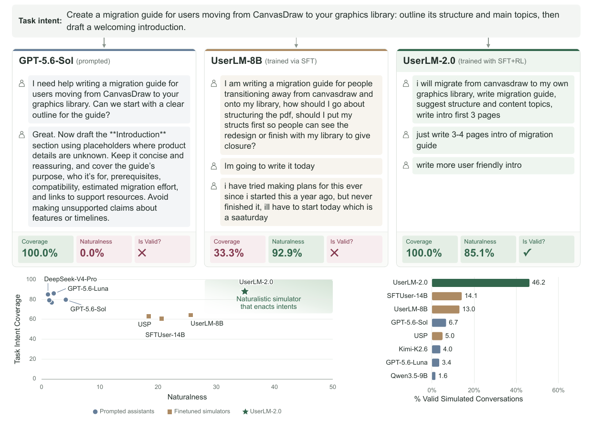

# Towards User Simulators That Stay on Task and Still Sound Natural

<p align="center">
  
</p>

UserLM-2.0 is an 8-billion-parameter user simulator for user-AI
conversations. Unlike typical language models trained to play the assistant,
UserLM-2.0 generates the **user** side of a conversation. It is conditioned on
a task intent that describes the user's high-level objective.

UserLM-2.0 can:

1. Generate an initial user utterance from a task intent.
2. Generate follow-up user utterances from the conversation so far.
3. Emit `<|endconversation|>` when it determines that the user's objective has
   been satisfied and the conversation should end.

The model is intended to support research on realistic user simulation and the
development and evaluation of more robust assistant models.

> **Paper:** The accompanying UserLM-2.0 paper is forthcoming. An arXiv link
> will be added when it becomes available.

## Model details

- **Developed by:** Omer Gul (Microsoft Research intern, Spring 2026),
  Philippe Laban (Microsoft Research), Tanya Goyal (Microsoft Research), and
  Jennifer Neville (Microsoft Research)
- **Model type:** Generative causal language model, 8B parameters
- **Language:** English
- **License:** MIT
- **Backbone:** [`meta-llama/Llama-3.1-8B-Instruct`](https://huggingface.co/meta-llama/Llama-3.1-8B-Instruct)
- **Repository:** [`microsoft/UserLM-2.0`](https://huggingface.co/microsoft/UserLM-2.0)

## How to use

UserLM-2.0 generates user turns. Put the task intent in the system message,
generate a user turn, append the assistant's reply, and call the model again.
The bundled chat template automatically opens the correct user-role generation
header.

The following example uses Hugging Face Transformers directly:

```python
import torch
from transformers import AutoModelForCausalLM, AutoTokenizer

model_id = "microsoft/UserLM-2.0"

tokenizer = AutoTokenizer.from_pretrained(model_id)
model = AutoModelForCausalLM.from_pretrained(
    model_id,
    dtype=torch.bfloat16,
    device_map="auto",
).eval()

task_intent = (
    "You want help planning a quick vegetarian dinner for four people. "
    "You have 45 minutes, one guest has a peanut allergy, and you need a "
    "shopping list and cooking instructions. You prefer pasta, but only "
    "mention that preference if the assistant asks. Your goal is not "
    "satisfied until you receive a menu, shopping list, and cooking steps."
)
messages = [{"role": "system", "content": task_intent}]


def generate_user_turn(messages: list[dict[str, str]]) -> str:
    inputs = tokenizer.apply_chat_template(
        messages,
        tokenize=True,
        add_generation_prompt=True,
        return_tensors="pt",
        return_dict=True,
    ).to(model.get_input_embeddings().weight.device)

    with torch.inference_mode():
        outputs = model.generate(
            **inputs,
            max_new_tokens=128,
            do_sample=True,
            temperature=1.0,
            top_p=0.8,
            eos_token_id=tokenizer.eos_token_id,
            pad_token_id=tokenizer.pad_token_id,
        )

    generated_ids = outputs[0, inputs["input_ids"].shape[1]:]
    return tokenizer.decode(generated_ids, skip_special_tokens=True).strip()


# First user turn
user_turn = generate_user_turn(messages)
messages.append({"role": "user", "content": user_turn})
print("User:", user_turn)

# Supply an assistant response, then generate the next user turn.
messages.append(
    {
        "role": "assistant",
        "content": "I can help with that. Would you prefer pasta, tacos, or a rice bowl?",
    }
)
user_turn = generate_user_turn(messages)

if "<|endconversation|>" not in user_turn:
    messages.append({"role": "user", "content": user_turn})
    print("User:", user_turn)
else:
    print("The simulated user ended the conversation.")
```

### Example output

The following user turns were produced by UserLM-2.0 with
`temperature=1.0` and `top_p=0.8`. Assistant turns were supplied by the
simulation harness.

> **UserLM-2.0:** hi. i need help with a dinner. i have 45 minutes. i need to
> make a dinner for 4 people. 1 of the people has a peanut allergy. i need a
> menu, shopping list, and step by step cooking instructions. if you need any
> more information from me, let me know.
>
> **Assistant:** I can help with that. Would you prefer pasta, tacos, or a rice
> bowl?
>
> **UserLM-2.0:** pasta.
>
> **Assistant:** Let's make chickpea tomato pasta with a green salad. For four
> people, buy 12 oz pasta, two cans of chickpeas, one 28 oz can of crushed
> tomatoes, garlic, one onion, olive oil, Italian herbs, one lemon, mixed
> greens, one cucumber, and Parmesan or a vegetarian alternative. The menu is
> peanut-free, but check package labels for cross-contamination. Would you like
> the step-by-step cooking order?
>
> **UserLM-2.0:** yes please.
>
> **Assistant:** Boil the pasta while you prepare a chickpea tomato sauce. Toss
> the greens and cucumber with lemon and olive oil, combine the pasta and
> sauce, and serve with the salad and optional cheese. This should take about
> 35 minutes.
>
> **UserLM-2.0:** `<|endconversation|>`

Treat `<|endconversation|>` as a control signal: stop the rollout rather than
showing it as dialogue in an end-user interface. Generated text is stochastic,
so outputs will vary across runs.

## Uses

### Direct intended uses

UserLM-2.0 is released for researchers evaluating assistant language models.
It can simulate multi-turn conversations to help estimate how an assistant may
perform with real users. Our evaluation provides evidence that UserLM-2.0
produces more realistic and task-faithful user behavior than prior user
simulators and prompted assistant models.

### Downstream uses

Potential research applications that were not implemented in the accompanying
work include:

1. User modeling, such as predicting user responses to a set of questions.
2. A foundation for fine-tuning judge models.
3. Synthetic conversation generation in conjunction with an assistant model.

### Out-of-scope uses

UserLM-2.0 is **not an assistant model**. It is unlikely to be useful to an end
user who needs direct help completing a task; an assistant language model is
more appropriate for that purpose.

We do not recommend deploying UserLM-2.0 in commercial or real-world
applications without additional testing, adaptation, and safeguards. This
checkpoint is released for research purposes.

## Risks and limitations

The main objective of a user simulator is twofold:

1. Faithfully enact the supplied task intent without critical omissions or
   contradictions.
2. Produce natural utterances that could plausibly have been written by a real
   user.

Although UserLM-2.0 improves this joint objective relative to prior work, it
remains imperfect. Simulated conversations may omit or contradict parts of the
task intent, introduce unsupported facts or requirements, behave unnaturally,
or terminate at an inappropriate point.

Additional limitations include:

- The model was designed and evaluated in English. Performance in other
  languages may vary and should be assessed by domain experts and native
  speakers.
- The model inherits biases, errors, and omissions from its
  Llama-3.1-8B-Instruct backbone.
- The model may inherit or amplify biases, errors, and omissions in its
  training data, including AI-generated interpretations of conversations.
- The model may hallucinate constraints not present in the task intent.
  Providing a specific intent can reduce, but not eliminate, this behavior.
- The model has not been systematically hardened against security
  vulnerabilities such as indirect prompt injection. Systems using the model
  should apply appropriate isolation, validation, and security controls.

## Recommendations

UserLM-2.0 is a research release and may require adaptation for new tasks and
environments. The original UserLM-8B work describes four useful generation
guardrails:

1. Filtering undesirable first tokens.
2. Avoiding premature dialogue termination.
3. Applying minimum and maximum utterance-length thresholds.
4. Filtering verbatim repetitions.

We encourage users to adapt these guardrails to their use case and to evaluate
task fidelity, naturalness, termination behavior, and safety before relying on
generated simulations.

## Training details

### Training data

UserLM-2.0 was trained on a filtered version of
[`allenai/WildChat-4.8M`](https://huggingface.co/datasets/allenai/WildChat-4.8M).
The filtering and processing procedure is described in the forthcoming paper.
The processed training data and processing scripts are not included with this
model release.

### Training procedure

UserLM-2.0 uses Llama-3.1-8B-Instruct as its backbone. A dedicated
`<|endconversation|>` token was added, and the chat template was modified so
generation begins under the user role rather than the assistant role.

Training consisted of:

1. **Supervised fine-tuning (SFT):** full-parameter fine-tuning on individual
   user turns conditioned on the preceding conversation, using a batch size of
   1,024, a learning rate of `2e-5`, and a maximum sequence length of 8,192
   tokens.
2. **Reinforcement learning:** post-training with GRPO to jointly optimize task
   intent coverage, response quality, naturalness, and appropriate
   conversation termination.

Additional hyperparameters and implementation details will be available in the
paper.

## Evaluation

### Testing data, factors, and metrics

UserLM-2.0 was compared with competitive fine-tuned user simulators and
prompted assistant models. Evaluation measured whether simulations faithfully
covered the supplied task intent and whether the resulting user behavior
appeared natural. Details of test-set construction and evaluation methodology
will be available in the paper.

### Evaluation results summary

We evaluate UserLM-2.0 along three complementary dimensions:

1. **Quality:** UserLM-2.0 generates coherent and contextually appropriate user
   behavior, outperforming all evaluated fine-tuned user simulators by at least
   12%.
2. **Coverage:** UserLM-2.0 reliably expresses subgoals specified by the user's
   intent, exceeding evaluated fine-tuned baselines by at least 23% and
   matching GPT-5.6-Luna, including on challenging multi-subgoal intents.
3. **Naturalness:** Using a general-purpose human-text classifier and
   dataset-specific discriminators, UserLM-2.0 produces highly natural user
   interactions. It matches specialized fine-tuned simulators while
   substantially outperforming smaller prompted assistant models.

Overall, UserLM-2.0 achieves Pareto-optimal performance across naturalness and
task-intent fidelity. Compared with prompted assistant models, it substantially
improves naturalness; compared with previous fine-tuned user simulators, it
substantially improves task-intent fidelity.

## Environmental impact

Carbon emissions were estimated using the Machine Learning Impact calculator
presented by Lacoste et al. (2019).

- **Hardware:** NVIDIA B200
- **Compute:** 4 GPUs for 12 hours (48 GPU-hours)
- **Cloud provider:** Microsoft Azure
- **Compute region:** East US
- **Estimated carbon emissions:** 115 kg CO2e

## Citation

A BibTeX entry will be added when the paper is publicly available. Please do
not cite an unpublished arXiv identifier.

## Glossary

**UserLM** means **User Language Model**.

## Model card contact

This research was conducted by members of Microsoft Research. We welcome
feedback and collaboration. To share suggestions, ask questions, or report
unexpected or offensive behavior, contact
[`plaban@microsoft.com`](mailto:plaban@microsoft.com).

If the team receives reports of undesired behavior or independently identifies
issues, this repository will be updated with appropriate mitigations.

## Privacy

See the [Microsoft Privacy Statement](https://www.microsoft.com/en-us/privacy/privacystatement).
