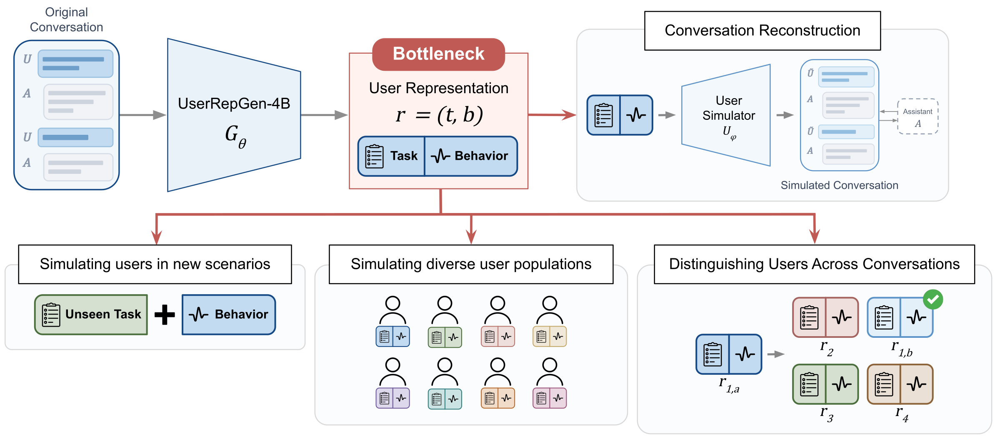

# UserRepGen-4B

<p align="center">
  
</p>

UserRepGen-4B is a fine-tuned Qwen3.5-4B language model that generates a
structured, natural-language user representation from a multi-turn
user-assistant conversation. Each representation contains a **task description**
and a **behavior description** for a user, and is intended to condition a
separate LLM-based user simulator.

Unlike [UserLM-8b](https://huggingface.co/microsoft/UserLM-8b) and
[UserLM-2.0](https://huggingface.co/microsoft/UserLM-2.0), which generate user
utterances, **UserRepGen-4B generates representations, not simulated user turns**.
It does not itself execute the user's task or serve as the simulator.

The model was trained with online supervised fine-tuning through hindsight
distillation, using feedback obtained by comparing simulated and original user
behavior. At inference time, it generates a representation directly from the
source conversation without requiring simulation rollouts or hindsight feedback.

## Model details

| Property | Description |
|---|---|
| Developed by | Microsoft Corporation |
| Model type | User-representation generator, 4B-class language model |
| Backbone | [Qwen3.5-4B](https://huggingface.co/Qwen/Qwen3.5-4B) |
| Adaptation | Rank-64 LoRA with online supervised fine-tuning |
| Language | English |
| Inputs | Text-only, multi-turn user-assistant conversations |
| Outputs | Text formatted as JSON with `task` and `user_behavior` fields |
| Training sequence length | 9,216 tokens: up to 8,192 prompt tokens and 1,024 completion tokens |
| Training dates | July-August 2026 |
| License | MIT |
| Repository | [microsoft/UserRepGen-4B](https://huggingface.co/microsoft/UserRepGen-4B) |

### Key capabilities

- Generates structured task and user-behavior descriptions from multi-turn
  user-assistant conversations.
- Captures conversational behavior including communication style, request
  formulation, incremental constraint disclosure, response patterns, feedback,
  context provision, engagement, and termination behavior.
- Produces representations that improve conversation-reconstruction fidelity
  when used with an unseen LLM-based simulation environment.
- Captures some user-specific behavioral patterns that transfer across
  conversations and unseen tasks.
- Produces representations that can help simulated populations better preserve
  the behavioral diversity of source conversations.
- Produces behavior descriptions that improve same-user conversation matching
  in the accompanying research's re-identification evaluation. This capability
  also presents a privacy risk; representations are not anonymized data.

## How to use

The intended workflow is:

1. Select a conversation that you are authorized to process, minimizing or
   removing identifying and sensitive information.
2. Format the conversation using the model's inference prompt and chat template.
3. Generate a representation and validate it as JSON containing `task` and
   `user_behavior` fields.
4. Review the descriptions for unsupported inferences, sensitive information,
   and task-specific leakage.
5. Pass the reviewed representation to a separate LLM-based user simulator.

### Quickstart

The following example uses Hugging Face Transformers. The conversation is a
newly written, simplified example inspired by an Excel-help conversation in
WildChat; it is not an original user transcript.

```python
import json
from pathlib import Path

import torch
from huggingface_hub import hf_hub_download
from transformers import AutoModelForImageTextToText, AutoTokenizer

model_id = "microsoft/UserRepGen-4B"
device = "cuda" if torch.cuda.is_available() else "cpu"
if device == "cpu":
    torch.set_num_threads(8)

conversation = [
    {"role": "user", "content": "I need an Excel formula to count dates in A2:A100 before today plus B1."},
    {"role": "assistant", "content": 'Try =COUNTIF(A2:A100,"<"&TODAY()+B1).'},
    {"role": "user", "content": "That didn't work. The dates come from another formula."},
    {"role": "assistant", "content": "Are those results actual Excel dates, or text that looks like dates?"},
    {"role": "user", "content": "They're text. Some cells are empty too."},
    {"role": "assistant", "content": "Convert the nonempty text values with DATEVALUE, then count the resulting dates."},
    {"role": "user", "content": "Can you show the steps using a helper column?"},
    {"role": "assistant", "content": 'In C2 enter =IF(A2="","",DATEVALUE(A2)), fill down to C100, then use =COUNTIFS(C2:C100,"<"&TODAY()+B1,C2:C100,">0").'},
]

template = Path(
    hf_hub_download(model_id, "representation_prompt.txt")
).read_text(encoding="utf-8").strip()
history = "\n".join(f"[{m['role']}]: {m['content']}" for m in conversation)
prompt = template.format(conversation_history=history)

tokenizer = AutoTokenizer.from_pretrained(model_id)
inputs = tokenizer.apply_chat_template(
    [{"role": "user", "content": prompt}],
    tokenize=True,
    add_generation_prompt=True,
    enable_thinking=False,
    return_tensors="pt",
    return_dict=True,
)
prompt_length = inputs["input_ids"].shape[1]
if prompt_length > 8192:
    raise ValueError("The formatted prompt exceeds the 8,192-token limit.")

model = AutoModelForImageTextToText.from_pretrained(
    model_id,
    dtype=torch.float32 if device == "cpu" else torch.bfloat16,
    device_map=device,
).eval()

with torch.inference_mode():
    output = model.generate(
        **inputs.to(device),
        max_new_tokens=1024,
        do_sample=False,
        temperature=None,
        top_p=None,
        top_k=None,
        eos_token_id=tokenizer.eos_token_id,
        pad_token_id=tokenizer.pad_token_id,
    )

text = tokenizer.decode(output[0, prompt_length:], skip_special_tokens=True).strip()
representation = json.loads(text)
if (
    not isinstance(representation, dict)
    or set(representation) != {"task", "user_behavior"}
    or not all(isinstance(value, str) and value.strip() for value in representation.values())
):
    raise ValueError("Expected nonempty task and user_behavior strings.")
print(json.dumps(representation, indent=2))
```

The [standalone example script](./example.py) runs the same conversation and
also accepts a JSON list of `role`/`content` messages:

```bash
hf download microsoft/UserRepGen-4B example.py --local-dir userrepgen-example
python userrepgen-example/example.py --device cuda
# To use your own authorized conversation:
python userrepgen-example/example.py --device cuda --conversation conversation.json
```

Use `--device cpu` when a suitable GPU is not available. The script accepts
`--model /path/to/local/model` for an already downloaded model directory.
While the repository is private, authenticate with `hf auth login` using an
account with read access.

The example uses greedy decoding for a simple smoke test, not the sampling
settings used for the paper's evaluations. Invalid JSON or missing/empty fields
raise an error rather than silently repairing the model's output.

### Example output

The following is the actual output from the standalone example above, run on
CPU using the published Hugging Face checkpoint. The prompt contained 481
tokens and generation produced 274 tokens, including the end-of-sequence token.
Outputs may vary with runtime, hardware, or generation settings.

<details>
<summary>Show generated task and user behavior</summary>

```json
{
  "task": "The user seeks an Excel formula to count dates within a specific range (A2:A100) that fall before a calculated threshold (today plus a value from B1), while handling edge cases where the source data is stored as text, contains empty cells, and requires a step-by-step solution involving a helper column.",
  "user_behavior": "The user initiates with a direct, concise request for a specific formula but immediately pivots to troubleshooting when the initial solution fails, providing brief, factual feedback about the nature of the data (e.g., 'text', 'empty cells') rather than emotional reactions. They decompose the problem incrementally across turns, asking for specific implementation details like 'steps using a helper column' rather than requesting a complete solution upfront. Their communication style is terse and functional, avoiding pleasantries or verbose explanations. They do not provide extensive context initially but reveal constraints (like data types) only after the assistant proposes a solution that doesn't work. They engage in a multi-turn iterative process, refining the request based on the assistant's output, and do not terminate the conversation prematurely or ask for unrelated tasks. They prefer the assistant to handle the logic and provide the formula, but they will explicitly request step-by-step instructions if the assistant's output is too abstract or if they need to verify the logic manually."
}
```

</details>

This is an inferred description, not verified facts about a person. Even this
example includes task-specific details and interpretations that go beyond
directly observed behavior. Review representations before sharing or reusing
them, as described in the limitations below.

### Inference requirements and checkpoint format

The reported inference setup uses Python, PyTorch, and a Qwen3.5-compatible
runtime such as Hugging Face Transformers or vLLM. The model was hosted with
vLLM on NVIDIA H100, A100, RTX A6000, and B200 GPUs. Other hardware and operating
systems were not evaluated in the research. A Linux CPU smoke test with
Transformers 5.2.0, PyTorch 2.11.0, and Accelerate 1.10.1 successfully loaded the
checkpoint and generated valid JSON for a local WildChat conversation. This is
a functional check, not a CPU performance benchmark. The published standalone
example was also tested end-to-end using the Hugging Face repository ID, rather
than a local model directory. CPU inference uses
float32 and requires substantially more memory than the approximately 9.1 GB
weight file. No optimized or device-specific formats are currently available.

The checkpoint retains the Qwen3.5 conditional-generation architecture, so the
example uses `AutoModelForImageTextToText`, even though UserRepGen-4B was
fine-tuned and evaluated for **text-only** inputs. Image and video use are not
supported by this release.

Configuration and tokenizer/chat-template assets come from
[Qwen3.5-4B revision `851bf6e`](https://huggingface.co/Qwen/Qwen3.5-4B/tree/851bf6e806efd8d0a36b00ddf55e13ccb7b8cd0a).
All 723 stored tensor names and shapes were checked against that configuration;
the output head shares the input-embedding weights. The upstream assets retain
their [Apache-2.0 license](./LICENSE.Qwen). The
[representation prompt](./representation_prompt.txt) and conversation formatting
match the training pipeline. The outer chat message has the `user` role, and
`enable_thinking=False` disables the backbone's reasoning mode.

The training limits were 8,192 prompt tokens and 1,024 completion tokens.
Extended-context use beyond the 9,216-token training sequence length is not
supported by this release, and long-context performance was not separately
benchmarked.

## Uses

### Direct intended uses

UserRepGen-4B is intended for research and development involving LLM-based user
simulation. Its primary use is to transform an authorized conversation into a
compact natural-language representation that can condition a separate user
simulator. This can support conversation reconstruction, simulator evaluation,
interactive training and evaluation of AI assistants, and research into
behavioral diversity in simulated user populations.

The model is most appropriate for English, multi-turn user-assistant
conversations similar to the seven evaluation datasets described below. The
intended audience includes academic and industry researchers, engineers, and
collaborators working on human-AI interaction, user simulation, or replication
and extension of the accompanying research.

### Downstream uses

The learned behavior component may be combined with a different task
description to study whether observed interaction patterns transfer to a new
scenario. Representations can also support research into population-level
behavioral diversity in simulations. Downstream fidelity depends on the
separate simulator and its environment, not just the representation.

### Out-of-scope uses

The model is not intended for non-consensual profiling, surveillance,
impersonation, deceptive automated engagement, identity discovery, or linking
records about a person without authorization. Representations must not be
treated as verified, exhaustive, stable, or clinically meaningful descriptions
of an individual. They must not be treated as anonymized data: the research
shows that learned behavior descriptions can increase the ability to link
conversations from the same user.

The model was not designed or evaluated for consequential decisions in areas
such as employment, education, housing, credit, insurance, healthcare, legal
services, law enforcement, or access to essential services. It was not evaluated
for non-English inputs, short or single-turn interactions, modalities other
than text, autonomous deployment, demographic inference, real-world identity
recovery, or faithful simulation outside user-assistant conversations.

Synthetic simulations should not replace research with real users or be
presented as genuine human feedback or evidence. The model must not be used to
operate deceptive automated accounts, manipulate online discussions or
engagement signals, contaminate datasets with interactions misrepresented as
human-generated, or fabricate research evidence.

## Risks and limitations

- **Inference from limited evidence:** A representation is inferred from one
  conversation and may overgeneralize absence or a one-time behavior into a
  stable rule about the user.
- **Unsupported interpretations:** Outputs may contain assumptions not grounded
  in the source conversation. The analysis found that the trained model can
  replace broad personality claims with behavioral rules that are still too
  confident.
- **Privacy and linkability:** Representations may preserve sensitive or
  identifying details and can facilitate cross-conversation linkage. They are
  not anonymized data.
- **Task-specific leakage:** Behavior descriptions may include exact commands,
  tool names, technical artifacts, or termination phrases from the source
  conversation, which can reduce transfer and expose source content.
- **Redundancy and length:** Outputs are longer on average than base-model
  outputs and may repeat similar instructions.
- **Simulator and pipeline dependence:** Downstream fidelity depends on the
  separate user simulator, assistant, prompts, sampling procedure, and judge.
  Performance may degrade when these differ from the research setup. A good
  representation does not guarantee a faithful rollout.
- **Evaluation dependence:** The main fidelity metric is produced by an LLM
  judge. Although an author annotation study found 88% preference agreement,
  this does not establish agreement across a broader population.
- **Language and domain coverage:** Training retained safe English
  conversations with at least four user turns. Performance is not established
  for other languages, shorter interactions, other modalities, or sensitive
  domains.
- **Fairness and representation:** Better aggregate behavioral diversity does
  not establish equitable performance across demographic groups. Demographic
  fairness was not evaluated.
- **Population coverage:** The selected datasets may overrepresent technical
  users, AI-model evaluators, paid online study participants, public-repository
  software developers, and users willing to interact through research
  interfaces. Demographic and age distributions for the selected samples are
  not reported.
- **Safety:** The fine-tune was not evaluated for standard generative-model
  safety categories such as hateful, sexual, violent, or self-harm content,
  jailbreak robustness, or copyright memorization.

### Alignment and safety evaluation

UserRepGen-4B was trained to generate user representations that optimize
downstream simulation fidelity. There was no explicit alignment objective.
The training pipeline retained safe English conversations and used
natural-language hindsight feedback from Qwen3.5-4B- and Gemma3-4B-based
simulation environments. These measures reduce exposure to unsafe training
examples but do not establish safety alignment, privacy protection, factual
grounding, or resistance to malicious use. The base model's alignment
properties may still apply, but were not independently characterized for this
fine-tune in the manuscript.

Training data was preprocessed to retain safe conversations, and model outputs
were manually analyzed for safety during development. Harmful outputs were not
observed when using known-safe inputs. However, the model was not specifically
trained to prevent the generation of harmful content, privacy and
sensitive-information disclosure, or reproduction of copyrighted or other
protected materials when such content is present in user-provided inputs.
Users should evaluate and select input datasets with this behavior in mind.

## Recommendations

Developers should process only conversations for which they have authorization
and a valid purpose, minimize or remove identifying and sensitive information,
and assess whether creating a persistent behavioral representation is necessary.
Generated descriptions should be reviewed for unsupported inferences,
sensitive-content retention, stereotyping, and task-specific leakage before
they are shared or reused. Access to source conversations, representations,
and simulated conversations should be restricted and audited.

The model is intended for research, batch-processing, and human-supervised
user simulation or evaluation workflows. For any consequential or high-risk
application, developers should perform application-specific legal and
responsible-AI review, evaluate performance with affected users, provide
meaningful human oversight, and avoid treating synthetic behavior as a
substitute for real-user evidence. Such review does not establish suitability
for the out-of-scope uses described above.

## Training details

### Training data

Training uses a fixed set of 3,200 English, multi-turn user-assistant
conversations drawn from seven datasets:

- **Real-world interactions:** WildChat, LMSYS-Chat-1M, PRISM, SWE-Chat, and
  ThoughtTrace.
- **Simulated interactions:** WildChat Coding and WildChat Writing.

Approximately 500 conversations are used from each dataset, except
ThoughtTrace, from which 200 are used. Preprocessing removes near-duplicate
conversations based on n-gram overlap and retains safe English conversations
with at least four user turns. Training also uses AI-generated initial
representations, simulated conversations, hindsight feedback, and
improved-representation targets.

The source datasets differ materially in collection setting and population.
WildChat and LMSYS-Chat-1M contain opt-in interactions from publicly accessible
chatbot services; PRISM and ThoughtTrace were collected through paid Prolific
studies; SWE-Chat contains public-repository coding-agent sessions; and WildChat
Coding and WildChat Writing contain model-simulated interactions grounded in
goals extracted from real WildChat conversations. These differences should be
considered when assessing representativeness, consent, privacy, and fitness for
a downstream use.

### Training procedure

The model adapts Qwen3.5-4B using rank-64 LoRA and online supervised fine-tuning
(OSFT) through hindsight distillation:

1. The current policy generates a representation from a source conversation.
2. Fixed simulation environments use the representation to produce simulated
   conversations.
3. Judges compare the simulated and original user behavior.
4. Natural-language hindsight feedback is used to generate an improved
   representation.
5. The improved representation serves as the supervised target for an online
   update.

Unlike approaches that optimize the simulator's policy, this method optimizes
the reusable representation on which a simulator is conditioned. Training used
up to 8,192 prompt tokens and 1,024 completion tokens.

## Evaluation

### Testing data and methodology

The primary evaluation uses a disjoint sample of 700 conversations, with 100
conversations from each of the seven datasets above. GPT-5.4 mini serves as the
user simulator, assistant, and fidelity judge, providing an evaluation
environment not used to produce training feedback.

Each representation generator receives the same source conversation. A
simulator conditioned on its representation interacts with an assistant until
termination or a maximum conversation length. A separate judging call compares
the original and simulated user behavior across communication style,
engagement, requests, responses, and context, assigning an overall fidelity
score from 1 to 10. Three rollouts are sampled per representation, and results
are reported as best-of-1 and best-of-3.

Human validation uses 100 pairs of simulations with unequal judge scores. An
expert annotator, blinded to model identity and presentation order, selects
the more faithful simulation; preference agreement with the judge is 88%.

### Simulation-fidelity results

Higher scores indicate better fidelity on the 1-10 judging scale.

| Representation generator / training method | Best-of-1 | Best-of-3 |
|---|---:|---:|
| Qwen3.5-4B base model | 3.41 | 4.42 |
| GPT-5.5 | 3.90 | 4.90 |
| Supervised fine-tuning (SFT) | 4.64 | 5.68 |
| OPSD | 4.46 | 5.60 |
| GRPO | 3.57 | 4.59 |
| **UserRepGen-4B (OSFT)** | **4.95** | **6.02** |

UserRepGen-4B improves on GPT-5.5, the strongest evaluated off-the-shelf model,
by 1.05 best-of-1 and 1.12 best-of-3 points.

Separately, applying iterative hindsight feedback to the base model at test
time raises fidelity from 3.41/4.42 initially to 6.10 best-of-1 after ten rounds
and a peak of 7.07 best-of-3 after nine rounds. These results use additional
test-time simulation and feedback, unlike direct UserRepGen-4B inference.

### Additional evaluations

- **Cross-task generalization:** Experiments use 147 ThoughtTrace users with
  at least two conversations who do not appear in training. Task descriptions
  come from target conversations, while behavior descriptions come from no
  conversation, a different user, another conversation from the same user,
  or the target conversation. Learned behavior descriptions improve fidelity
  for unseen tasks from the same user.
- **Population diversity:** Learned behavior descriptions reduce population-level
  Jensen-Shannon divergence and Self-BLEU relative to task-only conditioning,
  indicating closer behavioral-distribution matching and less homogeneous
  simulated conversations. Behavioral-distribution evaluation uses
  Qwen3.5-122B-A10B-FP8 descriptions across six dimensions, Qwen3-Embedding-8B
  embeddings, and k-means with 500 clusters.
- **Same-user re-identification:** Over 147 ThoughtTrace users, GPT-5.4 mini
  selects which of four candidates comes from the same user as a query.
  UserRepGen-4B behavior descriptions yield 51.02% accuracy, compared with
  44.22% using full conversations and 25% for random selection. This result
  demonstrates a linkability risk, not anonymization or suitability for
  identity discovery.

## Environmental impact

Training compute totals and a carbon-emissions estimate are not provided in
this model card. The inference hardware listed above should not be interpreted
as a training-compute or emissions estimate.

## Citation

The paper link and BibTeX entry are pending confirmation and will be added
before the model card is finalized.

## Glossary

- **User representation:** A natural-language task description and behavior
  description used to condition a separate user simulator.
- **OSFT:** Online supervised fine-tuning.
- **Hindsight distillation:** Learning from improved representations generated
  using feedback on simulated versus original user behavior.

## Model card contact

This research was conducted by members of Microsoft Research. We welcome
feedback and collaboration. To share suggestions, ask questions, or report
unexpected or offensive behavior, contact:

- **Primary:** Michel Galley,
  [mgalley@microsoft.com](mailto:mgalley@microsoft.com).
- **Secondary:** Philippe Laban,
  [plaban@microsoft.com](mailto:plaban@microsoft.com).

If the team receives reports of undesired behavior or independently identifies
issues, this repository will be updated with appropriate mitigations.

Requests for additional information can also be directed to
[MSFTAIActRequest@microsoft.com](mailto:MSFTAIActRequest@microsoft.com).

**Authorized representative:** Microsoft Ireland Operations Limited,
70 Sir John Rogerson's Quay, Dublin 2, D02 R296, Ireland.

## Privacy

See the [Microsoft Privacy Statement](https://www.microsoft.com/en-us/privacy/privacystatement).
