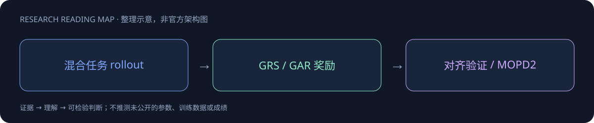

# MiMo-V2.6

> [!tldr]
> Pro / Flash / UltraSpeed family；混合 Agent RL、组内 grader 与 MOPD2，1M 原生全模态。 重点是将 reward 的质量与策略能力一起放大。二元成功奖励无法比较多个成功解，GRS 抽取组内差异生成 rubric，GAR 重新分配通过轨迹优势；这比仅增加 rollout 更直接地减少低效工具路径。MOPD2 用自主 rollout 与 teacher/SFT 历史前缀共同蒸馏，让难验证任务也能获得监督。

## 一页速览

| 维度 | 当前证据 |
|---|---|
| 发布时间 | 2026-09-22 |
| 类型 | 主干正代 / family · 主干正代 |
| 关键事实 1 | 309B / 15B active（Flash） |
| 关键事实 2 | 1.02T / 42B active（Pro） |
| 关键事实 3 | 1M context；图像、视频、音频、文本 |
| 检查日期 | 2026-10-13；官方原始资料在同级src/ |

## 为什么不是把模型再做大一次

这一代把训练预算扩展到策略、环境和 grader 三个维度。纯 pass/fail 奖励只能区分成功和失败，不能区分两个都成功但工具路径、修改范围和 token 花费完全不同的方案。GRS 在同组轨迹中找出这些差异，合成任务相关 rubric；GAR 则把成功样本内部的优势重新分配给较优路径。因此，性能和任务成本应一起看，而不是只用 pass rate 解释训练收益。

## Family 与 checkpoint：先分清比较对象

| 对象 | Pro | Flash |
|---|---|---|
| 总参 / 活跃参数 | 1.02T / 42B | 309B / 15B |
| 层数：SWA / 全局 | 70：60 / 10 | 48：39 / 9 |
| hidden size | 6144 | 4096 |
| 路由专家 / 每 token | 384 / 8 | 256 / 8 |
| 上下文 / 模态 | 1M；图像、视频、音频、文本 | 同左 |
| checkpoint | RL、MOPD | RL、MOPD |

UltraSpeed 是服务速度档，不另画一个新正代。MOPD checkpoint 也不另建根目录；9月27日的 Pro MOPD 工具重复修正属于同代更新。不同 checkpoint 必须记录清楚，不能以“MiMo2.6”一个名称掩盖部署差异。

## 架构：容量、长上下文与推理速度分别优化

Flash 主干以 128-token 滑动窗口处理局部依赖，穿插全局注意力保留远距离证据；第一层使用全局注意力和 dense FFN，后续 MoE 不使用共享专家。它不是只靠窗口覆盖全部长上下文。视觉 ViT 为 681M，28层中24层 SWA、4层全局，patch 为 2×16×16。音频包含308M AudioTokenizer 与127M patch encoder，将25Hz压为6.25Hz。

五层 SWA 的 MTP drafter 每次预测后续7个 token，再由主模型并行验证；“预测7个”不等于每次必定接受7个。部署时应测接受率、prefill、decode 及显存，不能直接把 drafter 长度换成7倍加速。

## 后训练闭环

1. **混合 RL**：coding、通用 Agent、视觉、cybersecurity 与不同 harness 在同一批次训练。官方给出异步 GRPO 每步1568个 prompts、每个16条 rollout；“一次混合 run”不是无需领域数据。
2. **GRS / GAR**：离线合成 rubric 与在线优势重分配，补充环境成功信号。潜在风险是 grader 的偏好代替真正目标，需要用独立隐藏测试验证。
3. **Aligned RL**：自我反思并改写失配动作作冷启动，配合环境加固、对抗筛查、verifier 交叉核验。源码未完整精读前，不据此推导所有奖励权重。
4. **MOPD2**：自主学生 rollout，加 Teacher-Prefix、SFT-Prefix 单轮决策监督；复用历史前缀，减少重跑前序轮次，同时把监督延伸到难验证任务。应检测前缀分布与真正自主 rollout 的差异。

## 结果：保留 family 内的 Pareto，而非只报最大值

| 官方自报评测 | Pro | Flash | V2.5 Pro |
|---|---:|---:|---:|
| DeepSWE v1.1 | 71.9 | 67.9 | 19.0 |
| AutomationBench v1.0.6 | 53.1 | 52.3 | 16.0 |
| Toolathlon-Verified | 76.9 | 73.6 | 49.1 |
| Agents’ Last Exam | 31.6 | 27.6 | 13.2 |
| Terminal-Bench 4.0 | 34.9 | 28.8 | 1.5 |
| Terminal-Bench 2.1 | 89.9 | 87.6 | 65.2 |
| OSWorld-Verified | 82.0 | 80.8 | 未报 |
| CyberGym | 94.0 | 95.1 | 40.0 |

Flash 在 CyberGym 高于 Pro，说明“总参更大”不是每项都更好；TB2.1与TB4.0分数不能跨版本比较。MiMo私有 Code/Cyber/VisualCoding benchmark 只能作为内部证据，不能代替独立复现。

## 部署与验收

官方建议 temperature=1.0、top_p=0.95，并给出 SGLang / vLLM 配方；仓库中的 trust_remote_code 与 latest 镜像只是原始示例，实际部署应先审代码并固定 revision。建议至少比较 RL / MOPD 的成功率、循环工具调用率、每个成功任务 token、grader 成本和长轨迹失败类型。1M 是支持上限，不是百万 token 任意细节都能可靠召回的保证。

> [!warning] 阅读范围
> 已读四份 RL/MOPD model card，保存官方图和报告链接；本轮未下载 PDF，也尚未完成 technical report 源码逐节精读。上述训练判断来自模型卡明确披露，不把报告标题当作已读报告。

## 对 Agent Training 的启发

> [!insight]
> 验收必须同时报告成功率、工具重复率、每个成功任务 token 与 grader 成本。比较 RL 与 MOPD checkpoint，保持 harness 和任务一致，避免把重复率改善归因于架构。

以上是基于已读官方资料的研究判断，不是官方保证，也没有在本机运行模型推理或复现论文成绩。下一步优先补独立验证器、固定任务/版本和完整失败轨迹，避免只保存最好样例。

## 一手资料与导航

- [S1] [HF Model Card](https://huggingface.co/XiaomiMiMo/MiMo-V2.6-Flash-RL)
- [S2] [HF Model Card · Pro RL](https://huggingface.co/XiaomiMiMo/MiMo-V2.6-Pro-RL)
- [S3] [HF Model Card · Pro MOPD](https://huggingface.co/XiaomiMiMo/MiMo-V2.6-Pro-MOPD)
- [S4] [HF Model Card · Flash MOPD](https://huggingface.co/XiaomiMiMo/MiMo-V2.6-Flash-MOPD)
- [S5] [Tech Report](https://huggingface.co/XiaomiMiMo/MiMo-V2.6-Pro-RL/blob/main/MiMo_V2_6_technical_report.pdf)
- [S6] [官方发布记录](https://mimo.mi.com/docs/en-US/updates/model)

原始下载文件与SHA-256见 [[src/retrieval_manifest.json|抓取记录]]。报告保留链接，不抓PDF；动态网页响应若只有壳文件，不将其标成完整离线正文。

- [[Topics/13_base_model/Base Model MOC|基模主题索引]]
- [[mimo-v2_6_poster_zh.html|中文Poster]]

> 📊 相关可视化: [[mimo-v2_6_poster_zh.html|MiMo-V2.6 中文Poster]]
