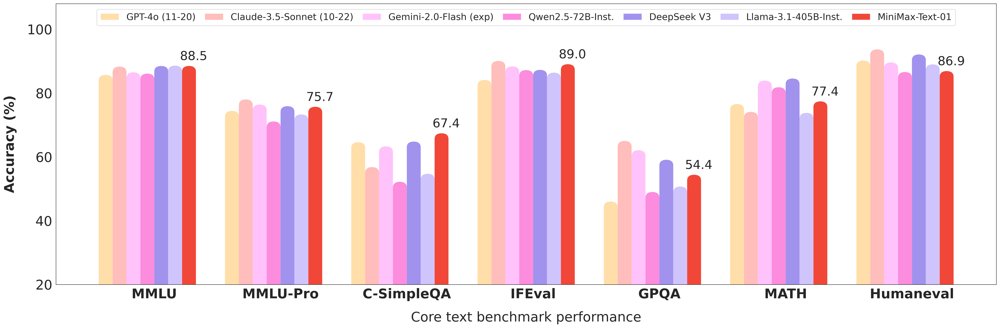
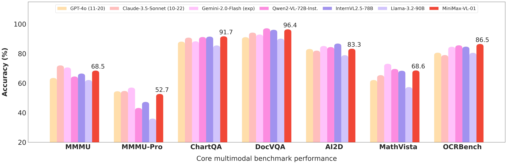

# MiniMax-01 family：Lightning Attention 与超长上下文

> [!tldr]
> **MiniMax-01 是 M1/M2 之前不可跳过的主干：将 Lightning Attention、少量Softmax Attention与MoE结合，把训练窗口推到1M，并展示4M推理外推。** Text-01与在其上扩展视觉的VL-01放在同一个family横向理解；4M检索成绩不是4M复杂推理可靠性的保证。

> [!warning] 当前研读范围
> 已亲读并归档Text-01、VL-01原始HF卡及2025-01-15官方博客；[Tech Report · 2501.08313](https://arxiv.org/pdf/2501.08313)保留链接，不下载PDF。**这次原始资料的研读范围仍不足以达到 GLM-5.3-Flash / Kimi-K3 的完整报告级拆解标准**：未完成报告源码精读，不能声称已核实LASP+推导、完整训练数据配方和attention消融。以下是模型卡级深入笔记，不伪装成论文全文复现。

## family和历史位置

官方2025年1月15日发布MiniMax-01，包含Text与VL。它不是后来MiniMax-M1的别名：01的重点是混合注意力与长上下文基础能力；M1才是下一阶段的推理模型路线。不要因为仓库有Text、VL两个名字就拆成两个主干代际，也不要漏掉视觉扩展带来的输入接口变化。

## 架构：7个Lightning层后接1个Softmax层

| 规格 | Text-01 |
|---|---|
| 参数 | 456B总参 /45.9B active |
| 层数 | 80 |
| 注意力布局 | 每7个Lightning Attention层后接1个Softmax Attention层 |
| 注意力头 | 64，head dim128 |
| MoE | 32专家，top-2；expert hidden9216 |
| hidden /词表 | 6144 /200064 |
| RoPE | 作用于一半head维度；base10000000 |
| 长度 | 训练1M，推理外推最多4M |

混合布局的直观目的，是在大多数层用更便宜的长序列状态更新，同时保留部分Softmax层的显式内容寻址。这里不能由“7:1”直接推出整体推理加速8倍：attention不是全部计算，MoE通信与长输入预填充也有成本。

LASP+、varlen ring attention、Expert Tensor Parallel是官方列出的训练系统方法，说明超长序列依赖并行与通信组织，而不是单独换一个attention公式就能实现。模型卡没有给出每项技术的独立贡献，所以不拆分编造百分比。

## 长上下文：检索、综合理解和外推应分开验收

Needle-in-a-Haystack测试说明能从很长输入里定位特定证据，但不等于能综合许多矛盾事实、维持多轮约束或完成长程Agent规划。

| RULER长度 | Text-01 | Gemini1.5Pro(002) |
|---|---:|---:|
| 4K | 0.963 | 0.962 |
| 128K | 0.947 | 0.917 |
| 512K | 0.928 | 0.861 |
| 1M | 0.910 | 0.850 |

Text-01自己也从4K的0.963下降到1M的0.910，所以“支持更长”不代表“完全不退化”。LongBench-v2带CoT整体56.5，GPT-4o同表为51.4，Qwen2.5-72B为43.5；不带CoT时Text-01为52.9。比较时必须保持是否CoT的设置，不能挑对手较低的一行。

## 通用结果：并非所有能力都领先

| 指标 | Text-01 | 对照与边界 |
|---|---:|---|
| MMLU | 88.5 | 同表Llama3.1-405B为88.6 |
| MMLU-Pro | 75.7 | Claude3.5Sonnet为78.0 |
| GPQA Diamond | 54.4 | Claude3.5Sonnet为65.0 |
| MATH | 77.4 | DeepSeekV3与Gemini1.5Pro均84.6 |
| HumanEval | 86.9 | Claude3.5Sonnet为93.7 |
| Arena-Hard | 89.1 | GPT-4o为92.4；不要把92.4误抄给Text-01 |

这是2025年初的官方比较快照，不是2026年10月排行榜。模型卡对带星号任务注明0-shot CoT；自报结果、不同checkpoint与采样设置仍需保留。

## VL-01：在文本主干上接入视觉，不抹平模态差异

VL-01采用303M ViT和两层MLP投影。动态分辨率范围336到2016，切成336×336 patch tiles，并保留336×336缩略图；这样既能保存局部细节，也能给全局布局信息。ViT使用694M图文对预训练，VL卡报告四阶段共512B tokens的视觉语言训练。**512B不是Text-01全部预训练token数**。

| VL指标 | 官方卡结果 | 应如何解释 |
|---|---:|---|
| MMMU /MMMU-Pro | 68.5 /52.7 | 视觉综合推理，不和文本MMLU横比 |
| ChartQA /DocVQA | 91.7 /96.4 | 图表与文档理解 |
| OCRBench | 865 | 非百分比；不能写865% |
| MathVista | 68.6 | 视觉数学 |
| MLongDoc | 32.5 | 仍体现长文档多模态困难 |

高分文档QA并不自动意味着复杂表格、长文档跨页推理无误。测试时需保存图片tile数量、分辨率、输入长度和题型；否则视觉预处理变化会掩盖模型变化。

## 部署和许可边界

原卡示例使用8GPU、INT8推荐量化、部分层不量化、trust_remote_code及分层device_map；这些是示例，不代表任意8卡都能承载4M上下文。这里没有执行远程代码或下载权重。

代码许可与模型许可分开：卡里代码为MIT，模型另有LICENSE-MODEL。**不把“代码MIT”简写成“模型全部MIT/Apache”**；实际商用前阅读对应权重版本的原条款。

> [!insight] 对 Agent Training 的启发
> 长历史应分成“证据能找到”“找到后能否正确组合”“多轮约束能否保留”三种测试。先在同一上下文长度和输出预算下比较混合attention模型，再测外推长度；记录终态成功、证据引用错误、重复工具和KV成本。单个needle分数不能代替轨迹级验证。

## 一手来源与关联

- [S1 · HF Model Card：Text-01](https://huggingface.co/MiniMaxAI/MiniMax-Text-01)，原始MD：[[src/MiniMax-Text-01-model-card]]。
- [S2 · HF Model Card：VL-01](https://huggingface.co/MiniMaxAI/MiniMax-VL-01)，原始MD：[[src/MiniMax-VL-01-model-card]]。
- [S3 · Tech Blog：2025-01-15](https://www.minimax.io/news/minimax-01-series-2)，原始HTML：`src/official-blog.html`。
- [S4 · Tech Report（PDF，仅链接）](https://arxiv.org/pdf/2501.08313)。
- 同期注意力路线对照：[[Topics/13_base_model/Tencent_Hunyuan/260423_Hy3/Hy3-Family]]；后者使用GQA，不等于同一种混合attention。

> 📊 中文 Poster：[[minimax-01-family_poster_zh.html]]
