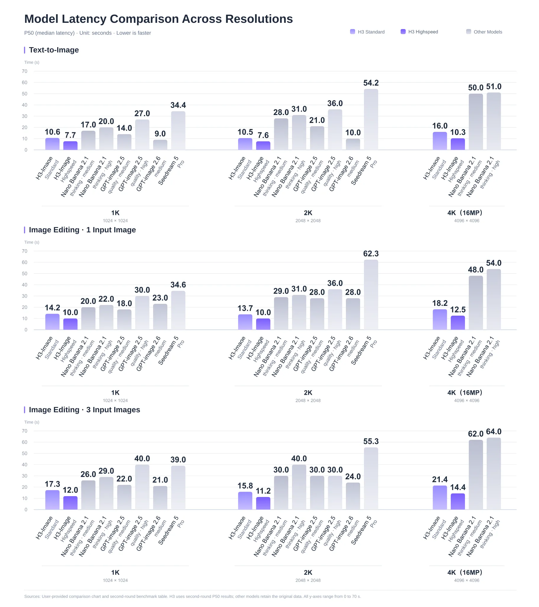
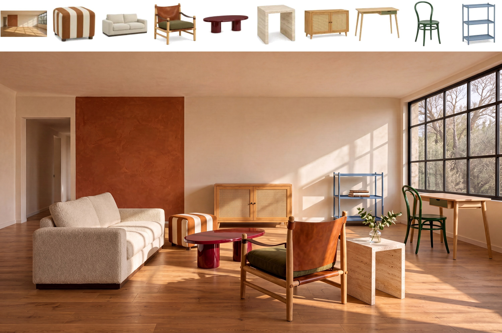

> [!tldr]
> H3-Image把H3的音画主干改造成图像生成/编辑专项：去掉音频支路，保留单流DiT与H3文本编码器，蒸馏成6步、无需CFG的原生约16MP生成。最容易混淆的是：生成器、27B提示扩写器PE与托管Context-IR是三个组件，公开编辑PE目前只有提示模板，不能宣传整条理解链已开放。

> [!warning] 发布与资料深度
> 官方博客明确2026-11-11“今天发布”，采用该声明日，不使用HF创建/更新时间。已读基础/PE两卡、官方博客和图；没有完整训练报告或独立实测，数据/RL/蒸馏损失及消融不足，未达到完整GLM/Kimi报告精读深度。H3-Image与7/31音视频H3分列专项；PE是本图像family组件，不另拆正代。

## 定位、日期与开放边界

> [!tldr]
> 这是11/11公开的图像专项；约16MP原生生成与高分辨率展示可以核实，但“十秒”和领先幅度需带硬件/模式/负载，不能用它们替代统一复测。

| 组件 | 规模 / 精度 | 职责与边界 |
|---|---|---|
| H3-Image DiT |33.1B；主要BF16，embedding/timestep/output为FP32|文生图、参考生成、多图编辑；50层，hidden5376，56头，FFN14336|
| H3文本编码器 |继承Qwen3-VL完整encoder，第50层hidden|与H3共用，另从H3仓库加载约66.7GB；不是本repo已包括|
| H3-Image-PE |Qwen3.8-27B微调，NVFP4|本地文生图提示扩写，输出caption与宽高比|
| H3-Image-Context-IR |托管接口|把简短多语言请求转为完整英文画面描述；不等同PE权重|
| 编辑PE |仅task prompt与message assembly|尚在开发，需要用户自选VLM；不能称已开源编辑扩写专用模型|

主仓库约68.65GB是文件体积，不是峰值显存，也未包含约66.7GB外部文本编码器。PE的17.9GB也不是DiT量化版。许可为H3-Image Community License，PE同许可；不误标MIT/Apache。

## 方法、接口与训练判断

> [!tldr]
> 图像VAE与单流DiT负责原生生成；PE负责意图描述。复现要冻结两级prompt、参考图顺序和实际内部画布，不能只保存最终一句提示。

图像VAE为CNN encoder与24层2D ViT decoder，空间16倍下采样、24latent通道；DiT再做2×2patch，每个token对应32×32像素。文本和参考图经H3文本编码器，参考图另经VAE，所有token拼为单流序列，预测目标latent后再VAE解码。官方卡的架构图仍是TODO，不把旧H3含音频架构图冒充本模型新结构图。

checkpoint固定6 NFEs、guidance_scale=1；接口对其他步数/引导系数报400，negative_prompt也不支持。工作范围约4–20MP、官方建议约16MP；生成器直接输出该分辨率，不需另一个放大器。但服务端对小于min_generation_area的请求会先放大内部画布再LANCZOS缩回，不能把所有小尺寸请求解释为直接在返回尺寸上推理。

| 比例 | 官方约16MP尺寸 |
|---|---|
|1:1|4096×4096|
|4:3 / 3:4|4736×3552 / 3552×4736|
|3:2 / 2:3|5024×3360 / 3360×5024|
|16:9 / 9:16|5472×3072 / 3072×5472|
|21:9|6272×2688|

原prompt按原样使用，截到4096tokens。编辑参考图按上传顺序变成Picture1、Picture2等，支持最多16参考图；重排会改变语义。CPU generator同seed只控制初始噪声，不证明不同GPU、后端、版本的最终结果逐像素一致。

PE文生图输出expanded_caption/aspect_ratio；用户显式选比例时优先用户值。编辑模板的target_aspect_ratio允许adaptive，但它由另选VLM推断。PE默认temperature1、top_p0.95、top_k20、4096tokens含thinking、effort xhigh；schema约束只保证结构，不保证语义忠实。官方本地生成与托管API对照用的是Context-IR增强后的prompt，不能当作不带扩写的裸DiT同质量证据。

> [!warning] 宣传文字与图中口径
> 博客写4K低于10秒，但P50图4K/16MP文生图Standard16.0s、Highspeed10.3s，单图编辑18.2/12.5s、三图编辑21.4/14.4s。图下注明H3第二轮P50、其他模型沿用原数据；不能当完整同场复测。

## 结果、反例与研究启发

> [!tldr]
> 有定量速度图和丰富选择样例，缺统一质量分数、置信区间、完整训练配方。十秒、5倍、标准/高速模式应分别记录，不能拼成任意GPU都成立的SLA。

博客称4K低于10秒、最高5倍，另称Standard1.5–2倍、Highspeed3–4倍；需保留图示硬件/模型/模式，不能跨模式套用最高倍数。HF卡主要给出原生尺寸、依赖与gallery，没有完整公开同预算质量benchmark数表。价格50–70%与首周4K五折是发布期宣传，不能当永久标价；本轮未调用收费API或测显存/延迟。

十参考家具拼图说明官方展示了多图编辑，但精选图不是16参考全部任务的成功率；文字推理画板也不是自动求解基准。原图全部留在src/assets，图卡细节不得靠缩略图推定准确率。

> [!insight]
> 对Agent生成任务，应把用户原意、PE扩写、生成输入、参考图顺序与最终图一并留痕。固定seed/后端/步数/内部画布，比较原prompt、PE、托管IR三组；同时验收要求遵循、非编辑区保持与额外生成内容，记录PE引入的错误意图和总成本。不能把提示扩写器做完的推理隐瞒成生成模型自身能力。

- [官方基础卡](https://huggingface.co/MiniMaxAI/MiniMax-H3-Image)
- [官方PE卡](https://huggingface.co/MiniMaxAI/MiniMax-H3-Image-PE)
- [11/11发布博客](https://www.minimax.io/blog/minimax-h3-image)
- 关联：[[Topics/13_base_model/MiniMax/Variants/260731_MiniMax_H3/MiniMax-H3|H3音视频系统]]。

> 📊 相关可视化: [[minimax_h3_image_poster_zh.html|中文Poster]]
