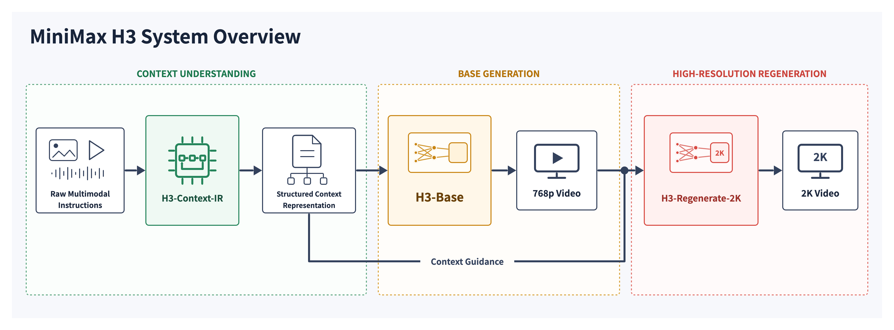
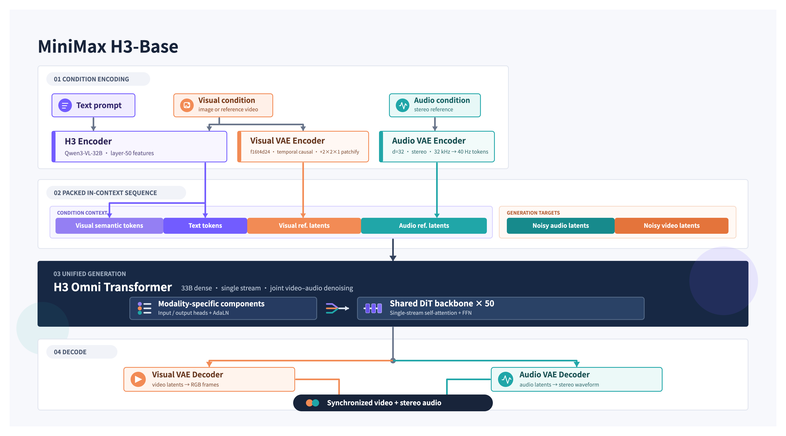

# MiniMax H3：开放Base，不等于开放完整2K系统

> [!tldr]
> H3的关键是把多模态理解、音画生成和高分辨率再生成拆成三个模块。当前HF卡给出的33B单流Transformer属于H3-Base；完整2K流程还依赖未开放的Context-IR与Regenerate-2K。首发博客为2026-07-31，本次属于历史专项漏项补齐。

> [!warning] 日期与披露边界
> 已读官方7月31日发布博客与当前HF模型卡，保存系统、架构等官方原图。本轮不保存PDF/权重；博客称报告将推出，未取得可精读的技术报告。训练配比、总预算、完整量化评测与首个权重公开日尚不明确，不能达到GLM-5.3-Flash / Kimi-K3完整报告精读标准。7月28日仓库创建、11月模型卡更新都不作首发日。

## 首发、系统边界与输入输出

> [!tldr]
> 7月31日是官方宣布H3的日期；“即将开放权重”与现在HF卡可读是两件事。FL2VA和Ref2VA是同一H3 family的任务checkpoint，不拆代际。

[S1博客](https://www.minimax.io/blog/minimax-h3)标注2026-07-31；[S2官方HF卡](https://huggingface.co/MiniMaxAI/MiniMax-H3)披露当前Base架构、推理与部署。H3是音视频生成专项，保留MiniMax通用语言主干，不以视觉/音频模态新名字替换M3.1。

| 模块 | 作用 | 当前开放边界 |
| --- | --- | --- |
| H3-Context-IR | 理解文本/图/视频/音频关系，推理并重写上下文 | 多阶段托管模型和编排服务，不在本次开源包；官方API可用性按文档声明 |
| H3-Base | 基于上下文生成768p视频与原生立体声 | 当前HF发布的完整Base权重与任务变体 |
| H3-Regenerate-2K | 将768p结果和原上下文重新送入模型再生成2K | 当前未开放；完整2K工作流需托管服务 |

2K不是仅放大像素：原上下文再参与生成可补细节，但也会引入内容漂移风险。若只部署Base，不能声称获得完整官方2K系统，比较成本时也不能漏掉IR与二次生成服务。

| 规格 | 当前官方卡 |
| --- | --- |
| 输出 | 4–15秒，24fps；默认短边768px |
| 高分辨率 | 2K依赖H3-Regenerate-2K |
| 音频 | 32kHz立体声 |
| 比例 | 21:9、16:9、4:3、1:1、3:4、9:16等 |
| 稳定对白语言 | 阿拉伯、中、英、法、德、意、日、韩、葡、俄、西班牙共11种；其他语言程度不同 |
| FL2VA | 0张图为文本生成；1张图首帧或末帧；2张图首末帧 |
| Ref2VA图片 | <=9张 |
| Ref2VA视频 | <=3段，各2–15秒，总时长<=15秒 |
| Ref2VA音频 | <=3段，各2–15秒，总时长<=15秒 |
| 混合参考 | 所有类型合计<=12个文件 |

## 架构、训练与部署机制

> [!tldr]
> 33B是Omni-Transformer，不包含整个托管系统；约13B AdaLN分支可缓存不加载也不意味着应改名20B模型。统一序列和模态专用VAE分别承担不同职责。

### 理解表征与音画latent如何进入同一主干

文本由H3-Encoder编码；图像/视频同时经过Encoder与VisualVAE；音频只经AudioVAE。编码结果打包为多模态序列，经3D MM-RoPE表示时空/模态位置，单流Transformer共同预测视频与音频latent，再由各自decoder还原。模态专属部分集中在输入/输出层与AdaLN，Attention和FFN共享，目的是减少互不沟通的模态分支。

H3-Encoder采用**Qwen3-VL-32B完整预训练权重**，取第50层hidden states；不是只借名字或部分小编码器。提供的tokenizer加了`<d>`等special token，部署不能随便换成原Qwen tokenizer配置。

VisualVAE为f16t4d24：空间16倍、时间4倍压缩、24通道，再以(time,height,width)=1×2×2做patch，主干实际空间降采样32倍、时间仍4倍。训练还优化latent可学习性，并单训ViT decoder改善还原与成本。压缩更强会影响字形、动作细节与可学习性，不能只把token减少当质量提升。

AudioVAE对左右声道使用同一套encoder/decoder，但独立编码与解码后合成立体声；32kHz每声道压至40Hz latent。32kHz是采样率，40Hz是latent时间频率，二者不能互换。

### 33B与AdaLN缓存

H3-Omni-Transformer为33B dense single-stream，其中约13B在AdaLN相关分支。因为调制输出能预计算并缓存，纯推理可不加载这些参数；发布完整权重供微调等用途。总参数、推理常驻参数和整套系统参数是三个口径，不能据此把全系统称33B，或说官方发布20B模型。

最终训练阶段支持原生稀疏注意力，但**初始开源推理只给full attention**，sparse实现列为后续发布。不能把训练支持当作现成可跑的稀疏推理库。

### 博客的训练主张与证据密度

博客强调任务泛化：自然多模态数据、早期融合与合理混合，使理解和生成协作。Context-IR案例可用约100K推理tokens形成约4K上下文中间表示；这描述预处理计算量与压缩结果，不是H3-Base的100K上下文窗口。理解/生成负载分离与任务分布优化称吞吐约+30%，缺少完整baseline、硬件/预算与误差范围，只能记录工程主张。

发布两类CFG-distilled BF16 checkpoint：FL2VA与Ref2VA；不据此臆测蒸馏教师、全部步数、训练数据配比或推理显存。官方许可是 **MiniMax H3 Community License**，不是MIT或Apache；使用时需阅读实际许可，不把“开放权重”替换为无限制开源。

## 评估缺口、可验证实验与启发

> [!tldr]
> 当前材料足以解释模块和实现边界，尚不足以证明对其他模型全面领先。最有意义的是拆分IR、Base与2K再生成的贡献，并用音画同步、细节保持与成本共同验收。

公开博客的精选演示与能力描述不等于未筛选评测。未取得有完整样本、对照版本、采样配置、种子与置信区间的量化横评，因此本页不制造分数，不把未来技术报告写成已读。

| 建议实验 | 控制变量 | 失败与代价 |
| --- | --- | --- |
| 原始prompt vs Context-IR | 同一Base、seed、参考素材 | 目标信息丢失、额外补语义是否改变意图；IR调用成本 |
| Base768p vs Regenerate2K | 固定原上下文；同一输出作为输入 | 参考主体漂移、文字变化、时序断裂；总耗时与服务依赖 |
| FL2VA vs Ref2VA | 同任务意图、相同参考信息预算 | 首末帧满足率、参考冲突、跨镜头一致性 |
| 音画联合生成 | 固定动作/台词/说话人 | 口型偏差、音频中断、左右声道一致性 |
| full vs sparse attention | 等分辨率、帧数、精度；待实现公开后 | 显存、速度和高频细节损失；不能提前宣称结果 |

对Agent Training，可把复杂生成任务分成“读懂参考→产生可执行上下文→生成→验证→修复”的轨迹。IR不应先替学生完成全部应学推理；训练/评测必须显式记录模型实际可见的文件、提示及工具输出。正奖励应基于可核验输出和参考约束，避免只奖励文案自述的成功。

> [!insight]
> H3最值得保留的不是2K口号，而是“理解系统+生成底座+上下文再生成”的组件边界。任何开源可复现主张都应逐模块核对权重、配置、服务调用和许可；不完整的系统不能在Atlas里写成完整开源复现。

### 资料与关联

原始博客HTML/可读文本、HF原始MD及官方三张图在src；本轮没有下载PDF、视频或权重。H3首个权重开放日仍待官方声明，不作为11月新增发布事件。

相关：[[Topics/13_base_model/Meituan_LongCat/260925_LongCat_2_5_Preview/LongCat-2.5-Preview]]（理解侧离散视觉，与H3生成latent不同）；中文Poster：[[minimax_h3_poster_zh.html]]。
