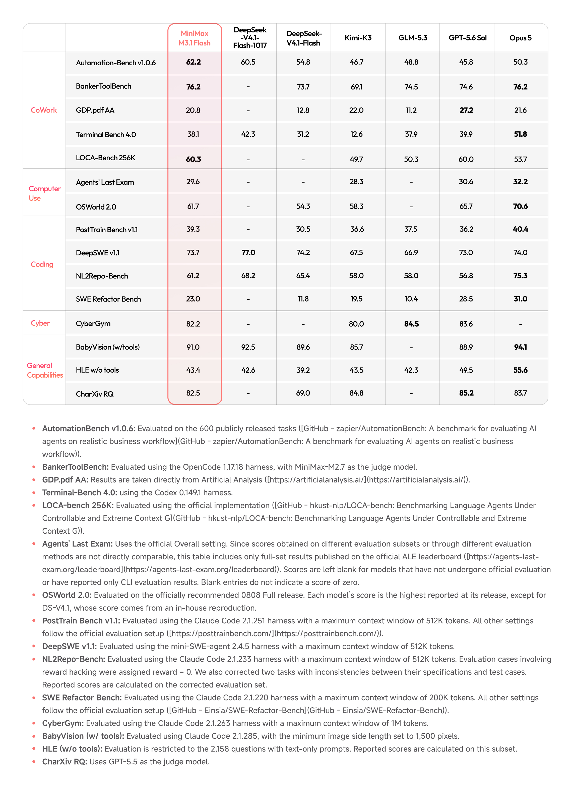
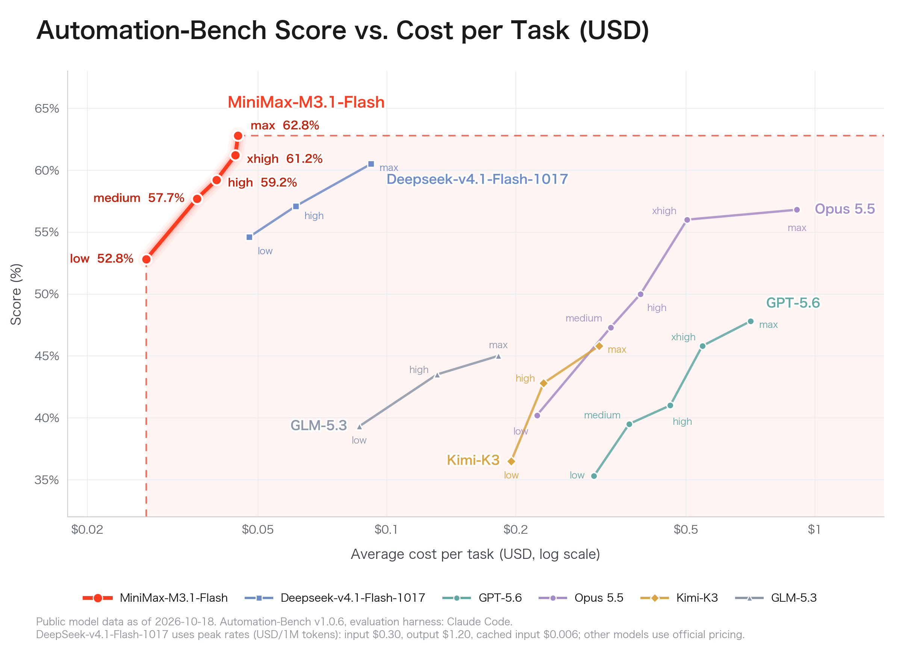
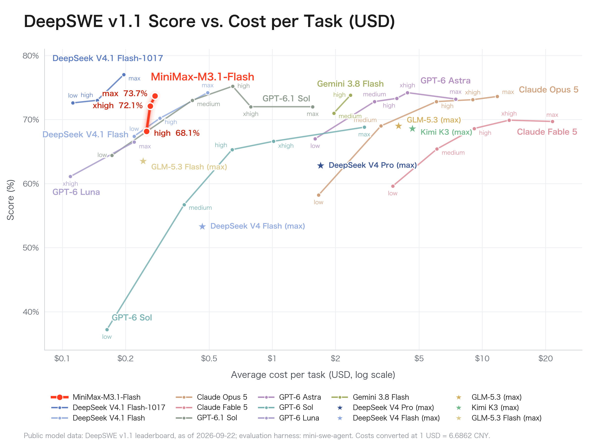
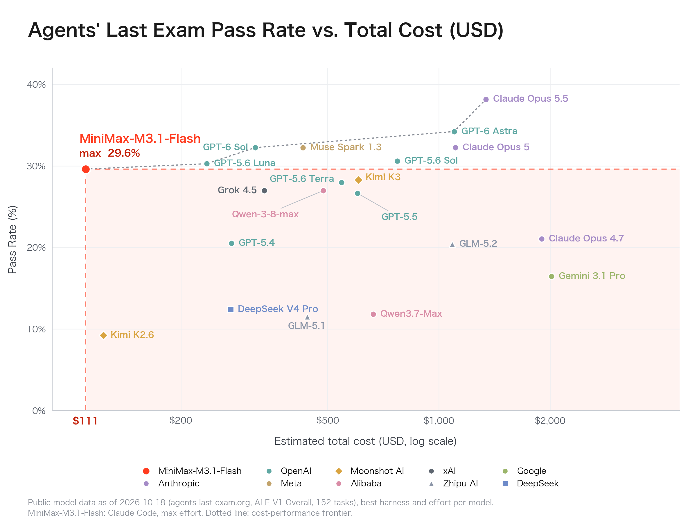

# MiniMax M3.1 Flash：更值得研究的是每个成功任务的成本

> [!tldr] 我的判断
> M3.1 Flash 的主要价值不是“所有榜单第一”，而是把多步工具、软件开发和计算机任务推到更低成本区间。官方总表给 Automation-Bench 62.2、DeepSWE 73.7、ALE 29.6；它仍落后于若干模型的代码与通用能力成绩。应把推理 effort、成功率、实际账单和工具成本一起验收，而不是把 200+ TPS 当成所有 Agent 任务的端到端加速。

> [!warning] 资料充分度：训练精读未达到完整技术报告标准
> **因为当前已读原始资料主要是发布 Tech Blog 和四张官方图，缺少独立技术报告、当前 GA 模型卡、完整架构与训练 recipe，本笔记的训练机制分析达不到 GLM-5.3-Flash / Kimi-K3 完整报告精读的深度。** 不补写未经披露的参数量、专家数、训练数据配比、RL 算法或组件消融。官网明确权重以后开放、Pro 以后到来；本次没有下载 PDF、权重，也没有运行模型或远程代码。四图均是原站原图，已离线保存，不是生成的示意图。

## 日期、Preview 与主线归属

发布正文明确标注 **2026-10-19**，宣布 M3.1 Flash 正式 rollout，并称 API、M Plan、MiniMax Code 已可用。本节点日期表示这次**正式发布阶段**，不声称它是整个 M3.1 family 首次可用的日期。

官方产品渠道在此之前已经出现 M3.1-Flash-Preview。本轮没有核实 Preview 的首次开放日，也没有证据证明 Preview 与 GA 权重完全相同，因此不把今天伪装成 Preview 首发，不把它们拆成多个正代。后续核实预览日期后应在同一 family 内补充阶段，保留本次 GA 日期。

M3.1 Flash 是 MiniMax 通用基模主线的发布阶段，不因 Flash 命名就降为专项支线。官网提到 Pro 后续推出，不代表现在已经发布，不能预建 Pro 叶子。匿名版本 Space Bunny 的“处理超过 200T tokens”描述的是运行使用量，**不是训练 token 数**。

## 为什么不是只看一个综合分

Agent 的一次任务包含多轮生成、工具执行、文件操作、重试与验证。token 单价低并不必然让任务总成本低：更多推理 token、失败重试或昂贵工具都可能抵消优势。M3.1 Flash 的发布主张同时涉及能力、稀疏推理、吞吐与账单，应拆开核验。

官方文字只披露“更激进的稀疏性”，没有给出当前 GA 的专家路由、稀疏模式、激活参数、稀疏率、训练损失和硬件 profile。不能从这个词直接推导成某种 MoE / Sparse Attention 的完整实现，也不能把旧 Preview 介绍中的规格无条件套给 GA。

## 官方全表：优势、弱项与空白一起读

*图 1｜MiniMax 官方原图，保留完整脚注。对照列为发布方整理，并非本次统一 harness 重跑；空白不是 0 分。文字正文 CyberGym 为约 82%，图中精确到 82.2。*

| 任务面 | Benchmark / 版本 | M3.1 Flash | 必须保留的解释 |
|---|---|---:|---|
| CoWork | Automation-Bench v1.0.6 | 62.2 | 600 个公开任务；与成本图 max 62.8 不混为同一运行 |
| CoWork | BankerToolBench | 76.2 | OpenCode 1.17.18；MiniMax-M2.7 作 judge |
| CoWork | GDP.pdf AA | 20.8 | 来自 Artificial Analysis；低于图中 GPT-5.6 Sol 的 27.2 |
| CoWork | Terminal-Bench 4.0 | 38.1 | Codex 0.149.1；低于 V4.1 Flash-1017 的 42.3 |
| CoWork | LOCA-Bench 256K | 60.3 | 官方实现；不能代替所有长上下文任务 |
| Computer Use | Agents’ Last Exam | 29.6 | 官方 Overall 全集；未参加全套的模型留空 |
| Computer Use | OSWorld 2.0 | 61.7 | 推荐 0808 Full release；图中 Opus 5 为 70.6 |
| Coding | PostTrain Bench v1.1 | 39.3 | Claude Code 2.1.251、512K context |
| Coding | DeepSWE v1.1 | 73.7 | mini-SWE-agent 2.4.5、512K context；1017 对照 77.0 |
| Coding | NL2Repo-Bench | 61.2 | Claude Code 2.1.233、512K；修正两题、reward hacking 判 0 |
| Coding | SWE Refactor Bench | 23.0 | Claude Code 2.1.220、200K；Opus 5 对照 31.0 |
| Cyber | CyberGym | 82.2 | Claude Code 2.1.263、1M context；GLM-5.3 对照 84.5 |
| General | BabyVision with tools | 91.0 | Claude Code 2.1.285，图像最短边 1,500 pixels |
| General | HLE without tools | 43.4 | 仅 2,158 道 text-only 子集，不代表 HLE 全集 |
| General | CharXiv RQ | 82.5 | GPT-5.5 作 judge；并非无模型裁判的确定性指标 |

这不是“全面压倒国内外模型”：总表里 GDP.pdf、Terminal、DeepSWE、NL2Repo、SWE Refactor、CyberGym 与 HLE 都存在更高对照。Automation 的优势值得重视，但不能外推成所有业务、所有模型配置的胜出。各表未提供置信区间，本笔记不宣称小差距统计显著。

OSWorld 的脚注明确：通常取各模型发布时最高成绩，但 DS-V4.1 是内部复现；不能把所有格子写成同一实验条件重跑。ALE 只比较官方 Overall 全集，不用 CLI 子集补空格。NL2Repo 的修题会改变可比性，需要保存该修正版而不是只留一个分数。

## 三张成本图，其实对应三套口径

*图 2｜官方原图。横轴为每任务美元成本、对数刻度；公开模型数据截至 10 月 18 日，harness 为 Claude Code。DeepSeek-1017 使用特定 peak rates，其余模型按官方价格，不能外推为当前所有时段账单。*

Automation 成本图中 effort 从 low→medium→high→xhigh→max 的 M3.1 分数分别为 **52.8 /57.7 /59.2 /61.2 /62.8%**。同一模型的额外预算可以带来明显变化，但 **总表 62.2 与图中 max 62.8 不一致**；正文没有给出足够运行细节来解释差异，应分开引用，不挑高者覆盖低者。图内未逐点给精确美元值，不从图片坐标猜造完整费用表。

*图 3｜官方原图。M3.1 high /xhigh /max 为 68.1 /72.1 /73.7%；成本单位是每任务，不是整个评测集。图脚注标公开数据截至 2026-09-22，却包含较晚命名的 1017 对照，时间标注存在疑点，不能据此认证所有对照的新鲜度。*

DeepSWE 曲线的高 effort 有收益，但发布图上 DeepSeek-1017 max 更高，不能说 M3.1 以最低成本取得绝对最高分。换算注明 **1 USD = 6.6862 CNY**，这是该图的转换条件，不是本笔记提供的实时汇率。图 1 使用的 mini-SWE-agent 2.4.5 与图 3 的来源/版本需各自追溯，不因同名 Benchmark 就假定全部条件一致。

*图 4｜官方原图。152 tasks、ALE-v1 Overall、各模型 best harness / effort。M3.1 使用 Claude Code、max effort。横轴明确是 estimated total cost：$111 是整套估算成本，不是每题 $111。*

29.6% 与 $111 一起体现成本位置，但不是最高通过率：图里 Opus 5.5 仍更高。除以 152 约为 $0.73 / task，这是按官方总价和题数计算的平均值，**不是官方逐任务收费，也不是每成功任务成本**。cost-performance frontier 虚线只表达这组选点的边界，不表示对所有任务分布存在支配关系。

## 价格与速度：token 费率不等于任务经济性

发布页给出的固定费率为每百万 tokens：未缓存输入 **$0.15**、输出 **$0.60**、缓存输入 **$0.015**。下面只是按该费率做核算，不是本次实测账单。

| 项目 | 可计算的部分 | 不能默认为已计入 |
|---|---|---|
| 模型 token 费用 | 输入、缓存输入、输出分别乘各自费率 | 搜索、工具、沙箱、失败重试和人工复核 |
| 单任务均值 | 整套美元费用 / 总任务数 | 成功任务成本、长尾任务费用 |
| 成功任务成本 | 同一冻结集总费用 / 实际成功任务数 | 不同难度集合间直接比较 |
| 输出 TPS | 官方称可达 200+、P50 稳定 170+ | TTFT、prefill、网络、工具等待、端到端耗时 |

官网另称 online inference 近 3×、Agent 总使用成本降低 70%，但未在已读正文充分展开基准 predecessor 的配置、负载分布、缓存命中率与统计协议。**这些是发布方主张，不是本次验证过的普遍收益**。不能用输出 TPS 自动推算 TTFT 降低三倍，也不能给每个业务承诺节省 70%。

## 读不到的训练部分，应明确留白

这次 Tech Blog 可以支撑能力位置、价格与产品阶段判断，不能支撑完整训练机制复现。没有独立 GA 模型卡、具体训练 token、数据混合、RL reward/grader 方案、算法伪码、router/sparsity 消融或权重 checksum。当前官方 HF inventory 未出现 M3.1 对应公开仓库；官网明确未来开放权重，因此**不生成假的 HF Model Card 和 Tech Report 按钮**。

Preview 相关产品页说明它早已可用，但不能单凭相似名字证明 GA 与 Preview 的参数、context、默认 reasoning effort 和 SDK 字段完全一致。上线前应以当前官方 API 文档与账号实测确认 model ID、输出上限、推理字段及错误行为。这里没有执行任何登录、付费调用或推理。

## 对 Agent Training 的启发：让预算比较回到同一个实验

> [!insight] 能力—成本曲线比单个最高点更能指导训练
> 如果训练数据只奖励“最终成功”，却不惩罚重复工具调用、过长推理或无效重试，就可能只把曲线往高预算端移动。这个发布最值得转成实验的问题是：在冻结环境、相同 effort 和费用口径下，训练能否同时提高成功率并减少每成功任务成本？官方发布没有披露实现该目标的具体训练算法，不能倒推出它已经使用某种效率 RL。

可做三组对照：固定 harness 与每题预算，比较不同模型；固定模型，扫描 effort；固定权重，改变缓存与工具并发。每组都记录输入/输出与缓存 tokens、工具次数、失败重试、TTFT、端到端 P50/P95、任务成功与人工验收。金融工作流额外用确定性算式和引用核验，避免把厂商 judge 对写作风格的偏好当成真实财务正确性。

对数据构建而言，保留完整成功与失败轨迹、原始工具响应、文档版本和最终状态验证。把“花更多 token 得到的提升”与“训练得到的更好策略”分开；成本图上的不同 effort 点本身不是不同模型代际。

## 来源与关联

- [Tech Blog｜M3.1 Flash 正式发布](https://www.minimax.io/blog/minimax-m31f)：本地 `src/official_release.html` 保留原始 HTML；`src/official_release.html.txt` 为静态正文。四张图片保存在 `src/assets/`，SHA256 见 `src/retrieval_manifest.json`。
- [官方 M Plan](https://www.minimax.io/m-plan)：证明存在 Preview 产品阶段，不作为首次发布日期证据。
- [官方 HF collections](https://huggingface.co/MiniMaxAI/collections)：本轮目录核查未见 M3.1 原卡；权重未来开放，不能把 M3 原卡冒充 M3.1。
- [[Topics/13_base_model/MiniMax/2606_MiniMax_M3/MiniMax-M3-Frontier-Coding-1M-Context-Native-Multimodality|MiniMax M3]]：前代主线，架构与训练资料独立阅读，不直接迁移到 M3.1 GA。

> 📊 相关可视化：[[Topics/13_base_model/MiniMax/261019_MiniMax_M3_1_Flash/minimax_m3_1_flash_poster_zh.html|MiniMax M3.1 Flash 中文 Poster]]
