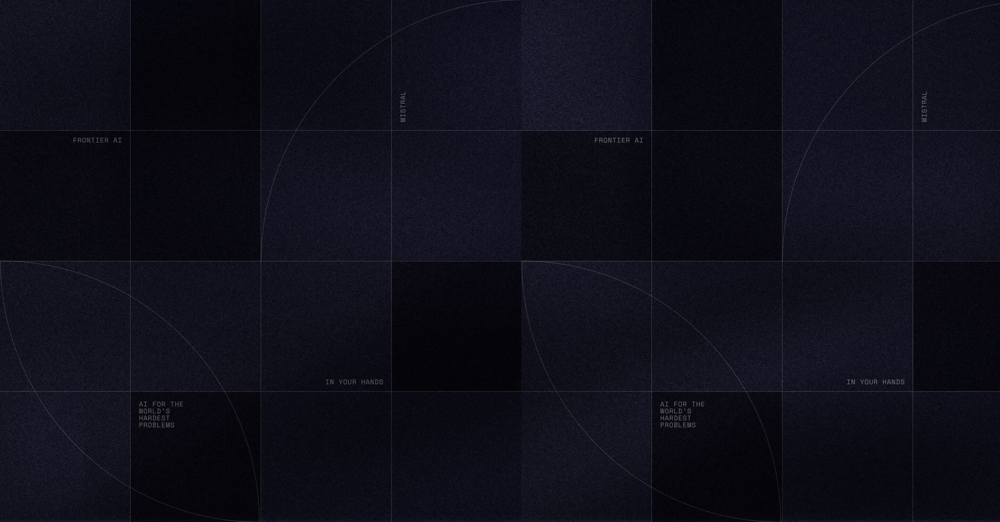
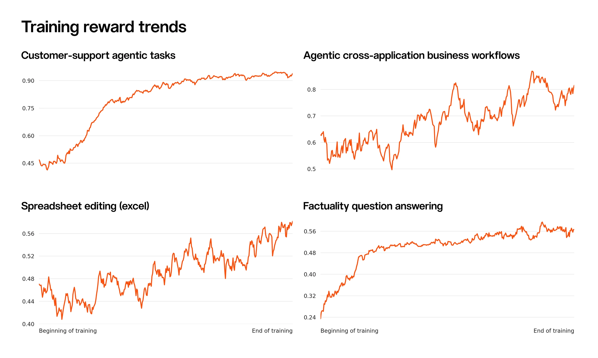
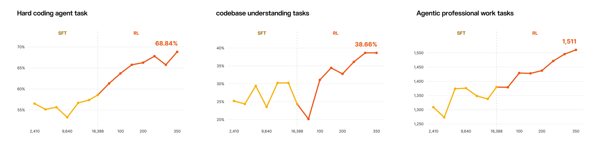
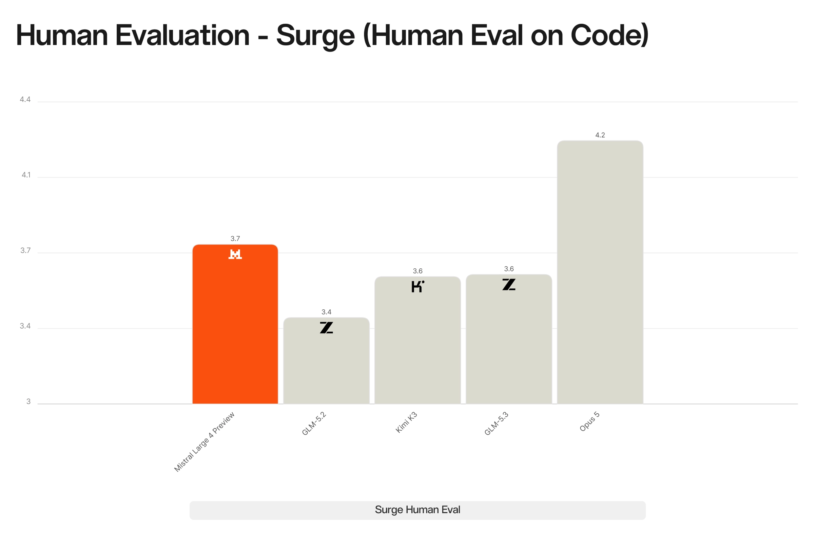
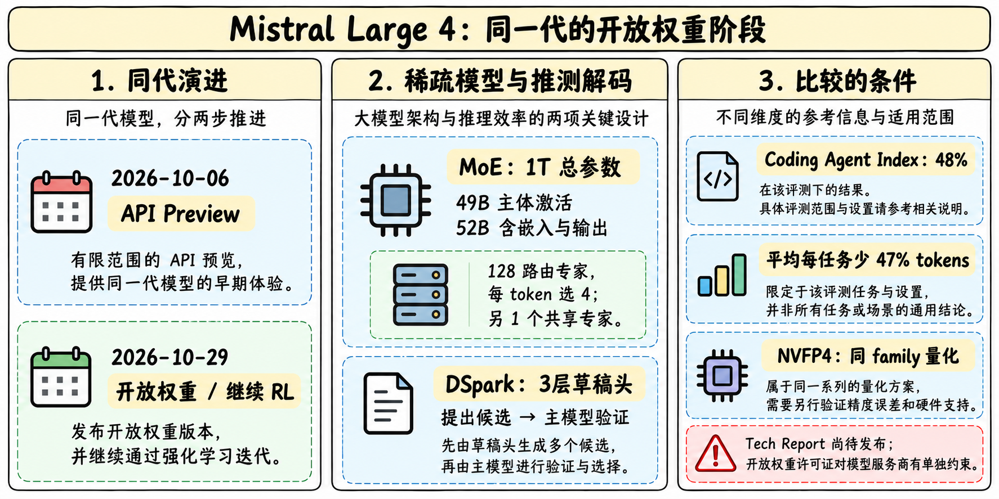
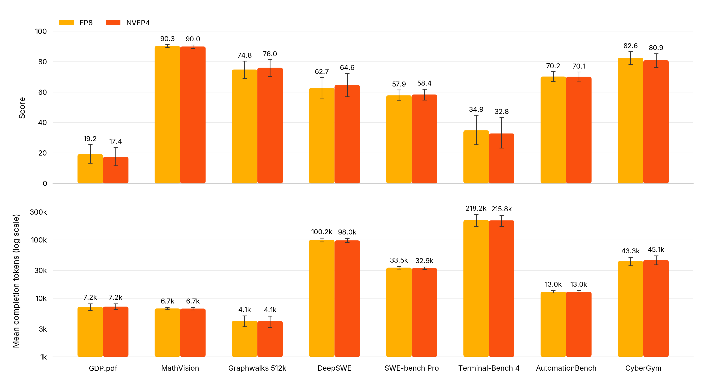
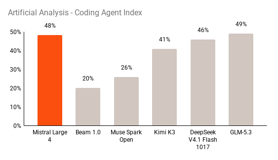
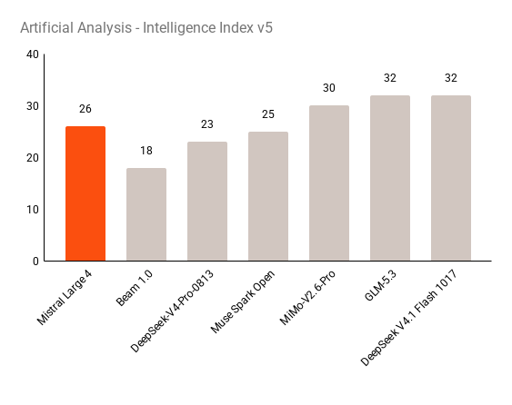

# Mistral Large 4

> [!tldr]
> ML4 的重要性不只在万亿参数：官方把多种可验证工作环境放进同一套异步 RL 流程，让模型学习持续执行、检查与修正。2026-10-06 发布的是 API Public Preview；本文保留Preview阶段证据；10/29已开放继续RL后的权重，新增内容见下方。开放权重不等于无条件MIT许可证。

## 10月6日Preview阶段：以下保留当时状态，不代表当前开放阶段

| 项目 | 已披露内容 | 不能据此推断的内容 |
|---|---|---|
| 架构规模 | 原生多模态 MoE，约 1T 总参数、52B 激活参数 | 层数、专家路由、视觉编码器和具体 attention 配方 |
| 训练基础设施 | 从零训练，欧洲自有数据中心，3,800 张 NVIDIA Grace Blackwell GPU | 预训练总 tokens、训练时长与计算效率 |
| 语言 | 训练语料覆盖 160+ 语言 | 每种语言的能力和训练比例相同 |
| 首次可用 | 2026-10-06，Mistral Studio/API Preview | 后续 checkpoint 与本次 Preview 完全不变 |
| 权重 | 官方计划月底发布 | 本次已能下载、许可证已确定 |
| 发布时价格 | 输入 $1.36/M、输出 $4.18/M tokens | 每个任务总成本必然低于其它模型 |

> [!warning] 10月6日记录的资料边界（当前已补HF卡，完整报告仍待发布）
> 本文已读完整官方 Tech Blog 并保存官方图，能认真拆解其评测与 RL 工程思路；当时尚无已核验HF卡；10/29两份HF卡现已补充，独立完整技术报告仍待官方后续发布。**因此达不到 GLM-5.3-Flash 那种可逐项核对架构、损失、数据配比的技术精读深度。** 原因是原始公开资料不足，不用推测补齐空白。以后权重和报告公开后在本笔记继续补充。

## 把异构任务放进同一个训练闭环

官方强调 composable environment interface：单轮问答、科学代码、安全对齐、事实性和长时程工具任务，可以共用环境接口、代码沙箱、搜索和外部 API。验证器并非只有“答对/答错”，而是按任务组合 reward model、单元测试、LLM judge 与静态检查。

我的理解是：这减少了新增环境的工程门槛，也让同一策略同时学习多个能力。但是“统一接口”没有自动解决奖励口径不一致：单元测试通过率、主观 judge 分数和安全拒绝率仍然需要校准，避免某一类便宜奖励主导训练。

运行时由可伸缩 actor 集群并行生成数万条 rollout，训练异步推进。官方称支持跨多次上下文压缩、百万 tokens 级别的 rollout budget，并通过工程优化减少策略滞后和 off-policy drift。这里的百万 tokens 指长轨迹预算，**不是已经披露了一个固定百万 tokens 的模型上下文上限**。

| RL 工程披露 | 阅读时应如何理解 |
|---|---|
| 单轮约 3k GPU 规模 | 是所描述 RL 运行的量级，不与 3,800 张预训练集群混为一谈 |
| 每天约 33B 生成 tokens | 包含所有生成内容；不是每天 33B 有效监督 tokens |
| 过滤/遮罩后约 16B trainable completion tokens | 可训练完成 tokens 约占生成量 48.5%，不是任务成功率 |
| rollout 与训练异步 | 提高吞吐的同时，需要控制生成策略与训练策略的版本差 |
| 不同环境共用资源 | 要检查环境重置、外部工具稳定性及任务间污染 |

奖励曲线上升是训练过程中“学会提高训练目标”的证据，不单独证明未知任务的泛化。官方另外展示 SFT→RL 对下游评测的贡献，应与训练奖励曲线分开读。

图中的三项任务终点是 68.84%、38.66% 和 1,511；这些任务标签与下方发布时 DeepSWE、SWE-Atlas、AA-Briefcase 的定义/版本并不完全相同。不能为了凑一张表，擅自把训练曲线终点替代正式评测数值。

## 能力证据：看分项，不看一个笼统“最强”

| 发布正文指标 | ML4 Preview | 口径与限制 |
|---|---:|---|
| DeepSWE v1.1 | 61.7% | 软件工程任务；不要与其它 DeepSWE 版本混列 |
| Terminal-Bench 4 | 28.3% | 版本 4，不是常见的 TB 2.0/2.1 |
| SWE-Atlas-QnA | 59.4% | 仓库理解问答，不等同修复成功率 |
| Coding Agent Index | 49.8% | 聚合指数，不是上述任务的简单通用成功率 |
| AutomationBench | 59.9% | 官方描述为 657 个跨应用业务工作流 |
| AA-Briefcase | 1,393 Elo | 排名量表，不是百分比 |
| Dense 200 | 42% | 视觉定位专项；不证明所有多模态任务领先 |
| Cybench | 93% | 40 个安全竞赛挑战；小样本与拒绝策略影响明显 |
| Cyber 漏洞复现并修补测试 | 82% | 官方描述某项测试；不泛化为完整 Cyber Index 得分 |
| B3 攻击抵抗 | 93.3% | 间接提示注入基准，不代表生产环境无风险 |
| KORA | 1.691/2 | 对话行为评价；与安全攻击通过率是不同维度 |

Surge AI 的盲测隐藏模型身份，专业标注者按 1–5 分评分。ML4 为 3.74，低于 Claude Opus 5 的 4.22，高于该组 Kimi K3（3.59）、GLM-5.3（3.60）和 GLM-5.2（3.40）。这支持“该组任务里代码质量有竞争力”，不支持“全面超过闭源旗舰”。

安全指标还要分辨能力与行为。若某个闭源模型因为策略拒绝而在漏洞复现任务接近零分，低分不一定代表它不会做。另一方面，减少合法请求误拒与拦截危险请求应分别验收；开放部署也不等于安全机制无用。

## 对 Agent Training 的判断

> [!insight]
> 最可复用的线索是“环境与验证器的可组合性 + 低策略滞后异步 RL”，而不是照搬参数规模。先让真实多轮工作任务具有可复位环境、可审计工具结果和明确验收，再扩大 rollout。否则吞吐扩张只会放大错误奖励。

值得转化成实验的是三组对照：

- 固定基础模型和 rollout token 总量，比较单环境 RL 与多环境混合；同时看目标环境成绩和未见环境泛化。
- 固定训练样本量，改变 actor 队列长度/策略版本差，检查长轨迹的 off-policy drift、有效完成 tokens 与失败恢复能力。
- 把结果验证、过程静态检查与 LLM judge 分开消融；报告每种奖励的误判、总 verifier 成本与每个成功任务的墙钟时间。

这些是阅读后的研究建议，**没有在本机复现训练或运行模型评测**。发布时官方 RL 仍在继续，所有结果需绑定 Preview 日期与 harness。

## 一手资料与继续阅读

- [S1] [Tech Blog：Introducing Mistral Large 4](https://mistral.ai/news/mistral-large-4/)，2026-10-06。
- [[src/retrieval_manifest.json|原始正文与官方图片抓取记录]]：保留 URL、抓取时间和 SHA-256；本轮未下载 PDF。
- [[Topics/13_base_model/Base Model MOC|基模主题索引]]
- [[mistral_large_4_poster_zh.html|中文 Poster]]

> 📊 相关可视化: [[mistral_large_4_poster_zh.html|Mistral Large 4 中文 Poster]]

## 10月29日开放权重：继续RL后的同一正代

首次公开Preview仍为10/6；10/29开放的是继续RL改进后的权重，作为同family阶段进入近30天表，不另造Large4.1或把量化版拆一代。已完整阅读两份HF卡和新的开放权重博客，保存原始MD/HTML、三张官方评测图和新的手绘研读图。

> [!warning] 完整报告仍待发布，不能伪装报告精读
> 新博客明确表示完整Technical Report后续发布。本次未找到可核验的该报告URL，不添加虚构Tech Report按钮，也未抓取PDF。HF卡补足了部署结构和评测快照，仍缺完整预训练/后训练数据配比、损失/奖励定义与可归因消融，因此依然达不到完整报告级深度。

### 模型结构：49B与52B是计数口径差异

| 已披露项目 | 10/29模型卡 | 阅读约束 |
|---|---|---|
| 总参数 | 1T | 不等于只需保存激活参数 |
| 主体激活 / 含嵌入输出 | 49B / 52B | 不是两个不同尺寸版本 |
| MoE | 128 routed专家，每token选4，另1 shared | 专家稀疏不消除通信、KV与权重存储 |
| 输入/输出 | 文本+图像输入，文本输出 | 不自动包含音频生成 |
| Vision | Pixtral风格可变分辨率/宽高比编码器 | 完整训练配方仍未公开 |
| 上下文 | 当前卡明确1M | 与旧博客“百万token长轨迹预算”各自独立 |
| 推理档位 | low / medium / high，默认high | low替代原None；不能保证逐题单调提升 |
| 统一能力 | 同权重指令、推理、函数/JSON调用 | schema符合不等于工具最终状态正确 |

### DSpark与NVFP4：加速机制不能替代精度验收

模型内附3层dense MLA草稿头，以BF16运行、按3-token块提出候选，主模型验证后接受；属于同一权重包的投机解码能力，不另建DSpark叶子。官方最高约1.9倍吞吐是条件化结果，接受率、batch、输出分布和内存压力都改变收益，不能写成所有任务延迟减半。

NVFP4仓库是同family的部署量化：MoE专家NVFP4、线性层FP8，目标Blackwell B200/B300/GB200/GB300。卡称所列评测基本维持质量，但并非所有提示上逐token等价。vLLM示例需要`fp8_ds_mla`KV格式；把它改成泛用FP8并非可直接替代。两份卡内示例均未在本机安装或运行。

### 新评测：同指标可比较，变版本不能硬减

| 新公开阶段结果 | 数值 | 证据与比较边界 |
|---|---|---|
| FrontierCode 2.0 | 19.7% | 私有仓库质量/合入评价；非传统SWE-bench成功率 |
| Coding Agent Index | 48% | 同组GLM5.3近似持平，平均每任务少47%tokens；不是任意任务成本结论 |
| Terminal-Bench 4.0 | 41% | 新博客自报Preview约28%→41%，约+13pp；旧精确28.3%保留，不混2.0 |
| AA Intelligence Index v5 | 26 | 版本5组合指数，不和旧49.8 CodingIndex或其它版本相减 |
| Cyber Index | 51% | 漏洞发现、复现/验证与修补；不等于所有网络安全任务 |
| 恶意网络请求拒绝 | 96.6% | 与防御任务能力另验，不是现实攻击零风险 |
| FinWorkBench / Finch | 73.3% | 博客与Preview67.4%对照；任务/预算需固定 |
| BrowseComp | 84.5% | 比较的是早期SFT75%，不是公开Preview配对成绩 |
| B3攻击抵抗 | 97.1% | Preview93.3%→97.1%，仍非生产环境绝对安全 |

新博客Surge盲测相对GLM5.3/KimiK3胜率各64%、DeepSeekV4.1Flash56%，对ClaudeOpus5.5仅22%。保留这个明显弱项，不能把“所评开放模型中强”改写成全面领先。旧Preview3.74/5是另一套评分，不与新成对胜率求提升百分点。

### 开放权重、许可证与专用网络安全版本分开

使用Mistral Ecosystem Open-Weight License（修改自MIT）。官方允许商业/非商业使用，但**Model-as-a-Service业务需要单独商业许可**；页面不能继续泛称“无约束MIT开源”。许可证正文是最终依据，此处只是原卡条件记录。

博客还提到给经审核design partners的网络安全专用版本，未确认公开独立权重和精确首发的情况下，不把它追加成新公共checkpoint。厂商称可以安全部署，不替代隔离工具、权限控制和真实攻击验收。

> [!insight] 对Agent训练的新增判断
> RL改进带来的任务质量与推理效率，要在同一Harness、工具预算、推理档位和checkpoint下比较。投机解码节省解码计算，减少无效推理节省生成tokens，两者不是同一种收益；量化又是第三个独立因素。先做三因素分离，再谈端到端每成功任务的成本。

### 新增官方来源

- [🤗 HF Model Card](https://huggingface.co/mistralai/Mistral-Large-4-1T-A52B)，[NVFP4同family卡](https://huggingface.co/mistralai/Mistral-Large-4-1T-A52B-NVFP4)。MD及官方图已离线归档。
- [Tech Blog：10/29开放权重阶段](https://mistral.ai/news/mistral-large-4-oss/)，与10/6Preview博客分别保留。
- [[mistral_large_4_poster_zh.html|更新后的中文Poster]]。
