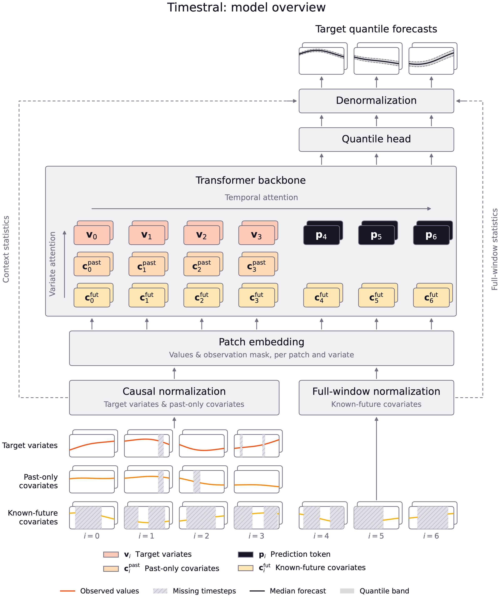
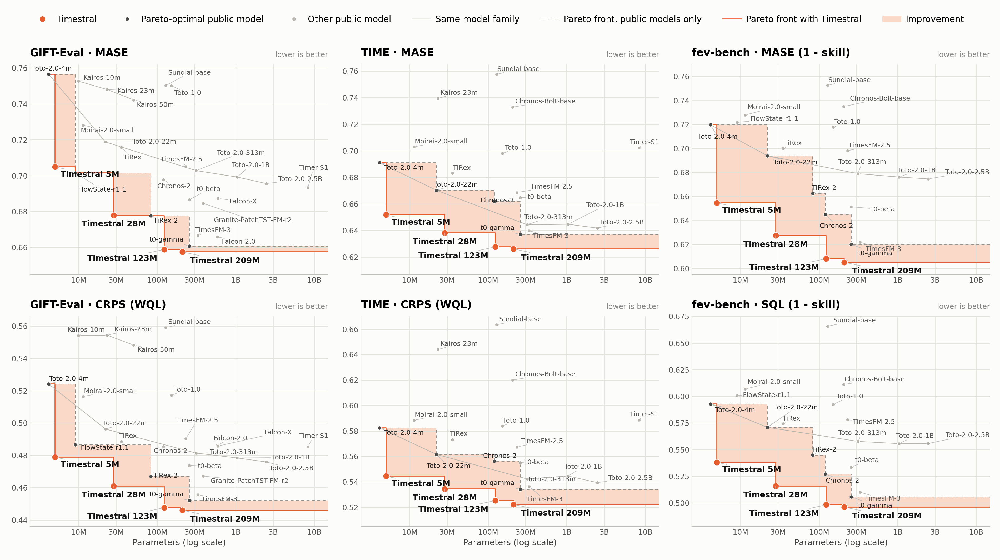

# Timestral family

> [!tldr] 核心判断
> Timestral 的关键不是把语言模型缩小到 209M，而是明确区分历史、预测区间与协变量的信息权限，再用以合成数据为主的训练获得可迁移的概率预测。5M、28M、123M、209M 是同一个时间序列专项 family，不是四个新正代。

> [!warning] 研读范围与资料深度
> 已阅读官方发布博客、209M 与 123M 模型卡，归档全部四种尺寸模型卡与官方图。博客明确说完整技术报告随后发布，当前尚不能达到 GLM-5.3-Flash / Kimi-K3 完整报告级的训练细节和消融深度。这里不编造训练语料总量、数据比例、学习率或未公布的报告。指标均为官方自报，未下载权重或本地复测。

## 先定位：预测未来的数值分布

官方博客日期为 **2026-10-15**；不把模型仓库更早创建的日期当作首发。原文只有日级日期，没有足够信息重建小时级北京时间。

Timestral 输入历史目标序列、仅过去可见的协变量、以及确实提前知道的未来协变量，输出未来各时点的分位数。工作日历可以是已知未来信息，未来实际销售额却不能冒充协变量。输入权限定义错误，离线成绩就可能来自泄漏，而不是预测能力。

| 项目 | 官方规格 | 阅读时的约束 |
|---|---|---|
| 尺寸 | 5M / 28M / 123M / 209M | 合并 family，按成本选择 |
| 最大历史 | 32,768 time steps | 是采样时间步，不是 LLM tokens |
| Patch | 32 time steps | 最大历史对应 1,024 patches |
| 单次预测 | 1,024 time steps | 更长区间采用分块自回归 |
| 输出 | 21 个分位数 | 不是已证明校准的置信区间 |
| 209M / 123M | 24 层、768 维 / 20 层、640 维 | 不从这两个规格猜测其他尺寸结构 |
| 许可 | Modified MIT | 不能简写成未修改 MIT |

*图：官方发布博客总览，已离线保存；不是本次实验图。*

## Decoupled Horizon Forecasting：预测区间不是伪造的缺失历史

一个常见实现把未来位置填成缺失值，和真正观测缺口混在一起。DHF 将预测 token 与历史观测分离：预测位置可以读取完整已观测历史，而历史中的 NaN 仍表示真实缺失。这样，模型不用把“尚未发生”和“已经发生但没观测到”学成同一种状态。

多变量场景还需要按角色限制注意力：目标侧保持因果约束；提前知道的未来协变量可以覆盖整个预测窗口；信息从协变量流入目标，不让未来目标值回流到协变量后再泄漏。这里的泛化能力既依赖训练数据，也依赖这些可见性约束。

对类别型协变量，官方采用 target encoding；数值特征、缺失指示也进入表示。落地时必须明确编码统计量从哪个时间切分计算，不能在全数据上算好再进行滚动评测。

## Synthetic-first 两阶段训练

第一阶段以合成数据训练，在 8,192 长度上覆盖趋势、周期、噪声等单变量变化，再加入非线性多变量依赖。第二阶段混合真实与合成序列，将上下文延长至 32,768。用合成机制扩大覆盖，不等于真实分布已经被完全模拟。

模型对 21 个分位数采用 pinball loss，其聚合近似 CRPS。对分位数 q、真实值 y 与预测 a，单项损失可写为：

$$\rho_q(y-a)=\max(q(y-a),(q-1)(y-a)).$$

官方分位数为 0.01、0.05、0.10、0.15 逐步至 0.90，再到 0.95、0.99。尾部风险任务不能只看中位数误差，也不能仅凭 CRPS 较低就宣布覆盖率准确。

超过 1,024 时间步时，模型将前一块的**中位数预测**追加到历史，再生成下一块。这是实用的长区间方法，但不等于把前块全部预测不确定性传给后块；长期尾部风险仍应单独验收。

## 四个尺寸的收益并不线性

以下采用官方家族表。MASE、CRPS 越低越好；fev skill 越高越好。不同基准的聚合方式不同，不能跨行比较绝对数值。

| 官方基准 | 5M | 28M | 123M | 209M |
|---|---:|---:|---:|---:|
| GIFT-Eval MASE ↓ | 0.705 | 0.678 | 0.659 | 0.658 |
| GIFT-Eval CRPS ↓ | 0.479 | 0.461 | 0.448 | 0.446 |
| TIME MASE ↓ | 0.652 | 0.638 | 0.628 | 0.626 |
| TIME CRPS ↓ | 0.545 | 0.534 | 0.525 | 0.522 |
| fev SQL skill ↑ | 46.19 | 48.42 | 50.18 | 50.39 |
| fev MASE skill ↑ | 34.54 | 37.27 | 39.19 | 39.49 |

123M→209M 在这些聚合指标上收益小于 5M→28M，不能只按最大模型选择。官方 209M GIFT MASE 为 0.658，对照 T0 gamma 为 0.661、TimesFM 3 为 0.667、Toto 2.0 2.5B 为 0.696、Chronos 2 为 0.698；它说明本次基准设置下的竞争力，不证明每个数据集都领先。

*图：HF 模型卡官方 Pareto 图。每个点绑定对应硬件、长度、基准；不据此推导通用吞吐。*

博客给出 CPU 8 线程、21 天 15 分钟采样历史、预测次日的例子：5M 约 10ms，209M 约 140ms。这不是任意多变量数、历史长度和线程配置下的 SLA。

## 我会怎样验收

先按业务真实时点切分训练、校准和测试，保证未来协变量在预测时确实已知；再分别测短期、跨周期、缺失和结构突变。除 MASE / CRPS 外，记录各分位数覆盖率、区间宽度、不同群体与尾部事件的误差。

对超过 1,024 步的任务，分块比较误差随 horizon 累积的形状；把单次预测与中位数回填路径分开报告。尺寸选择应画质量—延迟—内存曲线，而不是只抄最大模型分数。

> [!insight] 对 Agent Training 的启发
> 信息角色的显式划分值得迁移：工具返回的已知事实、模型猜测、尚未发生的环境状态不应混成同一种上下文。Verifier 应检查信息在当时是否可得，而不仅是答案是否碰巧正确。这个联系是研读推论，不是官方已完成的 Agent 实验。

## 来源与导航

- [Tech Blog](https://mistral.ai/news/timestral/)
- [HF Model Card · 209M](https://huggingface.co/mistralai/Timestral-209M)；[[src/Timestral-209M-model-card|本地原卡]]
- [HF family collection](https://huggingface.co/collections/mistralai/timestral)
- [[timestral_poster_zh.html|中文 Poster]]

> 📊 相关可视化：[[timestral_poster_zh.html|Timestral 中文 Poster]]
